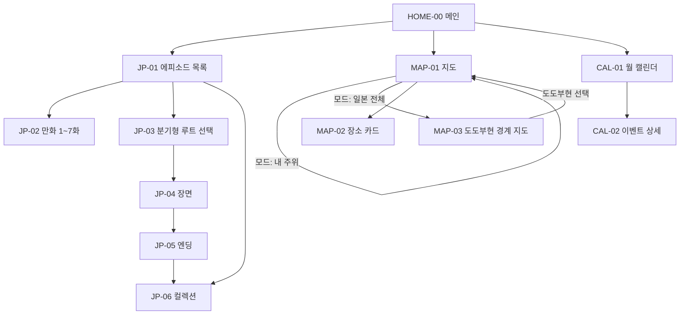

# YUI — MLP PRD

| | |
|---|---|
| 상태 | 초안 v1.2-mlp (2차 검토 반영) |
| 작성일 | 2026-10-12 |
| 대체 관계 | [PRD v0.4](PRD.md)(게시판 중심 전체 비전)를 **보류**하고, 이 문서가 다음 출시 범위를 정한다. v0.4 의 요구사항 ID 는 이 문서가 다시 쓴 것만 유효하다 |
| 기준 코드 | `index.html` 프로토타입 |

**출처 표시:** 요구사항마다 출처를 적는다.
- **요청** — 제품 책임자가 직접 정한 것
- **유지** — 프로토타입에 이미 있고 그대로 가져가는 것
- **제안** — 이 문서가 덧붙인 것. 책임자가 빼라고 하면 뺀다

---

## 1. 왜 바꾸는가

게시판 중심 계획(v0.4)은 첫 출시에 로그인, 익명성 백엔드, 운영자, 번역 서버가 모두 필요했다(v0.4 §10 M1~M5).
MLP(Minimum Lovable Product)는 **서버 없이 지금 바로 쓸 수 있는** 세 기능만 남긴다.

## 2. 책임자 결정 사항 (2026-10-12)

| # | 결정 |
|---|---|
| D1 | 게시판을 제거한다 |
| D2 | **세 기능**을 남긴다: 일본어 학습 만화(+분기형 대화 게임), 지도, 캘린더 |
| D3 | 로그인 없이 게임 엔딩 컬렉션을 기기에 기록한다 |
| D4 | 지도는 **내 주위**(기본) / **일본 전체** 중 고른다 |
| D5 | 일본 전체는 **실제 도도부현 경계 지도**에서 도도부현을 눌러 고른다 |
| D6 | 장소 데이터는 **직접 넣은 데이터만** 쓴다. 1차는 기존 추천 장소, 2차는 따로 수집한 데이터를 초기 데이터로 넣는다. 외부 자동 검색은 쓰지 않는다 |
| D7 | 앱을 열면 **메인(홈) 화면**이 뜨고, 거기서 세 기능으로 이동한다 |

## 3. 목표 / 비목표

### 목표

- G1. 로그인 없이 바로 쓸 수 있다 (D3)
- G2. 엔딩 카드 컬렉션이 이 기기에 남는다 (D3)
- G3. 내 주위와 일본 전체에서 직접 고른 장소를 찾는다 (D4~D6)
- G4. 기숙사 일정을 월 달력으로 보고 내 캘린더에 넣는다 (D2)
- G5. 서버·DB·계정이 없다. 운영비 0
- G6. 세 언어(en/ja/ko) 유지

### 비목표

| 기능 | 처리 |
|---|---|
| 익명 게시판, 글쓰기, 댓글, 공감 (v0.4 B-*) | **제거** (D1) |
| 신고, RA 모드 (v0.4 M-*), 프로필 교환 (v0.4 X-*) | **제거** — 게시판에 딸린 기능 |
| 이벤트 참가 인원 집계, 정원 마감 (v0.4 C-5 의 서버 부분) | 하지 않음 — 서버가 없어 집계할 수 없다 |
| 장소 자동 검색 (OSM Overpass 등) | 하지 않음 (D6) |
| 로그인, 서버 저장, 기기 간 동기화 | 하지 않음 |

제거한 기능의 문서(`docs/01`~`09`, `docs/architecture`, `docs/adr`, `schema.sql`)는 지우지 않고 **보류**로 둔다.

## 4. 정보구조

| ID | 요구사항 | 출처 |
|---|---|---|
| ML-H1 | 앱을 열면 HOME-00. 세 기능으로 가는 큰 카드 3개 | 요청 (D7) |
| ML-H2 | 카드에 요약을 보여준다: 일본어 = 컬렉션 "N / 5", 캘린더 = 다음 일정 1건, 지도 = "내 주위 장소 보기" | 제안 |
| ML-H3 | 하단 탭바: 홈 · 일본어 · 지도 · 캘린더. 기능 사이를 홈을 거치지 않고 오간다 | 제안 — 탭바 없이 홈에서만 이동하는 안도 가능 (Q-M7) |
| ML-H4 | 하위 화면의 ‹ 는 자기 기능의 루트로 간다. 루트 화면의 ‹ 는 홈으로. OS·브라우저 뒤로 가기도 같은 동작 | 제안 (v0.4 IA-1, IA-2 결함 해결) |
| ML-H5 | 헤더에서 게시판 탭, ＋, ⇄, ⚑ 버튼을 없앤다 | 요청 (D1) |

## 5. 기능 요구사항

각 요구사항의 **수락 기준**은 마지막 열.

### 5.1 일본어 — 만화와 분기형 대화 게임

| ID | 요구사항 | 출처 | 현재 | 수락 기준 |
|---|---|---|---|---|
| ML-J1 | 만화 에피소드 7편(레벨 1~7): 컷 + 일본어 대사 + 이번 회 표현 | 유지 | 구현, 그림은 자리표시 | 7편 모두 3개 언어로 열림 |
| ML-J2 | 분기형: 오사카/교토 루트, 루트당 5장면, 선택지 피드백, 4점 이상이면 베스트 엔딩 | 유지 | 구현 (`index.html:1878`) | 두 루트를 끝까지 진행 가능 |
| ML-J3 | 두 루트 엔딩을 모두 얻으면 특별 카드 | 유지 | 구현 | 오사카·교토 카드 각 1장 이상 → 특별 카드 해금 |
| ML-J4 | 컬렉션 화면: 얻은 카드 / 잠긴 카드 | 유지 | 구현 | 잠긴 카드는 "？？？" |
| ML-J5 | **컬렉션을 기기에 저장** — 새로고침·앱 재시작 후에도 유지 | 요청 (D3) | 메모리(`S.cg`)에만 있어 새로고침하면 사라진다 (`index.html:827`) | 카드 획득 → 새로고침 → 컬렉션 유지 |
| ML-J6 | 저장소를 쓸 수 없을 때(사생활 보호 모드, 저장소 차단)도 게임은 정상 동작하고 그 세션 동안만 기억한다. 오류를 띄우지 않는다 | 제안 (D3 의 예외 처리) | — | 저장소 차단 상태에서 게임 완주, 오류 없음 |
| ML-J7 | 컬렉션 초기화 (확인 후) | 제안 | 없음 | P2 |
| ML-J8 | 읽은 에피소드 표시 (목록에 ✓) | 제안 | 없음 | P2 |

### 5.2 지도

| ID | 요구사항 | 출처 | 현재 | 수락 기준 |
|---|---|---|---|---|
| ML-M1 | 모드 전환 버튼: **내 주위**(기본) / **일본 전체** | 요청 (D4) | 없음 | 지도 탭 진입 시 내 주위 |
| ML-M2 | **내 주위:** 기기 위치로 지도 중심을 잡고 현재 위치를 표시. 주변의 추천 장소를 보여준다 | 요청 (D4) | 없음 (結 고정) | 위치 허용 → 내 위치 중심 |
| ML-M3 | **위치 요청 전 안내:** 처음 내 주위를 열 때, 권한을 묻기 전에 "위치는 이 기기에서 지도 중심을 잡는 데만 쓰고 저장하지 않습니다. 다만 지도 그림을 불러올 때 보고 있는 지역이 지도 서버(OpenStreetMap)에 전달됩니다" 안내 + [위치 사용] [結 기준으로 보기] | 제안 (검토 지적: 동의 전 위치 사용 방지) | — | 안내 없이 권한 창이 뜨지 않음 |
| ML-M4 | 위치 실패 처리: 거부 → 結 기준 + "브라우저 설정에서 위치를 허용하면 내 주위를 볼 수 있습니다". 실패·시간 초과 → 結 기준 + [다시 시도] | 제안 | — | 거부 후에도 지도 사용 가능, 안내 3개 언어 |
| ML-M5 | **일본 전체:** 실제 도도부현 경계 지도를 보여주고, 도도부현을 누르면 그 경계에 맞춰 확대하고 그 도도부현의 추천 장소를 보여준다. 경계는 **같은 지도 객체 위의 레이어**로 그린다(별도 지도를 만들지 않는다 — ML-M11). 경계 데이터는 일본 전체 모드에 처음 들어가는 **동작 처리 코드**에서 불러오고, 화면 함수 안에서는 불러오지 않는다(헤드리스 검사) | 요청 (D5), 그리는 방식은 제안 | 없음 | 47개 도도부현 모두 누를 수 있음, 모드를 오가도 줌 보존 |
| ML-M6 | 작은 도도부현(도쿄·오사카·가가와 등)도 고를 수 있게 지도 아래에 **도도부현 목록**(지방별)을 함께 둔다 | 제안 (손가락으로 누르기 어려운 문제) | — | 목록에서 골라도 같은 결과 |
| ML-M7 | 장소가 없는 도도부현: "아직 등록된 장소가 없습니다" | 제안 | — | 빈 상태 문구 3개 언어 |
| ML-M8 | **장소 데이터는 직접 넣은 데이터만**: 1차 = 기존 13곳, 2차 = 수집 데이터 일괄 추가. 2차 데이터를 넣을 때 코드를 고치지 않아도 되는 형식 (§5.2.1) | 요청 (D6) | 13곳 (`index.html:1351`) | 형식대로 장소를 추가하면 지도·목록에 나타남 |
| ML-M9 | 카테고리 필터 6종 + 전체. 먹을 곳 포함 | 유지 | 구현 | — |
| ML-M10 | 장소 카드: 이름, 카테고리, 설명, 추가한 사람 라벨, Google 지도 링크, **현재 기준점에서의 직선거리 기반 도보 추정** | 유지 + 제안(도보 추정) | 도보 시간이 結 기준 고정값(`min`) | 기준점이 바뀌면 도보 시간도 바뀜, "약"으로 표시 |
| ML-M11 | 지도는 **한 번만 만들고** 화면 전환·필터·모드·언어 변경에도 유지 (줌·위치 보존) | 유지 원칙 (CLAUDE.md) + 결함 해결 | **지금은 지켜지지 않는다.** `#lmap` 이 `#main` 안에 있어 모든 `render()` 가 지도를 지우고(`index.html:1783`), 지도 탭을 떠나면 제거한다(`:1793-1794`). 언어 메뉴만 열어도 사라진다 (BUG-01) | 언어 메뉴 열기·언어 변경·탭 왕복 후에도 지도 유지 |
| ML-M12 | OSM 지도 그림(타일) 저작자 표시 "© OpenStreetMap contributors" + 저작권 페이지 링크 | 제안 (타일 이용 조건) | 링크·"contributors" 없음 (`:1546`) | 표시 확인 |
| ML-M13 | 오프라인: 장소 목록은 보이고, 지도 그림을 못 불러오면 안내 | 유지 | 지도 라이브러리가 캐시되지 않아(`sw.js:35`) 오프라인에서 지도 탭 자체가 실패 | 오프라인에서 목록 표시 |

#### 5.2.1 장소 데이터 형식 (2차 데이터용)

2차 수집 데이터는 이 형식으로 넣는다. 지금의 `PLACES` 항목에서 고정 도보 시간(`min`)을 빼고 도도부현을 더한 것이다.

| 필드 | 필수 | 내용 |
|---|---|---|
| `id` | O | 고유 문자열 |
| `pref` | O | 도도부현 코드 (JIS X 0401, `"27"` = 오사카부) |
| `cat` | O | `transit` · `daily` · `food` · `study` · `admin` · `health` |
| `lat`, `lng` | O | 좌표 |
| `n` | O | 이름 `{ja, en, ko}` |
| `d` | — | 설명 `{ja, en, ko}`. 없으면 카드에 설명 칸을 숨긴다 |
| `by` | — | 추가한 사람 라벨 키 (`ra` · `gip` · `anon`). 표시 문자열은 `T` 에 |
| `gid` | — | Google 지도 place ID |

세 언어를 모두 채우지 못한 데이터의 처리는 Q-M8.

### 5.3 캘린더

| ID | 요구사항 | 출처 | 현재 | 수락 기준 |
|---|---|---|---|---|
| ML-K1 | 월 달력, 이전/다음 달, 오늘 강조, 날짜별 일정 점 | 요청 (D2) | 구현 | 오늘 칸 강조, 일정 있는 날에 점, 달 이동 |
| ML-K2 | 날짜 선택 시 그날 일정, 미선택 시 다가오는 일정 3개 | 유지 | 구현 | 날짜를 누르면 그날 목록, 다시 누르면 다가오는 3개 |
| ML-K3 | 일정 상세: 일시, 주최, 장소, 설명 | 유지 | 구현 | 4개 항목이 3개 언어로 표시, ‹ 는 달력으로 |
| ML-K4 | .ics 내보내기 (내 캘린더에 추가) | 유지 | 구현, VTIMEZONE 없음·특수문자 미처리 (기능명세 FN-CAL-02-3) | 아이폰·구글 캘린더에서 올바른 시각으로 열림 |
| ML-K5 | **오늘 = 실제 날짜** (Asia/Tokyo) | 제안 (결함) | 2026-09-09 고정 (`index.html:753`) | 기기 날짜 기준 |
| ML-K6 | 일정 데이터는 장소처럼 직접 넣은 정적 데이터. 갱신은 데이터를 고쳐 다시 배포 | 제안 (서버가 없으므로. D6 는 장소에 대한 결정) | 9월 mock 7건 | 형식대로 넣으면 표시 |
| ML-K7 | 매주 반복 일정(GIP 화요일)은 한 번만 적고 기간 동안 매주 표시. 회차마다 내용이 다르면(보드게임 데이 / 노래방) 그 회차만 제목·설명을 덮어쓰는 필드를 둔다 | 제안 | 회차마다 따로 적음 (`index.html:782`, `:796`) | 반복 1건 → 기간 내 매주 표시, 덮어쓴 회차는 그 내용 |
| ML-K8 | "참가하기" 버튼: 서버가 없으므로 **내 기기에만 표시되는 '참가 예정' 표시**로 바꾸고 인원·정원 마감은 없앤다 | 제안 — 버튼 자체를 없애는 안도 가능 (Q-M9) | 인원·정원은 mock 숫자 | 표시가 새로고침 후 유지 |

### 5.4 공통

| ID | 요구사항 | 출처 | 현재 |
|---|---|---|---|
| ML-C1 | 3개 언어 UI, 기본 영어 | 유지 | 구현 |
| ML-C2 | 고른 언어를 기기에 기억 | 제안 | 없음 |
| ML-C3 | PWA 설치, 오프라인에서 홈·일본어·캘린더 동작 | 유지 | 앱 셸은 동작 |
| ML-C4 | 하드코딩 문자열 제거: 영어 `aria-label` 6개, "匿名" 라벨 (BUG-09, BUG-10) | 제안 (CLAUDE.md 규칙) | 미흡 |
| ML-C5 | 375px 에서 헤더·언어 버튼이 줄바꿈되지 않음, 한국어 어절 단위 줄바꿈 (BUG-07, BUG-12) | 제안 | 미흡 |
| ML-C6 | 터치 영역 44px 이상 (BUG-11) | 제안 | 미흡 |

## 6. 상태 화면

| 화면 | 빈 상태 | 오류·오프라인 |
|---|---|---|
| HOME-00 | 다가오는 일정 없음 → "예정된 일정이 없습니다" | — |
| JP-06 | 첫 실행: 카드 5장 모두 잠김 + "8화를 끝까지 하면 카드를 얻습니다" | 저장소 차단: 안내 없이 세션 동안만 기억 (ML-J6) |
| MAP-01 | 주변에 장소 없음: "근처에 등록된 장소가 없습니다. 일본 전체에서 지역을 골라 보세요" | 위치 실패 (ML-M4), 지도 그림 실패 (ML-M13) |
| MAP-03 | 장소 없는 도도부현 (ML-M7) | 경계 데이터 로드 실패: 도도부현 목록(ML-M6)은 계속 동작 |
| CAL-01 | 이 날 일정 없음 (있음) | — |

## 7. 개인정보

| ID | 요구사항 |
|---|---|
| ML-P1 | 계정·서버 저장 없음. 컬렉션·언어·참가 표시는 이 기기 브라우저 저장소에만 있다. 우리 쪽 서버로는 아무것도 보내지 않는다 |
| ML-P2 | **앱은 위치를 저장하지 않고 좌표를 어디로도 보내지 않는다.** 지도 중심과 도보 시간 계산에만 쓴다. 단, 지도 그림 요청이 보는 지역을 드러낸다 (ML-P3) |
| ML-P3 | 다만 **지도 그림(타일)을 불러올 때** 보고 있는 지역의 타일 번호가 OSM 타일 서버로 간다. 확대할수록 위치가 정확해진다. 이 사실을 ML-M3 안내에 한 줄로 밝힌다 |
| ML-P4 | 외부로 가는 요청: OSM 타일 서버(지도 그림), 지도 라이브러리 CDN(cdnjs, 지도 탭에서만 — 자체 호스팅이면 없음), Google 지도(장소 링크를 누를 때만). 각 요청에는 IP·브라우저 정보가 함께 간다 |
| ML-P5 | Referer 정책은 브라우저 기본값(출처만 전송)을 둔다. OSM 타일 정책이 Referer 를 요구하므로 `no-referrer` 로 막지 않는다 |
| ML-P6 | 분석 도구·추적 쿠키를 넣지 않는다 |

## 8. 비기능 요구사항

| 항목 | 요구사항 |
|---|---|
| 구조 | `index.html` 중심, 빌드 없음 (CLAUDE.md). 도도부현 경계 데이터는 크기 때문에 **별도 파일**로 두고 일본 전체를 처음 열 때 불러온다 (제안 — 단일 파일 원칙의 예외라 Q-M13 결정 필요) |
| 경계 데이터 | 라이선스가 배포를 허용하는 출처 (후보: Natural Earth, 국토지리원 등 — **라이선스 확인 필요**). 개발 시점에 한 번 단순화해 저장소에 넣는다. 목표 크기 150KB 이하 (추정치, 단순화 후 실측) |
| 지도 라이브러리 | 지금은 `<head>` 에서 동기 로드되어 첫 화면을 늦추고 오프라인에 캐시되지 않는다(`index.html:17-20`, `sw.js:35`). 지도 탭에 처음 들어갈 때 불러오고, 오프라인에서도 쓰도록 저장소에 직접 두는 안을 검토 (Q-M10) |
| 첫 화면 | 홈은 지도 라이브러리 없이 뜬다 |
| 저장 | 저장 키에 버전을 붙인다 (예: `yui.v1.collection`). 지금은 저장하는 것이 없어 옮길 데이터가 없다 |
| 검증 | CLAUDE.md 의 헤드리스 검사를 MLP 화면 목록으로 고친다. 검사는 Node 에서 `window` 가 빈 객체이므로, 화면 함수는 위치·저장소에 직접 접근하지 않는다 |
| 배포 | GitHub Pages. `sw.js` 의 `CACHE` 를 올린다 |

## 9. 바꿔야 할 파일

| 파일 | 변경 |
|---|---|
| `index.html` | 게시판·신고·교환 화면·데이터·문자열·클릭 처리 제거, 홈 추가, 지도 모드·경계 지도, 캘린더 수정, 저장 |
| `manifest.webmanifest` | 이름·설명("community board" 문구), `categories`(`social` → `education` 등), 바로가기: "이벤트"(`?tab=1`) → 캘린더, "글쓰기"(`?compose=1`) → 제거 또는 일본어 |
| `sw.js` | `CACHE` 올림, 경계 데이터 파일 캐시 |
| `CLAUDE.md` | 데이터·화면 목록, 헤드리스 검사 스크립트 |
| `README.md` | 범위·탭 설명 |
| `T.title` | "結の掲示板 / YUI Board / 결 게시판" → 새 이름 (Q-M5) |

**이미 설치된 앱의 옛 바로가기:** `?tab=1` 은 캘린더로, `?compose=1` 은 홈으로 보낸다.

## 10. 성공 지표

서버가 없으므로 앱 안에서 수집하지 않는다(ML-P6). 사람에게 직접 보여주고 판단한다.

| 확인할 것 | 방법 | 기준 |
|---|---|---|
| 게임이 재미있는가 | 입주자 5명 시연 | 5명 중 3명 이상이 자발적으로 두 번째 루트 |
| 지도가 쓸모 있는가 | "가장 가까운 우체국 찾기" | 1분 안에 성공 |
| 캘린더를 쓰는가 | "다음 GIP 일정을 내 캘린더에 넣기" | 1분 안에 성공 |
| 다시 열 이유가 있는가 | 1주 뒤 질문 | 절반 이상 |

## 11. 마일스톤

| 단계 | 내용 | 완료 기준 |
|---|---|---|
| MLP-1 | 제거 + 홈 + 탭 구조 + 뒤로 가기 | 헤드리스 검사 통과 |
| MLP-2 | 컬렉션·언어·참가 표시 저장 | 새로고침 후 유지, 저장소 차단 시 동작 |
| MLP-3 | 캘린더: 실제 날짜, 반복 일정, .ics 수정 | ML-K* 수락 기준 |
| MLP-4 | 지도: 지도 유지, 내 주위, 위치 안내, 장소 데이터 형식 | ML-M1~M4, M8~M13 |
| MLP-5 | 일본 전체: 경계 데이터 확보·단순화, 경계 지도, 도도부현 목록 | ML-M5~M7 |
| MLP-6 | 문구·접근성, manifest·README·CLAUDE.md, `CACHE`, 배포 | §9 전부 |
| MLP-7 | 2차 장소·일정 데이터 투입, 5명 시연 | §10 |

## 12. 리스크

| 리스크 | 대응 |
|---|---|
| 만화·엔딩 그림이 전부 자리표시 | 가장 큰 "lovable" 공백 — Q-M4 |
| 1차 데이터가 結 주변 13곳뿐이라 다른 지역 사용자에게 지도가 비어 보인다 | 빈 상태 안내(ML-M7), 2차 데이터(MLP-7) |
| 일정 데이터를 사람이 갱신하지 않으면 캘린더가 빈다 | 갱신 담당 지정 — Q-M11 |
| 저장소가 지워지면 컬렉션이 사라진다 (브라우저 정리 등) | 안내. 내보내기는 범위 밖 |
| OSM 타일 서버는 과도한 사용을 막고 저작자 표시를 요구한다 ([Blocked tiles](https://wiki.openstreetmap.org/wiki/Blocked_tiles), [OSMF 라이선스 FAQ](https://osmfoundation.org/wiki/Licence_and_Legal_FAQ), 2026-10-12 검색 확인 — 원문은 MLP-4 때 재확인) | 저작자 표시(ML-M12), 소규모 사용 |
| 이 개발 환경의 네트워크는 cdnjs·OSM 타일을 막는다 (QA 리포트 §2.3) | 지도 실동작은 실기기에서 확인 |

## 13. 열린 질문

| # | 질문 | 제안 |
|---|---|---|
| Q-M4 | 그림을 누가, 언제 | 미정. 그 전까지 자리표시 |
| Q-M5 | 앱 이름: 게시판이 빠졌으니 "結の掲示板 / YUI Board" 를 바꿀지 | "YUI" 유지, 부제 변경 |
| Q-M7 | 하단 탭바를 둘지, 홈에서만 이동할지 | 탭바 (홈 + 3) |
| Q-M8 | 2차 데이터에서 세 언어를 다 못 채운 장소는 | 있는 언어로 표시 (일본어 → 영어 순) |
| Q-M9 | 캘린더 "참가하기"를 기기 표시로 남길지 없앨지 | 기기 표시로 남김 |
| Q-M10 | 지도 라이브러리를 CDN 에서 받을지 저장소에 직접 둘지 | 저장소에 직접 (오프라인, 외부 요청 감소) |
| Q-M11 | 일정·장소 데이터를 누가 갱신하나 | 미정 |
| Q-M12 | 경계 데이터 출처 | 라이선스 확인 후 결정 |
| Q-M13 | **단일 파일 원칙의 예외.** CLAUDE.md 는 합의 없이 단일 파일 구조를 바꾸지 않게 한다. 경계 데이터 별도 파일(§8), 지도 라이브러리 저장소 보관(Q-M10)은 그 예외다. 허용할지 | 허용 제안: 둘 다 `index.html` 이 쓰는 데이터·라이브러리 파일일 뿐 빌드 단계는 생기지 않는다. 허용하지 않으면 경계 데이터를 `index.html` 안에 넣어야 해 첫 화면이 그만큼 무거워진다 |
