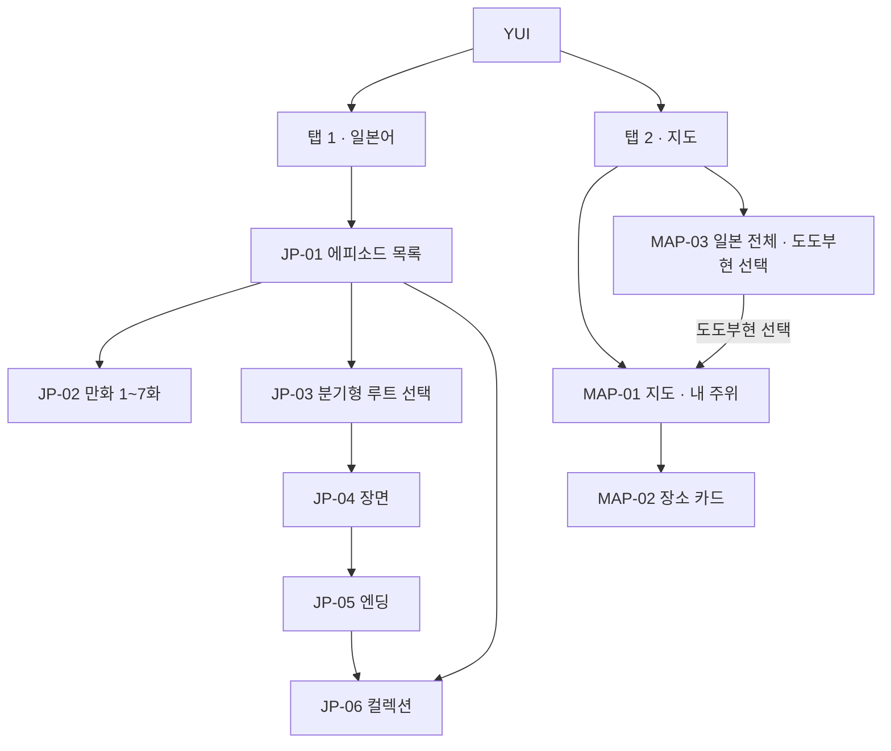

# YUI — MLP PRD

| | |
|---|---|
| 상태 | 초안 v1.0-mlp |
| 작성일 | 2026-10-12 |
| 대체 관계 | [PRD v0.4](PRD.md)(게시판 중심 전체 비전)를 **보류**하고, 이 문서가 다음 출시 범위를 정한다. v0.4 의 요구사항 ID 중 이 문서가 다시 쓰는 것만 유효하다 |
| 기준 코드 | `index.html` 프로토타입 |

---

## 1. 왜 바꾸는가

게시판 중심 계획(v0.4)은 로그인, 익명성 백엔드, 운영자, 번역 서버가 모두 있어야 첫 출시가 가능했다(PRD v0.4 §10 M1~M5).
리서치의 가설(H1~H7)은 하나도 검증되지 않았고, 사무실 승인(H7)도 없다.

MLP(Minimum Lovable Product)는 **백엔드 없이 지금 바로 쓸 수 있고, 써보고 싶어지는** 두 가지만 남긴다.

1. **생활 일본어 만화 + 분기형 대화 게임** — 프로토타입에서 이미 가장 완성도가 높은 부분
2. **지도** — 내 주위의 생활 시설을 바로 찾는 도구

## 2. 목표 / 비목표

### 목표

- G1. 로그인 없이 앱을 열자마자 쓸 수 있다.
- G2. 분기형 대화 게임의 엔딩 카드 수집이 **이 기기에 남는다**. 다시 열어도 컬렉션이 그대로다.
- G3. 지도는 **내 주위**가 기본이고, **일본 전체**에서 도도부현을 골라 그 지역을 볼 수 있다.
- G4. 서버·DB·계정이 없다. 운영비 0, 개인정보를 서버에 저장하지 않는다.
- G5. 세 언어(en/ja/ko) 유지.

### 비목표 (MLP 범위 밖)

| 기능 | 처리 |
|---|---|
| 익명 게시판, 글쓰기, 댓글, 공감 | **제거** (v0.4 B-*) |
| 신고, RA 모드, 운영자 큐 | **제거** (v0.4 M-*) |
| 프로필 교환 | **제거** (v0.4 X-*) |
| 캘린더, 이벤트, .ics | **제거** (v0.4 C-*) |
| 로그인, 계정, 서버 저장, 기기 간 동기화 | 하지 않음 |
| 입주자 장소 추천 작성 | 하지 않음 |

제거한 기능의 기획·설계 문서(`docs/01`~`09`, `docs/architecture`, `docs/adr`, `schema.sql`)는 지우지 않고 **보류** 상태로 둔다. 게시판을 다시 하게 되면 그대로 출발점이 된다.

## 3. 대상 사용자

| 대상 | 쓰는 이유 |
|---|---|
| 結 입주 교환학생 (리서치 PS-B, PS-C) | 생활 일본어, 기숙사 주변 시설 |
| 일본에 막 도착한 유학생·장기 체류자 일반 | 일본어 장면 학습, 어디서든 내 주위 생활 시설 |

結 입주자에게 한정하지 않는다. 로그인이 없으므로 누구나 열 수 있다. 다만 추천 장소(큐레이션)는 結 주변만 있다.

## 4. 정보구조

탭 2개. 헤더의 게시판 탭, ＋ 버튼, ⇄·⚑ 버튼은 모두 없어진다.

- **첫 화면:** 일본어 탭 (JP-01). 매니페스트 바로가기는 "컬렉션", "내 주위 지도"로 바꾼다.
- **뒤로 가기:** 하위 화면의 ‹ 는 자기 탭의 루트로 간다 (v0.4 IA-1 문제를 이번에 해결). OS 뒤로 가기도 같은 동작 (IA-2).

## 5. 기능 요구사항

ID 규칙: MLP 요구사항은 `ML-` 접두어. 괄호 안은 이어받은 v0.4 ID.

### 5.1 일본어 — 만화와 분기형 대화 게임

| ID | 요구사항 | 우선순위 | 현재 |
|---|---|---|---|
| ML-J1 | 만화 에피소드 7편(레벨 1~7): 컷 + 일본어 대사 + 이번 회 표현 (J-1) | P0 | 구현 (그림 자리표시) |
| ML-J2 | 분기형 에피소드: 오사카/교토 루트, 루트당 5장면, 선택지 피드백, 4점 이상 베스트 엔딩 (J-2, J-3) | P0 | 구현 |
| ML-J3 | 두 루트 엔딩을 모두 얻으면 특별 카드 (J-4) | P1 | 구현 |
| ML-J4 | 컬렉션 화면: 얻은 카드 / 잠긴 카드 (J-5) | P0 | 구현 |
| ML-J5 | **엔딩 카드 수집을 기기에 저장.** 새로고침·앱 재시작 후에도 유지 (J-7) | P0 | **없음** |
| ML-J6 | 저장소를 쓸 수 없을 때(사생활 보호 모드, 저장소 차단) 게임은 정상 동작하고 그 세션 동안만 기억한다. 오류를 띄우지 않는다 | P0 | — |
| ML-J7 | 컬렉션 초기화 (확인 후) | P2 | 없음 |
| ML-J8 | 읽은 에피소드 표시 (목록에 ✓) — 같은 저장 방식 | P2 | 없음 |

### 5.2 지도

| ID | 요구사항 | 우선순위 | 현재 |
|---|---|---|---|
| ML-M1 | 모드 전환: **내 주위**(기본) / **일본 전체**. 지도 위 세그먼트 버튼 | P0 | 없음 |
| ML-M2 | **내 주위:** 기기 위치(Geolocation)로 지도 중심을 잡고, 현재 위치를 표시 | P0 | 없음 (현재는 結 고정) |
| ML-M3 | 위치 권한 거부·실패·시간 초과 시: 結 를 중심으로 보여주고 "위치를 쓸 수 없어 結 기준으로 보여줍니다" 안내 + [다시 시도] | P0 | — |
| ML-M4 | **일본 전체:** 일본 지도에서 47개 도도부현 중 하나를 누르면, 그 도도부현청 소재지를 중심으로 MAP-01 을 보여준다. 선택한 도도부현명을 지도 위에 표시하고 "내 주위로" 버튼 제공 | P0 | 없음 |
| ML-M5 | **추천 장소(큐레이션):** 기존 結 주변 13곳은 그대로 보여준다. 설명·추가한 사람 라벨·Google 지도 링크 포함 (P-3) | P0 | 구현 |
| ML-M6 | **자동 장소(OSM):** 지도 중심 반경 약 1km 의 생활 시설을 OpenStreetMap 에서 불러와 표시. 카테고리는 기존 6종에 대응 (§5.2.1) | P0 | 없음 |
| ML-M7 | 자동 장소는 **사용자가 요청할 때만** 불러온다: 모드 진입 시 1회 + 지도를 옮긴 뒤 [이 지역 검색]. 지도를 움직일 때마다 자동 호출하지 않는다 | P0 | — |
| ML-M8 | 자동 장소 결과를 기기에 캐시(같은 지역 재요청 방지, 7일) | P1 | — |
| ML-M9 | 카테고리 필터 6종 + 전체 (P-2). 추천·자동 장소에 함께 적용 | P0 | 구현 (추천만) |
| ML-M10 | 장소 카드: 이름, 카테고리, 현재 기준점에서 도보 추정 시간, (추천이면) 설명·추가한 사람, Google 지도 링크 | P0 | 일부 |
| ML-M11 | 추천 장소와 자동 장소를 구분해 표시 (핀 모양 또는 배지 "추천") | P0 | — |
| ML-M12 | 지도는 한 번만 만들고, 모드·필터·언어 변경은 마커만 갱신 (P-4, BUG-01 해결) | P0 | 일부 (언어 변경 시 지도 사라짐) |
| ML-M13 | 오프라인·불러오기 실패 시 추천 장소와 캐시된 자동 장소는 계속 표시, 실패 안내 (P-5) | P0 | 일부 |
| ML-M14 | OSM 저작자 표시 "© OpenStreetMap contributors" + 저작권 페이지 링크 | P0 | 미흡 (링크·contributors 없음) |

#### 5.2.1 자동 장소 카테고리 대응 (제안)

| 카테고리 | OSM 태그 (예) |
|---|---|
| 교통 | `railway=station` |
| 생활 | `shop=convenience`, `shop=supermarket`, `shop=variety_store` |
| 먹을 곳 | 제외 (MLP). 결과가 너무 많아 지도가 덮인다 — 열린 질문 Q-M3 |
| 공부 | `amenity=library` |
| 행정 | `amenity=townhall`, `amenity=post_office` |
| 의료 | `amenity=hospital`, `amenity=clinic`, `amenity=pharmacy` |

이름은 OSM 의 `name:<언어>` 가 있으면 그것을, 없으면 `name` 을 쓴다. 자동 장소에는 설명이 없다.

### 5.3 공통

| ID | 요구사항 | 우선순위 | 현재 |
|---|---|---|---|
| ML-C1 | 3개 언어 UI, 기본 영어, 선택한 언어를 기기에 기억 (L-1, L-3) | P0 | 기억 없음 |
| ML-C2 | 첫 언어: 저장값 → 브라우저 언어(ja/ko/en) → 영어 | P1 | 없음 |
| ML-C3 | PWA 설치, 오프라인에서 앱 셸·만화·게임은 동작 (A-1) | P0 | 구현 |
| ML-C4 | 하드코딩 문자열 제거: 영어 `aria-label`, "匿名" 라벨 (BUG-09, BUG-10) | P0 | 미흡 |
| ML-C5 | 375px 에서 헤더·언어 버튼이 줄바꿈되지 않음, 한국어 어절 단위 줄바꿈 (BUG-07, BUG-12) | P0 | 미흡 |
| ML-C6 | 터치 영역 44px 이상 (뒤로 버튼 등, BUG-11) | P1 | 미흡 |

## 6. 개인정보

| ID | 요구사항 |
|---|---|
| ML-P1 | 계정·서버 저장 없음. 컬렉션·언어·캐시는 기기의 브라우저 저장소에만 있다 |
| ML-P2 | **위치는 저장하지 않는다.** 위치는 지도 중심을 잡고 도보 시간을 계산하는 데만 쓴다 |
| ML-P3 | **자동 장소 검색은 지도 중심 좌표를 OSM 검색 서버(Overpass API)로 보낸다.** 내 주위 모드라면 사실상 내 위치다. 앱 안 "정보" 화면에 이를 밝힌다 |
| ML-P4 | 지도 타일 요청은 OSM 타일 서버로, 장소 링크는 누를 때만 Google 지도로 간다 |
| ML-P5 | 위치 권한은 지도 탭에 처음 들어갈 때 요청한다 (앱 시작 시가 아니라) |
| ML-P6 | 분석 도구(쿠키 추적, GA 등)를 넣지 않는다 |

## 7. 비기능 요구사항

| 항목 | 요구사항 |
|---|---|
| 구조 | 단일 `index.html`, 빌드 없음 (CLAUDE.md 유지) |
| 도도부현 데이터 | 47개 도도부현의 이름(3개 언어)과 청 소재지 좌표만 내장. 경계 폴리곤 데이터는 넣지 않는다 (크기) |
| 일본 지도 표현 | 도도부현을 정사각형 칸으로 배치한 **타일 그리드 일본 지도**(제안). 모바일에서 47개 지역을 정확히 누를 수 있고 데이터가 거의 없다 — 열린 질문 Q-M1 |
| 외부 서비스 예절 | Overpass: 요청은 사용자 동작으로만, 반경 1km, 결과 캐시, 동시에 1건, 타임아웃 설정. 공개 인스턴스 기준 하루 약 1만 건 이하가 안전선이고 **앱의 모든 사용자 합계로 센다**(출처 §10) |
| 성능 | 첫 화면(일본어 탭)은 지도 라이브러리 없이 뜬다. 지도 탭에 들어갈 때 지도를 만든다 |
| 배포 | GitHub Pages, `sw.js` 의 `CACHE` 를 올린다 |
| 검증 | CLAUDE.md 의 헤드리스 렌더 검사를 MLP 화면 목록으로 갱신해 통과 |

## 8. 성공 지표

서버가 없으므로 앱 안에서 수집하지 않는다(ML-P6). MLP 는 **사람에게 직접 보여주고 묻는 방식**으로 판단한다.

| 확인할 것 | 방법 | 기준 |
|---|---|---|
| 게임이 재미있는가 | 입주자 5명에게 시연, 두 루트를 다 하는지 관찰 | 5명 중 3명 이상이 자발적으로 두 번째 루트 |
| 지도가 쓸모 있는가 | 같은 5명에게 "가장 가까운 우체국 찾기" 과제 | 1분 안에 성공 |
| 다시 열 이유가 있는가 | 1주 뒤 "그 뒤로 다시 열었나" 질문 | 절반 이상 |

## 9. 마일스톤

| 단계 | 내용 | 완료 기준 |
|---|---|---|
| MLP-1 | 제거: 게시판·캘린더·교환·신고 화면과 데이터, 헤더 정리, 탭 2개 | 헤드리스 검사 통과, 남은 화면 정상 |
| MLP-2 | 컬렉션·언어 저장 | 새로고침 후 유지, 저장소 차단 시에도 동작 |
| MLP-3 | 지도: 내 주위 + 일본 전체 + 자동 장소 + 캐시 | 375px 에서 ML-M1~M14 확인 |
| MLP-4 | 문구·접근성 정리 (ML-C4~C6), `CACHE` 올림, 배포 | QA 체크리스트 통과 |
| MLP-5 | 5명 시연 (§8) | 결과 기록 |

## 10. 리스크

| 리스크 | 대응 |
|---|---|
| Overpass 공개 서버는 "앱의 백엔드로 상시 의존"을 문제 사례로 들고, 상업적 이용은 자체 서버·유료 서버를 쓰라고 한다 ([Overpass API 위키](https://wiki.openstreetmap.org/wiki/Overpass_API), [사용자 매뉴얼](https://dev.overpass-api.de/overpass-doc/en/preface/commons.html), 2026-10-12 확인) | 사용자 동작으로만 호출, 캐시, 소규모 시연 범위. 사용자가 늘면 대안(자체 서버, 미리 만든 정적 데이터)으로 전환 — Q-M2 |
| OSM 타일 서버는 과도한 사용을 금지하고 저작자 표시를 요구한다 ([Blocked tiles](https://wiki.openstreetmap.org/wiki/Blocked_tiles), [OSMF 라이선스 FAQ](https://osmfoundation.org/wiki/Licence_and_Legal_FAQ), 2026-10-12 확인. 정책 원문은 M3 때 재확인) | 저작자 표시(ML-M14), 소규모 |
| 만화·엔딩 그림이 전부 자리표시라 "lovable" 하지 않다 | 그림 제작이 MLP 의 가장 큰 공백 — Q-M4 |
| 저장소가 지워지면 컬렉션이 사라진다 (브라우저 정리, iOS 의 장기 미사용 데이터 삭제 등) | 안내 문구. 내보내기는 범위 밖 |
| 위치 권한을 거부하는 사용자가 많다 | 結 기준 대체 화면 + 일본 전체 모드 |
| 이 개발 환경의 네트워크는 cdnjs·OSM 타일을 막는다(QA 리포트 §2.3) | 지도 실동작은 실기기·일반 네트워크에서 확인 |

## 11. 열린 질문

| # | 질문 | 제안 |
|---|---|---|
| Q-M1 | 일본 전체 지도: 타일 그리드 vs 실제 경계 지도(폴리곤) | 타일 그리드. 실제 경계는 데이터가 수백 KB 이고 작은 현을 누르기 어렵다 |
| Q-M2 | 사용자가 늘면 자동 장소 데이터를 어디서 | 그때 결정. 후보: 도도부현청 주변 정적 추출 데이터를 저장소에 넣기, 자체 Overpass |
| Q-M3 | "먹을 곳"을 자동 장소에 넣을지 | MLP 에서는 제외, 추천 장소에만 |
| Q-M4 | 그림을 누가, 언제 | 미정. 그 전까지 자리표시 유지 |
| Q-M5 | 앱 이름: 게시판이 빠졌으니 "結の掲示板 / YUI Board" 를 바꿀지 | 제안: "YUI" 유지, 부제를 바꾼다 |
| Q-M6 | 일본 전체 모드에서 도도부현 중심 = 도도부현청 소재지로 충분한가 | 충분. 지도를 옮기고 [이 지역 검색] 가능 |
