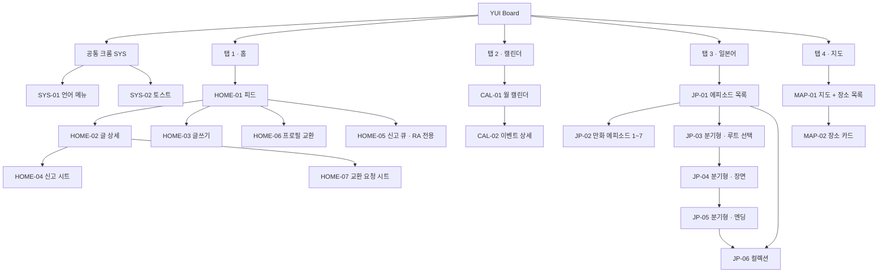
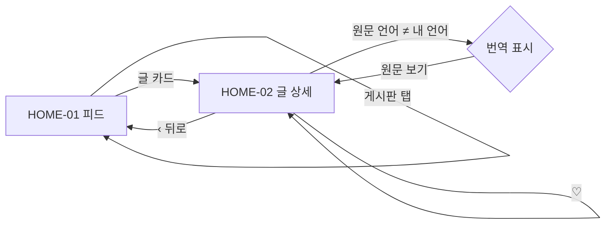
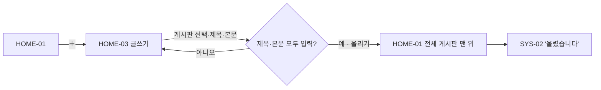
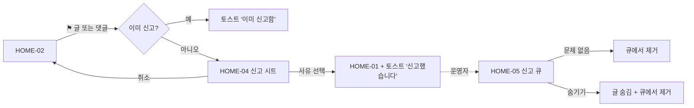
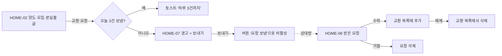
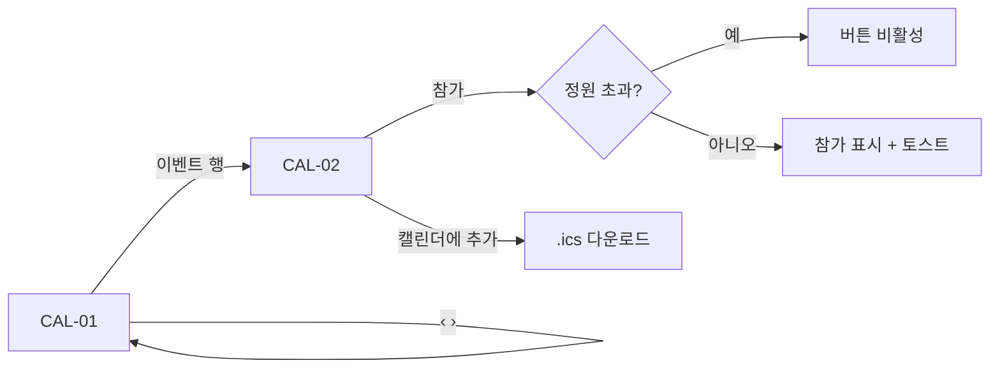
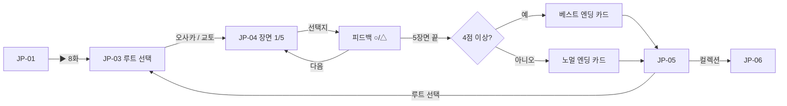
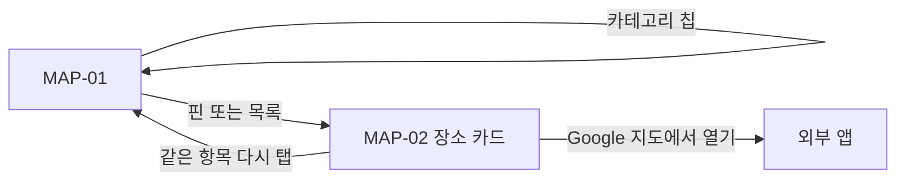

# 3단계 · 정보구조(IA)와 유저 플로우

| | |
|---|---|
| 상태 | 초안 v0.1 |
| 근거 | `index.html` 의 `render()`, 클릭 핸들러, 뷰 함수 |
| 이전 단계 | [PRD](../02-requirements/PRD.md) |
| 다음 단계 | [기능명세서](../04-spec/functional-spec.md), [화면설계서](../05-storyboard/storyboard.md) |

이 문서에서 정한 **화면 ID** 는 기능명세서, 화면설계서, 테스트 케이스가 모두 같이 쓴다.

---

## 1. 메뉴 구조도

## 2. 화면 목록

| 화면 ID | 화면명 | 코드 (`S.view` / 뷰 함수) | 진입 경로 | 헤더 | 탭바 | 접근 권한 |
|---|---|---|---|---|---|---|
| SYS-01 | 언어 메뉴 | `renderLang()` 드롭다운 | 헤더 🌐 버튼 | — | — | 전체 |
| SYS-02 | 토스트 | `toast()` | 각 동작 완료 시 | — | — | 전체 |
| HOME-01 | 피드 | `feed` / `feed()` | 탭 1, 뒤로 가기, 앱 시작 | O (게시판 탭 포함) | O | 입주자 |
| HOME-02 | 글 상세 | `post` / `detail()` | HOME-01 글 카드 | X (자체 상단 바) | O | 입주자 |
| HOME-03 | 글쓰기 | `compose` / `compose()` | HOME-01 ＋ 버튼, `?compose=1` | X | O | 입주자 |
| HOME-04 | 신고 시트 | `sheet()` kind=`post`/`cmt` | HOME-02 ⚑ 버튼 | — | — | 입주자 |
| HOME-05 | 신고 큐 | `reports` / `reports()` | HOME-01 헤더 ⚑ 버튼 | X | O | **RA·운영자** |
| HOME-06 | 프로필 교환 | `profiles` / `profiles()` | HOME-01 헤더 ⇄ 버튼 | X | O | 입주자 |
| HOME-07 | 교환 요청 시트 | `sheet()` kind=`ex` | HOME-02 "프로필 교환 요청" | — | — | 입주자 |
| CAL-01 | 월 캘린더 | `cal` / `calendar()` | 탭 2, `?tab=1` | O | O | 입주자 |
| CAL-02 | 이벤트 상세 | `event` / `evDetail()` | CAL-01 이벤트 행 | X | O | 입주자 |
| JP-01 | 에피소드 목록 | `learn` / `learn()` | 탭 3 | O | O | 입주자 |
| JP-02 | 만화 에피소드 | `lesson` / `lesson()` | JP-01 레벨 1~7 | X | O | 입주자 |
| JP-03 | 분기형 · 루트 선택 | `lesson` / `vnView()` (route 없음) | JP-01 ▶ 8화, JP-05 "루트 선택" | X | O | 입주자 |
| JP-04 | 분기형 · 장면 | `vnView()` (진행 중) | JP-03 루트 선택 | X | O | 입주자 |
| JP-05 | 분기형 · 엔딩 | `vnView()` (완료) | JP-04 마지막 장면 "다음" | X | O | 입주자 |
| JP-06 | 컬렉션 | `collection` / `collection()` | JP-01 컬렉션 행, JP-05 | X | O | 입주자 |
| MAP-01 | 지도 | `map` / `mapView()` | 탭 4 | O | O | 입주자 |
| MAP-02 | 장소 카드 | `pcardHTML()` (MAP-01 내부) | 핀 또는 목록 항목 | — | — | 입주자 |
| AUTH-01 | 로그인·가입 ✚ | (신규) | 앱 첫 실행, 로그아웃 상태 | X | X | 비로그인 |
| ME-01 | 내 정보 ✚ | (신규) | 헤더 아이콘 (디자인에서 결정) | X | O | 입주자 |

> ✚ 는 프로토타입에 없는 신규 화면이다. AUTH-01 은 로그인 방식(PRD §13 Q3)이 정해지지 않아 자리만 잡아 둔다.

## 3. 공통 크롬

| 요소 | 위치 | 보이는 화면 |
|---|---|---|
| 로고·제목 (結, 앱 이름, "GLOBAL COMMONS 結 -YUI-") | 헤더 | 탭 루트 4개 (HOME-01, CAL-01, JP-01, MAP-01) |
| 언어 버튼 → SYS-01 | 헤더 | 헤더가 보이는 화면 |
| ⇄ 프로필 교환 버튼 (받은 요청 있으면 점) | 헤더 | HOME-01 |
| ⚑ RA 버튼 | 헤더 | HOME-01, RA 권한일 때만 |
| 게시판 탭 (전체/자유/모집/유닛/양도/분실물) | 헤더 아래 | HOME-01 |
| ＋ 글쓰기 버튼 (FAB) | 우하단 | HOME-01 |
| 하단 탭바 (홈/캘린더/일본어/지도) | 하단 | 모든 화면 |

## 4. 유저 플로우

### F-1 글 읽기 · 번역 · 좋아요

### F-2 글쓰기

### F-3 신고 → 운영자 처리

### F-4 프로필 교환

### F-5 이벤트 참가

### F-6 분기형 에피소드

### F-7 지도 탐색

## 5. IA 단계에서 발견한 문제

| # | 문제 | 영향 | 제안 |
|---|---|---|---|
| IA-1 | **뒤로 가기가 항상 HOME-01 피드로 간다.** CAL-02, JP-02~JP-06, HOME-05, HOME-06 모두 `data-back` → `S.view="feed"`. 이때 `S.tab` 은 그대로라 하단 탭바는 "캘린더"가 선택된 채 피드가 보인다 | 이벤트 상세에서 뒤로 가면 캘린더가 아니라 홈으로 튄다 | 화면마다 부모 화면을 정해 뒤로 가기 대상으로 사용 (CAL-02 → CAL-01, JP-* → JP-01 등) |
| IA-2 | 브라우저 / OS 뒤로 가기(History API) 미지원 | 안드로이드 뒤로 버튼이 앱을 닫는다 | `history.pushState` 로 화면 전환 기록 |
| IA-3 | 신고 완료 후 HOME-01 로 강제 이동 | 신고한 글 문맥을 잃는다 | HOME-02 에 머무르고 토스트만 표시 |
| IA-4 | 프로필 교환(HOME-06) 진입점이 HOME-01 헤더에만 있다 | 다른 탭에서 받은 요청을 알 수 없다 | 알림(PRD A-3) 또는 전역 진입점 |
| IA-5 | 로그인·가입·내 정보(언어 설정, 로그아웃) 화면 없음 | 실서비스 필수 | AUTH-01, ME-01 추가 (PRD Q3 결정 후) |
| IA-6 | 내가 쓴 글 목록 없음 | 본인 글 수정·삭제(PRD M-7)의 진입점이 없다 | ME-01 에 "내 글" |
