# ERD · DB 설계서 — YUNABI v2

| | |
|---|---|
| 상태 | 제안 (v2.0-draft) |
| 작성일 | 2026-10-12 |
| 현행 | **DB 없음.** v1.3 은 `index.html` 안의 상수(`PLACES`, `EVENTS`)를 쓴다. `schema.sql`(게시판 설계, 보류)은 적용된 적 없고 v2 에 쓰지 않는다 |
| 근거 | [PRD-YUNABI v2.3](../02-requirements/PRD-YUNABI.md) Y-M6~M10, Y-K4~K11, Y-R1~R10, Y-E1~E3, Y-A1~A5, Y-C4, Y-P1~P7, Y-S1~S12 |
| 짝 문서 | [RFC-0003](rfc/0003-yunabi-v2.md), [openapi-v2.yaml](openapi-v2.yaml), ADR [0018](../adr/0018-backend-supabase-anonymous.md)·[0019](../adr/0019-moderation-autohide.md)·[0021](../adr/0021-data-access-views-rpc.md)·[0022](../adr/0022-security-baseline.md) |
| 개정 | **2026-10-12 보안 검토(판정 "보완 필요", 기준 `da55060`) 반영.** 고친 곳에 `[검토 #n]` 표시. 요지: PUBLIC 의 EXECUTE 회수(#2), `require_admin` 실패 안전(#3), 관리자 생성 경로(#4), IP 등급·/64·신뢰 헤더(#6·#7), 형식 오류도 상태 반환(#7), IP 가명 처리·보관(#8), 백업 범위(#9), 일괄 복원(#10), 테스트 보강(#14), 정지된 신고자 제외·`by_owner` 계산 순서·`goo.gl/maps` 제거(낮음·nit) |
| 이어받는 교훈 | [erd.md](erd.md) (보류): 모든 GRANT 명시(N-1), 열 단위로 식별자 숨김(N-6), 정의자 함수는 필요한 곳에만 + `search_path` 고정, 정책·뷰가 부르는 헬퍼의 EXECUTE(§6.3), 방어 트리거는 invoker(S-1), 실패해도 남아야 하는 기록은 예외 대신 반환값(S-2), 확인 후 쓰기는 잠금 아래(D-10), 지연 만료 |

> 이 문서의 SQL 은 **설계 설명용 조각**이다. 실제 파일은 §8 순서로 `supabase/migrations/` 에 새로 쓴다.

---

## 1. 불변식

| # | 불변식 | 근거 | 검증 (§9) |
|---|---|---|---|
| V-1 | 클라이언트 역할(`anon`, `authenticated`)은 `app` 스키마의 어떤 객체에도 권한이 없다. `app` 은 Data API 노출 스키마가 아니다 | Y-S1 | G-01, G-02 |
| V-2 | 쓰기는 `public` 의 정의자 RPC 로만. RPC 는 소유자를 `auth.uid()` 로만 정한다 | Y-A5, Y-M8, Y-K8 | G-10~G-14 |
| V-3 | 공개 뷰·RPC 반환값 어디에도 등록자·신고자의 uuid 가 없다. 관리자에게는 `accounts.ref`(가명)만 | Y-M9, Y-R9, Y-P2 | G-20~G-22 |
| V-4 | 공개 뷰는 `deleted_at`, `auto_hidden_at`, `suspension_hidden_at` 이 모두 null 인 행만 | Y-R3, Y-R7, Y-E2 | G-23 |
| V-5 | `mod_actions` 는 추가 전용 (1년 지난 행의 정리 함수 삭제만 예외) | Y-R5, Y-S3 | G-40~G-42 |
| V-6 | 관리 RPC 는 `admins` 행(허용 목록) + 비익명 + `aal2` + 세션 행 존재·12시간 이내. 하나라도 아니면 **예외로 실패**(fail-closed) `[검토 #3]` | Y-R5, Y-S3 | G-30~G-36 |
| V-7 | 정의자 함수는 모두 `set search_path = ''` 이고 동적 SQL(`execute`)을 쓰지 않는다 | Y-S5, Y-S1 | §8 `checks` |
| V-8 | 사람을 식별하는 값은 Y-P1 목록뿐: 익명 계정 id, 관리자 이메일. IP 는 **가명 처리**(일일 솔트 해시, IPv6 는 /64 단위)로만 저장 — `ip_hits` 1시간, `security_events.ip_key` 48시간 뒤 null, 솔트는 이틀 뒤 삭제·백업 제외. 솔트가 같은 DB 에 있는 동안은 익명화가 아니라 가명 처리이며(IPv4 공간 2^32 은 무차별 대입 가능), 방침에도 그렇게 쓴다 `[검토 #8]` | Y-P1, Y-S12 | 스키마 검토, G-56 |
| V-9 | **`PUBLIC` 을 포함해** `anon` 이 EXECUTE 할 수 있는 함수는 `data_version` 뿐, `authenticated` 는 허용 목록과 정확히 일치 `[검토 #2]` | Y-S1 | §8 `checks`, G-03 |

---

## 2. ERD (제안)

```mermaid
erDiagram
  AUTH_USERS ||--o| accounts : "user_id (첫 쓰기 때 생성, cascade)"
  AUTH_USERS ||--o| admins : "user_id (비익명만)"
  accounts ||--o{ place_owners : "owner_id (cascade — 계정 삭제 시 주인 없는 장소)"
  accounts ||--o{ event_owners : "owner_id (cascade)"
  places ||--|| place_owners : "place_id"
  events ||--|| event_owners : "event_id"
  events ||--o{ event_occurrences : "회차 취소·수정"
  prefectures ||--o{ places : "pref"
  places ||--o{ reports : "place_id (둘 중 하나)"
  events ||--o{ reports : "event_id (둘 중 하나)"
  accounts ||--o{ reports : "reporter_id (set null)"
  admins ||--o{ mod_actions : "actor_admin_id (restrict)"
  accounts ||--o{ write_log : "user_id (cascade)"
  admin_invites ||--o| admins : "email (초대 → 생성 후 연결) [검토 #4]"

  admin_invites {
    citext email PK "가입 훅이 확인"
    timestamptz invited_at
    timestamptz used_at
  }
  ip_tiers {
    cidr range PK "기숙사 공인 IP 등 — 평문 (개인정보 아님) [검토 #6]"
    text tier "dorm"
    text note
  }

  accounts {
    uuid user_id PK "FK auth.users"
    text ref UK "가명 a-xxxxxxxx (관리자에게만)"
    timestamptz created_at
    timestamptz last_active_at "쓰기·신고 때 갱신 (Y-P5)"
    timestamptz suspended_at
    text suspended_note
  }
  admins {
    uuid user_id PK "FK auth.users, 비익명"
    citext email UK "허용 목록"
    boolean active
    timestamptz added_at
  }
  places {
    bigint id PK "identity"
    text name "1-60"
    place_category category
    text description "0-500"
    text gmaps_url "허용 도메인"
    double lat
    double lng
    char2 pref FK
    ui_lang lang
    timestamptz created_at
    timestamptz edited_at
    timestamptz deleted_at
    text deleted_by "owner | admin"
    timestamptz auto_hidden_at
    timestamptz suspension_hidden_at
    timestamptz restored_at "보호 (Y-R6)"
  }
  place_owners {
    bigint place_id PK
    uuid owner_id FK
    uuid client_token "unique (owner, token) — 멱등"
  }
  events {
    bigint id PK
    text title "1-60"
    date start_date
    time start_time
    time end_time "> start"
    date weekly_until "null = 1회"
    text place_text "0-60"
    text body "0-500"
    ui_lang lang
    timestamptz created_at
    timestamptz edited_at
    timestamptz deleted_at
    text deleted_by
    timestamptz auto_hidden_at
    timestamptz suspension_hidden_at
    timestamptz restored_at
    date last_date "생성 열: coalesce(weekly_until, start_date)"
  }
  event_owners {
    bigint event_id PK
    uuid owner_id FK
    uuid client_token
  }
  event_occurrences {
    bigint event_id PK
    date occurs_on PK
    boolean cancelled
    text title "null = 시리즈 값"
    time start_time
    time end_time
    text place_text
    text body
    timestamptz edited_at
  }
  prefectures {
    char2 code PK "01-47"
    text name_ja
    text name_en
    text name_ko
    geography geom "MultiPolygon, 단순화본"
  }
  reports {
    bigint id PK
    bigint place_id FK
    bigint event_id FK
    uuid reporter_id FK
    report_reason reason
    boolean by_owner "세지 않음 (M-2)"
    text resolution "open, restored, deleted, dismissed"
    timestamptz created_at
    timestamptz resolved_at
  }
  mod_actions {
    bigint id PK
    timestamptz created_at
    text actor_kind "admin | system"
    uuid actor_admin_id FK
    citext actor_email "스냅샷"
    text action
    text target_kind "place | event | account"
    bigint target_id
    text account_ref
    jsonb detail "사유별 건수 등, 본문 사본 없음"
    text note
  }
  write_log {
    bigint id PK
    uuid user_id FK
    text action "place_create, event_create, edit, report"
    timestamptz at
  }
  ip_hits {
    bytea ip_key PK "IPv4 또는 IPv6 /64 + 일일 솔트 해시"
    timestamptz window_start PK
    int n
  }
  security_events {
    bigint id PK
    timestamptz at
    text kind
    uuid user_id "nullable"
    bytea ip_key "nullable, 48시간 뒤 null"
    text detail
  }
  settings {
    text key PK
    int int_value
  }
  data_version {
    int id PK "항상 1"
    bigint v
  }
```



모든 테이블은 `app` 스키마. `prefectures` 는 경계 판정용.

---

## 3. 타입

```sql
create schema app;                       -- Data API 노출 목록에 넣지 않는다
revoke all on schema app from public, anon, authenticated;
create type app.ui_lang        as enum ('en','ja','ko');
create type app.place_category as enum ('transit','daily','food','study','admin','health');
create type app.report_reason  as enum ('wrong','spam','inappropriate','privacy','other');   -- Y-R1
create type app.item_kind      as enum ('place','event');
```

---

## 4. 테이블 상세

열마다 "왜 필요한가" 를 적었다 — Y-S12 데이터 최소화 검토의 근거.

### 4.1 `app.places`

| 열 | 타입·제약 | 왜 |
|---|---|---|
| `id` | `bigint generated always as identity primary key` | 참조 |
| `name` | `text not null check (char_length(name) between 1 and 60 and name !~ '[[:cntrl:]]')` | Y-M6 |
| `category` | `app.place_category not null` | Y-M6 |
| `description` | `text not null default '' check (char_length(description) <= 500)` | Y-M6 |
| `gmaps_url` | `text check (gmaps_url is null or (char_length(gmaps_url) <= 500 and gmaps_url ~ '^https://((www\.)?google\.(com|co\.jp)/maps([/?#]|$)|maps\.app\.goo\.gl/)'))` | Y-M6, Y-S4. 함수가 먼저 같은 규칙으로 검사(상태 코드용), CHECK 는 마지막 방어선. **`goo.gl/maps` 는 뺐다** — 지원 종료된 단축 링크라 새로 받을 이유가 없다 `[검토 nit]`. PRD Y-M6 은 허용 목록에 넣고 있어 RFC-0003 OQ-16 으로 확인 요청 |
| `lat`, `lng` | `double precision not null check (lat between 20 and 46 and lng between 122 and 154)` | 대략 범위(마지막 방어선). 정밀 판정은 함수의 PostGIS |
| `pref` | `char(2) not null references app.prefectures(code)` | Y-M6 — 서버가 판정 |
| `lang` | `app.ui_lang not null` | Y-M6, Y-C5 |
| `created_at` | `timestamptz not null default now()` | 공개는 날짜만(Y-M9) |
| `edited_at` | `timestamptz` | Y-E1 "수정됨" |
| `deleted_at`, `deleted_by` | `timestamptz`, `text check (deleted_by in ('owner','admin'))`, `check ((deleted_at is null) = (deleted_by is null))` | Y-E2 (30일 보관) |
| `auto_hidden_at` | `timestamptz` | Y-R3 |
| `suspension_hidden_at` | `timestamptz` | Y-R7 |
| `restored_at` | `timestamptz` | Y-R6 보호. 수정하면 null |

인덱스: `places_visible (pref) where deleted_at is null and auto_hidden_at is null and suspension_hidden_at is null` (공개 뷰·도도부현 집계), `places_deleted (deleted_at) where deleted_at is not null` (정리 작업).

### 4.2 항목 상태 열 (장소·일정 공통)

| 상태 (ME-02 표시) | 조건 |
|---|---|
| `visible` | 세 숨김·삭제 열이 모두 null |
| `hidden_review` ("신고로 숨겨짐 — 검토 중", Y-R8) | `deleted_at is null and (auto_hidden_at is not null or suspension_hidden_at is not null)` |
| `deleted` | `deleted_at is not null` (30일 동안 등록자 ME-02·관리자에게만) |
| 보호 | `restored_at is not null` — 자동 숨김 대상 아님 |

### 4.3 `app.events`, `app.event_occurrences`

| 열 | 타입·제약 | 왜 |
|---|---|---|
| `title` | `text not null check (char_length(title) between 1 and 60 and title !~ '[[:cntrl:]]')` | Y-K4 |
| `start_date` | `date not null` | 생성 시 `>= 도쿄 오늘`은 함수가 검사(과거 행이 남아야 하므로 CHECK 불가) |
| `start_time`, `end_time` | `time not null`, `check (end_time > start_time)` | Y-K4 (같은 날) |
| `weekly_until` | `date`, `check (weekly_until is null or (weekly_until > start_date and weekly_until <= start_date + 175 and (weekly_until - start_date) % 7 = 0))` | Y-K6 — 최대 26회 (RFC-0003 OQ-3) |
| `place_text` | `text not null default '' check (char_length(place_text) <= 60)` | Y-K4 |
| `body` | `text not null default '' check (char_length(body) <= 500)` | Y-K4 |
| `lang` | `app.ui_lang not null` | Y-K4 |
| `last_date` | `date generated always as (coalesce(weekly_until, start_date)) stored` | 지난 일정 판정(Y-K9), 1년 정리(Y-P5) |
| 상태 열 | §4.1 과 같음 | |
| (없음) `kind`, `host` | — | Y-K5, Y-K1 — 종류·주최 폐기 |

`app.event_occurrences` (Y-K7): PK `(event_id, occurs_on)`, `event_id references app.events on delete cascade`. `cancelled boolean not null default false`, 덮어쓰기 열(`title`, `start_time`, `end_time`, `place_text`, `body`)은 null 이면 시리즈 값. 같은 길이 CHECK. `check (end_time is null or start_time is null or end_time > start_time)`. `occurs_on` 이 실제 회차인지는 함수가 검사(요일·범위).

### 4.4 소유 (`app.place_owners`, `app.event_owners`)

| 열 | 타입 | 왜 |
|---|---|---|
| `place_id` / `event_id` | `bigint primary key references … on delete cascade` | 1:1 |
| `owner_id` | `uuid not null references app.accounts(user_id) on delete cascade` | 내 항목만 수정(Y-M8). 계정 삭제 → 소유 행만 사라지고 장소는 남음(Y-P5) |
| `client_token` | `uuid not null`, `unique (owner_id, client_token)` | Y-C4 멱등 |

소유를 항목 테이블과 **분리**한 이유(ADR-0001 결정 1 재사용): 공개 뷰가 실수로 `select *` 를 해도 소유자가 섞이지 않는다. 인덱스 `(owner_id)` — `my_items`, 정지 처리.

### 4.5 신고·관리·계정

**`app.accounts`** (인덱스 `(created_at)` — 시간당 생성 상한 계산 `[재검토 #1]`): `user_id uuid primary key references auth.users on delete cascade`, `ref text not null unique default ('a-' || substr(encode(gen_random_bytes(6),'hex'),1,10))` (관리자에게 보이는 가명, uuid 와 무관한 난수), `created_at`, `last_active_at`, `suspended_at`, `suspended_note text check (char_length(suspended_note) <= 200)`.

**관리자 — 초대와 권한을 나눈다 `[검토 #4]`.** 첫 판은 `admins(user_id PK → auth.users)` 하나로 가입 훅과 권한을 모두 판단했는데, 훅은 사용자가 **생기기 전에** 돌므로 `admins` 행이 있을 수 없다(닭과 달걀). 또 익명 사용자는 `updateUser({email})` 로 훅을 거치지 않고 비익명이 될 수 있으므로 "비익명이면 허용 목록에 있다" 는 가정은 틀렸다. 그래서:

- **`app.admin_invites`**: `email citext primary key`, `invited_at`, `used_at`. 책임자가 SQL 로 넣는다. 가입 훅은 이 표만 본다(비익명 가입은 초대된 이메일만).
- **`app.admins`**: `user_id uuid primary key references auth.users on delete restrict`, `email citext not null unique`, `active boolean not null default true`, `added_at`. **사용자 계정이 만들어진 뒤** 책임자가 SQL 로 넣는다(초대의 `used_at` 갱신). **권한 판단은 오직 이 표**(`require_admin`) — 비익명 여부는 추가 조건일 뿐 근거가 아니다.
- **연결 탈취 방지 `[재검토 #2]`:** 익명 사용자는 책임자가 관리자를 만들기 **전에** `updateUser({email})` 로 초대된 이메일을 자기 계정에 걸 수 있다. 런북이 "이메일로 사용자를 찾아 `admins` 에 넣기" 라면 공격자 계정이 관리자가 된다. 그래서:
  1. `admins.user_id` 는 **Admin API 생성 호출(`auth.admin.createUser`)이 돌려준 `user_id` 만** 쓴다. 이메일로 사용자를 조회해 연결하지 않는다(대시보드에서 만들었다면 생성 화면이 보여 준 id 를 바로 기록).
  2. `admins` 행은 SQL 함수 `app.bind_admin(p_user_id uuid, p_email citext)`(책임자가 SQL 편집기에서 실행, 클라이언트 EXECUTE 없음)로만 넣는다. 함수는 `auth.users` 에서 그 id 의 **`is_anonymous = false`**, **`email_confirmed_at is not null`**, **`email = p_email`**, **`created_at > admin_invites.invited_at`**(초대 뒤에 생긴 계정), 초대가 아직 `used_at is null` 인지 확인하고, 하나라도 아니면 예외. 성공하면 `used_at` 을 채운다.
  3. 같은 이메일을 가진 다른 `auth.users` 행이 있으면(익명 전환 시도 흔적) 예외 + 책임자에게 알림(감시 `admin_bind_conflict`).
- 생성 절차(런북): 이메일 공급자의 **공개 가입은 끈다** → 초대 행 추가 → Admin API 또는 대시보드로 사용자 생성(비밀번호, 이메일 확인 처리) → 반환된 id 로 `bind_admin` → **책임자가 그 자리에서 TOTP 를 등록**한 뒤 관리자에게 넘긴다(비밀번호가 새도 공격자가 먼저 자기 TOTP 를 등록하지 못하게 — `[검토 낮음]`). 공개 가입을 끈 상태에서 익명 로그인이 계속 되는지, Admin API 생성에도 훅이 도는지는 Y-2 확인(OQ-E5).

**`app.reports`**: `place_id bigint references app.places on delete cascade`, `event_id bigint references app.events on delete cascade`, `check (num_nonnulls(place_id, event_id) = 1)`, `reporter_id uuid references app.accounts on delete set null`, `reason app.report_reason not null`, `by_owner boolean not null` (**INSERT 전에** 소유 테이블과 비교해 계산해 넣는다 — 기본값에 기대지 않는다 `[검토 nit]`), `resolution text not null default 'open' check (resolution in ('open','restored','deleted','dismissed'))`, `created_at`, `resolved_at`. 유일: `unique (place_id, reporter_id)`, `unique (event_id, reporter_id)` (null 신고자는 여럿 가능 — 삭제된 계정). 인덱스: `(place_id) where resolution='open'`, `(event_id) where resolution='open'`. **자유 서술 메모 없음**(신고자 개인정보·추가 노출 경로 방지 — Y-S12, OQ-E3).

**`app.mod_actions`**: `actor_kind text check (actor_kind in ('admin','system'))`, `actor_admin_id uuid references app.admins on delete restrict`, `check ((actor_kind='admin') = (actor_admin_id is not null))`, `actor_email citext` (기록 시점 스냅샷), `action text check (action in ('auto_hide','restore','delete','dismiss','suspend','unsuspend'))`, `target_kind text check (target_kind in ('place','event','account'))`, `target_id bigint`, `account_ref text`, `detail jsonb` (예 `{"reasons":{"spam":2,"privacy":1},"reporters":3}`), `note text check (char_length(note) <= 500)`. **본문 사본 없음.**

### 4.6 `app.prefectures` (Y-M6 서버 판정)

`data/japan-prefectures.geojson`(Natural Earth, 퍼블릭 도메인, ADR-0012)에서 `scripts/gen-prefectures-sql.ts` 가 마이그레이션 SQL(`insert … ST_GeogFromGeoJSON`)을 만든다 — 지도와 서버가 **같은 경계**를 쓴다. 인덱스 `gist (geom)`.

판정 함수 `app.pref_of(lat, lng) returns char(2)`: 점에서 10 km(`ST_DWithin` geography) 안의 폴리곤 중 가장 가까운 것의 `code`, 없으면 null(→ `invalid_location`). 10 km 는 단순화(`filter-islands min-area=5km2`)로 지워진 작은 섬·해안 지점 여유다(*추정* — Y-2 에서 샘플 좌표로 확인).

### 4.7 빈도·감시

**`app.write_log`**: `user_id → accounts cascade`, `action text check (action in ('place_create','event_create','edit','report'))`, `at timestamptz default now()`. 인덱스 `(user_id, action, at desc)`. 48시간 보관.

**`app.ip_hits`**: `ip_key bytea`, `window_start timestamptz` (5분 단위), `n int`, PK `(ip_key, window_start)`. 1시간 보관. `[검토 #6·#7·#8]`
- **어떤 IP 인가:** `x-forwarded-for` 의 **맨 왼쪽 값은 클라이언트가 위조할 수 있다.** 신뢰하는 프록시(Supabase 앞단)가 **덧붙인** 값(오른쪽에서 n번째)을 쓴다. n 은 Y-2 에서 실측해 `settings('xff_trusted_hops')` 로 둔다(공식 예시는 첫 값을 쓰지만 그대로 따르지 않는다 — tech-stack-v2 §5.5).
- **키:** IPv4 는 주소 전체, **IPv6 는 /64 접두어**(/128 은 한 사용자가 쉽게 바꾼다). 키 = `sha256(정규화한 주소 또는 /64 접두어 || 일일 솔트)`.
- **등급:** `app.ip_tiers(range cidr primary key, tier text check (tier in ('dorm')), note text)` — 기숙사 공인 IP/CIDR 를 **평문**으로(사람이 아니라 건물의 주소라 개인정보가 아님). 이 범위 안이면 한도가 `ip_writes_per_5min_dorm`. 범위 판단은 해시 전 원 주소로 하고, 원 주소는 저장하지 않는다.
- **가명 처리:** 솔트는 `app.salts(day date pk, salt bytea)` 에 하루 하나, 이틀 뒤 삭제. 같은 DB 에 솔트가 있는 동안은 IPv4 를 무차별 대입으로 되돌릴 수 있으므로 **익명화가 아니라 가명 처리**다. 솔트·`ip_hits` 는 백업에서 뺀다(RFC-0003 §17.5).

**`app.security_events`**: `kind text check (kind in ('forbidden','not_owner','rate_limited_account','rate_limited_ip','suspended_write','admin_denied','signup_throttled','invalid_input'))`, `user_id uuid` (계정 삭제 시 set null), `ip_key bytea` (**48시간 뒤 null** — V-8 과 맞춤 `[검토 #8]`), `detail text check (char_length(detail) <= 200)`. 행은 90일 보관(집계용, IP 연결 없이).

**`app.settings`**: `('report_hide_threshold',3)`, `('place_create_per_day',10)`, `('event_create_per_day',10)`, `('edit_per_day',30)`, `('report_per_day',20)`, `('ip_writes_per_5min',60)`, `('ip_writes_per_5min_dorm',600)` `[검토 #6]`, `('xff_trusted_hops', Y-2 실측)`, `('anon_signups_per_hour',200)`, `('accounts_per_hour',200)` `[재검토 #1]`, `('admin_session_hours',12)`, `('deleted_retention_days',30)`. 값 변경은 SQL 로(관리자 콘솔 편집은 범위 밖).

**`app.data_version`**: 한 행. 항목·회차·숨김이 바뀌는 문장 트리거가 `v = v + 1`.

---

## 5. 권한 (GRANT · RLS)

### 5.1 원칙

1. 마지막 마이그레이션(`grants`)에서 `public`·`app` 의 모든 객체에 대해 `anon`, `authenticated` 권한을 **먼저 전부 회수**하고 아래 표만 다시 준다. Supabase 의 기본 노출 정책(2026-05-30 이후 새 프로젝트는 자동 노출 없음 — tech-stack-v2 §5.2)이 바뀌어도 결과가 같다.
2. `alter default privileges in schema public, app revoke all … from anon, authenticated` (이후 객체 차단).
2a. **`PUBLIC` 의 EXECUTE 를 회수한다 `[검토 #2]`.** Postgres 는 새 함수의 EXECUTE 를 기본으로 `PUBLIC` 에 주고, Supabase 는 `postgres`·`supabase_admin` 의 기본 권한도 둔다. `anon`·`authenticated` 만 회수하면 둘 다 `PUBLIC` 의 구성원이라 **모든 함수(쓰기 RPC, `ops_health` 포함)를 여전히 부를 수 있다**. 첫 판의 이 결함을 다음으로 고친다:
   ```sql
   revoke execute on all functions in schema public, app from public;
   alter default privileges for role postgres in schema public, app revoke execute on functions from public;
   alter default privileges for role supabase_admin in schema public, app revoke execute on functions from public;  -- 이 역할로 ALTER 할 수 있는지 Y-2 확인
   -- 그 뒤 §5.2 표대로 anon / authenticated / service_role 에 명시 GRANT
   ```
   검사(§8 ③④⑨)는 `has_function_privilege(역할, oid, 'EXECUTE')` 로 **`public`·`anon`·`authenticated` 세 역할 모두**에 대해 한다(`proacl` 문자열 검사로는 PUBLIC 상속을 놓친다).
3. **`app` 의 모든 테이블은 RLS 활성 + 정책 0개**. GRANT 도 0 이라 이중으로 막힌다. RLS 는 GRANT 가 실수로 생겨도 0행을 돌려주게 하는 두 번째 벽이다.
4. 읽기는 `public` 뷰, 쓰기는 `public` 정의자 함수. 뷰는 소유자 권한으로 실행되는 **정의자 뷰**(`security_invoker = false`, 의도적 — Supabase 보안 점검기 경고에 주석). 뷰는 사용자 정의 함수를 부르지 않는다(뷰 안 함수는 조회자 권한으로 EXECUTE 검사 — erd.md §6.3 교훈. 오늘 날짜는 `(now() at time zone 'Asia/Tokyo')::date` 로 내장 함수만).
5. `public` 스키마의 `CREATE` 를 `public` 역할에서 회수(T-23).

### 5.2 객체별 권한표

| 객체 | `anon` | `authenticated` | `service_role` | RLS | 비고 |
|---|---|---|---|---|---|
| `app.*` 모든 테이블 | — | — | — (정의자 함수 경유) | 활성, 정책 0 | V-1. `service_role` 도 테이블 GRANT 를 회수해 감시·백업 외 경로를 줄인다(백업은 DB 비밀번호로 `postgres` 연결) |
| `public.places_public` (뷰) | SELECT | SELECT | — | — | 열: `id, name, category, description, gmaps_url, lat, lng, pref, lang, created_on, edited_on`. 조건 V-4 |
| `public.events_public` (뷰) | SELECT | SELECT | — | — | 열: `id, title, start_date, start_time, end_time, weekly_until, place_text, body, lang, created_on, edited_on`. 조건 V-4 + `last_date >= 도쿄 오늘 - 1년` |
| `public.event_occurrences_public` (뷰) | SELECT | SELECT | — | — | 보이는 일정의 회차 덮어쓰기 |
| `public.prefecture_counts` (뷰) | SELECT | SELECT | — | — | `pref, n` (일본 전체 목록의 장소 수) |
| `public.data_version()` | EXECUTE | EXECUTE | — | — | `stable`, 정의자, bigint 하나. **GET 으로 부른다**(`rpc('data_version', {}, {get:true})`) — IP 쓰기 한도에 세지 않게 `[검토 #1]` |
| 쓰기 RPC (§7.1), `submit_report` | — | EXECUTE | — | — | 익명 사용자도 `authenticated` |
| `public.my_items()` | — | EXECUTE | — | — | **`stable`, GET** `[검토 #1]`. 계정 행을 만들지 않는다(`require_writer` 를 부르지 않고 `auth.uid()` 만) |
| 관리 RPC `admin_*` (§7.3) | — | EXECUTE | — | — | 함수 첫 줄 `perform app.require_admin()` — 실패하면 **예외**(V-6) |
| `public.ops_health()` | — | — | EXECUTE | — | 감시 워크플로 전용 (Y-S10) |
| `app.require_writer()`, `app.require_admin()`, `app.pref_of()`, `app.ip_key()`, `app.evaluate_item()`, `app.setting()` | — | — | — | — | **헬퍼 EXECUTE 부여 안 함.** 정책·뷰가 부르지 않고 정의자 함수 안에서만 호출되므로(소유자 권한) 필요 없다 — erd.md 와 달리 RLS 정책이 없어서 가능 |
| `app.db_pre_request()` | (필요 시) | (필요 시) | — | — | `authenticator` 설정 `pgrst.db_pre_request` 로 호출. 요청 역할로 실행되므로 `anon`·`authenticated` EXECUTE 가 필요할 수 있다 — 클라우드에서 설정 가능 여부와 함께 Y-2 확인(OQ-E1). 필요하면 `checks` 의 허용 목록에 이 함수만 더한다 |
| `app.admin_invites`, `app.ip_tiers` | — | — | — | 활성, 정책 0 | `[검토 #4·#6]` SQL 로만 관리 |
| 트리거 함수 | — | — | — | — | EXECUTE 불필요 |
| `before-user-created` 훅 함수 | — | — | — | — | `supabase_auth_admin` 에만 EXECUTE (공식 훅 방식) |

### 5.3 `mod_actions` 추가 전용 (ADR-0006 재사용)

```sql
-- 반드시 security invoker. definer 면 current_user 가 소유자가 되어 아래 검사가 무력화된다.
create function app.mod_actions_guard() returns trigger
language plpgsql security invoker set search_path = '' as $$
begin
  if tg_op = 'DELETE'
     and current_setting('app.purging', true) = 'on'      -- 정리 함수만 켬
     and old.created_at < now() - interval '1 year' then   -- 1년 지난 행만 (Y-P5)
    return old;
  end if;
  raise exception using errcode = '42501', message = 'mod_actions is append-only';
end $$;
create trigger mod_actions_no_change before update or delete on app.mod_actions
  for each row execute function app.mod_actions_guard();
create trigger mod_actions_no_truncate before truncate on app.mod_actions
  for each statement execute function app.mod_actions_guard();
revoke truncate, update, delete on app.mod_actions from public, anon, authenticated, service_role;
```

`app.purging` 은 아무 역할이나 세션에서 켤 수 있지만, 테이블 DELETE 권한이 소유자(정리 함수)에게만 있고 조건이 "1년 지난 행" 이라 우회해도 얻는 것이 없다.

---

## 6. 정기 작업 (Supabase Cron)

| 작업 | 주기 | 내용 | 근거 |
|---|---|---|---|
| `app.purge_deleted()` | 매일 04:00 JST | `deleted_at < now() - 30일` 인 장소·일정 영구 삭제(소유·회차·신고 cascade) | Y-E2 |
| `app.purge_past_events()` | 매일 | `last_date < 도쿄 오늘 - 1년` 일정 삭제 | Y-P5 |
| `app.purge_records()` | 매시 | 1년 지난 `reports`(해결된 것), `mod_actions`(`app.purging=on`), 90일 지난 `security_events`, **48시간 지난 `security_events.ip_key` 를 null** `[검토 #8]`, 48시간 지난 `write_log`, 1시간 지난 `ip_hits`, 이틀 지난 솔트 | Y-P5, Y-S12 |
| `app.purge_inactive_accounts()` | 매일 | `accounts.last_active_at < now() - 1년` 이고 관리자가 아닌 익명 사용자를 `auth.users` 에서 삭제(→ `accounts`·소유 행 cascade, 신고자 null). 쓰기 없이 만들어진 익명 사용자(로그인 직후 실패 등)는 `created_at` 기준 | Y-P5, B-3 |

무료 플랜 일시정지 중에는 작업이 돌지 않는다 — 재개 후 다음 실행이 밀린 것을 처리한다(조건이 시각 기준이라 멱등). 일시정지 위험은 tech-stack-v2 B-4.

---

## 7. 함수 시그니처

공통: `language plpgsql security definer set search_path = ''`, 이름은 스키마 한정. 반환이 `jsonb` 인 함수는 `{"status": "...", ...}` (RFC-0003 §13.4).

**형식 오류도 상태로 돌려준다 `[검토 #7]`.** 첫 판은 형식 오류를 예외로 던졌는데, 예외는 같은 트랜잭션의 `ip_hits` 증가(`db_pre_request`)까지 되돌려 **형식 오류로 끝나는 요청은 IP 한도에 세지지 않았다** — 잘못된 입력을 무한히 보내는 공격이 한도를 피한다. 그래서 쓰기·신고 RPC 는 형식 오류를 `{status:'invalid', field:'<name>'}` 로 반환하고 `security_events('invalid_input')` 에 남긴다. 예외는 **예상하지 못한 오류**(DB CHECK 위반 등 — 함수 검사의 구멍)와 **관리 RPC 의 권한 실패**(§7.3, 실패 안전이 우선)에만 쓴다.

**호출 방식 `[검토 #1]`.** 사용자 앱이 반복해 부르는 읽기 전용(`stable`) 함수 `data_version`, `my_items` 는 GET 으로 부른다. 관리 RPC 는 POST 지만 아래 쓰기 RPC 목록에 없어 IP 한도에 세지 않는다(관리자 1~2명, 콘솔은 별도 출처). `db_pre_request` 는 **쓰기 RPC 목록**(`create_*`, `update_*`, `delete_*`, `set_occurrence`, `clear_occurrence`, `submit_report`)의 경로일 때만 센다(`current_setting('request.path', true)` 와 방식으로 판단).

### 7.1 쓰기 (`authenticated`)

| 함수 | 시그니처 → 반환 | 검사 순서 | 근거 |
|---|---|---|---|
| `public.create_place` | `(p_client_token uuid, p_name text, p_category app.place_category, p_description text, p_gmaps_url text, p_lat double precision, p_lng double precision, p_lang app.ui_lang) → jsonb` `{status, id?, pref?}` | `require_writer` → 잠금 → 멱등(`duplicate`) → 한도 `place_create` → 형식 → `pref_of` → insert ×2 + `write_log` | Y-M6, Y-A3, Y-C4 |
| `public.update_place` | `(p_id bigint, p_name text, p_category …, p_description text, p_gmaps_url text, p_lat double precision, p_lng double precision, p_lang app.ui_lang) → jsonb` `{status, pref?}` | `require_writer` → 소유·미삭제(`not_found`) → 한도 `edit` → 형식 → 갱신, `edited_at`, **`restored_at = null` 후 `evaluate_item`** (숨김 열은 건드리지 않음) | Y-M8, Y-E1, Y-R6 |
| `public.delete_place` | `(p_id bigint) → jsonb` | `require_writer`(**정지 계정도 삭제는 허용할지** — OQ-E2) → 소유 → `deleted_at`, `deleted_by='owner'`. 숨김 상태여도 가능 | Y-E2, Y-E3 |
| `public.create_event` | `(p_client_token uuid, p_title text, p_start_date date, p_start_time time, p_end_time time, p_weekly_until date, p_place_text text, p_body text, p_lang app.ui_lang) → jsonb` `{status, id?}` | 위와 같음 + `start_date >= 도쿄 오늘`, 반복 규칙 | Y-K4, Y-K6 |
| `public.update_event` | `(p_id bigint, … 같은 필드) → jsonb` | 소유 → `last_date` 의 끝 시각이 지났으면 `past_event` → 시작일이 지났으면 `start_date`·요일 변경 금지(`invalid_start_date`) → 갱신, 보호 해제 + 재평가 | Y-K8, Y-K9, Y-R6 |
| `public.delete_event` | `(p_id bigint) → jsonb` | 소유. 지난 일정도 가능 | Y-K9, Y-E3 |
| `public.set_occurrence` | `(p_event_id bigint, p_occurs_on date, p_cancelled boolean, p_title text, p_start_time time, p_end_time time, p_place_text text, p_body text) → jsonb` | 소유 → 회차가 실제 날짜(요일·범위) → 그 회차가 끝나지 않았을 것 → upsert. 한도 `edit` | Y-K7 |
| `public.clear_occurrence` | `(p_event_id bigint, p_occurs_on date) → jsonb` | 같은 검사 → 행 삭제(시리즈 값으로 복귀) | Y-K7 |
| `public.my_items` | `() → table(kind app.item_kind, id bigint, title text, state text, created_on date, edited_on date, deleted_on date, last_date date)` | `stable`, GET. `auth.uid()` 소유분만, 계정 행을 만들지 않음. `state` ∈ `visible, hidden_review, deleted` `[검토 #1]` | Y-R8, ME-02 |

### 7.2 신고 (`authenticated`)

```sql
public.submit_report(p_kind app.item_kind, p_id bigint, p_reason app.report_reason) returns jsonb
-- {status: ok | already_reported | not_found | rate_limited | suspended | invalid}
```

1. `require_writer()` (계정 생성·정지 확인, `last_active_at` 갱신)
2. 사용자 잠금 → 한도 `report` 20/24시간
3. 대상이 공개 상태인지(숨김·삭제된 항목은 `not_found` — 이미 처리 중)
4. `by_owner` = 신고자가 소유자인지 **먼저 계산**(M-2) `[검토 nit]`
5. `insert … (by_owner) on conflict do nothing` → 충돌이면 `already_reported` (Y-R2)
6. `perform app.evaluate_item(p_kind, p_id)`

```sql
app.evaluate_item(p_kind app.item_kind, p_id bigint) returns void
-- 대상 행을 for update 로 잠근 뒤:
--   보호 중(restored_at is not null) 이거나 이미 숨김·삭제면 끝
--   n := count(distinct r.reporter_id) from reports r join accounts a on a.user_id = r.reporter_id
--          where 대상 and r.resolution='open' and not r.by_owner
--            and a.suspended_at is null            -- 정지된 신고자의 신고는 세지 않는다 [검토 낮음]
--   n >= setting('report_hide_threshold') 이면
--     auto_hidden_at = now(); data_version++;
--     insert mod_actions(actor_kind='system', action='auto_hide', detail=사유별 건수)
```

대상 행 잠금으로 동시 신고 3건이 경쟁해도 숨김·기록이 한 번만 일어난다 — pgTAP 는 동시성을 재현하지 못하므로 통합 테스트(병렬 연결 3개)로 확인한다(G-60) `[검토 #14]`.

### 7.3 관리 (`authenticated` + `require_admin`)

| 함수 | 시그니처 → 반환 | 동작 | 근거 |
|---|---|---|---|
| `public.admin_whoami` | `() → jsonb` `{status, email?, session_expires_at?}` | 콘솔이 진입 가능 여부 확인 | Y-S3 |
| `public.admin_queue` | `(p_filter text default 'all', p_limit int default 50, p_before bigint default null) → table(kind, id, title, state, protected boolean, reports_open int, reasons jsonb, first_report_at, last_report_at, account_ref text, created_on, deleted_on)` | `p_filter` ∈ `hidden, reported, deleted, all`. 신고자 없음 | Y-R4, Y-R9, Y-P2, Y-E2 |
| `public.admin_item` | `(p_kind app.item_kind, p_id bigint) → jsonb` | 항목 전체 내용 + 회차 + 신고 집계 + 해당 항목의 관리 기록 | Y-R4 |
| `public.admin_restore` | `(p_kind, p_id, p_note text) → jsonb` | 숨김 열 모두 null, `restored_at=now()`, 미처리 신고 `restored`, 기록 | Y-R4, Y-R6 |
| `public.admin_restore_bulk` | `(p_since timestamptz, p_until timestamptz, p_note text, p_dry_run boolean default true) → jsonb` `{count, items?}` | **자동 숨김**(`auto_hidden_at`)이 기간 안에 걸린 항목을 한 번에 복원. 항목마다 `mod_actions` 1행. 기본은 미리보기(`p_dry_run`). 정지·관리자 삭제는 건드리지 않음. 대량 신고 공격 런북용(RFC-0003 §17.7) `[검토 #10]` | Y-R4, Y-A4 |
| `public.admin_delete` | `(p_kind, p_id, p_note text) → jsonb` | `deleted_at`, `deleted_by='admin'`, 미처리 신고 `deleted`, 기록 | Y-R4, Y-P7 |
| `public.admin_dismiss` | `(p_kind, p_id, p_note text) → jsonb` | 미처리 신고 `dismissed`, 기록. 항목은 그대로 | Y-R4 |
| `public.admin_suspend` | `(p_account_ref text, p_note text) → jsonb` | `suspended_at`, 그 계정의 보이는 항목 `suspension_hidden_at`, 기록 | Y-R7 |
| `public.admin_unsuspend` | `(p_account_ref text, p_note text) → jsonb` | `suspended_at = null`. **항목은 그대로 숨김** | Y-R7 |
| `public.admin_search` | `(p_q text, p_pref char(2) default null) → table(…)` | 이름·제목 부분 일치(매개변수, `ilike` 패턴은 `%` `_` 이스케이프) | Y-P6, Y-P7 |
| `public.admin_audit_log` | `(p_limit int default 100, p_before bigint default null) → setof (mod_actions 공개 열)` | 감사 기록 열람 | Y-R5 |

**`require_admin` — 실패 안전으로 고침 `[검토 #3]`.** 첫 판은 실패 때 null 을 돌려주고 호출 함수가 `forbidden` 을 반환하게 했다. 두 가지 구멍이 있었다: (1) 세션 행이 없으면 `now() - null` 이 null 이라 비교 분기를 쓰는 방식에 따라 통과할 수 있고, (2) 반환값 확인을 잊은 `admin_*` 함수는 열린다. 그래서 모든 단계를 "없거나 아니면 거절" 로 쓰고 **예외를 던진다**:

```sql
create function app.require_admin() returns app.admins
language plpgsql security definer set search_path = '' as $$
declare uid uuid := auth.uid(); sid uuid; created timestamptz; a app.admins;
begin
  if uid is null then raise exception using errcode = '42501', message = 'forbidden'; end if;
  if coalesce((auth.jwt()->>'is_anonymous')::boolean, true) then             -- 클레임 없음 = 거절
    raise exception using errcode = '42501', message = 'forbidden'; end if;
  if coalesce(auth.jwt()->>'aal', '') <> 'aal2' then
    raise exception using errcode = '42501', message = 'forbidden'; end if;
  sid := nullif(auth.jwt()->>'session_id', '')::uuid;
  select s.created_at into created from auth.sessions s where s.id = sid;
  if not found or created is null
     or created < now() - make_interval(hours => app.setting('admin_session_hours')) then
    raise exception using errcode = '42501', message = 'forbidden'; end if;
  select * into a from app.admins where user_id = uid and active;
  if not found then raise exception using errcode = '42501', message = 'forbidden'; end if;
  return a;
end $$;
```

- 모든 `admin_*` 함수의 **첫 문장**은 `perform app.require_admin();` (결과를 볼 필요가 없으므로 확인을 잊을 수 없다). 이것은 `checks` ⑪과 G-35 가 카탈로그에서 확인한다.
- **대가:** 예외는 트랜잭션을 되돌리므로 거절이 `security_events` 에 남지 않는다. 기록은 `admin_whoami()` 가 맡는다 — 이 함수만 예외 대신 `{status:'forbidden'}` 을 반환하며 거절을 기록한다(콘솔은 진입 때 반드시 부름). 콘솔을 거치지 않은 `admin_*` 직접 호출의 거절은 Supabase API 로그(42501 → HTTP 401/403)로만 보인다 → 감시에서의 처리는 OQ-E7.
- 세션 최대 수명·비활동 제한은 Pro 기능으로 보이므로(검토의 확인, tech-stack-v2 §5.5) **무료 플랜에서는 이 12시간 검사가 유일한 서버 측 만료다.**

### 7.4 보조

| 함수 | 권한 | 내용 |
|---|---|---|
| `public.data_version() → bigint` | anon, authenticated | §4.7. `stable`, GET |
| `public.admin_whoami() → jsonb` | authenticated | 예외 없이 `require_admin` 과 같은 검사를 하고, 실패면 `security_events('admin_denied')` + `{status:'forbidden'}`. 성공이면 이메일·세션 만료 시각 |
| `public.ops_health() → jsonb` | service_role | 최근 1시간·24시간: `security_events` 종류별 수, 익명 생성 수, 자동 숨김 수, 관리 조치 수, 미처리 신고 24시간 초과 수, 한도에 닿은 IP 창 수, DB 크기 (Y-S10). **숫자만** 돌려준다(IP·계정·항목 내용 없음) — 감시 출력이 노출돼도 방어 상태 외에는 드러나지 않게 |
| `app.require_writer() → uuid` | 없음 | `auth.uid()` null → `forbidden`; `accounts` 없으면 생성(Y-A1) — **생성 직전에 전역 잠금(`pg_advisory_xact_lock(hashtext('accounts:create'))`) 아래 최근 1시간 `accounts.created_at` 수를 세어 `settings('accounts_per_hour')`(기본 200) 이상이면 생성하지 않고 `security_events('signup_throttled')` + `rate_limited`** `[재검토 #1]`; 정지면 `suspended_write` 기록 후 `suspended`; `last_active_at` 갱신 |
| `app.db_pre_request() → void` | (OQ-E1) | **쓰기 RPC 경로일 때만**(위 목록) `[검토 #1]`: 신뢰 헤더 값(`xff_trusted_hops`)에서 IP 를 얻고 `[검토 #7]`, `ip_tiers` 범위면 `dorm` 한도, 아니면 기본 한도 `[검토 #6]`. 키(IPv6 /64)로 `ip_hits` 증가, 초과면 `raise sqlstate 'PT429'`(PostgREST 상태 코드 지정 방식 — Y-2 확인). 이 증가는 뒤따르는 RPC 가 예외 없이 끝나야 남는다 — 그래서 쓰기 RPC 는 형식 오류도 상태로 반환한다(§7 머리말) |
| `app.hook_before_user_created(event jsonb) → jsonb` | supabase_auth_admin | 익명: 최근 1시간 익명 생성 수 < `anon_signups_per_hour` 아니면 거절. **이 훅은 보조다** — 익명 가입에 훅이 도는지 미확인(OQ-E5)이므로 전역 상한의 보장은 `require_writer` 의 계정 생성 상한이 맡는다(계정은 첫 쓰기 때만 생기므로 Auth 와 무관하게 성립) `[재검토 #1]`. 비익명: 이메일이 **`admin_invites`** 에 있어야 함 `[검토 #4]`. 이 훅은 가입 경로만 막는다 — 익명 → 이메일 연결(`updateUser`)은 훅을 거치지 않으므로 **권한 판단에 쓰지 않는다**. 익명 가입에도 훅이 도는지·페이로드 형식은 **미확인**(OQ-E5) — 돌지 않으면 전역 한도는 감시 경보 + CAPTCHA 런북으로만 대응 |

---

## 8. 마이그레이션 파일 계획

경로 `supabase/migrations/<타임스탬프>_<이름>.sql`. 번호는 순서만 뜻한다. 운영 적용은 CI 의 수동 승인 단계(`supabase db push`).

| # | 파일 | 내용 | 근거 |
|---|---|---|---|
| 01 | `extensions` | `postgis`, `pgcrypto`, `citext`, `pg_cron` (Supabase 확장 목록에서 이름·스키마 확인) | §4.6 |
| 02 | `schema_types` | `app` 스키마, enum 4종, `public` CREATE 회수 | §3, T-23 |
| 03 | `settings_version` | `settings`(기본값), `data_version`, `salts` | §4.7 |
| 04 | `prefectures` | 테이블 + 47행(생성 스크립트 산출물) + gist | §4.6 |
| 05 | `accounts_admins` | `accounts`, `admin_invites`, `admins` `[검토 #4]` | §4.5 |
| 06 | `places` | `places`, `place_owners`, 인덱스 | §4.1, §4.4 |
| 07 | `events` | `events`, `event_occurrences`, `event_owners` | §4.3 |
| 08 | `moderation` | `reports`, `mod_actions` + 추가 전용 트리거(invoker) | §4.5, §5.3 |
| 09 | `security_tables` | `write_log`, `ip_hits`, `ip_tiers`, `security_events` | §4.7 |
| 10 | `helpers` | `setting`, `ip_key`, `pref_of`, `require_writer`, `require_admin`, `evaluate_item` | §7 |
| 11 | `triggers` | `data_version` 증가(문장 트리거), `edited_at` 은 함수에서 | §4.7 |
| 12 | `views` | 공개 뷰 4개 (정의자 뷰 주석) | §5.2 |
| 13 | `rpc_write` | §7.1 | Y-M\*, Y-K\* |
| 14 | `rpc_report` | §7.2 | Y-R\* |
| 15 | `rpc_admin` | §7.3 | Y-R4~R7 |
| 16 | `ops` | `data_version()`, `ops_health()`, `db_pre_request` + `alter role authenticator set pgrst.db_pre_request` (Supabase 클라우드에서 허용되는지 확인 — OQ-E1) | Y-S7, Y-S10 |
| 17 | `auth_hook` | `hook_before_user_created` + EXECUTE (대시보드에서 훅 등록) | Y-S3, Y-S7 |
| 18 | `jobs` | §6 의 cron 일정 | Y-P5 |
| 19 | `grants` | **`PUBLIC` 포함** 전부 회수(§5.1 2a) → §5.2 표대로 부여 → default privileges(`postgres`·`supabase_admin` 의 `PUBLIC` EXECUTE 포함) `[검토 #2]` | V-1, V-9, Y-S1 |
| 20 | `checks` | 적용 후 점검, 실패 시 예외로 마이그레이션 실패: ① `app` 테이블 전부 RLS 활성·정책 0 ② `public`·`anon`·`authenticated` 의 `app` 테이블 권한 0 (`has_table_privilege`) ③ `public`·`anon` 이 `has_function_privilege(…,'EXECUTE')` 인 `public`·`app` 함수 = {`data_version`} (+`db_pre_request` 필요 시) ④ `authenticated` 의 같은 검사 = 허용 목록과 정확히 일치 ⑤ 모든 정의자 함수의 `proconfig` 에 `search_path=` ⑥ 정의자 함수 본문(`prosrc`)에 `execute` 없음 ⑦ `mod_actions_guard` 의 `prosecdef = false` ⑧ 공개 뷰의 열 목록이 고정 목록과 일치 ⑨ `pg_default_acl` 에 `anon`·`authenticated`·**`PUBLIC`(grantee 0)** 의 EXECUTE 없음 ⑩ `service_role` EXECUTE 함수 = {`ops_health`} ⑪ 이름이 `admin_%` 인 모든 `public` 함수(`admin_whoami` 제외)의 본문 첫 문장이 `perform app.require_admin()` `[검토 #2·#3]` | V-1~V-9 |
| seed | `supabase/seed/fixtures.sql` | 로컬·CI 전용: 테스트 계정(익명 A·B·C·D, 관리자 1 — TOTP 비밀 고정), `tests/fixtures` 와 같은 장소·일정. **운영에 적용하지 않는다**(초기 데이터 0, Y-M4) | PRD §7 |

**대시보드 설정(마이그레이션 밖, 점검표):** 익명 로그인 ON, **이메일 공개 가입 OFF**(관리자는 대시보드·Admin API 로만 생성 `[검토 #4]`), TOTP ON, 세션 비활동·최대 수명(Pro 기능으로 보임 — 무료면 §7.3 의 DB 검사만), CAPTCHA 스위치(기본 OFF, Turnstile 키 미리 등록 — 사이트 키는 사용자 앱·콘솔 **빌드에 미리 포함**해야 재배포 없이 켤 수 있다, 켜면 **관리자 비밀번호 로그인에도 적용**된다 `[검토 #5]`), 익명 로그인 IP 한도, Data API 노출 스키마 `public` 만, 레거시 키 비활성화, 훅 등록, 프로젝트 멤버.

**되돌리기:** 빈 DB 에 처음 적용하므로 Y-2 까지는 재생성으로 충분. 운영 데이터가 생긴 뒤의 마이그레이션은 짝이 되는 되돌리기 SQL 을 함께 둔다.

---

## 9. 권한·검증 테스트 (pgTAP, Y-S1·S3·S5 수락 기준)

역할 × 객체 × 동작 매트릭스. 테스트 계정: 익명 A(등록자), 익명 B·C·D(신고자), 정지된 E, `anon`, 관리자 X(aal1 / aal2 / 13시간 지난 세션 / 세션 행 없음), 허용 목록 밖 비익명 Y, 익명에서 이메일을 연결한 Z.

| ID | 검증 | 기대 |
|---|---|---|
| G-01 | `anon`·`authenticated` 로 `app.*` 모든 테이블 SELECT/INSERT/UPDATE/DELETE | 권한 오류 |
| G-02 | `public` 뷰에 INSERT/UPDATE/DELETE | 권한 오류 |
| G-03 | **카탈로그 전수:** `public`·`app` 의 모든 함수에 대해 `has_function_privilege('public'/'anon'/'authenticated'/'service_role', oid, 'EXECUTE')` 가 허용 목록과 정확히 일치 — 특히 `anon` 이 `ops_health`·쓰기 RPC 를 못 부름 `[검토 #2·#14]` | 통과 |
| G-10 | B 가 A 의 장소 `update_place`·`delete_place`·`set_occurrence` | `not_found` + `security_events` 1행 |
| G-11 | E(정지)의 모든 쓰기·신고 | `suspended` |
| G-12 | `anon` 이 쓰기 RPC | 권한 오류 |
| G-13 | 같은 `client_token` 으로 `create_place` 두 번 | 같은 id, 행 1개 (Y-C4) |
| G-14 | 11번째 장소, 31번째 수정, 21번째 신고 (24시간) | `rate_limited` (Y-A3) |
| G-15 | 비정상 입력 세트: 길이 0/61/501, 제어 문자, 범위 밖 좌표, 바다 한가운데, `javascript:`·`http:`·`https://evil.com/maps`·`https://google.com.evil.com/maps`·`https://user@google.com/maps`·`https://goo.gl/maps/x` 링크, 끝 ≤ 시작, 과거 날짜, 26회 초과 반복, 요일이 다른 회차 | 전부 `{status:'invalid', field}` + `security_events('invalid_input')` — **예외가 아님** (Y-S5) `[검토 #7]` |
| G-16 | SQL 메타문자 문자열(`'; drop table …`)을 이름에 | 그대로 저장되고 다른 영향 없음 |
| G-20 | 공개 뷰 열 목록 | 고정 목록과 일치 (소유자·토큰·숨김 열 없음) |
| G-21 | `my_items` 를 B 로 | A 의 항목 없음 |
| G-22 | `admin_queue` 결과에 uuid·신고자 없음 | 통과 (Y-R9) |
| G-23 | 숨김(자동·정지)·삭제 항목이 **네 공개 뷰 모두**에 없음: `places_public`, `events_public`, **`event_occurrences_public`(숨김·삭제 일정의 회차), `prefecture_counts`(숨김·삭제 장소가 수에 안 들어감)** `[검토 #14]` | 통과 |
| G-24 | B·C·D 신고 → 숨김, 기록 1행(system). A 의 자기 신고는 안 셈. **D 가 정지된 상태면 2명으로 세어 숨기지 않음** `[검토 낮음]` | 통과 (Y-R3) |
| G-25 | 복원 후 신고 3건 → 보임(보호), 관리자 큐에는 집계 (Y-R6) | 통과 |
| G-26 | 복원 후 A 가 수정 → 미처리 신고 ≥ 3 이면 즉시 숨김 (Y-R6 v2.3) | 통과 |
| G-27 | 숨김 항목을 A 가 수정 → 계속 숨김 (Y-E1), 삭제 가능 (Y-E3) | 통과 |
| G-28 | 정지 → 항목 숨김, 해제 → 항목 계속 숨김 (Y-R7). **해제 후 `admin_restore` 로 항목별 복원 → 공개 뷰에 다시 보이고 보호 상태** `[검토 #14]` | 통과 |
| G-29 | 지난 일정 수정 `past_event`, 삭제 성공 (Y-K9) | 통과 |
| G-30 | **카탈로그에서 `admin_%` 함수를 모두 열거**해, 각각을 다섯 실패 경우로 부른다: ① `anon` ② 익명 `authenticated` ③ X aal1 ④ X aal2 + `auth.sessions` 행 없음 ⑤ X aal2 + 세션 13시간 ⑥ 허용 목록 밖 Y aal2 ⑦ 이메일을 연결한 Z aal2 (`[검토 #3·#4]` — 첫 판 G-30~33 은 함수 하나씩의 경우만 봤다) | 모두 SQLSTATE 42501 예외, 어떤 행도 바뀌지 않음 |
| G-31 | `admin_whoami` 를 위 ①~⑦ 로 | `{status:'forbidden'}` + `security_events('admin_denied')` |
| G-32 | `session_id` 클레임이 없거나 빈 문자열인 aal2 JWT | 42501 |
| G-33 | `admins.active = false` | 42501 |
| G-34 | X aal2 정상 → 조치 + `mod_actions` 에 이메일 | 통과 |
| G-35 | 카탈로그: `admin_%` 함수(`admin_whoami` 제외)의 본문 첫 문장이 `perform app.require_admin()` | 통과 (`checks` ⑪과 같음) |
| G-36 | `admin_restore_bulk` 미리보기는 아무것도 바꾸지 않고, 실행은 기간 안 자동 숨김만 복원 + 항목마다 기록 | 통과 |
| G-37 | 가입 훅: 초대 안 된 이메일 가입 거절, 초대된 이메일 통과 (Admin API 경로 포함 — OQ-E5) | 통과 |
| G-40 | `service_role`·`postgres` 로 `mod_actions` UPDATE/DELETE/TRUNCATE (1년 미만 행) | 거부 |
| G-41 | 정리 함수가 1년 지난 행만 삭제 | 통과 |
| G-42 | 가드 트리거 `prosecdef = false` | 통과 |
| G-50 | 정리 작업: 31일 지난 삭제 항목, 1년 지난 일정·기록, 1년 비활동 계정(장소는 남고 소유 행만 사라짐 — Y-P5) | 통과 |
| G-51 | 훅: 시간당 익명 생성 한도 + 1 | 거절 + `signup_throttled` |
| G-52 | `db_pre_request` 단위 시험(요청 GUC 를 흉내 내 호출): 쓰기 RPC 경로는 증가, **`data_version`·`my_items` GET 과 읽기 뷰는 증가 없음**, 기본 한도 61번째 `PT429`, `ip_tiers` 범위의 주소는 600까지 통과 `[검토 #1·#6·#14]` | 통과 |
| G-53 | IPv6 `2001:db8:1:2::a` 와 `2001:db8:1:2::b` 가 같은 키, `2001:db8:1:3::a` 는 다른 키 (/64) | 통과 |
| G-54 | `x-forwarded-for: 1.2.3.4, <프록시가 붙인 값>` 에서 키가 프록시가 붙인 값으로 계산됨 (왼쪽 위조 값 무시) | 통과 |
| G-55 | 형식 오류로 끝난 쓰기 요청도 `ip_hits` 에 남음 | 통과 `[검토 #7]` |
| G-56 | 정리 후 48시간 지난 `security_events.ip_key` 가 null | 통과 `[검토 #8]` |
| G-60 | (통합, 병렬 연결 3개) B·C·D 가 동시에 신고 | 숨김 1회, `auto_hide` 기록 1행 `[검토 #14]` |

HTTP 층 같은 케이스(PostgREST 경유)는 `tests/security/` 의 Playwright `request` 로 대표 항목(G-01, G-03, G-10, G-15, G-30)을 다시 확인한다 — DB 권한과 Data API 노출 설정을 함께 검증하기 위해. 특히 G-03 은 HTTP 로 `anon` 이 `POST /rpc/ops_health`·`/rpc/create_place` 를 불러 401/403 인지 본다.

---

## 10. 열린 질문

| # | 질문 | 관련 |
|---|---|---|
| OQ-E1 | Supabase 클라우드에서 `pgrst.db_pre_request` 설정이 허용되는지, 함수의 실행 역할·EXECUTE 필요 여부, 상태 코드 지정(`PT429`) 동작 | Y-S7 |
| OQ-E2 | 정지된 계정이 **자기 항목 삭제**는 할 수 있게 할지 (개인정보를 스스로 지우는 길) | Y-R7, Y-E3 — 제안: 허용 |
| OQ-E3 | 신고 사유 "기타" 에 자유 서술을 받을지 — 받지 않는 것을 제안(최소화) | Y-R1, Y-S12 |
| OQ-E4 | 좌표 판정 여유 10 km 가 적절한지 샘플(작은 섬·항구)로 확인 | Y-M6 |
| OQ-E5 | **미확인(보안 검토도 확인 못 함):** `before-user-created` 훅이 익명 가입·Admin API 생성에도 호출되는지, 페이로드에 `is_anonymous` 가 있는지. 안 되면 전역 한도는 감시 경보 + CAPTCHA 런북으로만 | Y-S7, Y-S3 |
| OQ-E6 | 백업에 `auth.users`·`auth.identities`·`auth.mfa_factors` 를 넣을지 — 넣지 않으면 복구 후 모든 익명 사용자가 자기 항목을 잃는다. **넣되 토큰·세션 표는 뺀다**(RFC-0003 §17.5 `[검토 #9]`). `mfa_factors` 에는 관리자 TOTP 비밀이 있으므로 넣지 않고 복구 후 TOTP 재등록하는 안도 있다 — 제안: 빼고 재등록 | Y-S9 |
| OQ-E7 | 콘솔을 거치지 않은 `admin_*` 직접 호출의 거절(42501)은 DB 에 남지 않는다(예외 롤백). Supabase API 로그를 감시에 넣을 방법(무료 플랜 로그 보관 기간 포함)을 Y-2 에서 확인 | Y-S10 |
| OQ-E8 | `xff_trusted_hops` 실측값과, 기숙사 공인 IP/CIDR (`ip_tiers` 에 넣을 값) | Y-S7 |
