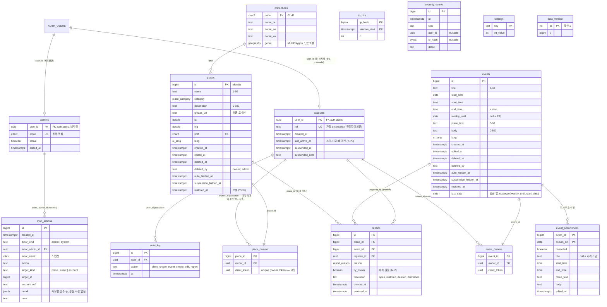

# ERD · DB 설계서 — YUNABI v2

| | |
|---|---|
| 상태 | 제안 (v2.0-draft) |
| 작성일 | 2026-10-12 |
| 현행 | **DB 없음.** v1.3 은 `index.html` 안의 상수(`PLACES`, `EVENTS`)를 쓴다. `schema.sql`(게시판 설계, 보류)은 적용된 적 없고 v2 에 쓰지 않는다 |
| 근거 | [PRD-YUNABI v2.3](../02-requirements/PRD-YUNABI.md) Y-M6~M10, Y-K4~K11, Y-R1~R10, Y-E1~E3, Y-A1~A5, Y-C4, Y-P1~P7, Y-S1~S12 |
| 짝 문서 | [RFC-0003](rfc/0003-yunabi-v2.md), [openapi-v2.yaml](openapi-v2.yaml), ADR [0018](../adr/0018-backend-supabase-anonymous.md)·[0019](../adr/0019-moderation-autohide.md)·[0021](../adr/0021-data-access-views-rpc.md)·[0022](../adr/0022-security-baseline.md) |
| 이어받는 교훈 | [erd.md](erd.md) (보류): 모든 GRANT 명시(N-1), 열 단위로 식별자 숨김(N-6), 정의자 함수는 필요한 곳에만 + `search_path` 고정, 정책·뷰가 부르는 헬퍼의 EXECUTE(§6.3), 방어 트리거는 invoker(S-1), 실패해도 남아야 하는 기록은 예외 대신 반환값(S-2), 확인 후 쓰기는 잠금 아래(D-10), 지연 만료 |

> 이 문서의 SQL 은 **설계 설명용 조각**이다. 실제 파일은 §8 순서로 `supabase/migrations/` 에 새로 쓴다.

---

## 1. 불변식

| # | 불변식 | 근거 | 검증 (§9) |
|---|---|---|---|
| V-1 | 클라이언트 역할(`anon`, `authenticated`)은 `app` 스키마의 어떤 객체에도 권한이 없다. `app` 은 Data API 노출 스키마가 아니다 | Y-S1 | G-01, G-02 |
| V-2 | 쓰기는 `public` 의 정의자 RPC 로만. RPC 는 소유자를 `auth.uid()` 로만 정한다 | Y-A5, Y-M8, Y-K8 | G-10~G-14 |
| V-3 | 공개 뷰·RPC 반환값 어디에도 등록자·신고자의 uuid 가 없다. 관리자에게는 `accounts.ref`(가명)만 | Y-M9, Y-R9, Y-P2 | G-20~G-22 |
| V-4 | 공개 뷰는 `deleted_at`, `auto_hidden_at`, `suspension_hidden_at` 이 모두 null 인 행만 | Y-R3, Y-R7, Y-E2 | G-23 |
| V-5 | `mod_actions` 는 추가 전용 (1년 지난 행의 정리 함수 삭제만 예외) | Y-R5, Y-S3 | G-40~G-42 |
| V-6 | 관리 RPC 는 허용 목록 + 비익명 + `aal2` + 세션 12시간 이내 | Y-R5, Y-S3 | G-30~G-34 |
| V-7 | 정의자 함수는 모두 `set search_path = ''` 이고 동적 SQL(`execute`)을 쓰지 않는다 | Y-S5, Y-S1 | §8 `checks` |
| V-8 | 사람을 식별하는 값은 Y-P1 목록뿐: 익명 계정 id, 관리자 이메일. IP 는 해시로 1시간만 | Y-P1, Y-S12 | 스키마 검토 |

---

## 2. ERD (제안)



모든 테이블은 `app` 스키마. `prefectures` 는 경계 판정용.

---

## 3. 타입

```sql
create schema app;                       -- Data API 노출 목록에 넣지 않는다
revoke all on schema app from public, anon, authenticated;
create type app.ui_lang        as enum ('en','ja','ko');
create type app.place_category as enum ('transit','daily','food','study','admin','health');
create type app.report_reason  as enum ('wrong','spam','inappropriate','privacy','other');   -- Y-R1
create type app.item_kind      as enum ('place','event');
```

---

## 4. 테이블 상세

열마다 "왜 필요한가" 를 적었다 — Y-S12 데이터 최소화 검토의 근거.

### 4.1 `app.places`

| 열 | 타입·제약 | 왜 |
|---|---|---|
| `id` | `bigint generated always as identity primary key` | 참조 |
| `name` | `text not null check (char_length(name) between 1 and 60 and name !~ '[[:cntrl:]]')` | Y-M6 |
| `category` | `app.place_category not null` | Y-M6 |
| `description` | `text not null default '' check (char_length(description) <= 500)` | Y-M6 |
| `gmaps_url` | `text check (gmaps_url is null or (char_length(gmaps_url) <= 500 and gmaps_url ~ '^https://((www\.)?google\.(com|co\.jp)/maps([/?#]|$)|maps\.app\.goo\.gl/|goo\.gl/maps/)'))` | Y-M6, Y-S4. 함수가 먼저 같은 규칙으로 검사(오류 코드용), CHECK 는 마지막 방어선 |
| `lat`, `lng` | `double precision not null check (lat between 20 and 46 and lng between 122 and 154)` | 대략 범위(마지막 방어선). 정밀 판정은 함수의 PostGIS |
| `pref` | `char(2) not null references app.prefectures(code)` | Y-M6 — 서버가 판정 |
| `lang` | `app.ui_lang not null` | Y-M6, Y-C5 |
| `created_at` | `timestamptz not null default now()` | 공개는 날짜만(Y-M9) |
| `edited_at` | `timestamptz` | Y-E1 "수정됨" |
| `deleted_at`, `deleted_by` | `timestamptz`, `text check (deleted_by in ('owner','admin'))`, `check ((deleted_at is null) = (deleted_by is null))` | Y-E2 (30일 보관) |
| `auto_hidden_at` | `timestamptz` | Y-R3 |
| `suspension_hidden_at` | `timestamptz` | Y-R7 |
| `restored_at` | `timestamptz` | Y-R6 보호. 수정하면 null |

인덱스: `places_visible (pref) where deleted_at is null and auto_hidden_at is null and suspension_hidden_at is null` (공개 뷰·도도부현 집계), `places_deleted (deleted_at) where deleted_at is not null` (정리 작업).

### 4.2 항목 상태 열 (장소·일정 공통)

| 상태 (ME-02 표시) | 조건 |
|---|---|
| `visible` | 세 숨김·삭제 열이 모두 null |
| `hidden_review` ("신고로 숨겨짐 — 검토 중", Y-R8) | `deleted_at is null and (auto_hidden_at is not null or suspension_hidden_at is not null)` |
| `deleted` | `deleted_at is not null` (30일 동안 등록자 ME-02·관리자에게만) |
| 보호 | `restored_at is not null` — 자동 숨김 대상 아님 |

### 4.3 `app.events`, `app.event_occurrences`

| 열 | 타입·제약 | 왜 |
|---|---|---|
| `title` | `text not null check (char_length(title) between 1 and 60 and title !~ '[[:cntrl:]]')` | Y-K4 |
| `start_date` | `date not null` | 생성 시 `>= 도쿄 오늘`은 함수가 검사(과거 행이 남아야 하므로 CHECK 불가) |
| `start_time`, `end_time` | `time not null`, `check (end_time > start_time)` | Y-K4 (같은 날) |
| `weekly_until` | `date`, `check (weekly_until is null or (weekly_until > start_date and weekly_until <= start_date + 175 and (weekly_until - start_date) % 7 = 0))` | Y-K6 — 최대 26회 (RFC-0003 OQ-3) |
| `place_text` | `text not null default '' check (char_length(place_text) <= 60)` | Y-K4 |
| `body` | `text not null default '' check (char_length(body) <= 500)` | Y-K4 |
| `lang` | `app.ui_lang not null` | Y-K4 |
| `last_date` | `date generated always as (coalesce(weekly_until, start_date)) stored` | 지난 일정 판정(Y-K9), 1년 정리(Y-P5) |
| 상태 열 | §4.1 과 같음 | |
| (없음) `kind`, `host` | — | Y-K5, Y-K1 — 종류·주최 폐기 |

`app.event_occurrences` (Y-K7): PK `(event_id, occurs_on)`, `event_id references app.events on delete cascade`. `cancelled boolean not null default false`, 덮어쓰기 열(`title`, `start_time`, `end_time`, `place_text`, `body`)은 null 이면 시리즈 값. 같은 길이 CHECK. `check (end_time is null or start_time is null or end_time > start_time)`. `occurs_on` 이 실제 회차인지는 함수가 검사(요일·범위).

### 4.4 소유 (`app.place_owners`, `app.event_owners`)

| 열 | 타입 | 왜 |
|---|---|---|
| `place_id` / `event_id` | `bigint primary key references … on delete cascade` | 1:1 |
| `owner_id` | `uuid not null references app.accounts(user_id) on delete cascade` | 내 항목만 수정(Y-M8). 계정 삭제 → 소유 행만 사라지고 장소는 남음(Y-P5) |
| `client_token` | `uuid not null`, `unique (owner_id, client_token)` | Y-C4 멱등 |

소유를 항목 테이블과 **분리**한 이유(ADR-0001 결정 1 재사용): 공개 뷰가 실수로 `select *` 를 해도 소유자가 섞이지 않는다. 인덱스 `(owner_id)` — `my_items`, 정지 처리.

### 4.5 신고·관리·계정

**`app.accounts`**: `user_id uuid primary key references auth.users on delete cascade`, `ref text not null unique default ('a-' || substr(encode(gen_random_bytes(6),'hex'),1,10))` (관리자에게 보이는 가명, uuid 와 무관한 난수), `created_at`, `last_active_at`, `suspended_at`, `suspended_note text check (char_length(suspended_note) <= 200)`.

**`app.admins`**: `user_id uuid primary key references auth.users on delete restrict`, `email citext not null unique`, `active boolean not null default true`, `added_at`. 행 추가는 마이그레이션·SQL 편집기로만.

**`app.reports`**: `place_id bigint references app.places on delete cascade`, `event_id bigint references app.events on delete cascade`, `check (num_nonnulls(place_id, event_id) = 1)`, `reporter_id uuid references app.accounts on delete set null`, `reason app.report_reason not null`, `by_owner boolean not null default false`, `resolution text not null default 'open' check (resolution in ('open','restored','deleted','dismissed'))`, `created_at`, `resolved_at`. 유일: `unique (place_id, reporter_id)`, `unique (event_id, reporter_id)` (null 신고자는 여럿 가능 — 삭제된 계정). 인덱스: `(place_id) where resolution='open'`, `(event_id) where resolution='open'`. **자유 서술 메모 없음**(신고자 개인정보·추가 노출 경로 방지 — Y-S12, OQ-E3).

**`app.mod_actions`**: `actor_kind text check (actor_kind in ('admin','system'))`, `actor_admin_id uuid references app.admins on delete restrict`, `check ((actor_kind='admin') = (actor_admin_id is not null))`, `actor_email citext` (기록 시점 스냅샷), `action text check (action in ('auto_hide','restore','delete','dismiss','suspend','unsuspend'))`, `target_kind text check (target_kind in ('place','event','account'))`, `target_id bigint`, `account_ref text`, `detail jsonb` (예 `{"reasons":{"spam":2,"privacy":1},"reporters":3}`), `note text check (char_length(note) <= 500)`. **본문 사본 없음.**

### 4.6 `app.prefectures` (Y-M6 서버 판정)

`data/japan-prefectures.geojson`(Natural Earth, 퍼블릭 도메인, ADR-0012)에서 `scripts/gen-prefectures-sql.ts` 가 마이그레이션 SQL(`insert … ST_GeogFromGeoJSON`)을 만든다 — 지도와 서버가 **같은 경계**를 쓴다. 인덱스 `gist (geom)`.

판정 함수 `app.pref_of(lat, lng) returns char(2)`: 점에서 10 km(`ST_DWithin` geography) 안의 폴리곤 중 가장 가까운 것의 `code`, 없으면 null(→ `invalid_location`). 10 km 는 단순화(`filter-islands min-area=5km2`)로 지워진 작은 섬·해안 지점 여유다(*추정* — Y-2 에서 샘플 좌표로 확인).

### 4.7 빈도·감시

**`app.write_log`**: `user_id → accounts cascade`, `action text check (action in ('place_create','event_create','edit','report'))`, `at timestamptz default now()`. 인덱스 `(user_id, action, at desc)`. 48시간 보관.

**`app.ip_hits`**: `ip_hash bytea`, `window_start timestamptz` (5분 단위), `n int`, PK `(ip_hash, window_start)`. `ip_hash = sha256(ip || 일일 솔트)`, 솔트는 `app.salts(day date pk, salt bytea)` 에 하루 하나(정리 작업이 이틀 지난 솔트 삭제 → 옛 해시는 되돌릴 수 없음). 1시간 보관.

**`app.security_events`**: `kind text check (kind in ('forbidden','not_owner','rate_limited_account','rate_limited_ip','suspended_write','admin_denied','signup_throttled'))`, `user_id uuid` (계정 삭제 시 set null), `ip_hash bytea`, `detail text check (char_length(detail) <= 200)`. 90일 보관.

**`app.settings`**: `('report_hide_threshold',3)`, `('place_create_per_day',10)`, `('event_create_per_day',10)`, `('edit_per_day',30)`, `('report_per_day',20)`, `('ip_writes_per_5min',60)`, `('anon_signups_per_hour',200)`, `('admin_session_hours',12)`, `('deleted_retention_days',30)`. 값 변경은 SQL 로(관리자 콘솔 편집은 범위 밖).

**`app.data_version`**: 한 행. 항목·회차·숨김이 바뀌는 문장 트리거가 `v = v + 1`.

---

## 5. 권한 (GRANT · RLS)

### 5.1 원칙

1. 마지막 마이그레이션(`grants`)에서 `public`·`app` 의 모든 객체에 대해 `anon`, `authenticated` 권한을 **먼저 전부 회수**하고 아래 표만 다시 준다. Supabase 의 기본 노출 정책(2026-05-30 이후 새 프로젝트는 자동 노출 없음 — tech-stack-v2 §5.2)이 바뀌어도 결과가 같다.
2. `alter default privileges in schema public, app revoke all … from anon, authenticated` (이후 객체 차단).
3. **`app` 의 모든 테이블은 RLS 활성 + 정책 0개**. GRANT 도 0 이라 이중으로 막힌다. RLS 는 GRANT 가 실수로 생겨도 0행을 돌려주게 하는 두 번째 벽이다.
4. 읽기는 `public` 뷰, 쓰기는 `public` 정의자 함수. 뷰는 소유자 권한으로 실행되는 **정의자 뷰**(`security_invoker = false`, 의도적 — Supabase 보안 점검기 경고에 주석). 뷰는 사용자 정의 함수를 부르지 않는다(뷰 안 함수는 조회자 권한으로 EXECUTE 검사 — erd.md §6.3 교훈. 오늘 날짜는 `(now() at time zone 'Asia/Tokyo')::date` 로 내장 함수만).
5. `public` 스키마의 `CREATE` 를 `public` 역할에서 회수(T-23).

### 5.2 객체별 권한표

| 객체 | `anon` | `authenticated` | `service_role` | RLS | 비고 |
|---|---|---|---|---|---|
| `app.*` 모든 테이블 | — | — | — (정의자 함수 경유) | 활성, 정책 0 | V-1. `service_role` 도 테이블 GRANT 를 회수해 감시·백업 외 경로를 줄인다(백업은 DB 비밀번호로 `postgres` 연결) |
| `public.places_public` (뷰) | SELECT | SELECT | — | — | 열: `id, name, category, description, gmaps_url, lat, lng, pref, lang, created_on, edited_on`. 조건 V-4 |
| `public.events_public` (뷰) | SELECT | SELECT | — | — | 열: `id, title, start_date, start_time, end_time, weekly_until, place_text, body, lang, created_on, edited_on`. 조건 V-4 + `last_date >= 도쿄 오늘 - 1년` |
| `public.event_occurrences_public` (뷰) | SELECT | SELECT | — | — | 보이는 일정의 회차 덮어쓰기 |
| `public.prefecture_counts` (뷰) | SELECT | SELECT | — | — | `pref, n` (일본 전체 목록의 장소 수) |
| `public.data_version()` | EXECUTE | EXECUTE | — | — | `stable`, 정의자, bigint 하나 |
| 쓰기 RPC (§7.1), `submit_report`, `my_items` | — | EXECUTE | — | — | 익명 사용자도 `authenticated` |
| 관리 RPC `admin_*` (§7.3) | — | EXECUTE | — | — | 함수 첫 줄 `app.require_admin()` (V-6) |
| `public.ops_health()` | — | — | EXECUTE | — | 감시 워크플로 전용 (Y-S10) |
| `app.require_writer()`, `app.require_admin()`, `app.pref_of()`, `app.ip_hash()`, `app.evaluate_item()`, `app.setting()` | — | — | — | — | **헬퍼 EXECUTE 부여 안 함.** 정책·뷰가 부르지 않고 정의자 함수 안에서만 호출되므로(소유자 권한) 필요 없다 — erd.md 와 달리 RLS 정책이 없어서 가능 |
| `app.db_pre_request()` | — | — | — | — | `authenticator` 설정 `pgrst.db_pre_request` 로 호출. 호출 역할에 맞춰 EXECUTE 필요 여부를 Y-2 에서 확인(OQ-E1) |
| 트리거 함수 | — | — | — | — | EXECUTE 불필요 |
| `before-user-created` 훅 함수 | — | — | — | — | `supabase_auth_admin` 에만 EXECUTE (공식 훅 방식) |

### 5.3 `mod_actions` 추가 전용 (ADR-0006 재사용)

```sql
-- 반드시 security invoker. definer 면 current_user 가 소유자가 되어 아래 검사가 무력화된다.
create function app.mod_actions_guard() returns trigger
language plpgsql security invoker set search_path = '' as $$
begin
  if tg_op = 'DELETE'
     and current_setting('app.purging', true) = 'on'      -- 정리 함수만 켬
     and old.created_at < now() - interval '1 year' then   -- 1년 지난 행만 (Y-P5)
    return old;
  end if;
  raise exception using errcode = '42501', message = 'mod_actions is append-only';
end $$;
create trigger mod_actions_no_change before update or delete on app.mod_actions
  for each row execute function app.mod_actions_guard();
create trigger mod_actions_no_truncate before truncate on app.mod_actions
  for each statement execute function app.mod_actions_guard();
revoke truncate, update, delete on app.mod_actions from public, anon, authenticated, service_role;
```

`app.purging` 은 아무 역할이나 세션에서 켤 수 있지만, 테이블 DELETE 권한이 소유자(정리 함수)에게만 있고 조건이 "1년 지난 행" 이라 우회해도 얻는 것이 없다.

---

## 6. 정기 작업 (Supabase Cron)

| 작업 | 주기 | 내용 | 근거 |
|---|---|---|---|
| `app.purge_deleted()` | 매일 04:00 JST | `deleted_at < now() - 30일` 인 장소·일정 영구 삭제(소유·회차·신고 cascade) | Y-E2 |
| `app.purge_past_events()` | 매일 | `last_date < 도쿄 오늘 - 1년` 일정 삭제 | Y-P5 |
| `app.purge_records()` | 매일 | 1년 지난 `reports`(해결된 것), `mod_actions`(`app.purging=on`), 90일 지난 `security_events`, 48시간 지난 `write_log`, 1시간 지난 `ip_hits`, 이틀 지난 솔트 | Y-P5, Y-S12 |
| `app.purge_inactive_accounts()` | 매일 | `accounts.last_active_at < now() - 1년` 이고 관리자가 아닌 익명 사용자를 `auth.users` 에서 삭제(→ `accounts`·소유 행 cascade, 신고자 null). 쓰기 없이 만들어진 익명 사용자(로그인 직후 실패 등)는 `created_at` 기준 | Y-P5, B-3 |

무료 플랜 일시정지 중에는 작업이 돌지 않는다 — 재개 후 다음 실행이 밀린 것을 처리한다(조건이 시각 기준이라 멱등). 일시정지 위험은 tech-stack-v2 B-4.

---

## 7. 함수 시그니처

공통: `language plpgsql security definer set search_path = ''`, 이름은 스키마 한정. 반환이 `jsonb` 인 함수는 `{"status": "...", ...}` (RFC-0003 §13.4). 형식 오류는 `raise exception using errcode='P0001', message='invalid_<field>'`.

### 7.1 쓰기 (`authenticated`)

| 함수 | 시그니처 → 반환 | 검사 순서 | 근거 |
|---|---|---|---|
| `public.create_place` | `(p_client_token uuid, p_name text, p_category app.place_category, p_description text, p_gmaps_url text, p_lat double precision, p_lng double precision, p_lang app.ui_lang) → jsonb` `{status, id?, pref?}` | `require_writer` → 잠금 → 멱등(`duplicate`) → 한도 `place_create` → 형식 → `pref_of` → insert ×2 + `write_log` | Y-M6, Y-A3, Y-C4 |
| `public.update_place` | `(p_id bigint, p_name text, p_category …, p_description text, p_gmaps_url text, p_lat double precision, p_lng double precision, p_lang app.ui_lang) → jsonb` `{status, pref?}` | `require_writer` → 소유·미삭제(`not_found`) → 한도 `edit` → 형식 → 갱신, `edited_at`, **`restored_at = null` 후 `evaluate_item`** (숨김 열은 건드리지 않음) | Y-M8, Y-E1, Y-R6 |
| `public.delete_place` | `(p_id bigint) → jsonb` | `require_writer`(**정지 계정도 삭제는 허용할지** — OQ-E2) → 소유 → `deleted_at`, `deleted_by='owner'`. 숨김 상태여도 가능 | Y-E2, Y-E3 |
| `public.create_event` | `(p_client_token uuid, p_title text, p_start_date date, p_start_time time, p_end_time time, p_weekly_until date, p_place_text text, p_body text, p_lang app.ui_lang) → jsonb` `{status, id?}` | 위와 같음 + `start_date >= 도쿄 오늘`, 반복 규칙 | Y-K4, Y-K6 |
| `public.update_event` | `(p_id bigint, … 같은 필드) → jsonb` | 소유 → `last_date` 의 끝 시각이 지났으면 `past_event` → 시작일이 지났으면 `start_date`·요일 변경 금지(`invalid_start_date`) → 갱신, 보호 해제 + 재평가 | Y-K8, Y-K9, Y-R6 |
| `public.delete_event` | `(p_id bigint) → jsonb` | 소유. 지난 일정도 가능 | Y-K9, Y-E3 |
| `public.set_occurrence` | `(p_event_id bigint, p_occurs_on date, p_cancelled boolean, p_title text, p_start_time time, p_end_time time, p_place_text text, p_body text) → jsonb` | 소유 → 회차가 실제 날짜(요일·범위) → 그 회차가 끝나지 않았을 것 → upsert. 한도 `edit` | Y-K7 |
| `public.clear_occurrence` | `(p_event_id bigint, p_occurs_on date) → jsonb` | 같은 검사 → 행 삭제(시리즈 값으로 복귀) | Y-K7 |
| `public.my_items` | `() → table(kind app.item_kind, id bigint, title text, state text, created_on date, edited_on date, deleted_on date, last_date date)` | `auth.uid()` 소유분만. `state` ∈ `visible, hidden_review, deleted` | Y-R8, ME-02 |

### 7.2 신고 (`authenticated`)

```sql
public.submit_report(p_kind app.item_kind, p_id bigint, p_reason app.report_reason) returns jsonb
-- {status: ok | already_reported | not_found | rate_limited | suspended}
```

1. `require_writer()` (계정 생성·정지 확인, `last_active_at` 갱신)
2. 사용자 잠금 → 한도 `report` 20/24시간
3. 대상이 공개 상태인지(숨김·삭제된 항목은 `not_found` — 이미 처리 중)
4. `insert … on conflict do nothing` → 충돌이면 `already_reported` (Y-R2)
5. `by_owner` = 신고자가 소유자인지 (M-2)
6. `perform app.evaluate_item(p_kind, p_id)`

```sql
app.evaluate_item(p_kind app.item_kind, p_id bigint) returns void
-- 대상 행을 for update 로 잠근 뒤:
--   보호 중(restored_at is not null) 이거나 이미 숨김·삭제면 끝
--   n := count(distinct reporter_id) from reports
--          where 대상 and resolution='open' and not by_owner and reporter_id is not null
--   n >= setting('report_hide_threshold') 이면
--     auto_hidden_at = now(); data_version++;
--     insert mod_actions(actor_kind='system', action='auto_hide', detail=사유별 건수)
```

대상 행 잠금으로 동시 신고 3건이 경쟁해도 숨김·기록이 한 번만 일어난다.

### 7.3 관리 (`authenticated` + `require_admin`)

| 함수 | 시그니처 → 반환 | 동작 | 근거 |
|---|---|---|---|
| `public.admin_whoami` | `() → jsonb` `{status, email?, session_expires_at?}` | 콘솔이 진입 가능 여부 확인 | Y-S3 |
| `public.admin_queue` | `(p_filter text default 'all', p_limit int default 50, p_before bigint default null) → table(kind, id, title, state, protected boolean, reports_open int, reasons jsonb, first_report_at, last_report_at, account_ref text, created_on, deleted_on)` | `p_filter` ∈ `hidden, reported, deleted, all`. 신고자 없음 | Y-R4, Y-R9, Y-P2, Y-E2 |
| `public.admin_item` | `(p_kind app.item_kind, p_id bigint) → jsonb` | 항목 전체 내용 + 회차 + 신고 집계 + 해당 항목의 관리 기록 | Y-R4 |
| `public.admin_restore` | `(p_kind, p_id, p_note text) → jsonb` | 숨김 열 모두 null, `restored_at=now()`, 미처리 신고 `restored`, 기록 | Y-R4, Y-R6 |
| `public.admin_delete` | `(p_kind, p_id, p_note text) → jsonb` | `deleted_at`, `deleted_by='admin'`, 미처리 신고 `deleted`, 기록 | Y-R4, Y-P7 |
| `public.admin_dismiss` | `(p_kind, p_id, p_note text) → jsonb` | 미처리 신고 `dismissed`, 기록. 항목은 그대로 | Y-R4 |
| `public.admin_suspend` | `(p_account_ref text, p_note text) → jsonb` | `suspended_at`, 그 계정의 보이는 항목 `suspension_hidden_at`, 기록 | Y-R7 |
| `public.admin_unsuspend` | `(p_account_ref text, p_note text) → jsonb` | `suspended_at = null`. **항목은 그대로 숨김** | Y-R7 |
| `public.admin_search` | `(p_q text, p_pref char(2) default null) → table(…)` | 이름·제목 부분 일치(매개변수, `ilike` 패턴은 `%` `_` 이스케이프) | Y-P6, Y-P7 |
| `public.admin_audit_log` | `(p_limit int default 100, p_before bigint default null) → setof (mod_actions 공개 열)` | 감사 기록 열람 | Y-R5 |

```sql
app.require_admin() returns app.admins
-- 1) uid := auth.uid(); 2) (auth.jwt()->>'is_anonymous')::boolean is not true
-- 3) auth.jwt()->>'aal' = 'aal2'
-- 4) select created_at from auth.sessions where id = (auth.jwt()->>'session_id')::uuid
--    → now() - created_at <= setting('admin_session_hours')
-- 5) admins 행 active
-- 실패: insert security_events('admin_denied') 후 null 반환 → 호출 함수는 {status:'forbidden'} 반환 (예외 아님: 기록 보존)
```

### 7.4 보조

| 함수 | 권한 | 내용 |
|---|---|---|
| `public.data_version() → bigint` | anon, authenticated | §4.7 |
| `public.ops_health() → jsonb` | service_role | 최근 1시간·24시간: `security_events` 종류별 수, 익명 생성 수, 자동 숨김 수, 관리 조치 수, 미처리 신고 24시간 초과 수, DB 크기 (Y-S10) |
| `app.require_writer() → uuid` | 없음 | `auth.uid()` null → `forbidden`; `accounts` 없으면 생성(Y-A1); 정지면 `suspended_write` 기록 후 `suspended`; `last_active_at` 갱신 |
| `app.db_pre_request() → void` | (OQ-E1) | 요청 방식이 GET/HEAD 가 아니면 `ip_hits` 증가, 한도 초과면 `raise sqlstate 'PT429'`(PostgREST 의 상태 코드 지정 방식 — Y-2 에서 확인) |
| `app.hook_before_user_created(event jsonb) → jsonb` | supabase_auth_admin | 익명: 최근 1시간 익명 생성 수 < `anon_signups_per_hour` 아니면 거절. 비익명: 이메일이 `admins` 에 있어야 함. 훅 페이로드 형식은 공식 문서로 Y-2 확인 |

---

## 8. 마이그레이션 파일 계획

경로 `supabase/migrations/<타임스탬프>_<이름>.sql`. 번호는 순서만 뜻한다. 운영 적용은 CI 의 수동 승인 단계(`supabase db push`).

| # | 파일 | 내용 | 근거 |
|---|---|---|---|
| 01 | `extensions` | `postgis`, `pgcrypto`, `citext`, `pg_cron` (Supabase 확장 목록에서 이름·스키마 확인) | §4.6 |
| 02 | `schema_types` | `app` 스키마, enum 4종, `public` CREATE 회수 | §3, T-23 |
| 03 | `settings_version` | `settings`(기본값), `data_version`, `salts` | §4.7 |
| 04 | `prefectures` | 테이블 + 47행(생성 스크립트 산출물) + gist | §4.6 |
| 05 | `accounts_admins` | `accounts`, `admins` | §4.5 |
| 06 | `places` | `places`, `place_owners`, 인덱스 | §4.1, §4.4 |
| 07 | `events` | `events`, `event_occurrences`, `event_owners` | §4.3 |
| 08 | `moderation` | `reports`, `mod_actions` + 추가 전용 트리거(invoker) | §4.5, §5.3 |
| 09 | `security_tables` | `write_log`, `ip_hits`, `security_events` | §4.7 |
| 10 | `helpers` | `setting`, `ip_hash`, `pref_of`, `require_writer`, `require_admin`, `evaluate_item` | §7 |
| 11 | `triggers` | `data_version` 증가(문장 트리거), `edited_at` 은 함수에서 | §4.7 |
| 12 | `views` | 공개 뷰 4개 (정의자 뷰 주석) | §5.2 |
| 13 | `rpc_write` | §7.1 | Y-M\*, Y-K\* |
| 14 | `rpc_report` | §7.2 | Y-R\* |
| 15 | `rpc_admin` | §7.3 | Y-R4~R7 |
| 16 | `ops` | `data_version()`, `ops_health()`, `db_pre_request` + `alter role authenticator set pgrst.db_pre_request` (Supabase 클라우드에서 허용되는지 확인 — OQ-E1) | Y-S7, Y-S10 |
| 17 | `auth_hook` | `hook_before_user_created` + EXECUTE (대시보드에서 훅 등록) | Y-S3, Y-S7 |
| 18 | `jobs` | §6 의 cron 일정 | Y-P5 |
| 19 | `grants` | 전부 회수 → §5.2 표대로 부여 → default privileges | V-1, Y-S1 |
| 20 | `checks` | 적용 후 점검, 실패 시 예외로 마이그레이션 실패: ① `app` 테이블 전부 RLS 활성·정책 0 ② `anon`·`authenticated` 의 `app` 권한 0 ③ `anon` 이 EXECUTE 가진 함수 = {`data_version`} ④ `authenticated` EXECUTE 함수 = 허용 목록과 정확히 일치 ⑤ 모든 정의자 함수의 `proconfig` 에 `search_path=` ⑥ 정의자 함수 본문(`prosrc`)에 `execute` 없음 ⑦ `mod_actions_guard` 의 `prosecdef = false` ⑧ 공개 뷰의 열 목록이 고정 목록과 일치 ⑨ `pg_default_acl` 에 `anon` 없음 | V-1~V-8 |
| seed | `supabase/seed/fixtures.sql` | 로컬·CI 전용: 테스트 계정(익명 A·B·C·D, 관리자 1 — TOTP 비밀 고정), `tests/fixtures` 와 같은 장소·일정. **운영에 적용하지 않는다**(초기 데이터 0, Y-M4) | PRD §7 |

**대시보드 설정(마이그레이션 밖, 점검표):** 익명 로그인 ON, 이메일 가입은 훅이 막으므로 켜도 됨(관리자 생성용), TOTP ON, 세션 비활동·최대 수명, CAPTCHA 스위치(기본 OFF, Turnstile 키 미리 등록), 익명 로그인 IP 한도, Data API 노출 스키마 `public` 만, 레거시 키 비활성화, 훅 등록, 프로젝트 멤버.

**되돌리기:** 빈 DB 에 처음 적용하므로 Y-2 까지는 재생성으로 충분. 운영 데이터가 생긴 뒤의 마이그레이션은 짝이 되는 되돌리기 SQL 을 함께 둔다.

---

## 9. 권한·검증 테스트 (pgTAP, Y-S1·S3·S5 수락 기준)

역할 × 객체 × 동작 매트릭스. 테스트 계정: 익명 A(등록자), 익명 B·C·D(신고자), 정지된 E, `anon`, 관리자 X(aal1 / aal2 / 13시간 지난 세션), 허용 목록 밖 비익명 Y.

| ID | 검증 | 기대 |
|---|---|---|
| G-01 | `anon`·`authenticated` 로 `app.*` 모든 테이블 SELECT/INSERT/UPDATE/DELETE | 권한 오류 |
| G-02 | `public` 뷰에 INSERT/UPDATE/DELETE | 권한 오류 |
| G-10 | B 가 A 의 장소 `update_place`·`delete_place`·`set_occurrence` | `not_found` + `security_events` 1행 |
| G-11 | E(정지)의 모든 쓰기·신고 | `suspended` |
| G-12 | `anon` 이 쓰기 RPC | 권한 오류 |
| G-13 | 같은 `client_token` 으로 `create_place` 두 번 | 같은 id, 행 1개 (Y-C4) |
| G-14 | 11번째 장소, 31번째 수정, 21번째 신고 (24시간) | `rate_limited` (Y-A3) |
| G-15 | 비정상 입력 세트: 길이 0/61/501, 제어 문자, 범위 밖 좌표, 바다 한가운데, `javascript:`·`http:`·`https://evil.com/maps`·`https://google.com.evil.com/maps`·`https://user@google.com/maps` 링크, 끝 ≤ 시작, 과거 날짜, 26회 초과 반복, 요일이 다른 회차 | 전부 `invalid_*` (Y-S5) |
| G-16 | SQL 메타문자 문자열(`'; drop table …`)을 이름에 | 그대로 저장되고 다른 영향 없음 |
| G-20 | 공개 뷰 열 목록 | 고정 목록과 일치 (소유자·토큰·숨김 열 없음) |
| G-21 | `my_items` 를 B 로 | A 의 항목 없음 |
| G-22 | `admin_queue` 결과에 uuid·신고자 없음 | 통과 (Y-R9) |
| G-23 | 숨김·삭제 항목이 공개 뷰에 없음 | 통과 |
| G-24 | B·C·D 신고 → 숨김, 기록 1행(system). A 의 자기 신고는 안 셈 | 통과 (Y-R3) |
| G-25 | 복원 후 신고 3건 → 보임(보호), 관리자 큐에는 집계 (Y-R6) | 통과 |
| G-26 | 복원 후 A 가 수정 → 미처리 신고 ≥ 3 이면 즉시 숨김 (Y-R6 v2.3) | 통과 |
| G-27 | 숨김 항목을 A 가 수정 → 계속 숨김 (Y-E1), 삭제 가능 (Y-E3) | 통과 |
| G-28 | 정지 → 항목 숨김, 해제 → 항목 계속 숨김 (Y-R7) | 통과 |
| G-29 | 지난 일정 수정 `past_event`, 삭제 성공 (Y-K9) | 통과 |
| G-30 | 익명 사용자가 `admin_*` | `forbidden` + 기록 |
| G-31 | 관리자 X aal1 | `forbidden` |
| G-32 | 허용 목록 밖 Y aal2 | `forbidden` |
| G-33 | X aal2, 세션 13시간 | `forbidden` |
| G-34 | X aal2 정상 → 조치 + `mod_actions` 에 이메일 | 통과 |
| G-40 | `service_role`·`postgres` 로 `mod_actions` UPDATE/DELETE/TRUNCATE (1년 미만 행) | 거부 |
| G-41 | 정리 함수가 1년 지난 행만 삭제 | 통과 |
| G-42 | 가드 트리거 `prosecdef = false` | 통과 |
| G-50 | 정리 작업: 31일 지난 삭제 항목, 1년 지난 일정·기록, 1년 비활동 계정(장소는 남고 소유 행만 사라짐 — Y-P5) | 통과 |
| G-51 | 훅: 시간당 익명 생성 한도 + 1 | 거절 + `signup_throttled` |

HTTP 층 같은 케이스(PostgREST 경유)는 `tests/security/` 의 Playwright `request` 로 대표 항목(G-01, G-10, G-15, G-30)을 다시 확인한다 — DB 권한과 Data API 노출 설정을 함께 검증하기 위해.

---

## 10. 열린 질문

| # | 질문 | 관련 |
|---|---|---|
| OQ-E1 | Supabase 클라우드에서 `pgrst.db_pre_request` 설정이 허용되는지, 함수의 실행 역할·EXECUTE 필요 여부, 상태 코드 지정(`PT429`) 동작 | Y-S7 |
| OQ-E2 | 정지된 계정이 **자기 항목 삭제**는 할 수 있게 할지 (개인정보를 스스로 지우는 길) | Y-R7, Y-E3 — 제안: 허용 |
| OQ-E3 | 신고 사유 "기타" 에 자유 서술을 받을지 — 받지 않는 것을 제안(최소화) | Y-R1, Y-S12 |
| OQ-E4 | 좌표 판정 여유 10 km 가 적절한지 샘플(작은 섬·항구)로 확인 | Y-M6 |
| OQ-E5 | `before-user-created` 훅이 익명 가입에도 호출되는지, 페이로드에 `is_anonymous` 가 있는지 (없으면 전역 한도를 다른 방식으로) | Y-S7 |
| OQ-E6 | 백업에 `auth` 스키마 사용자 행을 넣을지 — 넣지 않으면 복구 후 모든 익명 사용자가 자기 항목을 잃는다. 넣는 것을 제안 | Y-S9 |
