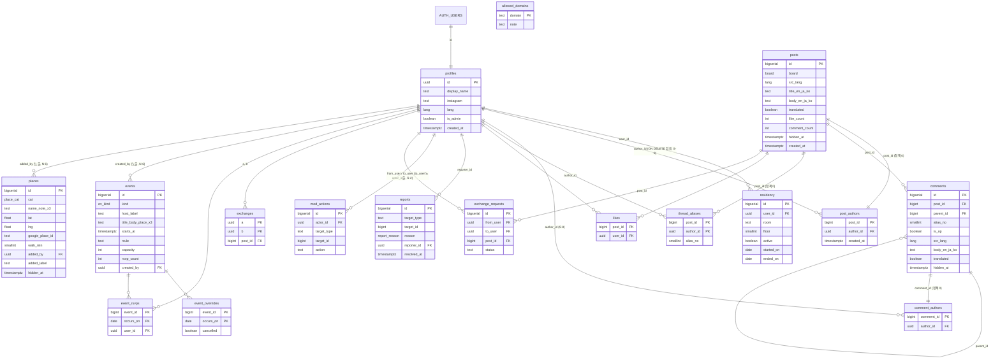

# ERD · DB 설계서

| | |
|---|---|
| 상태 | 제안 (v0.1) |
| 작성일 | 2026-10-11 |
| 현행 기준 | `schema.sql` (미적용 설계안, 536줄) |
| 근거 | [PRD](../02-requirements/PRD.md) §6·§7·§7.1·§13, [정책](../04-spec/policy.md), [핸드오프](../07-handoff/handoff.md) §3·§5·§9, [QA 테스트 계획](../08-qa/test-plan.md) §6.10 |
| 짝 문서 | [RFC-0001](rfc/0001-m1-backend-foundation.md), ADR [0001](../adr/0001-structural-anonymity.md)·[0005](../adr/0005-exchange-request-redesign.md)·[0006](../adr/0006-append-only-moderation-log.md)·[0007](../adr/0007-anonymous-metrics.md) |

> 이 문서는 **현행**(§2, `schema.sql` 그대로)과 **제안**(§3 이후)을 나눠 적는다. 제안은 아직 어떤 파일에도 없다. `schema.sql` 은 고치지 않았다. 제안 SQL 조각은 설계 설명용이며, 실제 마이그레이션은 §7 순서로 새로 쓴다.

---

## 1. 지켜야 할 불변식

| # | 불변식 | 근거 | 검증 |
|---|---|---|---|
| I-1 | 글·댓글 본문과 작성자는 다른 테이블에 있다 (`posts`↔`post_authors`, `comments`↔`comment_authors`) | PR-1, README | 구조 |
| I-2 | 작성자 테이블(`post_authors`, `comment_authors`, `thread_aliases`)은 RLS 활성 + **정책 0개**. `anon`/`authenticated` 에는 테이블 권한도 주지 않는다 | PR-2 | TC-PR-01 |
| I-3 | 작성자가 있는 행은 `SECURITY DEFINER` 함수로만 만든다. 본문과 작성자 행이 한 트랜잭션 | PR-3 | TC-PR-02 |
| I-4 | 신고자 ID 는 어떤 뷰·정책·함수 반환값으로도 나오지 않는다 | PR-5, M-3 | TC-PR-04 |
| I-5 | 운영 기록은 추가만 된다. 숨김 상태는 `moderate()` 로만 바뀐다 | PR-6, PR-11 | TC-PR-05, TC-PR-10 |
| I-6 | 다른 사용자의 uuid 를 클라이언트가 얻을 수 없다 (교환 상대 포함) | PR-8, PR-10, N-6 | §8 추가 케이스 E-1 |
| I-7 | 클라이언트는 권한 컬럼을 바꿀 수 없다 | PR-9, S-1 | TC-PR-08 |
| I-8 | 방 번호는 저장하되 어떤 뷰·컬럼 GRANT 로도 나가지 않는다 | PR-7 | TC-PR-06 |

---

## 2. 현행 ERD (`schema.sql`)



(`title_en_ja_ko` 는 `title_en, title_ja, title_ko` 세 컬럼을 줄여 적은 것이다.)

### 2.1 현행 결함 요약

PRD §7.1 과 핸드오프 §9.2 의 항목을 테이블 기준으로 다시 묶었다. 이 문서가 새로 찾은 것은 **굵게** 표시.

| 테이블·함수 | 결함 | ID |
|---|---|---|
| `profiles` | `profile_self_update` 가 컬럼 제한 없음 → `is_admin` 자기 승격 | S-1 |
| `exchange_requests`, `request_exchange` | `to_user` 노출, 오류로 동일 작성자 판별, 실패 시도 롤백, 게시판 미확인 | S-2, Q7 |
| `posts`/`comments` 정책, `mod_actions` | 직접 `hidden_at` UPDATE, 기록 수정·삭제 | S-3 |
| `bump_like_count` | definer 아님 → 카운트 안 오름 | S-4 |
| `create_post`, `add_comment` | 클라이언트 직접 호출, 언어별 다른 내용 | S-5, Q4 |
| `add_comment`, `comments_read` | 숨김 글·부모 소속·깊이·길이 미검사, 부모 글 숨김 무시 | S-6 |
| 가입 경로 | `profiles`·`residency` 생성 경로 없음, `allowed_domains` 미적용 | S-7 |
| 작성자 FK | `ON DELETE` 없음 | S-8 |
| (클라이언트) `index.html` `profiles()` | 방 번호·Instagram 핸들을 `esc()` 없이 출력 (`index.html:1593`, `:1600-1601`). **수정은 클라이언트에서** `esc()` 적용. DB 쪽 `profiles.instagram` 형식 CHECK(§4.1)는 심층 방어일 뿐 대체가 아니다 | S-9, BUG-13 |
| 함수 권한 | `anon` 에 EXECUTE 잔존 | N-1 |
| `event_overrides` | 쓰기 경로 없음 | N-2 |
| `events.host_label` | 단일 언어 | N-3 |
| `reports` | RPC·직접 INSERT 공존, 중복 판별 불가 | N-5 |
| `my_contacts.id`, `places.added_by`, `events.created_by` | uuid 노출 → 교환 상대가 등록한 항목 특정 | N-6 |
| `likes_self`, `rsvp_self`, `respond_exchange` | 거주 확인 없음 | N-8 |
| `report_queue` | (대상, 사유)별 분리, 인용문·행 키 없음 | N-9 |
| `add_comment` | **같은 글에 동시에 처음 댓글을 다는 두 사람이 같은 `max+1` 번호를 받아 `thread_alias_unique` 위반 → 한쪽 실패** (경쟁 조건) | 신규 D-1 |
| `events.rsvp_count` | **RSVP 는 회차 단위(`occurs_on`, C-8)인데 카운터와 `capacity` 는 시리즈 단위 한 칸 → 매주 GIP 의 회차별 인원·정원을 표현 못 함** | 신규 D-2, Q6 |
| `schema.sql:23-26` 주석 | **방 계정 이름 바꾸기 모델은 uuid 를 방에 묶어, 작성 이력·교환 목록이 다음 입주자에게 넘어간다. `residency`(사람별 이력)와 모순** | 신규 D-3, Q3 |
| `moderate()` | **존재하지 않는 `p_id` 에도 성공하고 `mod_actions` 에 기록. `p_type` 이 post/comment 외이면 `else` 분기로 `comments` 를 갱신** | 신규 D-4 |
| 정책의 `is_resident()` 호출 | 행마다 함수 호출. `(select is_resident())` 로 감싸면 문장당 1회 평가(Supabase RLS 성능 권고, *일반 지식*) | 신규 D-5 (성능, 낮음) |
| `posts`/`comments` 제목·본문 | **DB 길이 제약 없음.** 함수만 고치면 service 경로 외의 쓰기(운영자 SQL 등)에 제약이 없다 | M-9 보강 |

---

## 3. 제안 ERD

```mermaid
erDiagram
  AUTH_USERS ||--|| profiles : "트리거로 생성 (S-7)"
  profiles ||--o{ residency : "사람별 입주 이력"
  room_invites ||--o| residency : "claim_residency"
  posts ||--|| post_authors : "정책 0, client_token"
  profiles ||--o{ post_authors : "ON DELETE CASCADE (연결만 끊김)"
  posts ||--o{ comments : ""
  comments ||--o{ comments : "parent_id (1단계)"
  comments ||--|| comment_authors : "정책 0, created_at 추가"
  profiles ||--o{ comment_authors : "CASCADE"
  posts ||--o{ thread_aliases : "정책 0"
  posts ||--o{ likes : ""
  profiles ||--o{ likes : ""
  profiles ||--o{ reports : "reporter_id ON DELETE SET NULL"
  profiles ||--o{ mod_actions : "actor_id RESTRICT"
  profiles ||--o{ exchange_requests : "from_user, to_user (to_user 는 아무에게도 SELECT 불가)"
  profiles ||--o{ exchange_attempts : "user_id (정책 0)"
  posts ||--o{ exchange_requests : ""
  profiles ||--o{ exchanges : "a, b — id 로만 참조"
  events ||--o{ event_overrides : "운영자 쓰기 (N-2)"
  events ||--o{ event_rsvps : "회차 단위"
  profiles ||--o{ places : "added_by (컬럼 GRANT 제외)"

  profiles {
    uuid id PK
    text display_name
    text instagram
    lang lang
    boolean is_admin "UPDATE 불가"
    timestamptz created_at
  }
  residency {
    bigserial id PK
    uuid user_id FK
    text room "GRANT 제외"
    smallint floor
    boolean active
    date started_on
    date ended_on
  }
  room_invites {
    text code_hash PK
    text room
    smallint floor
    timestamptz expires_at
    timestamptz used_at
    uuid used_by FK
  }
  allowed_domains {
    text domain PK
    text note
  }
  posts {
    bigserial id PK
    board board
    lang src_lang
    text title_x3 "칸당 200자 이하"
    text body_x3 "칸당 12000자 이하"
    boolean translated
    int like_count
    int comment_count
    timestamptz edited_at
    timestamptz deleted_at
    timestamptz hidden_at
    timestamptz created_at
  }
  post_authors {
    bigint post_id PK
    uuid author_id FK
    uuid client_token UK
    timestamptz created_at
  }
  comments {
    bigserial id PK
    bigint post_id FK
    bigint parent_id FK
    smallint alias_no
    boolean is_op
    lang src_lang
    text body_x3
    boolean translated
    timestamptz deleted_at
    timestamptz hidden_at
    timestamptz created_at
  }
  comment_authors {
    bigint comment_id PK
    uuid author_id FK
    uuid client_token UK
    timestamptz created_at
  }
  thread_aliases {
    bigint post_id PK
    uuid author_id PK
    smallint alias_no
  }
  likes {
    bigint post_id PK
    uuid user_id PK
    timestamptz created_at
  }
  reports {
    bigserial id PK
    text target_type
    bigint target_id
    report_reason reason
    uuid reporter_id FK
    timestamptz resolved_at
    timestamptz created_at
  }
  mod_actions {
    bigserial id PK
    uuid actor_id FK
    text target_type
    bigint target_id
    text action
    text note
    timestamptz created_at
  }
  exchange_requests {
    bigserial id PK
    uuid from_user FK
    uuid to_user FK
    bigint post_id FK
    text status "pending, accepted, declined, suppressed, expired"
    timestamptz created_at
    timestamptz responded_at
  }
  exchange_attempts {
    bigserial id PK
    uuid user_id FK
    timestamptz created_at
  }
  exchanges {
    bigserial id PK
    uuid a FK
    uuid b FK
    bigint post_id FK
    timestamptz created_at
  }
  events {
    bigserial id PK
    ev_kind kind
    text host_x3
    text title_body_place_x3
    timestamptz starts_at
    timestamptz ends_at
    text rrule
    date until_on
    int capacity "회차당"
    uuid created_by FK "GRANT 제외"
  }
  event_overrides {
    bigint event_id PK
    date occurs_on PK
    boolean cancelled
    text title_body_x3
    int capacity
  }
  event_rsvps {
    bigint event_id PK
    date occurs_on PK
    uuid user_id PK
    timestamptz created_at
  }
  places {
    bigserial id PK
    place_cat cat
    text name_note_x3
    float lat
    float lng
    text google_place_id
    smallint walk_min
    uuid added_by FK "GRANT 제외"
    text added_label "ra, gip, anon 코드"
    timestamptz hidden_at
  }
  metric_daily {
    date day PK
    text metric PK
    text dim1 PK
    text dim2 PK
    bigint n "사용자 ID 없음"
  }
```



### 3.1 현행 대비 변경 목록

| 대상 | 변경 | 해결 | ADR |
|---|---|---|---|
| `profiles` | 테이블 UPDATE 권한 회수, `grant update (display_name, instagram, lang)`. 방어 2중: `is_admin` 변경 시 `current_user <> 'service_role'` 이면 예외를 던지는 BEFORE UPDATE 트리거(**security invoker** — §6 보안 속성 규칙) | S-1, PR-9 | — |
| `room_invites` (신규) | 방별 1회용 초대 코드. 코드는 해시로 저장. 정책 0, `claim_residency` 로만 사용 | S-7, D-3 | 0004 |
| `residency` | 쓰기는 `claim_residency`·운영자 RPC 만. `room` 은 컬럼 GRANT 제외 → 본인도 SELECT 로 못 읽음(`floor` 만) | S-7, PR-7 | 0004 |
| `posts` | `edited_at`, `deleted_at` 추가. 길이 CHECK(언어 칸별 상한은 번역 팽창을 감안해 원문 상한의 3배 — 원문 상한은 함수에서) | M-7, M-9 | 0002 |
| `post_authors` | `client_token uuid unique`(멱등), `author_id … on delete cascade` | Q4, S-8 | 0002 |
| `comment_authors` | `created_at`(빈도 제한), `client_token`, cascade | M-9, S-8 | 0002 |
| `comments` | `deleted_at`. `comments_read` 정책에 부모 글 미숨김·미삭제 조건 | S-6, M-7 | — |
| `thread_aliases` | `author_id … on delete cascade`. 번호 발급은 `posts` 행 잠금(`select … for update`) 아래에서 | S-8, D-1 | — |
| `likes`, `event_rsvps` 정책 | `and (select is_resident())` 추가 | N-8 | — |
| `reports` | 직접 INSERT 정책 제거, `submit_report` 만. `reporter_id … on delete set null` | N-5, S-8 | — |
| `mod_actions` | `note` 추가. 정책은 운영자 SELECT 만. INSERT 는 `moderate()` 안에서만. BEFORE UPDATE/DELETE 행 트리거 + BEFORE TRUNCATE 문장 트리거로 거부(`service_role` 포함), TRUNCATE 권한 회수 | S-3, PR-11 | 0006 |
| `posts`/`comments` 운영 정책 | `posts_moderate`, `comments_moderate` 삭제 | S-3 | 0006 |
| `exchange_requests` | 요청자·수신자 모두 테이블 SELECT 불가(정책 0 + GRANT 없음). 뷰 `my_sent_requests`, `my_incoming_requests` 만. `status` 에 `suppressed`, `expired`. 유일 인덱스를 `(from_user, post_id)` 로 | S-2, PR-10, Q7 | 0005 |
| `exchange_attempts` (신규) | 시도마다 1행, 정책 0. 하루 3건 판단에 사용 — `unavailable` 등 실패도 센다. `request_exchange` 는 예외 대신 결과 코드를 반환하므로 이 행이 롤백되지 않는다 | S-2, POL-4-4 | 0005 |
| `exchanges` | 대리 키 `id` 추가, `unique(a,b)`, `check(a<b)` 유지. 클라이언트 정책 제거 → `my_contacts` 뷰와 `unlink_exchange(p_contact_id)` 만 | N-6 | 0005 |
| `events` | `host_label` → `host_en, host_ja, host_ko`. `rsvp_count` 제거 → 뷰 `event_occurrence_counts`. `capacity` 는 회차당. `created_by` GRANT 제외 | N-3, D-2, Q6, N-6 | — |
| `event_overrides` | 운영자 `for all` 정책, 회차별 `capacity` 덮어쓰기 | N-2, C-7 | — |
| `places` | `added_label` 을 코드값(`ra`/`gip`/`anon`)으로, `added_by` GRANT 제외 | P-3, BUG-09, N-6 | — |
| `metric_daily` (신규) | 사용자 ID 없는 일별 카운터 | Q10, POL-5-7, BL-35 | 0007 |
| 카운터 트리거 | `bump_like_count` definer + `set search_path`. 댓글 삭제(소프트)는 카운트 유지 | S-4 | — |
| 모든 함수 | `revoke execute … from public, anon, authenticated` 후 필요한 역할에만 GRANT. 클라이언트 RPC 와 헬퍼 `is_admin`/`is_resident` 는 `authenticated` 에 부여(§6.3) | N-1 | 0001 |
| `request_exchange`, `toggle_rsvp` | 요청자 단위 advisory 잠금 / 이벤트 행 `for update` 잠금 | POL-4-4·4-5, Q6 | 0005 |

---

## 4. 테이블 상세 (제안)

현행과 같은 컬럼은 생략하고 바뀌거나 새로 생긴 것만 적는다. 타입은 Postgres 기준.

### 4.1 신원·입주

| 테이블 | 컬럼 | 타입·제약 | 설명 |
|---|---|---|---|
| `profiles` | `display_name` | `text not null check (char_length(display_name) between 1 and 40)` | 교환 시 상대에게 보이는 이름 |
| | `instagram` | `text check (instagram ~ '^@?[A-Za-z0-9._]{1,30}$')` | S-9: 형식 제한으로 저장형 XSS 경로 축소. 출력 시 `esc()` 는 여전히 필수 |
| `room_invites` | `code_hash` | `text primary key` | `encode(digest(code,'sha256'),'hex')` — `pgcrypto` |
| | `room`, `floor` | `text not null`, `smallint not null` | |
| | `expires_at` | `timestamptz not null` | 발급 후 30일(*제안*) |
| | `used_at`, `used_by` | `timestamptz`, `uuid references profiles on delete set null` | 1회용 |
| `residency` | (현행 유지) | `residency_one_per_room`, `residency_one_per_user` (active 조건부 유일) | 방 이동·퇴거 이력 |

### 4.2 글·댓글

| 테이블 | 컬럼 | 타입·제약 | 설명 |
|---|---|---|---|
| `posts` | `title_{en,ja,ko}` | `text check (char_length(…) <= 200)` | 원문 60자 상한(B-3)은 함수에서. 번역본은 길어질 수 있어 DB 는 여유 상한 |
| | `body_{en,ja,ko}` | `text check (char_length(…) <= 3 × B)` | `B` = R-3 에서 정할 원문 본문 상한. 2000 이면 6000, 4000 이면 12000. 마이그레이션은 R-3 결정 후 상수를 정한다. **번역본이 이 상한을 넘으면 글 작성을 실패시키지 않는다:** Edge Function 이 RPC 호출 전에 칸 길이를 검사해, 넘는 경우 세 칸 모두 원문으로 채우고 `translated=false` 로 저장한다(POL-6-3 과 같은 경로). DB CHECK 는 마지막 방어선이다. 제목 칸(200)도 같다 |
| | `edited_at`, `deleted_at` | `timestamptz` | 삭제는 본문을 `null` 로 비우고 시각만 남김(POL-5-4) |
| `post_authors` | `client_token` | `uuid unique` | 재시도 멱등 키. 클라이언트에 보이지 않음 |
| | `author_id` | `uuid not null references profiles on delete cascade` | 사용자 삭제 시 연결만 사라지고 글은 익명으로 남는다(S-8, POL-5-4) |
| `comment_authors` | `created_at` | `timestamptz not null default now()` | 빈도 제한용 |
| `comments` | `parent_id` | `bigint references comments on delete cascade` | 1단계 제한은 함수에서(부모의 `parent_id is null`) |

**인덱스**

| 인덱스 | 대상 | 근거 |
|---|---|---|
| `posts_feed (created_at desc, id desc) where hidden_at is null and deleted_at is null` | 피드 "전체" keyset | 핸드오프 §5.1 (현행은 `created_at` 만 → `id` 보조 정렬을 위해 포함) |
| `posts_board_feed (board, created_at desc, id desc) where …` | 게시판별 | B-1 |
| `post_authors_by_user (author_id, created_at desc)` | 빈도 제한, "내 글"(IA-6) | M-9 |
| `comment_authors_by_user (author_id, created_at desc)` | 빈도 제한 | M-9 |
| `comments_thread (post_id, created_at, id)` | 상세 | FN-HOME-02-4 |
| `reports_open (target_type, target_id) where resolved_at is null` | 운영 큐 | M-4 |
| `exchange_attempts_by_user (user_id, created_at desc)` | 하루 3건 | X-3 |
| `exchange_one_per_post (from_user, post_id)` unique | 같은 글 중복 요청 | X-6 |
| `event_rsvps_occ (event_id, occurs_on)` | 회차 인원 | C-8 |

### 4.3 교환 (ADR-0005)

| 테이블 | 컬럼 | 비고 |
|---|---|---|
| `exchange_requests` | `status text check (status in ('pending','accepted','declined','suppressed','expired'))` | `suppressed` = 본인 글·이미 교환·같은 상대에게 **14일 이내** 대기 중. 수신자에게 안 보인다. `expired` 는 아래 지연 만료가 설정한다 |
| | `responded_at timestamptz` | |
| `exchange_attempts` | `user_id uuid references profiles on delete cascade`, `created_at` | 정책 0 |
| `exchanges` | `id bigserial primary key`, `unique (a, b)`, `check (a < b)` | `a`,`b` 는 클라이언트에 노출되지 않음 |
| 인덱스 `exchange_one_pending (from_user, to_user) where status = 'pending'` unique | (현행 유지) | 같은 상대 대기 요청 1건(POL-4-5)의 **백스톱**. 정상 경로에서는 아래 잠금 때문에 위반이 일어나지 않는다. 아래 "만료" 의 지연 만료가 같은 트랜잭션에서 먼저 실행되므로, 14일 지난 `pending` 이 인덱스에 남아 새 요청을 막는 일이 없다 |
| 함수 `exchange_ttl() → interval` | `immutable`, `interval '14 days'` | POL-4-8 의 만료 기간을 **한 곳**에 둔다. 뷰·`request_exchange`·`respond_exchange` 가 모두 이 함수를 쓴다 |

**만료 (POL-4-8) — 지연 만료(lazy expiry)를 택한다.** `status='expired'` 로 바꾸는 주기 작업을 두지 않는다. 대신:

1. `request_exchange` 가 요청자 잠금을 잡은 직후, **요청자 자신의** 오래된 대기 요청을 만료시킨다: `update exchange_requests set status='expired' where from_user = me and status = 'pending' and created_at <= now() - exchange_ttl()`. 이어지는 "같은 상대에게 대기 중" 판정과 INSERT 는 이 갱신 뒤에 실행되므로, 무시된 요청 하나가 이후 요청을 영구히 `suppressed` 로 만드는 일이 없고, 부분 유일 인덱스도 막지 않는다.
2. "같은 상대에게 대기 중" 판정 자체에도 `created_at > now() - exchange_ttl()` 를 넣는다(1과 같은 조건 — 이중 방어).
3. `respond_exchange` 는 `created_at > now() - exchange_ttl()` 인 `pending` 만 처리한다. 지난 요청은 `not_found` 를 반환하고 그 행을 `expired` 로 바꾼다.
4. `my_incoming_requests` 는 같은 조건으로 거른다(현행 설계 유지).

갱신되지 않은 채 남는 오래된 `pending` 행(요청자가 다시 요청하지 않은 경우)은 어디에서도 보이지 않고 수락할 수도 없으므로 동작상 `expired` 와 같다. 지표 "교환 성사율"(출시 계획 §3)은 `status='pending' and created_at <= now() - exchange_ttl()` 를 만료로 세어야 한다.

**(a) 주기 작업 대신 이 방식을 고른 이유**
- 정확성이 작업 실행 시각에 기대지 않는다. 주기 작업이면 작업 사이 최대 한 주기 동안 14일 지난 `pending` 이 부분 유일 인덱스와 "대기 중" 판정에 남아 새 요청이 `suppressed` 된다.
- `pg_cron` 이 무료 플랜에서 쓸 수 있는지 이번에 확인하지 못했다(**확인 필요**). 지연 만료는 확장·스케줄러·운영 절차가 필요 없다.
- 갱신 범위가 요청자 자신의 행뿐이라 이미 잡은 요청자 잠금 아래에서 안전하다.
- 단점: 테이블에 오래된 `pending` 이 남는다. 데이터 정리가 필요해지면(퇴거 30일 후 삭제, POL-5-5) 그때 같은 조건으로 일괄 정리한다.

**동시성.** `request_exchange` 는 첫 문장에서 `pg_advisory_xact_lock(hashtextextended('exreq:' || auth.uid()::text, 0))` 로 **요청자 단위 잠금**을 잡는다. 같은 사용자의 동시 호출이 직렬화되므로 (1) 하루 3건 판단(`exchange_attempts` 카운트 → INSERT)이 3건을 넘지 않고 (2) 같은 상대에 대한 대기 요청 확인(`pending` 존재 → `suppressed`)이 경쟁하지 않는다. 다른 사용자끼리는 서로 막지 않는다.

### 4.4 이벤트

| 테이블 | 컬럼 | 비고 |
|---|---|---|
| `events` | `host_{en,ja,ko} text not null` | N-3. 운영자가 세 언어로 입력(POL-6-5) |
| | `capacity integer check (capacity > 0)` | **회차당** 정원. `null` = 정원 없음 |
| | (삭제) `rsvp_count` | D-2. 뷰로 대체 |
| `event_overrides` | `capacity integer` | 회차별 정원 변경(예: 장소가 바뀐 회차) |
| 뷰 `event_occurrence_counts` | `event_id, occurs_on, n` | `event_rsvps` 집계. 입주자 SELECT |

반복 일정 전개(RRULE)는 클라이언트에서 한다(핸드오프 §5.1 CAL-01). `toggle_rsvp` 는 `occurs_on` 이 RRULE 회차인지 검사해야 하는데, Postgres 에 RRULE 파서가 없으므로 지원 범위를 `FREQ=WEEKLY;BYDAY=xx` 와 단발로 한정하고 함수에서 요일·`until_on` 만 검사한다(*제안*, 열린 질문 E-Q3).

### 4.5 지표 (ADR-0007)

| 컬럼 | 타입 | 예 |
|---|---|---|
| `day` | `date` (Asia/Tokyo 기준) | 2026-10-11 |
| `metric` | `text check (metric in ('open_week','view_detail','view_original','lesson_done','tr_chars'))` | |
| `dim1`, `dim2` | `text not null default ''` | `view_detail`: dim1=src_lang, dim2=view_lang |
| `n` | `bigint not null default 0` | |

---

## 5. 권한 (GRANT) 설계

### 5.1 원칙

1. 권한 마이그레이션(§7 `0014_grants`)에서 `public` 스키마의 **모든 테이블·뷰·시퀀스·함수에 대해 `anon`, `authenticated` 권한을 먼저 회수**하고, 아래 표의 것만 다시 준다. Supabase 의 기본 권한이나 대시보드 설정에 기대지 않는다(N-1, [tech-stack §2.1](tech-stack.md#21-확인한-사실-2026-10-11)).
2. `alter default privileges … revoke … from anon, authenticated` 로 나중에 생기는 객체도 막는다. `supabase_admin` 소유 기본 ACL 이 남는다는 커뮤니티 보고가 있으므로 `pg_default_acl` 점검 쿼리로 확인한다.
3. `anon` 에는 아무것도 주지 않는다. 비로그인 사용자가 볼 화면(AUTH-01)은 데이터가 필요 없다.
4. uuid·방 번호처럼 노출하면 안 되는 컬럼은 **컬럼 GRANT** 로 뺀다. 따라서 클라이언트는 `select=*` 를 쓸 수 없다(쓰면 권한 오류) — 컨벤션.

### 5.2 `authenticated` 권한표

| 객체 | SELECT | INSERT | UPDATE | DELETE | RLS 조건 |
|---|---|---|---|---|---|
| `profiles` | 본인 행, 컬럼 `display_name, instagram, lang, is_admin` | — | 컬럼 `display_name, instagram, lang` | — | `id = (select auth.uid())` |
| `residency` | 컬럼 `floor, active, started_on` (`room` 제외) | — | — | — | 본인 |
| `posts` | 컬럼 전부 | — | — | — | `(select is_resident()) and hidden_at is null and deleted_at is null`, 운영자는 전부 |
| `comments` | 컬럼 전부 | — | — | — | 위 + 부모 글 조건 |
| `likes` | `post_id, user_id, created_at` | `post_id, user_id` | — | ○ | 본인 + 입주자 (N-8). `user_id` SELECT 는 `DELETE …?user_id=eq.<uuid>` 의 WHERE 절에 필요하다(컬럼 SELECT 권한이 없으면 42501). RLS 가 본인 행만 보이게 하므로 드러나는 uuid 는 자기 것뿐이다 |
| `event_rsvps` | `event_id, occurs_on` | — | — | — | 본인. 쓰기는 `toggle_rsvp` |
| `events` | `created_by` 제외 전부 | — | — | — | 입주자 |
| `event_overrides` | 전부 | 운영자 | 운영자 | 운영자 | N-2 |
| `places` | `added_by` 제외 전부 | 운영자 | 운영자 | 운영자 | 입주자·미숨김 |
| `mod_actions` | 운영자 | — | — | — | `is_admin()` |
| `post_authors`, `comment_authors`, `thread_aliases`, `reports`, `exchange_requests`, `exchange_attempts`, `exchanges`, `room_invites`, `allowed_domains`, `metric_daily` | **없음** | 없음 | 없음 | 없음 | RLS 활성, 정책 0 |
| 뷰 `my_contacts`, `my_incoming_requests`, `my_sent_requests`, `report_queue`, `hidden_items`, `event_occurrence_counts`, `my_post_ids` | ○ | | | | 뷰 안의 `auth.uid()`/`is_admin()` 조건 |

운영자 쓰기 권한이 필요한 테이블(`events`, `places`, `event_overrides`)은 테이블 권한을 주고 RLS 정책을 `is_admin()` 으로 거는 현행 방식을 유지한다.

**함수 EXECUTE (`authenticated`):** §6.2 의 클라이언트 RPC 와 **헬퍼 `is_admin()`, `is_resident()`**. RLS 정책 식은 호출자 역할로 평가되므로, 정책이 부르는 헬퍼에는 `authenticated` 의 EXECUTE 가 반드시 필요하다(없으면 모든 읽기가 42501). 두 함수는 `auth.uid()` 본인에 대한 boolean 만 반환하므로 노출 위험이 없다. `is_resident_id(uuid)` 는 임의 uuid 를 받으므로 부여하지 않는다(정의자 함수 안에서만 호출).

**PRD PR-3 과의 차이 (기획 변경 요청).** PR-3 은 "좋아요·신고·RSVP 는 본인 행 직접 INSERT 허용"이라고 적고 있다. 이 설계는 좋아요만 직접 INSERT 를 남기고, **신고는 `submit_report` RPC 로만**(N-5: 중복 판별·경로 통일), **RSVP 는 `toggle_rsvp` RPC 로만**(Q6: 정원 검사·잠금) 쓴다. 익명성 보장은 약해지지 않고 오히려 좁아지지만, PRD 문구와 다르므로 PR-3 개정이 필요하다 → §9 E-Q7.

### 5.3 뷰 정의 (제안)

뷰는 소유자 권한으로 실행되어(정의자 뷰) 정책 0 테이블을 읽되, 반환 컬럼에 uuid 를 넣지 않는다. Supabase 보안 점검기가 정의자 뷰를 경고하므로 각 뷰에 "의도적으로 정의자 뷰" 주석을 단다.

| 뷰 | 컬럼 | 조건 | 바뀐 점 |
|---|---|---|---|
| `my_contacts` | `contact_id`(=`exchanges.id`), `display_name`, `instagram`, `floor`, `post_id`, `created_at` | 내가 `a` 또는 `b` | 현행의 `id`(상대 uuid) 제거 (N-6) |
| `my_incoming_requests` | `id`, `post_id`, `display_name`, `floor`, `created_at` | `to_user = auth.uid() and status='pending' and created_at > now() - exchange_ttl()` | 만료(POL-4-8 제안, §4.3 지연 만료) |
| `my_sent_requests` (신규) | `post_id`, `created_at` | `from_user = auth.uid()` (모든 status) | 상태를 보여주지 않는다 → 거절 비통지(POL-4-6) |
| `my_post_ids` (신규) | `post_id`, `kind`('post'/'comment'), `id` | 본인 작성 | 수정·삭제 메뉴(M-7, IA-6), 교환 버튼 숨김(FN-HOME-02-7). 본인 것만 |
| `report_queue` | `target_type`, `target_id`, `n`, `reasons report_reason[]`, `by_reason jsonb`, `first_at`, `last_at` | 미처리, `is_admin()` | 대상 단위로 묶음 (N-9). `reporter_id` 없음 |
| `hidden_items` (신규) | `target_type`, `target_id`, `hidden_at`, `actor_name`(마지막 조치 운영자) | `is_admin()` | M-6 숨김 목록 |
| `event_occurrence_counts` (신규) | `event_id`, `occurs_on`, `n` | 입주자 | D-2 |

---

## 6. 함수(RPC)

**보안 속성 규칙**

| 종류 | 속성 | 이유 |
|---|---|---|
| RPC (§6.1, §6.2), 헬퍼 `is_admin`/`is_resident`/`is_resident_id`, 카운터 트리거 `bump_like_count`/`bump_comment_count`, `handle_new_user`, `hook_before_user_created` | `security definer set search_path = public` | 정책 0 테이블 접근, 호출자에게 없는 `posts` UPDATE 권한(S-4) |
| **방어용 트리거 `profiles_guard_admin`, `mod_actions_append_only`, `mod_actions_no_truncate`** | **`security invoker`(기본값). 정의자로 만들지 않는다** | 이 트리거는 `current_user`(실제 호출 역할)로 판단한다. 정의자로 만들면 `current_user` 가 소유자(`postgres`)가 되어 검사가 항상 통과하고 S-1 이 다시 열린다 |

**오류와 결과 코드.** 기본은 `raise exception using errcode = 'P0001', message = '<code>'` 로 짧은 코드 문자열을 쓰고 클라이언트가 `T` 키로 매핑한다(핸드오프 §5.4). **예외: 실패해도 남아야 하는 기록이 있는 함수**(`request_exchange` 의 시도 기록, `respond_exchange` 의 만료 표시)는 예외를 던지지 않고 **결과 코드를 반환값으로** 돌려준다. 예외는 트랜잭션을 롤백해 `exchange_attempts` INSERT 를 지우기 때문이다(S-2 의 "실패 시도 롤백" 결함).

### 6.1 `service_role` 전용 (Edge Function 이 호출)

| 함수 | 시그니처 | 검사 | 결과 |
|---|---|---|---|
| `create_post` | `(p_author uuid, p_client_token uuid, p_board board, p_src lang, p_title_en/ja/ko text, p_body_en/ja/ko text, p_translated boolean) → bigint` | `is_resident_id(p_author)`, 원문 칸 길이(제목 ≤60, 본문 ≤R-3), 빈도(*제안*: 10분 3건, 하루 20건), `client_token` 중복이면 기존 id 반환 | `posts` + `post_authors` + `thread_aliases(0)` |
| `add_comment` | `(p_author uuid, p_client_token uuid, p_post bigint, p_parent bigint, p_src lang, p_body_* text, p_translated boolean) → table(id bigint, alias_no smallint, is_op boolean)` | 거주, 글 존재·미숨김·미삭제(`for update` 로 잠금 — D-1), 부모가 같은 글·`parent_id is null`, 길이(≤1000 *제안*), 빈도(1분 5건 *제안*) | 별칭 재사용·발급, `comments` + `comment_authors` |
| `edit_post` | `(p_author uuid, p_post bigint, p_title_* , p_body_* , p_translated) → void` | 작성자 일치, 미숨김(숨긴 글 수정으로 우회 방지) | 본문 교체, `edited_at`. 원문 언어 불변 |

### 6.2 `authenticated` (클라이언트)

| 함수 | 시그니처 → 반환 | 오류 코드 | 근거 |
|---|---|---|---|
| `claim_residency` | `(p_code text) → table(floor smallint)` | `invalid_code` (만료·사용됨·없음 모두 같은 코드), `already_resident` | S-7, ADR-0004 |
| `delete_own_post` / `delete_own_comment` | `(p_id bigint) → void` | `not_found` (남의 것·없음 동일) | M-7, POL-5-4 |
| `submit_report` | `(p_type text, p_id bigint, p_reason report_reason) → table(already boolean)` | `not_found`, `not_resident` | M-1, M-2, N-5 |
| `request_exchange` | `(p_post bigint) → text` — **반환값** `'sent'` / `'daily_limit'` / `'unavailable'` / `'not_resident'`. 예외를 던지지 않는다(시도 기록 보존). 요청자 단위 advisory 잠금(§4.3) | (반환값으로 대체) | S-2, Q7, X-1~X-6, POL-4-4·4-5, ADR-0005 |
| `respond_exchange` | `(p_req bigint, p_accept boolean) → text`. 대상 행을 `for update` 로 잠그고 `created_at > now() - exchange_ttl()` 인 `pending` 만 처리. 지난 요청은 `expired` 로 바꾼 뒤 `not_found` (갱신을 남기기 위해 예외 대신 결과 반환 — 반환형을 `text` 로: `'ok'`/`'not_found'`/`'not_resident'`) | (반환값) | X-4, N-8, POL-4-8 |
| `unlink_exchange` | `(p_contact_id bigint) → void` | `not_found` | X-5, N-6 |
| `toggle_rsvp` | `(p_event bigint, p_occurs_on date) → table(going boolean, n int, full boolean)`. 정원 검사 전에 `select … from events where id = p_event for update` 로 **이벤트 행을 잠근다** → 같은 이벤트의 동시 참가가 직렬화되어 `count < capacity` 확인과 INSERT 사이에 끼어들 수 없다(정원 초과 방지). 회차별로 더 잘게 잠그려면 `pg_advisory_xact_lock(p_event, (p_occurs_on - date '2000-01-01'))` 도 가능하나 규모상 행 잠금으로 충분 | `full`, `not_found`, `not_resident` | C-5, C-8, Q6 |
| `moderate` | `(p_type text, p_id bigint, p_action text, p_note text default null) → void` | `not_operator`, `not_found`, `bad_action` | M-4~M-6, S-3, D-4 |
| `bump_metric` | `(p_metric text, p_dim1 text default '', p_dim2 text default '') → void` | 허용 목록 밖이면 무시 | Q10, ADR-0007 |

### 6.3 헬퍼와 내부 함수

| 함수 | EXECUTE | 이유 |
|---|---|---|
| `is_admin()`, `is_resident()` | **`authenticated` 에 부여 (필수)** | RLS 정책 식은 호출 역할(`authenticated`)로 평가된다. 회수하면 정책 평가가 42501 로 실패한다. 반환값은 본인에 대한 boolean 뿐 |
| `exchange_ttl()` | **`authenticated` 에 부여 (필수)** | 뷰 `my_incoming_requests` 가 호출한다. 뷰 안의 함수 호출은 뷰를 조회하는 사용자가 직접 부른 것으로 취급되므로(PostgreSQL `CREATE VIEW` 문서) 부여하지 않으면 입주자 조회가 42501 로 실패한다. 상수만 반환하므로 노출 위험 없음 |
| `is_resident_id(uuid)` | 부여 없음 | 임의 uuid 의 거주 여부를 묻는 함수라 클라이언트에 열면 uuid 탐색 도구가 된다. 정의자 RPC 안에서만 호출(소유자 권한) |
| 트리거 함수 (`bump_like_count`, `bump_comment_count`, `profiles_guard_admin`, `mod_actions_append_only`, `mod_actions_no_truncate`, `handle_new_user`) | 부여 없음 | 트리거는 EXECUTE 권한 없이 실행된다 |
| 가입 훅 `hook_before_user_created(event jsonb)` | `supabase_auth_admin` 에만 | 공식 훅 문서 방식 |

### 6.4 핵심 조각 (설계 설명용)

```sql
-- S-1: 컬럼 단위 권한 + 방어 트리거
revoke update on profiles from authenticated;
grant  update (display_name, instagram, lang) on profiles to authenticated;

-- 반드시 security invoker (기본값). definer 로 만들면 current_user 가 소유자가 되어 검사가 무력화된다.
create function profiles_guard_admin() returns trigger
language plpgsql security invoker as $$
begin
  if new.is_admin is distinct from old.is_admin and current_user <> 'service_role'
     and current_user <> 'postgres' then
    raise exception using errcode = '42501', message = 'forbidden';
  end if;
  return new;
end $$;

-- S-3: 운영 기록은 추가만 (UPDATE·DELETE·TRUNCATE 모두 차단)
create function mod_actions_append_only() returns trigger
language plpgsql security invoker as $$
begin
  raise exception using errcode = '42501', message = 'mod_actions is append-only';
end $$;
create trigger mod_actions_no_change before update or delete on mod_actions
  for each row execute function mod_actions_append_only();
-- 행 트리거는 TRUNCATE 에 발동하지 않으므로 문장 단위 트리거를 따로 둔다
create trigger mod_actions_no_truncate before truncate on mod_actions
  for each statement execute function mod_actions_append_only();
revoke truncate on mod_actions from public, anon, authenticated, service_role;

-- S-2: 실패 시도도 남도록 예외 대신 결과 코드를 반환 (요지만)
create function request_exchange(p_post bigint) returns text
language plpgsql security definer set search_path = public as $$
declare me uuid := auth.uid(); target uuid; p posts;
begin
  perform pg_advisory_xact_lock(hashtextextended('exreq:' || me::text, 0)); -- 요청자 단위 직렬화
  if not is_resident_id(me) then return 'not_resident'; end if;
  if (select count(*) from exchange_attempts
        where user_id = me and created_at > now() - interval '24 hours') >= 3 then
    return 'daily_limit';                       -- 한도 초과 시도는 기록하지 않는다(무한 증가 방지)
  end if;
  insert into exchange_attempts (user_id) values (me);   -- 이후 어떤 결과든 커밋된다
  update exchange_requests set status = 'expired'          -- 지연 만료 (POL-4-8): 내 오래된 대기 요청
   where from_user = me and status = 'pending' and created_at <= now() - exchange_ttl();
  select * into p from posts where id = p_post;
  if p.id is null or p.hidden_at is not null or p.deleted_at is not null
     or p.board not in ('market','meet','lost') then
    return 'unavailable';
  end if;
  select author_id into target from post_authors where post_id = p_post;
  if target is null then return 'unavailable'; end if;   -- 작성자 연결이 끊긴 글(탈퇴, S-8)
  insert into exchange_requests (from_user, to_user, post_id, status)
  values (me, target, p_post,
          case when target = me
                 or exists (select 1 from exchanges where a = least(me,target) and b = greatest(me,target))
                 or exists (select 1 from exchange_requests where from_user = me and to_user = target
                              and status = 'pending' and created_at > now() - exchange_ttl())
               then 'suppressed' else 'pending' end)
  on conflict (from_user, post_id) do nothing;
  return 'sent';
end $$;

-- Q4/S-5: 서버 전용 작성 함수 권한
revoke execute on function create_post(uuid, uuid, board, lang, text, text, text, text, text, text, boolean)
  from public, anon, authenticated;
grant  execute on function create_post(uuid, uuid, board, lang, text, text, text, text, text, text, boolean)
  to service_role;
```

---

## 7. 마이그레이션 파일 순서

경로는 Supabase CLI 관례 `supabase/migrations/<타임스탬프>_<이름>.sql` 을 제안한다(R-5 결정 필요). 아래 번호는 순서만 뜻한다. **`schema.sql` 은 설계 기록으로 남기고, 적용은 이 파일들로 한다.** 두 곳이 달라지지 않게 `schema.sql` 머리에 "적용본은 supabase/migrations" 주석을 다는 것을 제안한다(코드 변경이므로 이 문서에서는 하지 않음).

| 순서 | 파일 | 내용 | 해결 ID |
|---|---|---|---|
| 0001 | `extensions_types` | `pgcrypto`, enum 5종 | — |
| 0002 | `identity` | `profiles`, `residency`, `allowed_domains`, `room_invites` | S-7, D-3 |
| 0003 | `content` | `posts`, `post_authors`, `comments`, `comment_authors`, `thread_aliases`, `likes` + 길이 CHECK + cascade | S-8, M-9 |
| 0004 | `moderation` | `reports`, `mod_actions` | — |
| 0005 | `exchange` | `exchange_requests`, `exchange_attempts`, `exchanges` | S-2 |
| 0006 | `events` | `events`(host 3칸, rsvp_count 없음), `event_overrides`, `event_rsvps` | N-3, D-2 |
| 0007 | `places` | `places` | — |
| 0008 | `metrics` | `metric_daily` | Q10 |
| 0009 | `helpers` | `is_admin`, `is_resident`, `is_resident_id`, `exchange_ttl` | Q4, POL-4-8 |
| 0010 | `triggers` | 카운터(definer), `profiles_guard_admin`·`mod_actions_append_only`(invoker), TRUNCATE 차단 | S-1, S-3, S-4 |
| 0011 | `rls` | 모든 테이블 RLS 활성, 정책(§5.2). 작성자 테이블은 활성만 | I-2, N-2, N-8, S-3, S-6 |
| 0012 | `views` | §5.3 뷰 7개 | N-6, N-9, M-6 |
| 0013 | `rpc` | §6.1·6.2 함수. `exchange_ttl()` 은 `0009_helpers` 에 둔다(뷰 0012 가 먼저 쓰므로). 교환 만료는 지연 만료라 스케줄 작업·`pg_cron` 마이그레이션 없음 | S-2, S-5, S-6, N-5, Q6, Q7, D-1, D-4, POL-4-8 |
| 0014 | `grants` | 전부 회수 → 표대로 부여 → default privileges | N-1, S-1, N-6, PR-7 |
| 0015 | `auth_hooks` | `handle_new_user` 트리거(`auth.users` AFTER INSERT), `hook_before_user_created` | S-7 |
| 0016 | `checks` | 적용 후 점검 — 실패 시 예외로 마이그레이션 실패: (1) RLS 비활성 테이블 0, (2) `anon` 의 테이블·함수 권한 0, (3) `pg_default_acl` 에 `anon` 0, (4) `authenticated` 가 EXECUTE 를 가진 함수가 **허용 목록**(§6.2 RPC + `is_admin`, `is_resident`, `exchange_ttl`)과 정확히 일치, (5) `service_role` 전용 함수(§6.1)에 `authenticated` EXECUTE 없음, (6) `profiles_guard_admin`·`mod_actions_append_only` 의 `prosecdef = false` | N-1, S-1 |
| seed | `seed.sql` (마이그레이션 아님) | `allowed_domains`, `places` 13곳(mock `PLACES`), 이번 학기 이벤트 | — |

**되돌리기.** 출시 계획 §2 "DB 마이그레이션은 되돌리는 스크립트를 함께" 를 따르되, M1 은 빈 DB 에 처음 적용하므로 되돌리기 = 프로젝트 재생성으로 충분하다. 데이터가 생긴 뒤(M2 이후)의 마이그레이션부터 `down` 스크립트를 짝으로 둔다.

**대시보드 설정(마이그레이션 밖):** Auth 훅 등록(`before-user-created` → `hook_before_user_created`), 커스텀 SMTP, OTP 길이·만료, Data API 노출 스키마 = `public` 만. [infra.md §3](infra.md#3-환경과-설정) 체크리스트.

---

## 8. 익명성 검증 케이스 추가 제안

QA test-plan §6.10 에 더할 것. 테스트 계획 문서는 고치지 않고 여기서 제안한다.

| 제안 ID | 검증 | 기대 | 관련 |
|---|---|---|---|
| E-1 | `authenticated` 로 `my_contacts`, `places`, `events` 를 `select=*` 및 컬럼 지정으로 조회 | uuid 컬럼이 없거나 권한 오류 | N-6, I-6 |
| E-2 | `residency?select=room` | 권한 오류 | PR-7 |
| E-3 | `exchange_requests` 직접 SELECT (요청자·수신자) | 권한 오류 | S-2 |
| E-4 | 같은 작성자 글 2개 / 다른 작성자 글 / 본인 글 / 이미 교환한 상대 글에 요청 → 반환값·HTTP 코드 비교 | 모두 `sent`, 200 | PR-10 |
| E-5 | `service_role` 로 `mod_actions` UPDATE·DELETE | 트리거가 거부 | PR-11 |
| E-6 | `select grantee, privilege_type from information_schema.role_table_grants where grantee='anon'` | 0행 | N-1 |
| E-7 | 같은 글에 두 세션이 동시에 첫 댓글 | 둘 다 성공, 번호 1·2 | D-1 |
| E-8 | `create_post` 를 같은 `client_token` 으로 두 번 | 같은 id, 글 1개 | 멱등 |
| E-9 | 한 사용자가 `request_exchange` 를 서로 다른 글에 동시에 5번 | 시도 기록 3건, 반환값 `sent`/`unavailable` 3번 + `daily_limit` 2번. 같은 상대에게 `pending` 은 최대 1건 | POL-4-4, POL-4-5 |
| E-10 | `unavailable` 을 받은 요청 직후 `exchange_attempts` 행 수 확인 | 시도가 남아 있다(롤백 없음) | S-2 |
| E-11 | 정원 1 남은 회차에 두 사용자가 동시에 `toggle_rsvp` | 한 명만 `going`, 다른 한 명 `full` | Q6 |
| E-12 | `service_role` 로 `truncate mod_actions` | 거부 | PR-11 |
| E-14 | B 가 A 의 글 1에 요청(`pending`) → A 가 응답하지 않음 → `created_at` 을 15일 전으로 당긴 뒤(테스트 데이터) B 가 A 의 글 2에 요청 | 반환 `sent`, 글 1 요청은 `expired`, 글 2 요청은 `pending`(수신자 `my_incoming_requests` 에 보임). `exchange_one_pending` 위반 없음 | POL-4-5, POL-4-8 |
| E-15 | 위와 같이 15일 지난 요청에 A 가 `respond_exchange(…, true)` | `not_found`, 행은 `expired`, `exchanges` 생성 안 됨 | POL-4-8 |
| E-16 | 13일 된 `pending` 이 있는 상태에서 B 가 A 의 다른 글에 요청 | `sent`, 새 행은 `suppressed`(같은 상대 대기 1건 유지) | POL-4-5 |
| E-13 | `authenticated` 로 `profiles` 의 `is_admin` PATCH (컬럼 GRANT 우회 시도 포함), `pg_proc.prosecdef` 로 가드 트리거가 invoker 인지 확인 | 거부, `false` | S-1 |

## 9. 열린 질문

| # | 질문 | 관련 |
|---|---|---|
| E-Q1 | Q1(방 번호 vs 층) — 이 설계는 층만 내보낸다. 사무실이 방 번호 공개를 원하면 뷰 하나만 바꾸면 되지만 PR-7 을 고쳐야 한다 | Q1, BL-09 |
| E-Q2 | Q8(RA 범위): `is_admin` 하나로 갈지, `role text check (role in ('resident','ra','office'))` + 유닛 범위로 갈지. 범위 운영이면 `report_queue` 에 대상 글의 유닛 정보가 필요한데, 글에는 유닛이 없다(익명) → 유닛 범위 운영은 구조상 어렵다 | Q8, Q11 |
| E-Q3 | 반복 일정 지원 범위를 `WEEKLY;BYDAY` 와 단발로 한정해도 되는가 | C-7 |
| E-Q4 | 빈도 제한 수치(글 10분 3건·하루 20건, 댓글 1분 5건)는 제안값 | M-9 |
| E-Q5 | 사용자 삭제(퇴거 후 본인 요청) 시 `post_authors` 연결만 끊고 글은 남긴다(cascade). 본인이 글 본문 삭제를 원하면 탈퇴 전에 `delete_own_*` — 이 순서를 정책으로 확정할 것 | S-8, POL-5-4, PR-12 |
| E-Q6 | 자동 임시 숨김(POL-3-8, 5명 신고)을 넣으면 `mod_actions.actor_id` 가 없는 시스템 조치가 생긴다. `actor_id` nullable + `actor_kind` 를 지금 넣을지 | POL-3-8, BL-39 |
| E-Q7 | **기획 변경 요청:** PRD PR-3 의 "좋아요·신고·RSVP 는 본인 행 직접 INSERT 허용"을 "좋아요만 직접 INSERT, 신고는 `submit_report`, RSVP 는 `toggle_rsvp` RPC 로만"으로 개정할 것인가 (§5.2 하단). 이 문서는 PRD 를 고치지 않았다 | PR-3, N-5, Q6 |
| E-Q8 | 본문 원문 상한 `B` (R-3: 2000 vs 4000) — 번역본 칸 CHECK(`3 × B`)가 이 값에 따라 정해진다 | R-3, M-9 |
