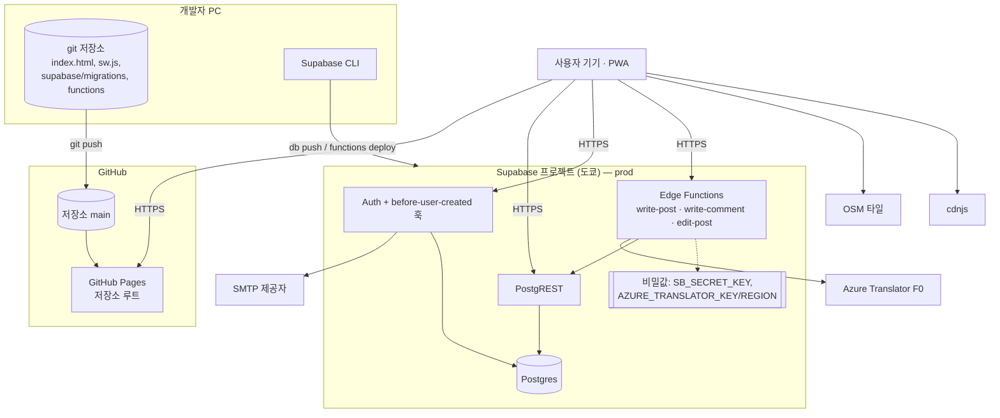

# 인프라 구성도

| | |
|---|---|
| 상태 | 제안 (v0.1) |
| 작성일 | 2026-10-11 |
| 근거 | README "Deploying", PRD §8·§10, 핸드오프 §8, 출시 계획 §2·§4, `sw.js`, `.gitignore` |
| 관련 | [tech-stack](tech-stack.md), [RFC-0001](rfc/0001-m1-backend-foundation.md), ADR [0002](../adr/0002-write-path-and-translation.md)·[0008](../adr/0008-hosting.md) |

> 현행: GitHub Pages 로 정적 파일만 배포. 백엔드·CI 없음. 아래는 **제안**이다.

## 1. 구성도

## 2. 환경

| 환경 | 구성 | 용도 | 데이터 |
|---|---|---|---|
| local | `python -m http.server`(README) + `CFG.url` 빈 값 → **fixture 모드** | 화면 개발, CLAUDE.md 하네스 | mock |
| local-db (선택) | Supabase CLI 로컬 스택 (Docker 필요) | 마이그레이션·RLS 테스트 | 테스트 계정 A/B/R (test-plan §6.10) |
| prod | Supabase 무료 프로젝트 1개(도쿄) + GitHub Pages | 서비스 | 실데이터 |

**stg 를 따로 두지 않는다.** 무료 활성 프로젝트가 2개뿐이고, 두 번째 프로젝트도 1주 비활동이면 일시정지된다(tech-stack §2.1). 대신 마이그레이션은 local-db 에서 TC-PR 케이스를 통과한 뒤 prod 에 적용한다. 파일럿(출시 계획 §2 단계 2)은 prod 에서 한 유닛 대상으로 한다. Docker 를 쓸 수 없으면 두 번째 무료 프로젝트를 stg 로 쓰고 일시정지를 감수한다(열린 질문 I-1).

## 3. 환경과 설정

마이그레이션 밖에서 대시보드로 하는 설정. 배포 전 체크리스트로 쓴다.

| # | 항목 | 값 | 근거 |
|---|---|---|---|
| 1 | 리전 | Tokyo (`ap-northeast-1`) | PRD §8, T-1 |
| 2 | API 키 | publishable 키(클라이언트 `CFG.key`), secret 키(Edge Function 비밀값). 레거시 키 비활성화 | tech-stack §2.1 |
| 3 | Data API 노출 스키마 | `public` 만 | ADR-0001 |
| 4 | 새 객체 기본 권한 | 끔 (마이그레이션이 명시적으로 GRANT) | N-1 |
| 5 | Auth | 이메일 OTP 사용, 매직 링크 끔, 비밀번호 가입 끔, OTP 길이 6 | ADR-0004 |
| 6 | Auth 훅 | `before-user-created` → `public.hook_before_user_created` | S-7 |
| 7 | SMTP | 외부 제공자, 발신 주소, 3개 언어 메일 템플릿 | T-2 |
| 8 | Rate limits | 이메일·OTP 검증 한도 확인 | tech-stack §4.3 |
| 9 | 프로젝트 멤버 | 1~2명. RA·사무실 직원은 넣지 않는다 | RFC §4.3 경계 3 |
| 10 | Edge Function 비밀값 | `SB_SECRET_KEY`, `AZURE_TRANSLATOR_KEY`, `AZURE_TRANSLATOR_REGION` | 핸드오프 §5.3 |

## 4. 배포

### 4.1 클라이언트 (현행 규칙 유지)

1. CLAUDE.md 하네스 `clean` (TC-L-02)
2. `sw.js` 의 `CACHE` 올림 (TC-A-07)
3. CSP 인라인 해시 갱신 (ADR-0008, 도입한 경우)
4. `index.html` 에 비밀값 패턴 없음 확인 — `sb_secret_`, `eyJ` (TC-PR-03)
5. `main` 에 push → Pages 반영

롤백: 이전 커밋으로 되돌리고 `CACHE` 를 한 번 더 올린다(출시 계획 §2).

### 4.2 DB·함수

1. local-db 에서 `supabase db reset` → 익명성 케이스(TC-PR-01~10, ERD §8) 통과
2. `supabase db push` (prod)
3. `supabase functions deploy <name>`
4. 적용 후 ERD §7 `0016_checks` 가 실패하지 않았는지 확인

**순서 규칙:** DB 변경을 먼저, 클라이언트를 나중에. 클라이언트가 새 RPC 를 부르기 전에 함수가 있어야 한다. 컬럼 삭제처럼 클라이언트를 깨는 변경은 클라이언트 배포 후 다음 마이그레이션에서 한다.

CI(GitHub Actions)는 M1 범위에서 두지 않는다. 테스트 러너를 두지 않는다는 결정(docs/README)과 함께 R-5 에서 정한다.

## 5. 백업·데이터 보호

| 항목 | 제안 |
|---|---|
| 자동 백업 | 무료 플랜에는 없다고 본다(3자 자료, 확인 필요) |
| 수동 백업 | 학기 시작·종료와 마이그레이션 직전에 `pg_dump` |
| 보관 | 덤프에는 `post_authors`·`reports.reporter_id` 가 포함된다 → **경계 3 자산**. 암호화(예: age/GPG)해 소유자만 접근하는 곳에 둔다. 저장소·공유 드라이브 금지 |
| 보존 기간 | 2학기분만 유지, 이전 것은 삭제(PR-12 와 맞출 것) |

## 6. 비용

[tech-stack §8](tech-stack.md#8-비용-추정-월) 참조. 월 0엔 목표, 유료 전환 조건은 Supabase 일시정지·백업 필요 시 Pro $25/월.

## 7. 모니터링 (최소)

| 지표 | 어디서 | 경보 |
|---|---|---|
| 번역 사용량 | `metric_daily.tr_chars` 월 합계 | 160만 자(80%) |
| 미처리 신고 24시간 초과 | `report_queue.first_at` | 운영자에게 (출시 계획 §3) — 알림 수단 미정(A-3) |
| Supabase 사용량 | 대시보드 | 무료 한도 70% |
| 프로젝트 일시정지 | 대시보드·메일 | 학기 중 발생 시 즉시 재개 |

## 8. 열린 질문

| # | 질문 |
|---|---|
| I-1 | local-db(Docker)를 쓸 수 있는가, 아니면 두 번째 무료 프로젝트를 stg 로 쓸 것인가 |
| I-2 | 백업 덤프를 보관할 곳과 키 관리자 |
| I-3 | 런북(장애 대응) 문서는 M3 이후 작성 — 지금은 이 문서 §4 로 대신 |
