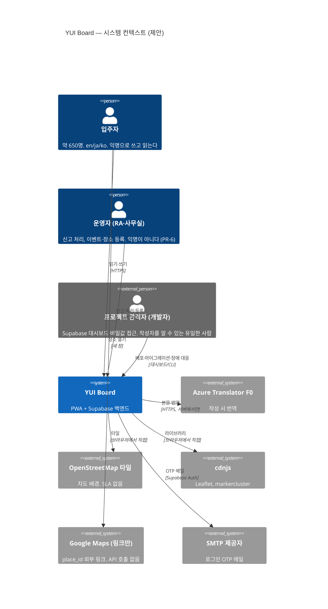
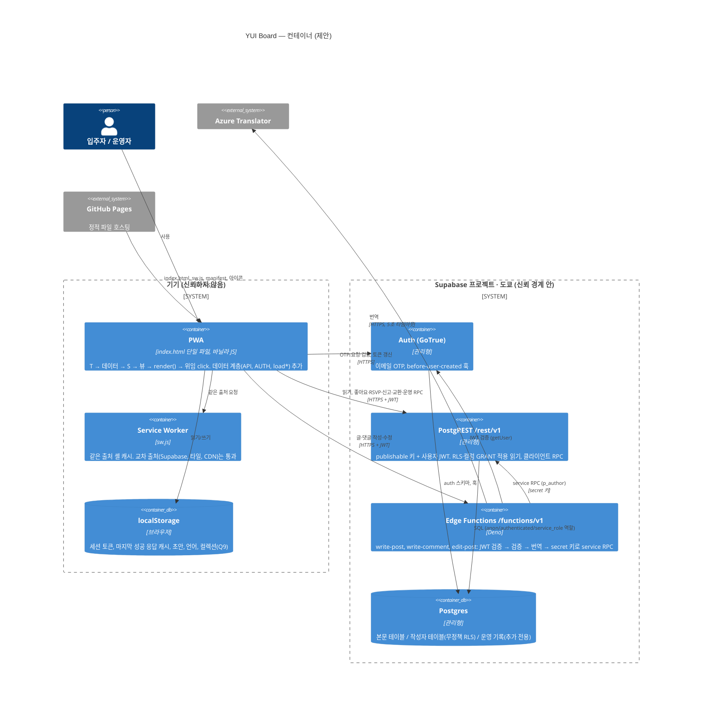
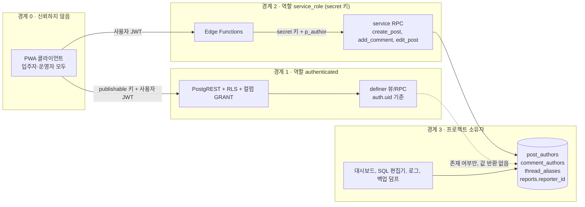
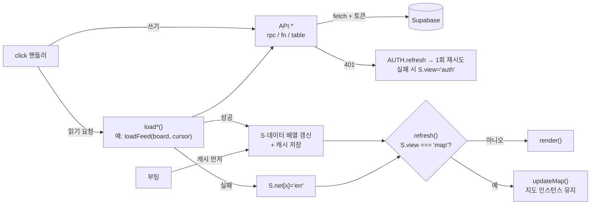
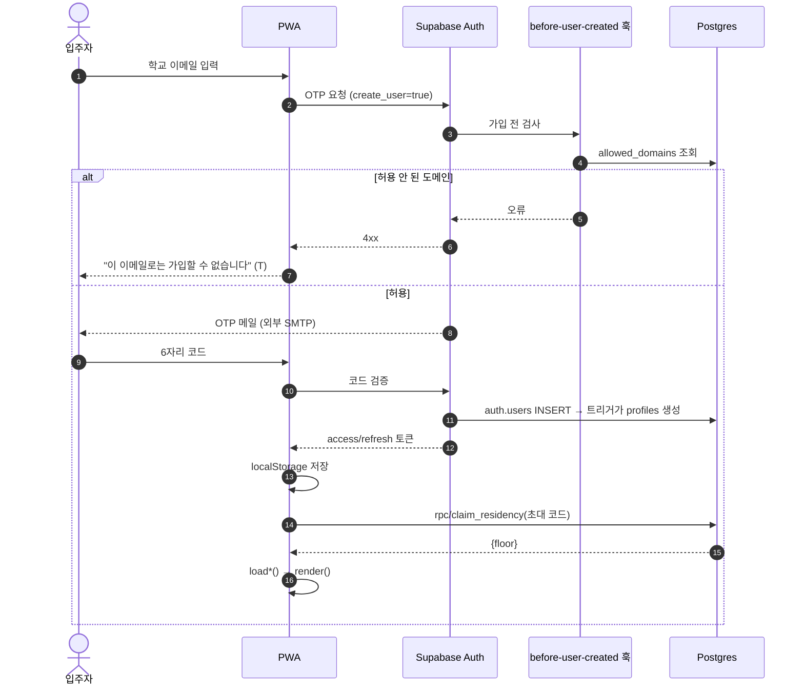
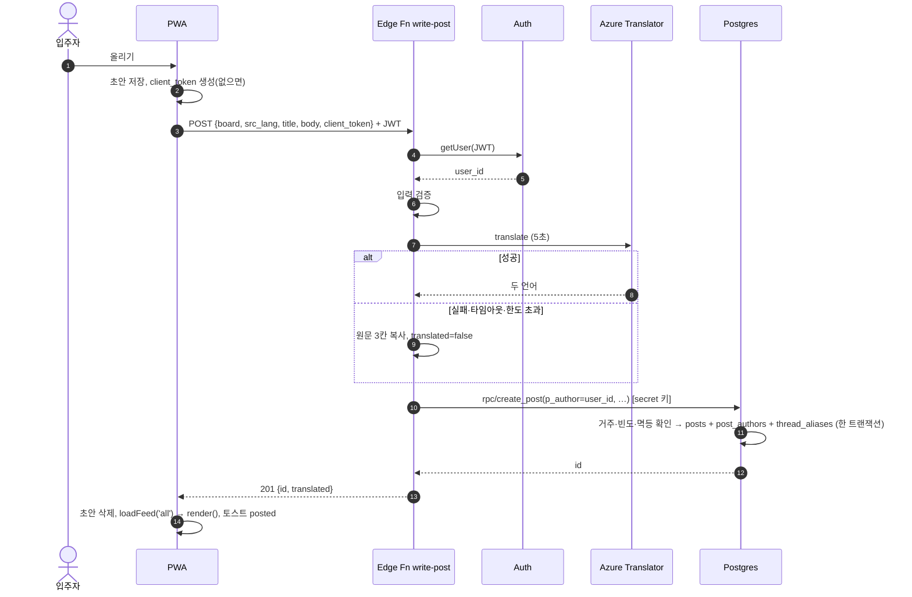
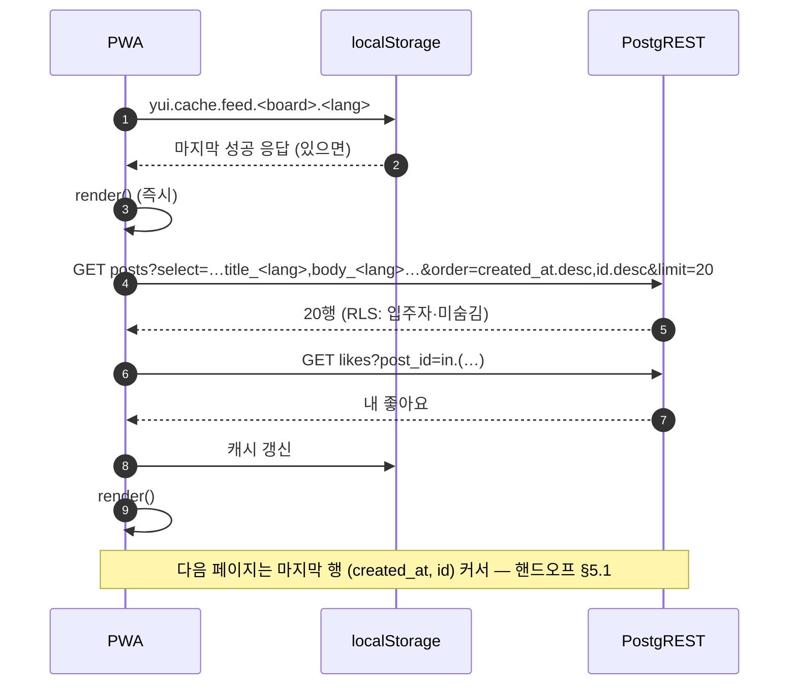
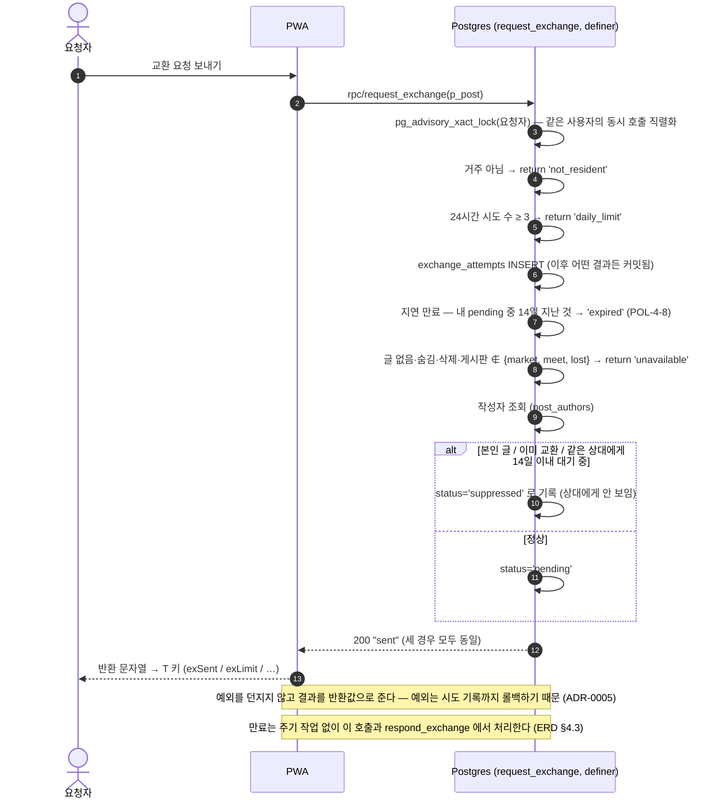
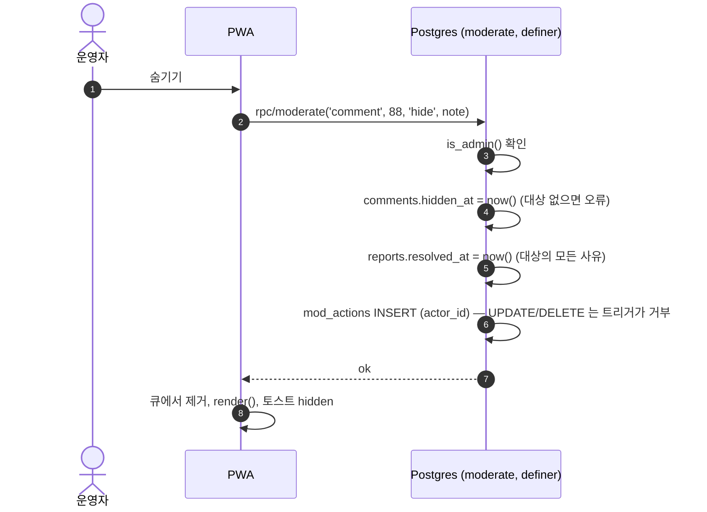

# RFC-0001 · M1 백엔드 기반 — 아키텍처, 쓰기 경로, 클라이언트 데이터 계층

| | |
|---|---|
| 상태 | 제안됨 |
| 작성일 | 2026-10-11 |
| 범위 | PRD §10 M1(백엔드 기반) ~ M3(쓰기 경로)의 구조. M4 이후는 필요한 자리만 남긴다 |
| 근거 | [PRD](../../02-requirements/PRD.md) v0.4, [기능명세](../../04-spec/functional-spec.md), [정책](../../04-spec/policy.md), [핸드오프](../../07-handoff/handoff.md) v0.1, [QA 리포트](../../08-qa/qa-report.md), [백로그](../../09-release/backlog.md), `index.html`, `sw.js`, `schema.sql`, `CLAUDE.md` |
| 같이 읽는 문서 | [기술 검토서](../tech-stack.md), [ERD·DB 설계](../erd.md), [OpenAPI](../openapi.yaml), [인프라](../infra.md), [개발 컨벤션](../conventions.md), ADR [0001](../../adr/0001-structural-anonymity.md)~[0008](../../adr/0008-hosting.md) |

---

## 0. 문서 형식 — SAD 대신 RFC

**판단: SAD 를 따로 쓰지 않고 이 RFC 하나에 아키텍처를 모은다. 결정은 ADR 로 남긴다.**

| 고려 | 내용 |
|---|---|
| 규모 | 입주자 약 650명, 개발자 소수, 운영비 0 목표(PRD §1, G6). 배포 단위는 정적 파일 하나 + 관리형 백엔드 하나 |
| 컨테이너 수 | 4개(PWA, Supabase API, Edge Function, 외부 번역) — SAD 의 논리/프로세스/배포 뷰를 따로 나눌 만큼 구조가 크지 않다 |
| 이미 있는 문서 | API 초안(핸드오프 §5), 테스트 계획(QA test-plan)이 있다. 이 RFC 는 그것을 이어받아 **설계 결정과 근거**만 더한다 |
| 예외 | ERD·DB 설계는 [erd.md](../erd.md) 로 분리했다. 스키마가 이 제품의 핵심 보안 장치(PR-1~PR-11)이고, 마이그레이션 단위로 따로 바뀌기 때문이다. 기술 검토서([tech-stack.md](../tech-stack.md))도 PRD 의 짝 문서라 분리했다 |

SAD 로 옮길 시점: 컨테이너가 늘거나(예: 알림 서버, 별도 관리 도구), 개발자가 3명을 넘어 영역별 소유가 생길 때.

---

## 1. 배경과 문제

- `index.html` 은 mock data 로 동작하는 프로토타입이고 백엔드가 없다(PRD §5).
- `schema.sql` 은 적용되지 않은 설계안이며 보안 결함 S-1~S-9(PRD §7.1)와 핸드오프 발견 사항 N-1~N-10 이 있다.
- PRD §9 의 목표 구성(읽기는 RLS 아래 직접, 쓰기는 서버가 번역 후 `service_role` 로)은 한 단락뿐이고, 다음이 정해지지 않았다.
  1. 서버가 작성 함수를 **어떤 권한으로** 부르는가 (Q4, S-5)
  2. 단일 파일·빌드 없음(CLAUDE.md) 안에서 **데이터 계층을 어디에 어떻게** 붙이는가
  3. 로그인(Q3)과 입주 확인(S-7)
  4. 오프라인 시 데이터(A-1)
  5. 신뢰 경계 — "운영자에게도 익명"(G3)이 **누구에게까지** 성립하는가

## 2. 목표 / 비목표

**목표**
- M1 완료 기준(PRD §10)을 만족하는 구조: S-1~S-6 수정, 도쿄 Supabase, 마이그레이션, §7 익명성 검증 테스트(TC-PR-01~10, TC-S-04~06) 통과.
- M2·M3 에서 화면을 다시 짜지 않고 mock → 실데이터로 바꿀 수 있는 클라이언트 데이터 계층.
- 비용 0(PRD §8).

**비목표** (PRD §3 비목표 + 이번 범위 밖)
- 실시간 갱신(Realtime 구독), 푸시 알림(A-3), 검색(A-4).
- 오프라인 쓰기 대기열.
- 네이티브 앱, 빌드 도구·프레임워크 도입(ADR-0003).

## 3. 품질 속성과 목표치

| 속성 | 목표 | 측정 | 근거 |
|---|---|---|---|
| 익명성 | 어떤 클라이언트 요청(`anon`/`authenticated`, 운영자 포함)으로도 글·댓글 작성자, 신고자, 교환 상대 uuid 를 얻을 수 없다 | TC-PR-01, 04, 07, 09 + 이 RFC §4.3 의 추가 케이스 | G3, PR-1~PR-10 |
| 무결성 | 운영 기록은 추가만 된다. 숨김은 `moderate()` 로만 | TC-PR-05, 10 | PR-6, PR-11 |
| 피드 첫 화면 | 앱 열기 → 피드 첫 20건 표시 p95 **1.5초 이하** (기숙사 Wi-Fi, 캐시 있음 시 즉시 표시 후 갱신) | 실기기 ENV-1/2, `performance.now()` 로그 | B-2, *목표치는 제안* |
| 글 작성 | 올리기 → 완료 토스트 p95 **3초 이하**. 번역 타임아웃 5초, 최악 **7초** 안에 성공(번역 없이) 또는 오류 | Edge Function 소요 시간 로그(사용자 ID 없이) | L-2, POL-6-3 |
| 가용성 | 별도 SLA 없음(무료 티어·OSM best-effort). 백엔드 장애 시에도 앱 셸·마지막 캐시 데이터·일본어 콘텐츠는 열린다 | TC-A-02 | A-1, P-5 |
| 비용 | 월 0엔 | 대시보드 사용량 | G6, [tech-stack §8](../tech-stack.md#8-비용-추정-월) |
| 번역 한도 | 월 200만 자의 80% 도달 시 경고 | 서버 집계 | 출시 계획 §3 |

---

## 4. 아키텍처

### 4.1 컨텍스트 (C4 Level 1)

### 4.2 컨테이너 (C4 Level 2)

**컨테이너별 책임과 근거**

| 컨테이너 | 책임 | 하지 않는 것 | 근거 ID |
|---|---|---|---|
| PWA | 화면, 상태 `S`, 데이터 계층, 세션 보관 | 작성자 정보를 다루지 않는다. 번역하지 않는다. 비밀 키 없음 | CLAUDE.md, PR-4, FN-HOME-03-5 |
| Service Worker | 앱 셸 캐시, 배포 갱신(`CACHE`) | API 응답 캐시(앱이 직접 함, §8), 타일 캐시 | A-1, PRD §8 캐시, OSM 정책 |
| Auth | 가입·로그인, 허용 도메인 검사 | 입주 확인(그건 `claim_residency` RPC) | Q3, S-7, ADR-0004 |
| PostgREST | 모든 읽기, 본문을 만들지 않는 쓰기(좋아요, RSVP, 신고, 교환, 운영, 본인 글 삭제) | 글·댓글 본문 작성 | PR-3, 핸드오프 §5.1·5.2 |
| Edge Functions | 본문을 만드는 쓰기: 검증 → 번역 → `p_author` 명시 호출 | 읽기 API, 작성자 정보 응답 | Q4, S-5, L-2, M-9 |
| Postgres | 불변식 강제: RLS, 컬럼 GRANT, `SECURITY DEFINER`, 추가 전용 트리거 | — | PR-1~PR-11 |

### 4.3 신뢰 경계

| 경계 | 누가 | 작성자를 알 수 있나 | 통제 |
|---|---|---|---|
| 0 → 1 | 모든 클라이언트(운영자 포함) | **아니오.** 작성자 테이블은 RLS 무정책(PR-2), 교환 요청자에게 `to_user` 없음(S-2 수정), uuid 컬럼은 컬럼 GRANT 에서 제외(N-6), definer 뷰·RPC 는 작성자 값을 반환하지 않고 오류를 균일화(PR-10) | [ERD §5](../erd.md#5-권한-grant-설계), TC-PR-01·07·09 |
| 1 → 2 | Edge Function 코드 | 요청 처리 중에는 안다(JWT 의 `sub`). 저장·로그로 남기지 않는다 | 로그 규칙(§5.4), 코드 리뷰 |
| 2 → 3 | 프로젝트 소유자(개발자) | **예.** SQL 편집기로 `post_authors` 를 읽을 수 있고, 플랫폼 로그에서 요청 시각을 `posts.created_at` 과 대조할 수도 있다 | 소유자 수 최소화(1~2명), 조회는 POL-1-4 의 사유로만 하고 기록, 개인정보처리방침에 명시 |

> **G3 의 정확한 범위.** "운영자를 포함해 **클라이언트에서는** 글쓴이를 알 수 없다"는 경계 0·1 에 대한 약속이다. 경계 3(프로젝트 소유자)에게는 성립하지 않는다. 이 사실은 PRD·정책서에 명시되어 있지 않다 → 열린 질문 R-1. 운영자(RA)에게 Supabase 대시보드 권한을 주면 G3 가 깨진다(운영 규칙으로 금지).

**추가 위협과 대응 (PRD·핸드오프에 없는 것)**

| 위협 | 대응 |
|---|---|
| 시각 대조: 클라이언트가 자기 행동 시각과 `posts.created_at`/`comments.created_at` 을 맞춰 남의 글을 추정 | 본인 행동만 알 수 있으므로 위협 아님. 단 **응답에 `post_authors.created_at` 같은 작성자 측 시각을 노출하지 않는다** |
| CDN 변조로 세션 토큰 탈취 (토큰이 `localStorage` 에 있음) | Leaflet·markercluster `<script>`/`<link>` 에 SRI `integrity` + `crossorigin`. `<meta http-equiv="Content-Security-Policy">` 로 `script-src` 를 자기 출처·cdnjs 해시로 한정(ADR-0008) |
| 저장형 XSS | 모든 데이터 문자열 `esc()`(CLAUDE.md). S-9/BUG-13 수정. `esc()` 는 작은따옴표를 바꾸지 않으므로 **속성값은 항상 큰따옴표**로 감싼다(컨벤션) |
| 백업 덤프 유출 | 덤프는 경계 3 자산. 암호화 후 소유자만 접근([infra §5](../infra.md)) |
| 교환 기능의 타이밍 차이로 동일 작성자 추정 | `request_exchange` 가 모든 대상에 대해 같은 쿼리 경로를 타게 설계(ADR-0005) |

---

## 5. 쓰기 경로 — 작성 시 번역

결정 기록: [ADR-0002](../../adr/0002-write-path-and-translation.md). 엔드포인트 형식: [openapi.yaml](../openapi.yaml). 핸드오프 §5.3 을 이어받는다.

### 5.1 쓰기 분류

| 종류 | 경로 | 이유 | 요구사항 |
|---|---|---|---|
| 글 작성·수정, 댓글 작성 (본문 생성) | **PWA → Edge Function → service RPC** | 번역(L-2), 언어별 내용 일치(S-5), 서버측 길이·빈도 제한(M-9) | B-3, B-6, M-7, L-2 |
| 본인 글·댓글 삭제 | PWA → 클라이언트 RPC `delete_own_post/comment` (`auth.uid()`) | 번역 불필요. 함수 안에서 작성자 테이블과 대조, 결과는 "삭제됨/대상 없음" 두 가지뿐 | M-7, POL-5-4 |
| 좋아요, RSVP | PWA → PostgREST 테이블 / `toggle_rsvp` RPC | 본인 행. RSVP 는 정원 검사 때문에 RPC(Q6) | B-5, C-5, C-8 |
| 신고 | `submit_report` RPC 하나로 통일, 중복 여부 반환 | N-5 | M-1, M-2 |
| 교환 요청·응답·해제 | RPC (`request_exchange`, `respond_exchange`, `unlink_exchange`) | S-2, N-6 | X-1~X-6 |
| 운영 조치 | `moderate` RPC 만 | S-3 | M-4~M-6 |
| 입주 등록 | `claim_residency(code)` RPC | S-7 | ADR-0004 |
| 언어 설정 | `PATCH profiles` (컬럼 GRANT: `display_name, instagram, lang` 만) | S-1 | L-3 |

### 5.2 Edge Function 처리 순서 (`write-post`)

1. **인증.** `Authorization: Bearer <access token>` 을 `auth.getUser(token)` 으로 검증 → `user_id`. 실패 시 401. (새 API 키는 JWT 가 아니므로 함수의 플랫폼 JWT 검사에 기대지 않고 코드에서 검증한다 — [tech-stack §2.1](../tech-stack.md#21-확인한-사실-2026-10-11))
2. **입력 검증.** `board` ∈ enum, `src_lang` ∈ {en, ja, ko}, 제목 1~60자, 본문 1~N자(N 은 열린 질문 R-3), `client_token` UUID. 실패 시 422.
3. **번역.** 어댑터 `translate([title, body], src, targets)` — Azure v3, 타임아웃 5초. 대상은 원문 외 두 언어.
4. **실패 처리.** 비-2xx·타임아웃·네트워크 오류는 하나의 경로: 원문을 세 칸에 복사, `translated=false`. 작성을 막지 않는다(POL-6-3, 6-4). Azure 문서상 무료 한도 소진은 오류 코드 **429001**, 그 밖에 **시간당 문자 수 제한(약 200만 자/시간)** 에 따른 429 계열 응답이 있다([Translator service limits](https://learn.microsoft.com/azure/ai-services/translator/service-limits), 리뷰어 확인 2026-10-11). 둘 다 같은 실패 경로로 처리하고, 응답 본문의 오류 코드만 로그(사용자 ID 없이)에 남겨 "월 한도 소진(429001)"과 "일시 제한"을 구별한다. 429001 이면 그달 남은 기간 번역 호출을 건너뛰도록 `metric_daily` 에 `tr_quota_out` 표시 행을 남기는 방식을 제안한다(*제안*, 지표 허용 목록에 추가 필요).
4a. **길이 초과 처리.** 번역본이 DB 칸 상한(제목 200, 본문 `3 × B` — [ERD §4.2](../erd.md#42-글댓글))을 넘으면 같은 경로로 원문 저장 + `translated=false`. DB CHECK 위반으로 글 작성이 실패하지 않게 한다.
5. **DB 호출.** secret 키로 `rpc/create_post(p_author := user_id, p_client_token, p_board, p_src, p_title_*, p_body_*, p_translated)`. 거주 확인·빈도 제한·멱등성은 **DB 함수 안에서** 한다(서버 코드가 우회되어도 유지되도록).
6. **응답.** `201 {id, translated}`. 같은 `client_token` 재요청은 같은 `id` 를 돌려준다(재시도 안전).

`write-comment` 는 3~5단계가 같고, DB 함수가 숨김 글·부모 소속·깊이(S-6)를 검사하고 `{id, alias_no, is_op}` 를 반환한다(핸드오프 §5.3 "add_comment 는 id 만 반환" 해결). `edit-post` 는 원문 언어를 유지하고 다시 번역한다.

### 5.3 Q4 제안의 구체화

| 항목 | 현행 `schema.sql` | 제안 |
|---|---|---|
| 작성자 식별 | `auth.uid()` (service 호출 시 null) | 인자 `p_author uuid` |
| 거주 확인 | `is_resident()` (`auth.uid()` 기준) | `is_resident_id(p_author)` |
| EXECUTE 권한 | `public` 회수, `authenticated` 부여 | `public, anon, authenticated` 회수, `service_role` 만 부여 (N-1) |
| 빈도 제한 (M-9) | 없음 | `post_authors.created_at` / `comment_authors.created_at` 으로 최근 N분 작성 수를 센다. **별도 로그 테이블을 만들지 않는다** — 작성자와 시각을 묶은 새 테이블은 새 유출 경로다 |
| 멱등성 | 없음 | `post_authors.client_token uuid unique` — 작성자 테이블에 두어 클라이언트에 보이지 않게 |

### 5.4 로그 규칙

- Edge Function 은 `user_id` 와 글 `id` 를 **같은 로그 줄에도, 서로 다른 줄에도** 남기지 않는다. 남기는 것: 소요 시간, 번역 성공 여부, 번역 글자 수, 오류 코드.
- 번역 사용량 집계(출시 계획 §3 "번역 사용량")는 `metric_daily` 카운터에 글자 수만 더한다(ADR-0007).
- 플랫폼(Supabase) 요청 로그는 통제할 수 없다 → 경계 3 으로 분류(§4.3).

---

## 6. 단일 파일 클라이언트에 데이터 계층 붙이기

결정 기록: [ADR-0003](../../adr/0003-keep-single-file-client.md). 핸드오프 §1.2 "실데이터 연결 시 추가 규칙(제안)"을 구체화한다.

### 6.1 스크립트 안의 위치

CLAUDE.md 의 순서를 유지하고 두 블록을 끼워 넣는다.

| 순서 | 블록 | 변경 |
|---|---|---|
| 1 | `T` | 오류·로딩·오프라인·로그인 문자열 추가(3개 언어) — BL-53, BL-30 |
| 2 | 데이터 `POSTS`, `EVENTS`, `PLACES` … | **이름 유지, `let` 으로.** 내용은 fixture. 실서비스에서는 서버 응답으로 교체. CLAUDE.md 헤드리스 하네스가 `POSTS[0].id`, `EVENTS[0].id`, `"p13"`, `"l1"` 을 쓰므로 fixture 를 지우지 않는다 |
| 2a | **`CFG`** (신규) | `{url:"", key:""}` — Supabase URL 과 publishable 키. 둘 다 공개값. **빈 값이면 fixture 모드**(로컬 열기·하네스) |
| 2b | **`API`, `AUTH`, `load*()`** (신규) | `fetch` 래퍼, 세션, 화면별 로더. 뷰 함수보다 앞, 순수 함수 정의만(부수 효과 없음) |
| 3 | `S` | `S.me`(본인 정보), `S.net`(`{feed:'idle'|'loading'|'ok'|'err', …}`), `S.cursor`, `S.offline` 추가 |
| 4 | 뷰 함수 | **동기 유지.** `S` 와 데이터 배열만 읽는다. `S.net[x]` 로 로딩·오류·빈 상태를 그린다 |
| 5 | `render()` | 변경 없음 (지도 처리 BUG-01 수정은 별개) |
| 6 | 위임 `click` 핸들러 | 쓰기 동작은 `API.*` 호출 → 결과로 `S` 갱신 → `render()` |
| 7 | **부팅** (`/* Manifest shortcuts` 아래) | 세션 복원, 첫 로드, 서비스 워커 등록. **모든 부수 효과는 이 표시 아래에 둔다** — CLAUDE.md 하네스가 이 주석부터 끝까지 잘라내고 실행하기 때문이다 |

### 6.2 데이터 흐름

규칙
- 뷰 함수 안에서 `fetch` 하지 않는다. 로더가 끝나면 `render()` 를 한 번 부른다.
- 로더는 같은 키의 진행 중 요청을 중복 시작하지 않는다(`S.net[x]==='loading'` 이면 무시).
- **지도 화면 규칙.** 로더가 끝났을 때 `S.view === "map"` 이면 `render()` 가 아니라 `updateMap()` 을 부른다. `render()` 는 `#main` 을 통째로 바꿔 Leaflet 이 붙은 `#lmap` 을 떼어 내는데, `LMAP` 이 null 이 아니면 `initMap()` 이 다시 불리지 않아 지도가 빈 칸이 된다(`index.html:1781`, `:1788-1789` — BUG-01 과 같은 원인). 비동기 로더는 사용자가 이미 다른 화면으로 옮긴 뒤에 끝날 수 있으므로, 완료 시점의 `S.view` 로 판단한다. 장소 외 데이터(본인 정보, 받은 요청 점 등)도 지도 화면에서는 `#main` 을 다시 쓰지 않고 헤더·`updateMap()` 만 갱신한다. 공통 함수 `refresh()` = `S.view==="map" ? updateMap() : render()` 를 두고 로더는 이것만 부른다.
- 서버에서 온 문자열은 fixture 와 마찬가지로 뷰에서 `esc()` 한다. 서버 데이터라고 안전하지 않다.
- 응답 → 프로토타입 모양 변환(`created_at` → `min`, `title_*` → `t.{…}` 등)은 로더 안의 `toPost()` 같은 매핑 함수 한 곳에서 한다. 매핑 표는 핸드오프 §6.

### 6.3 SDK 를 쓰지 않는 이유

| 선택 | 장점 | 단점 |
|---|---|---|
| **`fetch` 래퍼 (선정)** | 새 의존성·CDN 신뢰 경계 없음. 하네스(`new Function` 실행)에서 전역 SDK 없이도 정의가 평가된다. 필요한 기능은 REST 몇 개(OTP 요청·검증, 토큰 갱신, PostgREST, 함수 호출) | 토큰 갱신·만료 처리를 직접 쓴다(약 50줄 *추정*). Auth REST 경로·응답 형식은 구현 시 공식 문서로 확인 |
| Supabase JS (UMD, CDN) | 세션 관리 내장 | 고정 버전 + SRI 필요, 크기 증가, 하네스에 스텁 필요, 세션 저장 방식이 SDK 내부에 숨는다 |

---

## 7. 인증·입주 확인

결정 기록: [ADR-0004](../../adr/0004-login-method.md) (Q3).

- **신원:** 이메일 OTP 6자리 코드. 가입은 `before-user-created` 훅이 `allowed_domains` 로 거른다(S-7). 신규 `auth.users` 행이 생기면 트리거가 `profiles` 행을 만든다.
- **입주:** 방마다 사무실이 발급한 1회용 초대 코드를 `claim_residency(code)` 로 입력 → `residency` 행 생성. `is_resident()` 가 참이 되어야 읽기·쓰기가 열린다(POL-9-1).
- **퇴거·방 이동:** 사무실이 `residency.active=false, ended_on` 처리. uuid 는 사람에게 남는다 → 작성 이력·교환이 다음 입주자에게 넘어가지 않는다([tech-stack §4.2](../tech-stack.md#42-방-계정roomyuilocal-이름-바꾸기-방식의-결함--신규-발견)).
- **세션 저장:** `localStorage`(설치형 PWA 재실행 후에도 유지). 로그아웃 시 세션·데이터 캐시·초안을 모두 지운다.

---

## 8. 오프라인·캐시

| 대상 | 저장 위치 | 전략 | 근거 |
|---|---|---|---|
| 앱 셸 (`index.html`, manifest, 아이콘) | SW `CACHE` | 문서 network-first, 정적 cache-first (현행 유지). 배포마다 `CACHE` 올림 | A-1, CLAUDE.md |
| Leaflet·markercluster | (현행) 캐시 안 됨 | **선택지:** 같은 버전 파일을 저장소에 두고(빌드 아님, 정적 자산) SW 셸에 포함 → 오프라인에서도 지도 UI·목록이 뜬다(타일은 없음). 열린 질문 R-4 | A-1 한계, TC-A-03 |
| OSM 타일 | 캐시 안 함 | 정책상 사전 다운로드 금지 | [tech-stack §5](../tech-stack.md#5-지도) |
| 피드 첫 페이지(게시판별), 이번 달 이벤트, 장소, 본인 정보 | `localStorage` 키 `yui.cache.<kind>.<lang>` | **stale-while-revalidate**: 부팅·탭 진입 시 캐시로 즉시 그리고, 응답이 오면 교체. 캐시에는 작성자 정보가 원래 없다 | B-2, A-1, FN-SYS-08 |
| 글 상세·댓글 | 메모리(`S`)만 | 오프라인에서는 "오프라인" 상태 표시 | — |
| 작성 초안 | `localStorage` `yui.draft.compose` | 입력마다 저장, 성공 시 삭제. 실패·오프라인이면 남는다 | FN-HOME-03-4·6, BUG-03 |
| 쓰기 | 대기열 없음 | 오프라인이면 버튼 비활성 + 문구. 재시도는 사용자가 한다(`client_token` 으로 중복 방지) | 비목표 |
| 컬렉션 진행 | `localStorage` `yui.cg` | Q9 제안: 기기 저장 | J-7, Q9 |

`localStorage` 접근은 모두 `try/catch` 로 감싼다(사파리 사설 모드 등에서 예외). 캐시 크기 상한: 종류별 1개 키, 피드는 첫 페이지 20건만.

`sw.js` 변경은 없다. 단 `index.html` 이 바뀔 때마다 `CACHE` 를 올리는 규칙(CLAUDE.md)은 그대로 적용된다.

---

## 9. 주요 시퀀스

### 9.1 첫 로그인과 입주 등록 (AUTH-01, 신규 화면)

### 9.2 글 작성 (HOME-03, 번역 실패 경로 포함)

### 9.3 피드 읽기 (HOME-01, keyset)

### 9.4 교환 요청 (HOME-07, S-2 수정 후)

### 9.5 운영자 숨김 (HOME-05)

---

## 10. API

설계 수준 명세는 [openapi.yaml](../openapi.yaml) 과 [ERD §6 함수 목록](../erd.md#6-함수rpc). 핸드오프 §5 와의 차이만 적는다.

| 핸드오프 §5 | 이 RFC |
|---|---|
| `POST /api/posts`, `/api/posts/:id/comments` | 경로를 Supabase 형식으로: `POST /functions/v1/write-post`, `/functions/v1/write-comment`, `/functions/v1/edit-post`. 요청에 `client_token` 추가 |
| `request_exchange` 오류 4종 + 23505 | **예외 없음.** HTTP 200 + 반환 문자열 `sent` / `daily_limit` / `unavailable` / `not_resident` (ADR-0005) |
| `respond_exchange` → `void`, 오류 `no such request` | HTTP 200 + 반환값 `ok` / `not_found` / `not_resident`. 14일(POL-4-8) 지난 요청은 `expired` 로 바꾸고 `not_found` — 만료는 주기 작업 없는 지연 만료 (ERD §4.3, ADR-0005) |
| `POST /api/posts/:id/comments` 의 `404 post_not_found` | `404 {"error":"not_found"}` — Edge Function 오류 코드를 `unauthorized, not_resident, invalid, not_found, rate_limited, server_error` 로 통일. 숨김·삭제·없는 글을 구별하지 않는다 |
| `create_post`/`add_comment` 의 `authenticated` EXECUTE | `service_role` 만 (Q4, N-1). 헬퍼 `is_admin`/`is_resident` 는 RLS 평가에 필요해 `authenticated` EXECUTE 유지 |
| `exchange_requests` 직접 SELECT 로 "보낸 요청 여부" | 뷰 `my_sent_requests(post_id, created_at)` |
| `DELETE /rest/v1/exchanges?a=…&b=…` (상대 uuid 필요) | `rpc/unlink_exchange(p_contact_id)` (N-6) |
| `reports` 직접 INSERT 와 RPC 공존 | RPC 만, `{already: boolean}` 반환 (N-5) |
| `event_rsvps` 직접 INSERT/DELETE | `rpc/toggle_rsvp(p_event, p_occurs_on)` → `{going, n, full}`, 이벤트 행 잠금으로 정원 초과 방지 (Q6). **PRD PR-3 과 다름** (아래) |
| `reports` 직접 INSERT 허용 (PRD PR-3) | `submit_report` RPC 만. **PRD PR-3 과 다름** (아래) |

> **기획 변경 요청 (PR-3).** PRD PR-3 은 "좋아요·신고·RSVP 는 본인 행 직접 INSERT 허용"이다. 이 설계는 신고(N-5)와 RSVP(Q6)를 RPC 전용으로 바꾼다. 익명성 보장은 그대로이고 쓰기 경로가 좁아질 뿐이지만, PRD 문구 개정이 필요하다 → 열린 질문 R-7. 이 RFC 는 PRD 를 고치지 않았다.
| `GET events?select=*` (핸드오프 §5.1 CAL-02) | `select=*` 금지 — 컬럼 GRANT 로 `created_by` 를 막으면 `*` 는 권한 오류가 난다. 컬럼을 나열한다 |
| `GET profiles?select=…is_admin` | 유지. `is_admin` 은 읽기만 가능 |

---

## 11. 고려한 대안

| 대안 | 기각 이유 |
|---|---|
| 클라이언트가 사용자 JWT 로 `create_post` 직접 호출, 번역은 읽을 때 | S-5 를 막지 못한다. POL-6-1(작성 시 번역) 위반, 읽기마다 번역 비용 |
| Edge Function 이 사용자 JWT 를 그대로 DB 에 전달 | DB 가 서버와 클라이언트를 구별 못 함 → S-5 그대로 (PRD Q4) |
| Postgres 트리거 + `pg_net` 으로 비동기 번역 | 글이 번역 전 상태로 먼저 보이고, 번역 키가 DB 에 저장됨 |
| 빌드 도구·프레임워크 도입 후 SDK 사용 | CLAUDE.md 제약. ADR-0003 |
| 모든 쓰기를 Edge Function 으로 | 좋아요·RSVP 마다 함수 호출 — 지연·호출 수 증가. 본문이 없는 쓰기는 RLS·RPC 로 충분 |

## 12. 영향 범위·이행 순서

| 마일스톤 | 작업 | 산출물 | 완료 판정 |
|---|---|---|---|
| M1 | 마이그레이션 0001~0016 ([ERD §7](../erd.md#7-마이그레이션-파일-순서)), Supabase 도쿄 프로젝트(새 API 키), 익명성 SQL 테스트 | `supabase/migrations/*`, `supabase/tests/*` (제안 경로) | TC-PR-01~10, TC-S-04~06 Pass, N-1 기본 권한 점검 쿼리 0행 |
| M2 | `CFG`/`API`/`AUTH`/로더, AUTH-01·ME-01, 읽기 연결, fixture 유지 | `index.html` | CLAUDE.md 하네스 clean(fixture 모드), TC-L-06, 실데이터 읽기 |
| M3 | Edge Functions 3종, 번역 어댑터, 쓰기 연결 | `supabase/functions/*` | TC-L-05, TC-M-11, TC-S-05 |
| M4 | 운영 도구(숨김 목록·복원, 이벤트·장소·회차 예외 쓰기) | | TC-M-05·06·08 |

**저장소 구조 영향:** `supabase/` 디렉터리가 생긴다(마이그레이션·함수·테스트). 클라이언트는 여전히 `index.html` 하나다. 이 디렉터리를 둘지, 테스트 도구(pgTAP 등)를 도입할지는 "테스트 러너를 두지 않는다"(docs/README) 와 충돌하므로 결정이 필요하다 → R-5.

## 13. 리스크

| 리스크 | 가능성 | 영향 | 대응 |
|---|---|---|---|
| 레거시 키 폐기(2026년 말)와 문서 용어 불일치 | 높음 | 중 | 처음부터 새 키 사용. 문서의 "service_role 키"는 역할로 읽는다 |
| 무료 프로젝트 일시정지(방학) | 중 | 중 | 학기 중에는 사용으로 유지. 방학 일시정지는 허용하고 재개 절차를 런북에(T-5) |
| Supabase 기본 권한 변경 | 중 | 높음 | 마이그레이션 마지막에 명시적 REVOKE/GRANT + 점검 쿼리 |
| 번역 품질로 오해 발생 | 중 | 중 | 원문 보기 항상 제공(POL-6-2), 댓글에도(BL-38) |
| 단일 파일 비대화 | 중 | 낮음 | 4,000줄 또는 데이터 계층 500줄 초과 시 ADR-0003 재검토 |
| 프로젝트 소유자에 의한 익명성 침해 | 낮음 | 치명 | 소유자 최소화, 조회 기록(POL-1-4), 방침 공개(R-1) |

---

## 14. 추적표

| 설계 항목 | 근거 ID |
|---|---|
| Edge Function 쓰기 경로, `p_author` | Q4, S-5, L-2, POL-6-1~6-4, B-3, B-6, M-7, M-9, BL-04, BL-12, BL-27, TC-S-05, TC-L-05, TC-M-11 |
| 신뢰 경계·컬럼 GRANT | G3, PR-1~PR-10, N-1, N-6, S-1, BL-01, BL-46, BL-48, TC-PR-01·07·08 |
| 데이터 계층 | CLAUDE.md, 핸드오프 §1.2·§6, FN-HOME-01-1, BL-30, BL-53 |
| 오프라인·캐시 | A-1, FN-SYS-08, TC-A-02·03, PRD §8 캐시 |
| 인증·입주 | Q3, S-7, POL-9-1~9-3, IA-5, AUTH-01, BL-07, BL-08, BL-26, TC-S-07 |
| 교환 시퀀스 | S-2, Q7, X-1~X-6, POL-4-1~4-8, PR-10, BL-02, TC-PR-09, TC-X-08 |
| 운영 시퀀스 | S-3, M-4~M-6, PR-6, PR-11, POL-3-4·3-5, BUG-02, BL-03, BL-14, BL-15, TC-PR-05·10 |
| CSP·SRI | §8 보안, S-9, BUG-13, TC-SEC-01~03 |

## 15. 열린 질문

| # | 질문 | 누가 | 언제 |
|---|---|---|---|
| R-1 | G3 의 범위를 "클라이언트(운영자 포함)에게 익명, 프로젝트 소유자 1~2명은 기술적으로 열람 가능"으로 PRD·개인정보처리방침에 명시할 것인가 | 기획·사무실 | M1 |
| R-2 | 학교 이메일 도메인 목록과, 교환학생이 학교 이메일을 입주 전에 받는지 (ADR-0004) | 사무실 | M2 전 |
| R-3 | 본문 길이 상한: 기능명세 FN-HOME-03-2 는 2000자, 핸드오프 §5.3 은 4000자 — 어느 쪽인가 | 기획 | M3 전 |
| R-4 | Leaflet 을 저장소에 두어(same-origin) 오프라인 셸에 포함할 것인가, cdnjs + SRI 로 둘 것인가 | 개발 | M2 |
| R-5 | `supabase/` 디렉터리와 SQL 테스트 도구(pgTAP) 도입 — "테스트 러너 없음" 원칙의 예외로 둘 것인가 | 개발 | M1 시작 |
| R-6 | 피드 응답을 `localStorage` 에 캐시하는 것을 허용할 것인가 (공용 기기에서 로그아웃 안 하면 남는다) | 기획 | M2 |
| R-7 | **기획 변경 요청:** PRD PR-3 을 "좋아요만 직접 INSERT, 신고·RSVP 는 RPC 전용"으로 개정할 것인가 (§10, ERD E-Q7) | 기획 | M1 |
