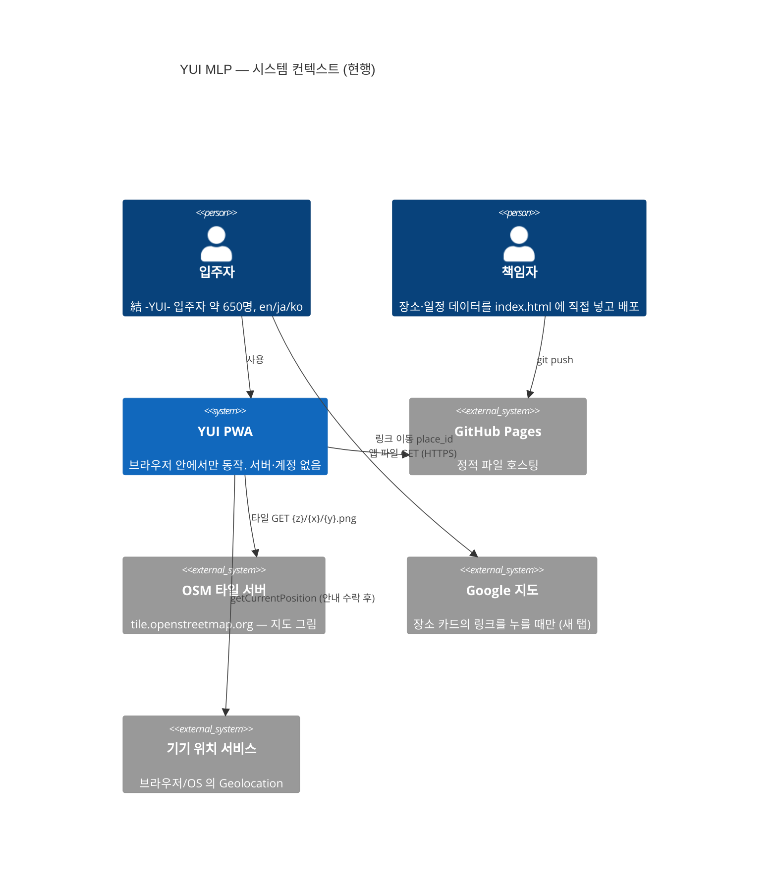
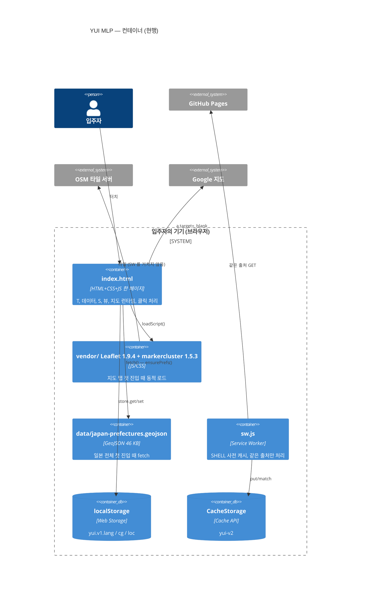
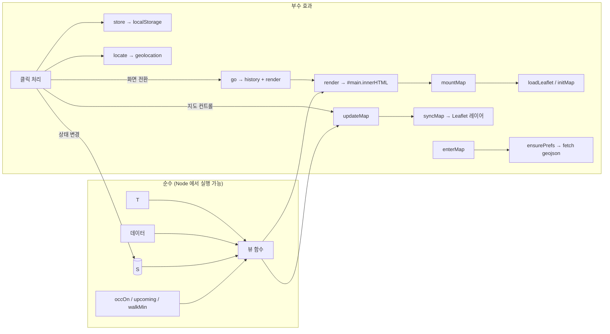
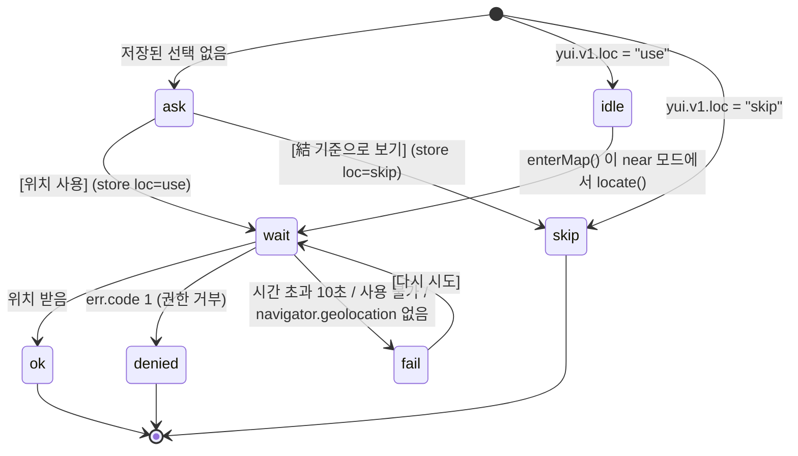
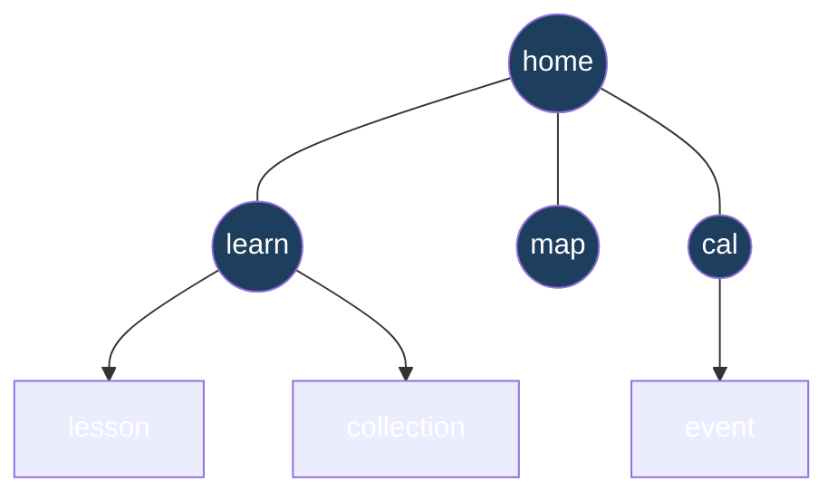
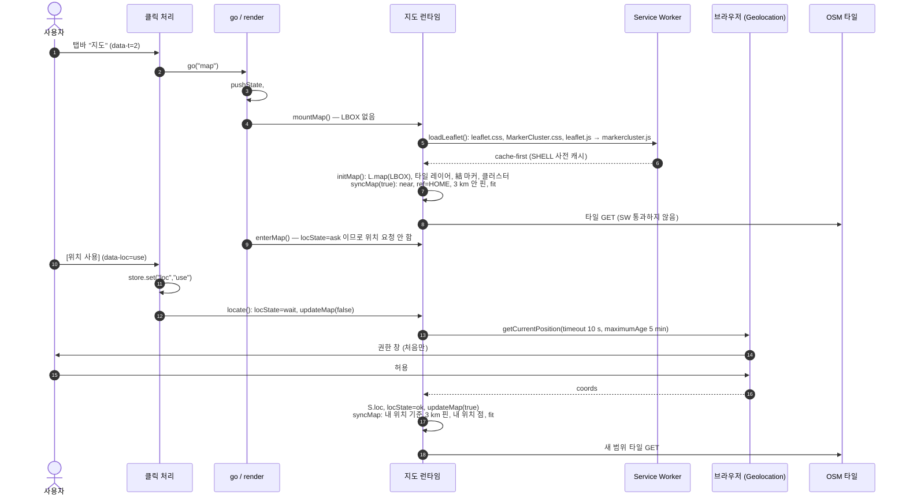
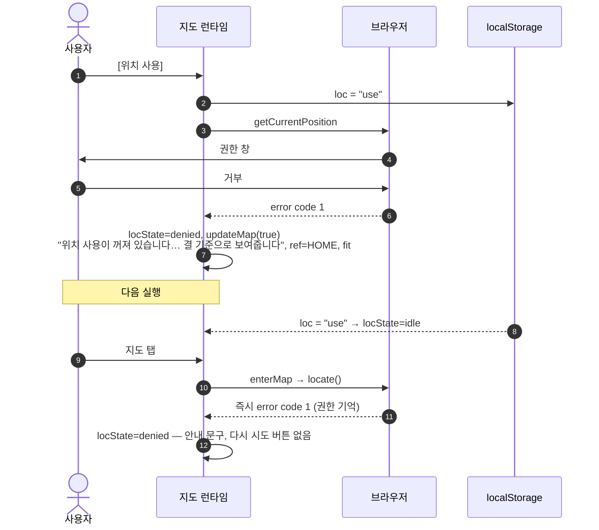
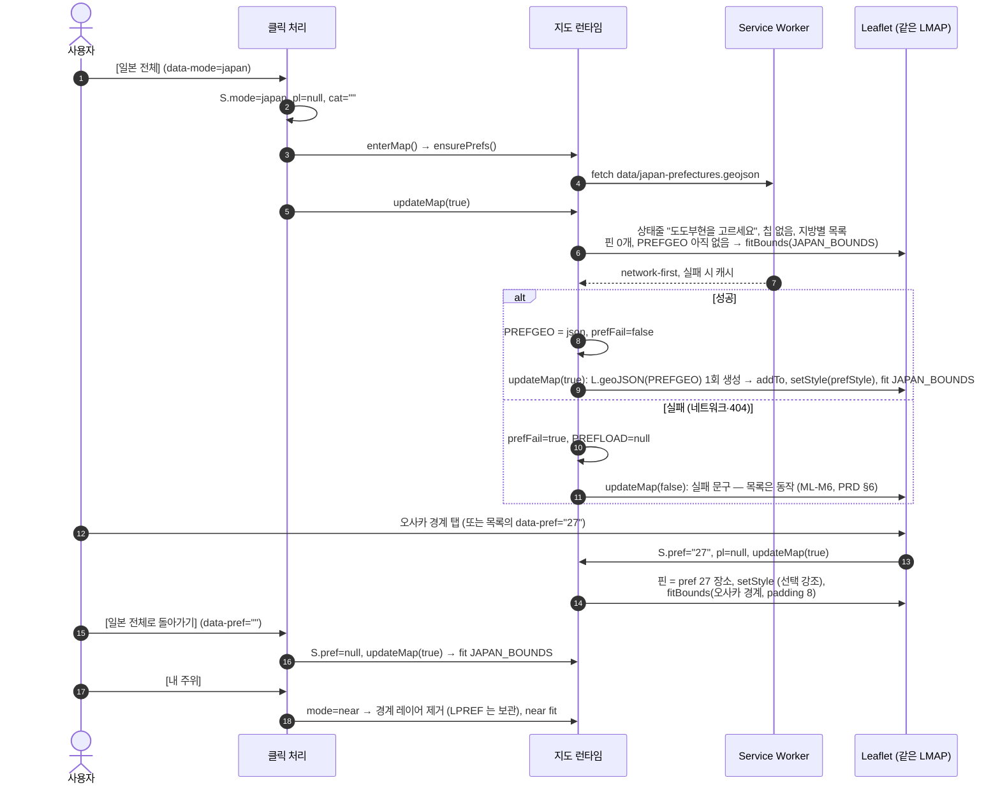

# RFC-0002 · MLP — 서버 없는 클라이언트 단독 구조 (현행 기록)

| | |
|---|---|
| 상태 | 제안됨 |
| 작성일 | 2026-10-12 |
| 범위 | [PRD-MLP](../../02-requirements/PRD-MLP.md) v1.2 의 구현(커밋 `c7de4d7` "Vendor Leaflet…", `1010992` "Build the MLP…") 과 그 뒤 책임자 결정 |
| 근거 | PRD-MLP v1.2 (ML-H\*, ML-J\*, ML-M\*, ML-K\*, ML-C\*, ML-P\*, Q-M4~Q-M13), `index.html`, `sw.js`, `manifest.webmanifest`, `vendor/`, `data/japan-prefectures.geojson`, `README.md`, `CLAUDE.md`, [QA 리포트](../../08-qa/qa-report.md) (BUG-01) |
| 대체 관계 | [RFC-0001](0001-m1-backend-foundation.md)(백엔드 기반)을 **보류**한다. 지우지 않는다 — [ADR-0009](../../adr/0009-client-only-mlp.md) |
| 같이 읽는 문서 | ADR [0009](../../adr/0009-client-only-mlp.md) ~ [0014](../../adr/0014-map-container-survives-render.md) |

**문서 형식: SAD 대신 RFC 하나 + ADR.** 컨테이너가 브라우저 하나뿐이고(서버 없음), 개발자 소수, 운영비 0 이다. RFC-0001 §0 의 판단을 그대로 잇는다. ERD·OpenAPI·인프라 문서는 **만들지 않는다** — DB 도 API 도 없다. 데이터 형식은 §9, 배포는 §8 에 둔다.

**읽는 법:** 이 문서는 대부분 **현행**(지금 코드가 하는 것)이다. 줄 번호는 `index.html` 기준(1,739줄). **제안**·**이탈**은 따로 표시했다. 코드는 바꾸지 않았다.

---

## 0. 책임자 결정 (PRD v1.2 이후, PRD 보다 우선)

| # | 결정 | PRD 에 미치는 영향 | 기록 |
|---|---|---|---|
| OD-1 | 단일 파일 원칙 폐기 (Q-M13: 허용) | §8 "구조" 의 예외가 원칙이 됨 | [ADR-0013](../../adr/0013-drop-single-file-vendor-leaflet.md), ADR-0003 대체 |
| OD-2 | Leaflet 을 `vendor/` 에 둔다 (Q-M10) | ML-P4 의 CDN 요청 없음, ML-M13 오프라인 해결 | ADR-0013 |
| OD-3 | 경계 데이터 = Natural Earth admin-1, 퍼블릭 도메인, mapshaper 로 46 KB (Q-M12) | §8 "경계 데이터" 목표(150 KB 이하) 충족 | [ADR-0012](../../adr/0012-prefecture-boundary-map.md) |
| OD-4 | 캘린더 참가 버튼 없음 (Q-M9: 제거) | **ML-K8 제거** | §7 |
| OD-5 | 앱 이름 미정, "YUI" 는 자리표시 (Q-M5 열림) | `T.*.appName`, `<title>`, manifest | §15 |
| OD-6 | 제안 채택: 탭바 홈+3 (Q-M7), 언어 기억 (ML-C2), 뒤로 가기 수정 (ML-H4) | ML-H3, ML-C2, ML-H4 확정 | §5, §6 |
| OD-7 | OSM/Overpass 검색 없음, 장소는 직접 넣은 것만 | D6 재확인 | [ADR-0011](../../adr/0011-curated-static-data.md) |

---

## 1. 배경과 문제

PRD v0.4(게시판) 는 첫 출시에 로그인·익명 백엔드·번역 서버가 필요했다. MLP 는 서버 없이 세 기능(일본어 만화+분기 게임, 지도, 캘린더)만 낸다 (PRD-MLP §1, D1~D7). 서버가 없으므로 다음을 클라이언트 안에서 풀어야 했다.

1. 기억해야 하는 것(컬렉션·언어·위치 선택)을 어디에 두나 → §6, ADR-0010
2. 지도를 한 번만 만들고 화면 전환에도 유지 (BUG-01) → §7, ADR-0014
3. 일본 전체 지도에 실제 도도부현 경계 → §7.5, ADR-0012
4. 위치 사용 전 동의 → §4.2
5. 일정의 반복과 내 캘린더 내보내기 → §8
6. 오프라인 → §9

## 2. 목표 / 비목표

**목표** — PRD-MLP G1~G6. 서버·DB·계정 없음, 운영비 0, 3개 언어, 오프라인에서 홈·일본어·캘린더·장소 목록.

**비목표** — PRD-MLP §3 비목표 그대로. 추가로: 기기 간 동기화, 데이터 내보내기, 런타임 장소 검색, 빌드 단계.

## 3. 품질 속성과 목표치

| 속성 | 목표 | 현행 측정 방법 | 근거 |
|---|---|---|---|
| 첫 화면 | 홈은 지도 라이브러리 없이 뜬다 | `<head>` 에 Leaflet 없음(현행 확인). 지도 탭 첫 진입 때 `loadLeaflet()` | PRD §8 "첫 화면" |
| 지도 유지 | 언어 메뉴·언어 변경·탭 왕복 후에도 같은 지도 인스턴스, 줌·중심 유지 | Playwright (§11.2) | ML-M11 |
| 오프라인 | 두 번째 방문부터 네트워크 없이 홈·일본어·캘린더·장소 목록·경계 지도 동작. 지도 그림(타일)은 제외 | Playwright 오프라인 (§11.2) | ML-C3, ML-M13 |
| 저장소 차단 | 오류 없이 동작, 세션 동안만 기억 | `store` 의 try/catch, 헤드리스는 `localStorage` 없이 실행 | ML-J6 |
| 개인정보 | 우리 쪽으로 가는 데이터 0. 좌표는 어디로도 안 보냄 | 코드 검토 (§12) | ML-P1~P6 |
| 접근성 | 터치 영역 44px, 375px 에서 헤더 줄바꿈 없음 | Playwright 375px (§11.2) | ML-C5, ML-C6 |
| 비용 | 0 | GitHub Pages | G5 |

목표치는 PRD 에서 왔고 이 문서가 새로 정한 수치는 없다. 로드 시간 목표(ms)는 PRD 에 없다 — 열린 질문 OQ-12.

---

## 4. 아키텍처 뷰

### 4.1 컨텍스트 (C4 Level 1)



### 4.2 컨테이너 (C4 Level 2)



**백엔드 없음.** `fetch` 는 경계 데이터 한 곳뿐이고(`index.html:1629`) 같은 출처다. 외부로 가는 것은 타일과 사용자가 누른 Google 링크뿐이다(§12).

### 4.3 컴포넌트 — 스크립트의 모듈 구조 (현행)

`index.html` 의 `<script>` 하나가 아래 순서로 되어 있다. 모듈 시스템은 없고 전역 스코프다.

| # | 블록 | 줄 | 내용 | 부수 효과 |
|---|---|---|---|---|
| 1 | `T` | 384–604 | UI 문자열 `ja`/`en`/`ko`. 배열(`tabs`, `wd`), 중첩 객체(`by`, `regions`, `cats`) 포함 | 없음 |
| 2 | 데이터 | 609–1166 | `HOSTS`, `EVENTS`, `LESSONS`, `ENDINGS`, `VN`, `CATCOLOR`, `GMAP`, `HOME`, `PLACES`, `PREFS`, `JAPAN_BOUNDS`, `regionOf()` | 없음 |
| 3 | 상태 | 1171–1185 | `S`, `$`, `esc`, `store`, `toast`, `fill` | 없음 (정의만) |
| 4 | 날짜·.ics | 1188–1238 | `today()`, `addDays`, `dayDiff`, `stamp`, `occOn`, `upcoming`, `icsEsc`, `icsFold`, `downloadICS` | `downloadICS` 만 (클릭 때) |
| 5 | 크롬 | 1241–1265 | `TABS`, `TABOF`, `PARENT`, `ROOTS`, `renderLang`, `renderTabs`, `backBar` | DOM 쓰기 (호출 때) |
| 6 | 뷰 | 1268–1532 | `home`, `calendar`(+`evRow`), `evDetail`, `mapView`(+`modesHTML`, `statusHTML`, `chipsHTML`, `pcardHTML`, `listHTML`), `learn`, `collection`, `lesson`, `vnView`. `VIEWS` 맵 | **없음** — HTML 문자열만 반환 (CLAUDE.md 규칙) |
| 7 | 지도 런타임 | 1352–1361, 1535–1637 | 모듈 변수 `LBOX`, `LMAP`, `LCLUSTER`, `LPINS`, `LME`, `LPREF`, `PREFGEO`, `PREFLOAD`, `LEAFLET`. `ref`, `distM`, `walkMin`, `shownPlaces`(뷰도 씀), `loadLeaflet`, `mountMap`, `initMap`, `syncMap`, `updateMap`, `locate`, `ensurePrefs`, `enterMap` | 있음 (네트워크·위치·DOM) |
| 8 | render / go | 1640–1667 | `dragScroll`, `render`, `snap`, `go` | DOM, history |
| 9 | 클릭 처리 | 1670–1717 | `document` 에 위임 `click` 하나. `data-*` 로 분기 | 있음 |
| 10 | **부수 효과 경계** | 1719 | 주석 `/* Manifest shortcuts` — 헤드리스 검사가 이 지점부터 잘라낸다 | — |
| 11 | 시작 코드 | 1722–1736 | URL 파라미터, `store` 에서 lang·cg·loc 복원, `replaceState`, `popstate`, 첫 `render()`, SW 등록 | 있음 |



**경계 규칙 (현행, CLAUDE.md):** 뷰는 `localStorage`·`navigator`·`fetch`·`L` 을 건드리지 않는다. 헤드리스 검사는 `window={}`, `L=undefined` 로 뷰를 부르므로 이 규칙을 어기면 바로 실패한다. `shownPlaces()`·`walkMin()` 은 지도 런타임 블록에 있지만 순수 함수라 뷰가 써도 된다.

**설계 메모 (약점):** 경계가 **주석 문자열**(`/* Manifest shortcuts`)이다. 주석을 고치거나 그 위에 부수 효과 코드를 넣어도 문법 검사는 통과한다. 헤드리스 검사가 `window`·`L` 접근으로 일부를 잡지만 `document.addEventListener` 같은 것은 스텁이 삼킨다. → OQ-9.

---

## 5. 상태 모델

### 5.1 `S` 필드 (현행, `index.html:1171-1173`)

| 필드 | 값 | 초기값 | 저장 | 쓰는 곳 |
|---|---|---|---|---|
| `lang` | `"en"`·`"ja"`·`"ko"` | `store.get("lang","en")`, `T` 에 없으면 `"en"` | **저장** `yui.v1.lang` | 모든 뷰 |
| `view` | `VIEWS` 키: `home`, `learn`, `lesson`, `collection`, `map`, `cal`, `event` | URL `?v=` · `?tab=1` → `cal` · 그 외 `home` | history state | `render()` |
| `prevView` | 이전 view | `null` | history state | ‹ 처리 |
| `menu` | 언어 메뉴 열림 | `false` | — | `renderLang()` |
| `lid` | 레슨 id (`l1`~`l8`) | `null` | history state | `lesson()` |
| `eid`, `eday` | 일정 id + 회차 날짜 | `null` | history state | `evDetail()` |
| `day`, `month` | 선택 날짜 `YYYY-MM-DD`, 보는 달 `YYYY-MM` | `null` (= 오늘의 달) | — | `calendar()` |
| `cg` | 획득 카드 `{ending_id: true}` | `store.get("cg",{})` | **저장** `yui.v1.cg` | `home`, `learn`, `collection` |
| `vn` | `{route, i, picked, score}` 분기 게임 진행 | 모두 초기 | — (메모리만) | `vnView()` |
| `mode` | `"near"`·`"japan"` | `"near"` | — | 지도 |
| `pref` | JIS 코드 `"01"`~`"47"` 또는 `null` | `null` | — | 지도 (japan) |
| `cat` | 카테고리 키 또는 `""`(전체) | `""` | — | 지도 |
| `pl` | 선택된 장소 id | `null` | — | 지도 |
| `loc` | `{lat,lng}` | `null` | **저장 안 함** (ML-P2) | `ref()` |
| `locState` | 아래 상태 기계 | `store.get("loc")` 로 결정 | 선택만 저장 `yui.v1.loc` | `statusHTML`, `enterMap` |
| `prefFail` | 경계 데이터 로드 실패 | `false` | — | `statusHTML` |

### 5.2 `locState` 상태 기계 (현행)



| 상태 | 화면 (`statusHTML`) | 기준점 `ref()` |
|---|---|---|
| `ask` | 안내 카드 + [위치 사용] [結 기준으로 보기] (ML-M3) | `HOME` |
| `idle` | 없음 (곧 `wait`) | `HOME` |
| `wait` | "현재 위치를 확인하고 있습니다…" | `HOME` |
| `ok` | 없음. 지도에 내 위치 점 | `S.loc` |
| `denied` | 브라우저 설정 안내 (ML-M4) — **다시 시도 버튼 없음** | `HOME` |
| `fail` | 실패 안내 + [다시 시도] (ML-M4) | `HOME` |
| `skip` | **없음** | `HOME` |

**설계 메모:**
- `idle` 은 "예전에 동의했고 이번 세션에는 아직 위치를 안 받음" 이다. 동의를 기억하므로 두 번째 실행부터는 안내 없이 `getCurrentPosition` 을 부른다. 동의 후 사용이므로 ML-M3 수락 기준("안내 없이 권한 창이 뜨지 않음")과 맞다.
- **`skip` 에서 빠져나갈 길이 없다.** 한 번 [結 기준으로 보기] 를 누르면 저장되어, 이후 모든 실행에서 안내도 버튼도 없다. 위치를 다시 켜려면 사이트 데이터를 지워야 한다. ML-M2("내 주위") 를 영구히 잃는 경로 → OQ-3.
- `denied` 도 저장된 선택은 `"use"` 로 남는다. 다음 실행마다 `locate()` 가 불리고 브라우저가 즉시 거부한다. 해롭지 않지만 사용자가 설정에서 허용으로 바꾼 경우에만 회복된다 — PRD 가 의도한 동작.
- `S.loc` 는 메모리에만 있다. 세션마다 새로 받는다 (`maximumAge: 300000` 은 브라우저 캐시 허용).

### 5.3 지도 `mode` / `pref`

| `mode` | `pref` | 상태줄 | 칩 | 목록 | 지도 레이어 | 맞춤(fit) |
|---|---|---|---|---|---|---|
| `near` | — | `locState` 별 | 7개 | 기준점 3 km(`NEAR_M`) 안, 거리순, 도보 추정 | 핀(클러스터), `ok` 이면 내 위치 | 가까운 8곳 + 기준점, pad 0.15, maxZoom 16 |
| `japan` | `null` | "도도부현을 고르세요" (+실패 문구) | 없음 | 지방별 도도부현 버튼 47개, 장소 수 | 경계 레이어 | `JAPAN_BOUNDS` |
| `japan` | `"27"` 등 | 도도부현 이름 + [일본 전체로 돌아가기] | 7개 | 그 도도부현 장소, 도보 추정 없음 | 경계(선택 강조) + 핀 | 그 도도부현 경계. 경계가 없으면 장소들(maxZoom 14) |

모드 전환은 `S.pl=null; S.cat=""` 후 `enterMap(); updateMap(true)` (`:1691`). `mode`·`pref` 는 저장하지 않고 history 에도 넣지 않는다 (§5.4).

### 5.4 내비게이션 (현행)



| 요소 | 동작 | 줄 |
|---|---|---|
| `ROOTS` | `home`, `learn`, `map`, `cal`. 루트에서만 헤더(언어 버튼)를 보이고, 하위 화면은 헤더를 숨기고 `backBar` 를 쓴다 | 1245, 1657 |
| `PARENT` | `learn/map/cal → home`, `lesson/collection → learn`, `event → cal` | 1244 |
| `go(view, replace)` | `prevView` 기록 → `S.view` 변경 → `pushState`(또는 `replaceState`)`(snap())` → `render()` → 맨 위로 스크롤 → 지도면 `enterMap()` | 1662 |
| `snap()` | history state = `{v, lid, eid, eday, prev}` | 1661 |
| ‹ (`data-back`) | `p = PARENT[view]`. **`prevView === p` 이면 `history.back()`**(브라우저 기록과 일치), 아니면 `go(p, true)`(현재 항목 교체) | 1681 |
| `popstate` | state 에서 `view/lid/eid/eday/prev` 복원 → `render()` → 지도면 `enterMap()`. state 가 없거나 모르는 view 면 무시 | 1728 |
| 시작 | `?v=learn|map|cal` (manifest 바로가기), `?tab=1` → `cal`, `?compose=1` → `home` (옛 바로가기, PRD §9) 후 `replaceState` | 1726 |
| 탭 | `go(TABS[i])`. `learn` 이면 `lid=null`, `cal` 이면 `day=month=null` | 1676 |

이로써 ML-H4(하위 ‹ → 기능 루트, 루트 ‹ → 홈, OS 뒤로 가기 같은 동작)가 성립한다. 루트 화면에는 ‹ 가 없고 OS 뒤로 가기는 기록을 따른다.

**설계 메모 (약점):**
- history state 는 **화면만** 복원한다. `mode/pref/cat/pl`, `day/month`, `vn` 진행은 메모리 상태 그대로다. 예: 일본 전체 → 오사카 선택 → OS 뒤로 가기는 "일본 전체 목록" 이 아니라 **이전 화면(홈 등)** 으로 간다. 지도 안의 선택은 기록 항목이 아니다 → OQ-5.
- 같은 탭을 다시 누르면 `go()` 가 같은 view 로 `pushState` 한다 — 뒤로 가기가 같은 화면을 한 번 더 보여 준다.
- `go()` 는 `pushState` 실패를 삼킨다(`try`). 샌드박스·`file://` 에서도 앱은 동작하지만 뒤로 가기는 깨진다.

---

## 6. 저장 (persistence) — [ADR-0010](../../adr/0010-device-storage-localstorage.md)

### 6.1 키와 모양 (현행)

| 키 | 값(JSON) | 쓰는 시점 | 읽는 시점 | 검증 |
|---|---|---|---|---|
| `yui.v1.lang` | `"en"` · `"ja"` · `"ko"` | 언어 선택 (`:1675`) | 시작 (`:1723`) | `T[lang]` 없으면 `"en"` |
| `yui.v1.cg` | `{"e_osaka_best":true, …, "e_both":true}` | 엔딩 도달 (`:1713`) | 시작 (`:1724`) | `|| {}` 만. **모양 검증 없음** |
| `yui.v1.loc` | `"use"` · `"skip"` | 안내 버튼 (`:1693-1694`) | 시작 (`:1725`) | 그 외 값은 `ask` |

좌표·지도 모드·진행 중 게임은 저장하지 않는다 (ML-P2).

### 6.2 가드 (현행, `index.html:1179-1181`)

```js
const store={
  get(k,d){try{const v=localStorage.getItem("yui.v1."+k);return v==null?d:JSON.parse(v);}catch(e){return d;}},
  set(k,v){try{localStorage.setItem("yui.v1."+k,JSON.stringify(v));}catch(e){}}};
```

- `localStorage` 가 없거나(헤드리스, 일부 사생활 모드) 접근이 예외를 던지거나(저장소 차단, 할당량 초과) JSON 이 깨져도 기본값을 돌려준다. 오류 UI 없음 (ML-J6).
- **메모리 폴백:** 진짜 상태는 늘 `S` 에 있고 `store` 는 기록만 한다. 쓰기가 실패해도 그 세션은 `S` 로 동작하고 새로고침하면 잊는다.
- **버전:** 접두어 `yui.v1.`. 모양이 바뀌면 `v2` 키를 새로 읽고, 필요하면 시작 코드에서 `v1` 을 옮긴 뒤 지운다(**제안** — 지금은 옮길 코드가 없다).

**설계 메모:**
- `cg` 가 객체가 아닌 값(예: 문자열)으로 저장돼 있으면 `S.cg[id]=true` 가 비엄격 모드에서 조용히 무시되어 **카드가 영원히 저장되지 않는다.** 외부에서 값을 넣을 경로는 없으므로 확률은 낮다 → 리스크 R-9.
- `localStorage` 는 **출처(origin) 단위**다. GitHub Pages 프로젝트 사이트(`<user>.github.io/<repo>/`)는 같은 사용자의 다른 프로젝트 페이지와 출처를 공유한다. `yui.v1.` 접두어가 충돌은 막지만 격리는 아니다 → R-6.

---

## 7. 지도 수명 주기 — [ADR-0014](../../adr/0014-map-container-survives-render.md), [ADR-0012](../../adr/0012-prefecture-boundary-map.md), [ADR-0013](../../adr/0013-drop-single-file-vendor-leaflet.md)

### 7.1 구성 요소 (현행)

| 이름 | 역할 |
|---|---|
| `LBOX` | Leaflet 컨테이너 `<div id="lmap">`. **`render()` 바깥에 산다.** 지도 화면이 아니면 DOM 에서 떨어져 있을 뿐 버려지지 않는다 |
| `#lmapslot` | `mapView()` 가 그리는 빈 자리(로딩 문구 포함). `render()` 마다 새로 생긴다 |
| `mountMap()` | `render()` 끝에서 지도 화면일 때 호출. `LBOX` 가 있으면 슬롯에 다시 붙이고 `invalidateSize()`. 없으면 `loadLeaflet()` 후 `initMap()` |
| `loadLeaflet()` | CSS 2개 `<link>`, JS 2개 순차 `<script>`. 약속(promise)을 `LEAFLET` 에 저장해 한 번만. 실패하면 `LEAFLET=null` 로 되돌려 다음 진입에 재시도 |
| `initMap()` | `L.map` 1회 생성, OSM 타일 레이어(저작자 표시 + 저작권 링크, ML-M12), 結 마커, 클러스터 그룹, `syncMap(true)` |
| `syncMap(fit)` | 클러스터 비우고 `shownPlaces()` 로 핀 다시 만듦, 내 위치 마커 추가/제거, japan 모드면 경계 레이어 추가·재스타일, `fit` 이면 §5.3 의 맞춤 규칙 |
| `updateMap(fit, fromPin)` | 지도 화면의 하위 컨테이너 5개(`#mmodes`, `#mstatus`, `#mfilters`, `#pcardwrap`, `#plist`)의 `innerHTML` 만 바꾸고 `syncMap`. `fromPin` 이면 핀 아이콘만 바꾸고 선택 핀으로 이동(줌 ≥ 15) |
| `enterMap()` | 지도 화면 진입 때(`go`, `popstate`, 시작): near+`idle` 이면 `locate()`, japan 이면 `ensurePrefs()` |
| `ensurePrefs()` | 경계 GeoJSON 을 한 번 fetch → `PREFGEO`. 실패면 `prefFail=true`, `PREFLOAD=null`(재시도 가능) |

규칙: **지도 화면 안의 컨트롤은 `render()` 를 부르지 않는다.** 언어 변경·화면 전환만 `render()` 를 부르고, 그때 `mountMap()` 이 `LBOX` 를 되돌려 놓는다. BUG-01(언어 메뉴만 열어도 지도가 빈 칸)의 원인이던 "`#lmap` 이 `#main` 안에 있음"이 사라졌다.

### 7.2 첫 지도 방문 + 위치 안내 (현행)



### 7.3 거부 경로 (현행)



시간 초과·위치 불가(code 2, 3)와 `navigator.geolocation` 이 없는 경우는 `fail` → [다시 시도] 버튼.

### 7.4 일본 전체 → 도도부현 선택 (현행)



### 7.5 경계 레이어와 맞춤 규칙

- `LPREF` 는 처음 한 번 `L.geoJSON` 으로 만들고, 모드를 떠나면 지도에서 **제거만** 한다(재생성 없음). 스타일(`prefStyle`)은 선택 여부와 "장소가 있는 도도부현" 여부로 3단계 채움.
- 피처 속성은 `{c, ja, en, ko}` 네 개다(`c` = JIS 코드 `"01"`~`"47"`). 47개 피처, Polygon 35 + MultiPolygon 12 (파일에서 셈). 화면의 도도부현 이름은 GeoJSON 이 아니라 `PREFS` 에서 온다 — 두 곳에 같은 이름이 있다.

**설계 메모 (약점):**
- **도도부현 맞춤은 피처 전체 범위를 쓴다.** 도쿄도 피처에는 이즈 제도가 들어 있어(파일에 하치조지마 부근 좌표 `[139.791, 33.1355]` 확인) 도쿄를 고르면 남쪽 바다가 대부분인 화면이 된다. 가고시마(아마미)·오키나와(사키시마)도 같다. 장소가 있는 도도부현은 "장소 범위 + 본토 폴리곤" 으로 맞추는 편이 낫다 → OQ-6.
- **다시 붙일 때 레이어를 상태에 맞추지 않는다.** `mountMap()` 은 `LBOX` 를 붙이고 `invalidateSize()` 만 한다. 지도 화면을 떠난 사이에 `locate()` 나 `ensurePrefs()` 가 끝나면 그 결과(`S.view==="map"` 일 때만 `updateMap`)가 지도에 반영되지 않은 채로 돌아온다 — 목록은 새로 그려지지만 핀·경계·내 위치 점은 옛 상태. 핀의 `title`(언어별 이름)도 언어 변경 후 옛 언어로 남는다. `mountMap()` 에서 `syncMap(false)` 를 부르면 해결된다(**제안**) → R-4.
- 모드 전환은 매번 다시 맞춘다(`updateMap(true)`). PRD ML-M5 수락 기준 "모드를 오가도 줌 보존" 과 글자 그대로는 다르다. 지도 **인스턴스**는 보존된다 — 해석 확인 필요 → OQ-7.
- 타일 URL 이 코드에 박혀 있다(`:1562`). OSM 타일 정책은 URL 을 하드코딩하지 말라고 권한다(차단 시 대응을 위해) — 웹앱은 재배포가 즉시라 영향은 작지만 상수로 빼 두는 것이 좋다 → R-2.

---

## 8. 캘린더 모델 (현행)

### 8.1 일정 데이터와 반복

```js
{id:"gip", kind:"gip", d:"2026-09-15", time:"17:00", end:"19:00", host:"gip",
 weekly:{until:"2026-12-22"},
 place:{ja,en,ko}, t:{ja,en,ko}, b:{ja,en,ko},
 over:{"2026-09-22":{t:{…}, b:{…}}}}
```

`occOn(k)` (`:1198`) — 날짜 `k` 하루의 회차 목록:
- 일회성: `e.d === k`
- 매주: `e.d ≤ k ≤ weekly.until` 이고 `dayDiff(e.d, k) % 7 === 0`. `dayDiff` 는 UTC 자정끼리 빼므로 기기 시간대·서머타임과 무관
- 회차 덮어쓰기: `over[k]` 의 `t`·`b` 가 있으면 그 회차만 교체 (ML-K7)
- 결과는 `{e, d, t, b}` 회차 객체, 시작 시각순

`upcoming(from, n)` 은 오늘부터 최대 180일을 하루씩 `occOn` 으로 훑는다. `today()` 는 `Intl.DateTimeFormat(…, {timeZone:"Asia/Tokyo"})` — **실제 날짜, 도쿄 기준** (ML-K5). 달력 격자는 기기 로컬 `Date(y, m-1, 1)` 로 배치만 한다.

달력 셀마다 `occOn` 을 부르므로 한 달 렌더는 `42 × 일정 수` 비교다. 일정 수백 건까지는 문제없다(*추정*).

**한계 (설계 메모):** 반복은 "매주" 하나뿐. 특정 회차 **취소**(휴일)는 표현할 수 없다 — `over` 는 제목·설명만 바꾼다. 격주·매월 없음. 자정을 넘는 일정(`end < time`) 처리 없음. 호스트 짧은 이름은 `HOSTS` 문자열을 `"（"`·`" ("` 로 잘라 만든다(`:1288`) — 데이터 모양에 기대는 처리 → OQ-8.

### 8.2 .ics 생성 (`downloadICS`, `:1224`)

- 회차 하나를 VEVENT 하나로. 반복 일정도 **그 회차만** 내보낸다(RRULE 없음).
- `VTIMEZONE` `Asia/Tokyo` (+0900 고정, STANDARD 하나)를 넣고 `DTSTART;TZID=Asia/Tokyo` — 아이폰·구글 캘린더가 기기 시간대로 바르게 옮긴다 (ML-K4).
- `UID = <id>-<날짜>@yui` — 같은 회차를 다시 넣으면 갱신으로 인식될 수 있다.
- 텍스트 이스케이프(`\` `;` `,` 줄바꿈)와 75 옥텟 줄 접기(`TextEncoder` 로 UTF-8 바이트 셈) — RFC 5545.
- 현재 언어로 SUMMARY·LOCATION·DESCRIPTION.
- Blob URL → 임시 `<a download>` 클릭 → 즉시 `revokeObjectURL`. 기기 밖으로 나가는 것 없음.

**리스크:** iOS 홈 화면 앱(standalone)에서 Blob `.ics` 다운로드 동작과, 클릭 직후 `revokeObjectURL` 의 안전성은 Chromium 자동 검사로만 확인됐다 → R-5.

참가 버튼(ML-K8)은 **책임자 결정으로 없다**(Q-M9). CSS 에 `.chip.full`, `.evbtns .go[aria-pressed]` 같은 옛 스타일이 남아 있다(동작 영향 없음).

---

## 9. 서비스 워커와 오프라인 (현행, `sw.js`)

### 9.1 전략

| 요청 | 전략 | 이유 |
|---|---|---|
| 설치 | `SHELL` 12개 사전 캐시: `./`, `index.html`, manifest, 아이콘 4개, `vendor/` 4개, `data/japan-prefectures.geojson`. 끝나면 `skipWaiting()` | 첫 방문 뒤 바로 오프라인 가능 |
| 활성화 | `CACHE`(`"yui-v2"`)가 아닌 캐시를 **모두** 지우고 `clients.claim()` | 옛 빌드 정리 |
| 다른 출처 (OSM 타일, Google) | 처리 안 함 (`return`) — 브라우저 기본 | OSM 타일은 "우리가 캐시할 것이 아님". 대량 다운로드 금지 정책과도 맞음 |
| 탐색, `*.json`, `*.geojson` | **network-first** → 성공하면 캐시 갱신, 실패하면 캐시(탐색은 `ignoreSearch`) → 그래도 없으면 `index.html` | 재배포가 바로 보이게 |
| 그 밖의 같은 출처 GET | **cache-first** → 없으면 네트워크 후 캐시 | vendor·아이콘은 `CACHE` 버전으로 갱신 |

배포 규칙: **출력이 바뀌면 `CACHE` 를 올린다**, 새 같은 출처 파일은 `SHELL` 에 넣는다 (README, CLAUDE.md).

### 9.2 오프라인 동작 (두 번째 방문 이후)

| 기능 | 오프라인 | 근거 |
|---|---|---|
| 홈, 일본어(만화·게임·컬렉션), 캘린더, 일정 상세, .ics | 동작 | 모두 `index.html` 안의 데이터 |
| 지도 — 라이브러리, 핀, 목록, 장소 카드, 도보 추정 | 동작 | vendor 사전 캐시 |
| 지도 — 경계 레이어, 도도부현 목록 | 동작 | geojson 사전 캐시 |
| 지도 그림(타일) | **회색** — 캐시 안 함 | 다른 출처 |
| 내 위치 | 기기에 따라 (GPS 는 되고 네트워크 측위는 안 될 수 있음) | 브라우저 |
| Google 지도 링크 | 안 됨 | 외부 |

**이탈 (ML-M13 부분 충족):** 수락 기준 "지도 그림을 못 불러오면 안내" — 타일 실패(`tileerror`)를 감지하는 코드가 없다. `mapFail` 문구는 **Leaflet 로드 실패** 때만 나온다. 오프라인에서 사용자는 빈 회색 지도와 정상 목록을 본다.

### 9.3 설계 메모 (약점)

- **활성화가 같은 출처의 다른 캐시까지 지운다.** `keys.filter(k => k !== CACHE)` 는 이름 접두어를 보지 않는다. GitHub Pages 의 `<user>.github.io` 출처를 공유하는 다른 PWA 의 캐시도 지운다(그 반대도 가능) → R-6. `k.startsWith("yui-")` 로 거르는 것이 안전(**제안**).
- network-first 에 **시간 제한이 없다.** 기숙사 Wi-Fi 가 끊기지 않고 느리기만 하면 탐색이 브라우저 기본 시간 초과까지 기다린다.
- 응답의 `ok` 를 보지 않고 캐시한다. 배포 중 404·오류 페이지가 캐시를 덮을 수 있다(network-first 경로).
- `skipWaiting()` + `clients.claim()` — 새 SW 가 열려 있는 옛 페이지도 바로 맡는다. 옛 페이지가 그 뒤 처음 지도를 열면 **새** vendor 를 받는다. vendor 를 바꾸는 배포에서만 문제가 될 수 있다.
- 사전 캐시 때문에 지도를 한 번도 안 여는 사용자도 첫 방문에 vendor·geojson 을 받는다. "지도 탭 첫 진입 때 로드"는 **페이지 파싱·실행**에 대한 것이고 **네트워크 바이트**는 아니다. 오프라인 준비와 맞바꾼 의도된 선택으로 본다.

---

## 10. 데이터 형식 — 2차 장소·일정 (현행) — [ADR-0011](../../adr/0011-curated-static-data.md)

데이터는 `index.html` 안의 상수다. 책임자가 **배열에 항목을 붙이고 커밋·배포**하면 된다(빌드 없음, `CACHE` 올림).

### 10.1 장소 `PLACES` (`:1077`)

| 필드 | 필수 | 형식 | 코드에서 |
|---|---|---|---|
| `id` | O | 고유 문자열 (`"p14"`) | 선택·핀 키 |
| `pref` | O | JIS X 0401 2자리 문자열 (`"27"`) — `PREFS` 의 첫 열과 같아야 함 | japan 모드 필터, 목록 개수, 경계 채움 |
| `cat` | O | `transit`·`daily`·`food`·`study`·`admin`·`health` | `CATCOLOR`, `T.*.cats` |
| `lat`, `lng` | O | WGS84 십진수 | 핀, 거리 |
| `n` | O | `{ja, en, ko}` | 이름 |
| `d` | — | `{ja, en, ko}`. 없으면 설명 칸 숨김 | 카드 |
| `by` | — | `T.*.by` 의 키 (`ra`·`gip`·`anon`) | "추가" 라벨. 모르는 키는 그대로 표시 |
| `gid` | — | Google place ID | `https://www.google.com/maps/place/?q=place_id:` 링크 |

예시(**형식 설명용**, 실제 장소 아님):

```js
{id:"p14",pref:"26",cat:"food",lat:35.0,lng:135.76,by:"gip",
 n:{ja:"…",en:"…",ko:"…"},
 d:{ja:"…",en:"…",ko:"…"}}
```

PRD §5.2.1 과 일치하고 옛 `min`(고정 도보 시간)은 없다 — 도보는 `walkMin()` 이 기준점에서 계산(직선 × 1.25, 분당 78 m).

### 10.2 일정 `EVENTS` (`:615`)

| 필드 | 필수 | 형식 |
|---|---|---|
| `id` | O | 고유 문자열 — .ics UID 와 파일명에 쓰임 |
| `kind` | O | 색 구분 CSS 클래스. 스타일이 있는 값: `gip`·`office`·`student`. 그 외(예: `ra`)는 기본색 |
| `d` | O | `YYYY-MM-DD` (반복이면 첫 회) |
| `time`, `end` | O | `HH:MM` 24시간, 도쿄 시각. 같은 날 안 |
| `host` | O | `HOSTS` 의 키 (`gip`·`ra`·`office`·`student`) |
| `place`, `t`, `b` | O | `{ja, en, ko}` |
| `weekly` | — | `{until: "YYYY-MM-DD"}` — 매주 같은 요일 |
| `over` | — | `{"YYYY-MM-DD": {t?, b?}}` — 그 회차만 제목·설명 교체 |

### 10.3 데이터 검증 공백

- 형식 검사 코드가 없다. `cat` 오타 → 카드에 `undefined`, 핀 색 `background:undefined`. `pref` 가 `"7"` 처럼 한 자리 → 어느 도도부현에도 안 나타남. `host` 오타 → **예외로 캘린더 전체가 그려지지 않음** (`HOSTS[e.host][S.lang]`).
- 헤드리스 검사는 **지금 들어 있는 데이터**로 뷰를 그리므로 새 항목이 그 경로에 걸리면 잡지만(`undefined` 탐지), 모든 장소를 지도 카드로 그려 보지는 않는다(`pl:"p1"`, `p3` 만).
- 2차 데이터가 많아지면 `index.html` 이 데이터 파일이 된다. 경계 데이터처럼 `data/places.json` 으로 빼는 안이 있다(ADR-0011 열린 질문) → OQ-4.
- 3개 언어를 다 못 채운 데이터(Q-M8)는 지금 `undefined` 가 표시된다. 폴백 규칙 미구현.

---

## 11. 테스트 전략

### 11.1 헤드리스 뷰 검사 (CLAUDE.md, 현행)

Node 에서 `<script>` 를 `/* Manifest shortcuts` 앞까지 잘라 `new Function` 으로 실행. `document` 는 스텁, `window={}`, `L=undefined`, `localStorage` 없음.

| 범위 | 케이스 |
|---|---|
| 화면 | `home`, `learn`, `lesson`(l1), `collection`(빈/가득), `cal`(기본/날짜 선택/빈 날), `event`(덮어쓴 회차/일반 반복 회차/없는 회차) |
| 지도 | near × `locState` 7종(`ok` 는 도쿄 좌표), near + 선택 장소, japan + 경계 실패, pref 27 + 카테고리 + 선택, pref 13(장소 없음) |
| 언어 | 위 전부 × en/ja/ko |
| 분기 게임 | 두 루트, 각 장면 × (선택 전 / 선택 후), 엔딩 |
| 탐지 | 예외, 출력에 `undefined`·`NaN`·`[object Object]` |
| 자기 점검 | `VIEWS` 의 모든 화면에 케이스가 있는지 |

잡는 것: 뷰가 바깥 세계를 건드림, 지운 함수, 빠진 번역 키, 상태 조합별 예외. 못 잡는 것: 지도·위치·저장소·SW·레이아웃·클릭 흐름.

### 11.2 Playwright 브라우저 검사 (이번 구현 때 사용, 작업 보고 기준)

Chromium 헤드리스, 375px, `python3 -m http.server` 로 서빙. **35개 검사**. 스크립트는 저장소에 없다(docs/README "QA 재실행" 과 같은 방침) — 아래는 범주이며 개별 목록은 이 문서가 검증하지 못했다.

| 범주 | 확인한 것 | 관련 ID |
|---|---|---|
| 내비게이션 | 탭 전환, ‹ 가 기능 루트·홈으로, OS 뒤로 가기, manifest 바로가기 `?v=`, 옛 `?tab=1`·`?compose=1` | ML-H1, H3, H4 |
| 저장 | 카드 획득 → 새로고침 → 유지, 언어 기억, 저장소 차단 시 오류 없음 | ML-J5, J6, C2 |
| 지도 | 언어 메뉴·언어 변경·탭 왕복 후 같은 지도 유지(BUG-01 회귀), 필터·핀 선택 | ML-M9, M11 |
| 위치 허용 / 거부 | 안내 → 허용 → 내 위치 중심 / 거부 → 結 기준 + 안내 | ML-M2, M3, M4 |
| 일본 전체 | 경계 로드, 도도부현 선택(경계·목록), 장소 없는 도도부현 문구 | ML-M5, M6, M7 |
| .ics | 파일 내용: VTIMEZONE, TZID, 이스케이프, 줄 접기 | ML-K4 |
| 375px 넘침 | 가로 스크롤 없음, 헤더 줄바꿈 없음 (3개 언어) | ML-C5 |
| 오프라인 | SW 설치 후 네트워크 끊고 홈·일본어·캘린더·지도 목록 | ML-C3, M13 |

### 11.3 공백과 제안

| 공백 | 영향 | 제안 |
|---|---|---|
| Playwright 스크립트가 저장소에 없음 | 다음 변경 때 회귀를 같은 기준으로 못 돌림 | `tests/` 에 두되 "테스트 러너 없음" 원칙과 충돌 → OQ-10 |
| 이 개발 환경은 OSM 타일을 막음(QA 리포트 §2.3) | 타일 표시·저작자 링크 클릭은 미확인 | 실기기 회차 |
| Chromium 만 | iOS Safari 의 저장소 정책, standalone `.ics`, 위치 권한 UI 미확인 | 실기기 iOS·Android 회차 (QA 리포트 §7 과 같음) |
| 데이터 형식 검사 없음 | 2차 데이터 투입 때 §10.3 의 오류 | 헤드리스 검사에 "모든 `PLACES`·`EVENTS` 필드 검사" 추가(**제안**) |
| QA 테스트 케이스(TC-xx)가 게시판 기준 | MLP 수락 기준과 연결된 TC 없음 | `docs/08-qa/test-plan.md` MLP 판 → OQ-11 |

---

## 12. 성능 (파일에서 셀 수 있는 것)

| 항목 | 값 | 출처 |
|---|---|---|
| `index.html` | 1,739줄. 그중 `T` 221줄, 일정 59줄, 레슨·엔딩·게임 대사 약 395줄, 장소·도도부현 약 100줄, CSS 약 345줄 | 줄 번호로 셈 |
| 외부 라이브러리 | 첫 화면에 **0**. 지도 탭 첫 진입 때 CSS 2 + JS 2 (순차) | `loadLeaflet()` |
| `vendor/` | Leaflet 1.9.4 (축소판) + markercluster 1.5.3 | README, LICENSE |
| 경계 데이터 | 46 KB, 1줄, 47 피처(Polygon 35, MultiPolygon 12), 속성 4개 | 책임자 측정(크기), 파일에서 셈(나머지) |
| SW 사전 캐시 | 12개 파일 | `sw.js` |
| 첫 방문 요청 | 문서 1 + manifest + 아이콘 + SW 설치 때 SHELL 12 | — |

**바이트 단위 크기(`index.html`, `vendor/`)와 gzip 크기는 이 세션에서 측정하지 못했다**(셸 도구 없음). 다음으로 잰다:

```bash
wc -c index.html sw.js manifest.webmanifest vendor/*/* data/*
for f in index.html vendor/leaflet/leaflet.js vendor/leaflet.markercluster/leaflet.markercluster.js data/japan-prefectures.geojson; do printf "%s gzip " "$f"; gzip -c "$f" | wc -c; done
```

PRD 에 로드 시간 목표가 없다 → OQ-12.

---

## 13. 개인정보 — 무엇이 기기를 떠나는가 (현행)

| 대상 | 언제 | 보내는 것 | 사용자에게 알림 | 근거 |
|---|---|---|---|---|
| GitHub Pages | 앱 파일 요청 | IP, UA, 요청 경로 (`?v=map` 같은 바로가기 파라미터 포함) | README | 호스팅 |
| OSM 타일 서버 | 지도 화면, 이동·확대마다 | IP, UA, **타일 좌표 = 보는 지역**, Referer(출처만 — 기본 정책, `no-referrer` 를 걸지 않음) | 위치 안내 카드 (ML-M3) | ML-P3, ML-P5 |
| Google 지도 | 장소 카드 링크를 **누를 때만** | place_id, IP, Referer(출처). `rel="noopener"` | 링크 문구 | ML-P4 |
| 기기 위치 서비스 | `getCurrentPosition` | 브라우저·OS 가 측위에 쓰는 정보 (네트워크 측위면 OS 사업자에 Wi-Fi 정보가 갈 수 있음) | 브라우저 권한 창 | 앱 바깥 — 아래 메모 |

보내지 않는 것: 좌표(어디로도), 컬렉션, 언어, 사용 기록. 분석 도구·쿠키 없음(ML-P6). `.ics` 는 기기에서 만든다.

**메모:** 안내 문구 "위치는 이 기기에서만 쓴다" 는 **앱**에 대해 참이다. `enableHighAccuracy:false` 면 기기가 네트워크 측위를 쓸 가능성이 높고, 그 측위는 OS·브라우저 사업자 서비스가 처리한다. 앱이 통제할 수 없는 부분이라 문구를 바꿀지는 OQ-13.

CSP 는 없다. ADR-0008 의 CSP 초안은 cdnjs·Supabase 기준이라 맞지 않는다 → OQ-14.

---

## 14. 리스크

| # | 리스크 | 가능성/영향 | 대응 |
|---|---|---|---|
| R-1 | 그림이 모두 자리표시이고, 장면 메모(`s`)가 **영어로만** 모든 언어 사용자에게 보인다 | 높음/높음 — "lovable" 공백 | Q-M4. 그 전까지 `s` 를 숨기거나 `T` 로 (ML-C 원칙과의 충돌) |
| R-2 | OSM 타일 서버 정책: 무거운 사용 차단, 보증 없음, URL 하드코딩 비권장 | 낮음(650명)/중간 | 저작자 표시 완료. URL 상수화, 대체 제공자 목록 준비 ([정책](https://operations.osmfoundation.org/policies/tiles/), 2026-10-12 검색 확인) |
| R-3 | 저장소가 지워지면 컬렉션이 사라짐. Safari 의 스크립트 저장소 7일 제한(홈 화면 앱은 자체 카운터 — 예외가 늘 성립하는지는 버그 보고 있음) | 중간/중간 | ADR-0010. 홈 화면 설치 안내 |
| R-4 | 지도 재부착 때 레이어·마커 제목이 상태와 어긋날 수 있음 (§7.5) | 중간/낮음 | `mountMap()` 에서 `syncMap(false)` |
| R-5 | iOS standalone 에서 `.ics` 다운로드, 즉시 `revokeObjectURL` | 중간/중간 (성공 지표 "1분 안에 캘린더에 넣기") | 실기기 확인 |
| R-6 | `github.io` 출처 공유: SW 활성화가 다른 앱 캐시 삭제, localStorage 공유 | 낮음/중간 | 캐시 이름 접두어 필터. 사용자 도메인 또는 사용자 사이트 저장소 고려 |
| R-7 | 데이터 형식 오류 하나가 화면 전체를 깨뜨림 (§10.3, 특히 `host`) | 중간/높음 (2차 데이터 때) | 형식 검사를 헤드리스 검사에 |
| R-8 | 일정 갱신 담당 없음 → 캘린더가 빔. 현재 표본 일정은 9월이고 GIP 반복만 12-22 까지 | 높음/중간 | Q-M11 |
| R-9 | 저장된 `cg` 의 모양 검증 없음 | 낮음/중간 | 시작 때 객체인지 확인 |
| R-10 | Leaflet 1.9.4 는 2023-05 이후 안정판 갱신이 없고 2.0 은 알파 (2026-10-12 검색). vendor 는 수동 갱신 | 낮음/낮음 | ADR-0013 재검토 조건 |
| R-11 | 부수 효과 경계가 주석 문자열 (§4.3) | 낮음/중간 | OQ-9 |
| R-12 | Playwright 검사가 저장소에 없어 재현 불가 | 중간/중간 | OQ-10 |

---

## 15. 추적표 — PRD-MLP v1.2 ↔ 설계·현행

상태: **구현** / **부분** / **미구현** / **제거**(책임자 결정) / **이탈**(PRD 와 다름).

| ID | 요구사항 (요약) | 상태 | 현행 위치 / 메모 |
|---|---|---|---|
| ML-H1 | 홈 + 큰 카드 3개 | 구현 | `home()` |
| ML-H2 | 카드 요약(N/5, 다음 일정, 지도) | 구현 | `home()`. 다음 일정은 날짜 단위 — 오늘 이미 끝난 일정도 나올 수 있음 |
| ML-H3 | 탭바 홈+3 | 구현 | `renderTabs()` (OD-6) |
| ML-H4 | ‹ 와 OS 뒤로 가기 | 구현 | §5.4. 지도 내부 선택은 기록 밖 (OQ-5) |
| ML-H5 | 게시판 버튼 제거 | 구현 | 헤더에 언어 버튼만 |
| ML-J1 | 만화 7편 3개 언어 | 구현 | `LESSONS` l1~l7. 그림·장면 메모는 R-1 |
| ML-J2 | 분기 게임 2루트, 4점 이상 베스트 | 구현 | `vnView()`, 클릭 처리 `data-vnnext` |
| ML-J3 | 두 루트 → 특별 카드 | 구현 | `e_both` |
| ML-J4 | 컬렉션 잠김 "？？？" | 구현 | `collection()` |
| ML-J5 | 컬렉션 기기 저장 | 구현 | `yui.v1.cg` (§6) |
| ML-J6 | 저장소 차단 시 정상 | 구현 | `store` 가드 |
| ML-J7 | 컬렉션 초기화 (P2) | 미구현 | P2 |
| ML-J8 | 읽은 에피소드 ✓ (P2) | 미구현 | P2 |
| ML-M1 | 내 주위(기본)/일본 전체 | 구현 | 단, `mode` 는 세션 동안 유지되어 재진입 때 마지막 모드 (OQ-7) |
| ML-M2 | 내 위치 중심 | 부분 | 구현됐으나 `skip` 선택 뒤 되돌릴 UI 없음 (OQ-3) |
| ML-M3 | 위치 요청 전 안내 | 구현 | `locState=ask` |
| ML-M4 | 거부·실패 처리 | 구현 | `denied`/`fail` |
| ML-M5 | 실제 경계 지도, 같은 지도 객체, 동작 처리 코드에서 로드 | 구현 / 이탈 | 레이어·로드 위치는 일치. "모드를 오가도 줌 보존" 은 재맞춤으로 다름(OQ-7). 도쿄 등 맞춤 범위(OQ-6) |
| ML-M6 | 지방별 도도부현 목록 | 구현 | `listHTML()` |
| ML-M7 | 장소 없는 도도부현 문구 | 구현 | `prefEmpty` |
| ML-M8 | 직접 넣은 데이터, 2차 형식 | 구현 | §10. 데이터는 `index.html` 안 (OQ-4) |
| ML-M9 | 카테고리 6 + 전체 | 구현 | `chipsHTML()` |
| ML-M10 | 장소 카드 + 기준점 기반 도보 추정 | 구현 | 일본 전체 모드에서는 도보 추정 숨김 |
| ML-M11 | 지도 1회 생성·유지 | 구현 | ADR-0014. 재부착 동기화는 R-4 |
| ML-M12 | OSM 저작자 표시 + 링크 | 구현 | `initMap()` |
| ML-M13 | 오프라인: 목록 표시, 지도 그림 실패 안내 | 부분 | 목록 동작. 타일 실패 안내 없음 (§9.2) |
| ML-K1 | 월 달력, 오늘 강조, 점 | 구현 | `calendar()` |
| ML-K2 | 날짜별 / 다가오는 3개 | 구현 | |
| ML-K3 | 일정 상세 4항목, ‹ 는 달력 | 구현 | `evDetail()`, `PARENT.event="cal"` |
| ML-K4 | .ics (VTIMEZONE, 이스케이프) | 구현 | §8.2. iOS 실기기 미확인 (R-5) |
| ML-K5 | 오늘 = 실제 날짜 (도쿄) | 구현 | `today()` |
| ML-K6 | 정적 일정 데이터 | 구현 | `EVENTS` |
| ML-K7 | 매주 반복 + 회차 덮어쓰기 | 구현 | `occOn()`. 회차 취소 없음 (OQ-8) |
| ML-K8 | 참가 표시 | **제거** | Q-M9 책임자 결정 (OD-4) |
| ML-C1 | 3개 언어, 기본 영어 | 구현 | |
| ML-C2 | 언어 기억 | 구현 | `yui.v1.lang` |
| ML-C3 | PWA, 오프라인 홈·일본어·캘린더 | 구현 | §9 |
| ML-C4 | 하드코딩 문자열 제거 | 부분 | 앱의 `aria-label` 은 `T` 로. 남은 것: Leaflet 확대/축소 버튼 제목(라이브러리 영어 기본값), 장면 메모 `s`(영어), `<title>`·meta description·manifest(영어만) |
| ML-C5 | 375px 줄바꿈, 한국어 어절 | 구현 | `keep-all`, 헤더 `nowrap`+말줄임 |
| ML-C6 | 터치 44px | 부분 | 탭·‹·달 이동·모드·안내 버튼은 44px. 카테고리 칩(약 34px, CSS 로 계산), 도도부현 버튼(40px), "다시 시도"(32px), Leaflet 확대 버튼은 미달 |
| ML-P1 | 서버 저장 없음 | 구현 | §13 |
| ML-P2 | 위치 저장·전송 없음 | 구현 | `S.loc` 메모리만 |
| ML-P3 | 타일 요청이 지역을 드러냄을 안내 | 구현 | `locAskB` |
| ML-P4 | 외부 요청 목록 | 구현 | CDN 없음 (vendor) |
| ML-P5 | Referer 기본값 | 구현 | `<meta name="referrer">` 없음 = 기본 |
| ML-P6 | 분석·추적 없음 | 구현 | |
| Q-M4 | 그림 | 열림 | R-1 |
| Q-M5 | 앱 이름 | 열림 | "YUI" 자리표시 (OD-5) |
| Q-M7 | 탭바 | 답함 | 탭바 (OD-6) |
| Q-M8 | 언어 누락 데이터 | 열림 | 폴백 미구현 (§10.3) |
| Q-M9 | 참가 버튼 | 답함 | 제거 (OD-4) |
| Q-M10 | 라이브러리 위치 | 답함 | vendor (ADR-0013) |
| Q-M11 | 데이터 갱신 담당 | 열림 | R-8 |
| Q-M12 | 경계 출처 | 답함 | Natural Earth (ADR-0012) |
| Q-M13 | 단일 파일 예외 | 답함 | 원칙 폐기 (ADR-0013) |

---

## 16. 열린 질문

| # | 질문 | 제안 |
|---|---|---|
| OQ-1 | 앱 이름 (Q-M5). 바꿀 곳: `T.*.appName`, `<title>`, `apple-mobile-web-app-title`, manifest `name`/`short_name`, PRODID `-//YUI//EN`, UID 도메인 `@yui`, 저장 키 접두어 `yui.v1.`(**바꾸면 저장된 컬렉션을 잃는다** — 키는 유지 권장), 캐시 이름 `yui-v*` | 키·캐시 이름은 이름과 무관한 내부 식별자로 두기 |
| OQ-2 | 장면 메모 `s`(영어)를 그림이 나올 때까지 사용자에게 보일 것인가 — CLAUDE.md "모든 사용자 노출 문자열은 3개 언어" 와 충돌 | 숨기거나 `T` 의 일반 문구로 |
| OQ-3 | `skip` 을 고른 사용자가 나중에 위치를 켜는 길 (상태줄에 "내 위치 사용" 링크 등) | 추가 — ML-M2 를 영구히 잃지 않게 |
| OQ-4 | 2차 장소·일정을 `index.html` 안 상수로 둘지, `data/places.json`·`data/events.json` 으로 뺄지 (뷰는 순수 유지, 로드는 시작 코드에서) | 수십 건이면 그대로, 수백 건이면 분리 (ADR-0011) |
| OQ-5 | 지도 안의 선택(모드·도도부현)을 history 항목으로 만들지 — Android 뒤로 가기가 "일본 전체" 로 돌아가는 것이 기대일 수 있음 | 사용성 시연(PRD §10)에서 확인 후 |
| OQ-6 | 도도부현 맞춤 범위: 도쿄(이즈 제도)·가고시마·오키나와에서 바다가 대부분 | 장소가 있으면 장소 범위, 없으면 가장 큰 폴리곤 |
| OQ-7 | ML-M5 "모드를 오가도 줌 보존" 의 뜻 — 인스턴스 보존(현행)인가, 모드별 마지막 화면 복원인가. 또 지도 탭 재진입 때 마지막 모드 유지(현행)가 ML-M1 "진입 시 내 주위" 와 맞는가 | 책임자 확인 |
| OQ-8 | 반복 일정의 회차 취소(휴일)·격주가 필요한가 | 필요하면 `over[date] = {cancel:true}` |
| OQ-9 | 부수 효과 경계를 주석이 아닌 구조로(예: 시작 코드를 `boot()` 함수로 감싸고 검사는 `boot` 를 부르지 않음) | 다음 리팩터링 때 |
| OQ-10 | Playwright 검사 35개를 저장소에 둘지 — "테스트 러너 없음"(CLAUDE.md) 의 예외 | `tests/` 에 두되 CI 없이 수동 실행 |
| OQ-11 | `docs/08-qa/test-plan.md` 를 MLP 수락 기준 기준으로 다시 쓸지 (TC ↔ ML-* 연결) | QA 단계에서 |
| OQ-12 | 로드 성능 목표치(예: 홈 표시 시간) 를 둘지 | 바이트 실측(§12) 후 결정 |
| OQ-13 | 위치 안내 문구에 "브라우저·OS 의 위치 서비스는 별도" 를 넣을지 | 법적 검토 없이 정확성만 보면 한 줄 추가 |
| OQ-14 | CSP: ADR-0008 의 초안(cdnjs, Supabase)은 MLP 와 맞지 않는다. MLP 용 `<meta>` CSP(`script-src 'self' 'unsafe-inline'`, `img-src 'self' data: https://tile.openstreetmap.org`, `connect-src 'self'`)를 둘지 | 새 ADR 로 |
| OQ-15 | ADR-0001(익명성)을 이 작업에서 "보류" 로 바꿨다 — 게시판 전용 결정이라 판단. 원칙으로 남기길 원하면 되돌린다 | 책임자 확인 |
| OQ-16 | 경계 데이터의 재현 절차(원본 NE 버전·축척, 속성 변환, mapshaper 명령)가 저장소에 없다 | `data/README.md` 에 기록 (ADR-0012) |
