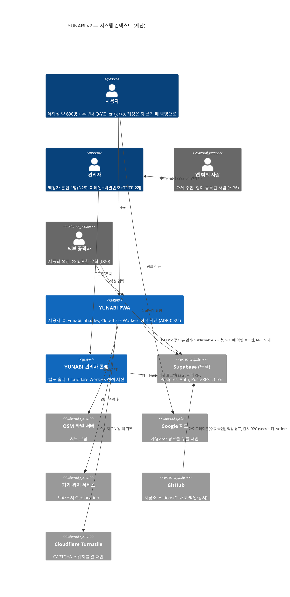
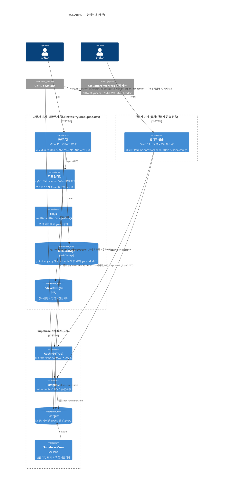
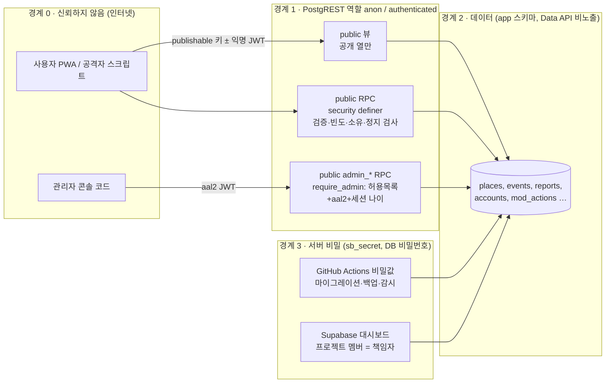
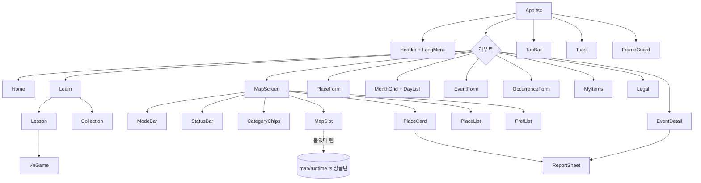
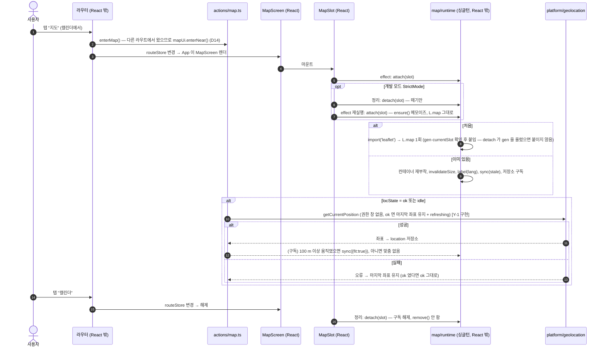
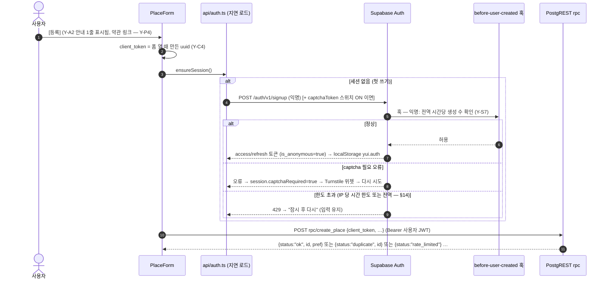
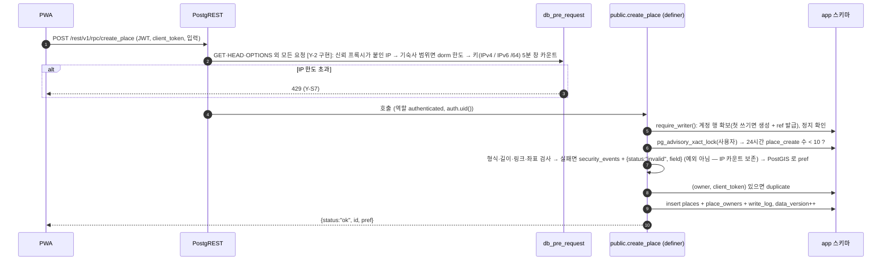
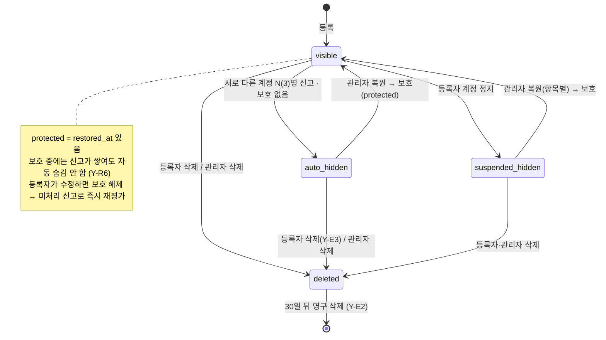
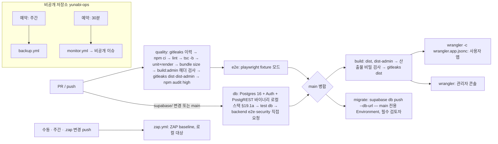

# RFC-0003 · YUNABI v2 — 재작성 구조, 공유 데이터 백엔드, 신고·관리, 보안

| | |
|---|---|
| 상태 | 제안됨 |
| 작성일 | 2026-10-12 |
| 범위 | [PRD-YUNABI v2.5](../../02-requirements/PRD-YUNABI.md) — D12~D26, Y-B\*, Y-J\*, Y-M\*, Y-K\*, Y-R\*, Y-E\*, Y-A\*, Y-C\*, Y-P\*, Y-S1~S12. 마일스톤 Y-0 의 설계 산출물 |
| 현행 코드 | `index.html` @`8ce701a` (1,835줄, v1.3 + 브랜드 + D14 + D15), `sw.js` (`CACHE = "yui-v6"`), `manifest.webmanifest` (`id: "./"`), `vendor/`, `data/japan-prefectures.geojson`, `assets/brand/yunabi-mark.svg`, 아이콘 4개. **백엔드 없음, 빌드 없음, 테스트 러너 없음** |
| 대체 관계 | [RFC-0002](0002-mlp-client-only.md)(클라이언트 단독 MLP)의 **공유 데이터 부분과 구조 부분**을 대체한다. 일본어 콘텐츠·지도 수명 주기·캘린더 모델·.ics 는 RFC-0002 의 동작을 그대로 옮긴다 |
| 같이 읽는 문서 | [tech-stack-v2](../tech-stack-v2.md), [ERD v2](../erd-v2.md), [openapi-v2.yaml](../openapi-v2.yaml), ADR [0015](../../adr/0015-frontend-framework-svelte.md)(폐기됨)~[0023](../../adr/0023-frontend-framework-react.md) |

**문서 형식: SAD 대신 RFC 하나 + ADR.** 개발자 소수, 컨테이너 셋(사용자 PWA, 관리자 콘솔, Supabase), 운영비 0 목표라 RFC-0001·0002 와 같은 형식을 잇는다. DB 는 [ERD v2](../erd-v2.md), API 는 [openapi-v2.yaml](../openapi-v2.yaml) 로 나눴다.

**읽는 법:** **현행** = 지금 코드에 있는 것(줄 번호는 `index.html` @`8ce701a`). **제안** = 이 RFC 가 정하는 것으로, 아직 어디에도 구현되지 않았다. 코드는 바꾸지 않았다.

**개정 (2026-10-12, 보안 검토 반영).** 독립 보안 검토(기준 `da55060`, 판정 "보완 필요 — 구조는 견고")의 지적을 모두 반영했다. 고친 곳에 `[검토 #n]` 을 달았다: #1 폴링이 IP 쓰기 한도를 소진(→ GET), #2 `PUBLIC` EXECUTE, #3 `require_admin` 실패 개방, #4 관리자 생성 경로, #5 CAPTCHA ON 시 관리자 잠김, #6 기숙사 NAT, #7 IP 한도 우회(XFF·롤백), #8 IP 가명 처리, #9 백업 범위·비밀값, #10 스크립트 대량 숨김, #11 가입 한도 DoS, #12 Leaflet HTML 경로, #13 CSP `'self'` 범위, #14 테스트 공백, 그리고 낮음·nit 항목. **재검토(조건부 승인)** 의 조건은 `[재검토 #n]` 으로 표시했다: #1 훅과 무관한 계정 생성 전역 상한, #2 관리자 연결 탈취 방지, #3 PostGIS 스키마, #4 SMTP 소모, #5 관리 RPC 의 남은 감시 공백.

**개정 (2026-10-12, 책임자 결정 D21~D26 반영).** 고친 곳에 `[D24]` 등을 달았다.
- **D24 — 프레임워크는 React** ([ADR-0023](../../adr/0023-frontend-framework-react.md), 승인됨). 이 RFC 의 첫 판은 Svelte 5 를 제안했다(ADR-0015, 이제 폐기됨). 구조 — 도메인·지도 런타임·라우터·API·플랫폼은 프레임워크 없는 TS — 는 그대로이고, §4.2·§5·§7·§8·§9·§17·§19 의 컴포넌트·상태·린트·테스트를 React 판으로 바꿨다. Svelte 판의 내용은 각 절에 "(이전 안: …)" 으로 짧게 남겼다.
- **D25 — 관리자는 책임자 본인 1명.** 관리자 생성·TOTP 등록·복구·부재 대응을 1인 기준으로 고쳤다(§12.2, §17.7 R-5·R-7·R-8, OQ-C·OQ-G·OQ-19).
- **D26 — 기숙사 공인 IP 확인과 SMTP 설정은 뒤로 미룬다.** 출시 전 점검 항목으로 §17.6a 에 모았다.
- D21(관리자 콘솔 별도 출처 — ADR-0020 승인), D22(디자인 방향 A "맑은 하늘"), D23(첫 배포는 Y-2 이후 — §20 과 같음)은 이 RFC 의 제안과 같아 OQ-B·OQ-D 를 해결로 표시했다.

**개정 (2026-10-12, React 전환 문서 검토 반영).** 검토("보완 필요")의 지적 1~11 을 반영하고 `[검토 R-n]` 을 달았다(R-n = 검토 지적 번호. 이 RFC 의 런북 R-n·리스크 R-n 과는 다른 번호다). 승인된 ADR-0023 은 고치지 않고 보완 결정을 [ADR-0024](../../adr/0024-react-switch-review-fixes.md)(제안됨)에 모았다.
- R-1: 홈 예산 100 KB (실측)
- R-2: `getServerSnapshot`
- R-3: `prerender` 렌더 검사
- R-4: Leaflet 인자 린트
- R-5: `detach` 세대
- R-6: flat config 선택자
- R-7: 지연 라우트 오류 경계·전환
- R-8: 버전
- R-9: TOTP 복구 런북
- R-10: 부재 중 숨김의 사용자 문구·OQ-21
- R-11: history state

**개정 (Y-2 구현 반영, 브랜치 `claude/sharp-einstein-3m78cy` `e2e1597` — 리뷰 수정 포함).** 구현과 리뷰가 바꾸거나 확정한 곳에 `[Y-2 구현]` 을 달았다: IP 한도가 경로 대신 메서드로 셈(§11.1, §13.3, §14), 클라이언트의 읽기 페이지 나눔·401 재시도·세션 분실·CAPTCHA·언어 청크(§8, §11, §12.1), 로컬 테스트 스택(§19), 실제 프로젝트에서 확인할 항목(§17.6a PL-6). DB 쪽 세부는 [ERD v2](../erd-v2.md) 의 같은 표시.

---

## 1. 배경과 문제

v1.3 은 서버 없이 직접 넣은 장소·일정을 보여주는 단일 HTML PWA 였다(RFC-0002). v2 는 세 가지가 바뀐다(PRD §1).

1. 장소·일정을 **사용자가 등록하고 모두가 본다**(D16, 초기 데이터 0). 서버·계정·권한·신고·관리가 필요하다.
2. 코드를 **Vite + TypeScript + 프레임워크**로 다시 쓴다(D19). v1.3 의 "단일 파일·빌드 없음·테스트 러너 없음" 규칙을 없앤다.
3. 사용자 악용 대응은 규모(약 600명)에 맞게 **단순하게**, 대신 **외부 공격 보안**을 기준선으로 갖춘다(D20, §6.1 Y-S1~S12).

풀어야 하는 문제:

| # | 문제 | 절 |
|---|---|---|
| P1 | v1.3 의 동작(뒤로 가기·지도 유지·3개 언어·오프라인)을 퇴행 없이 새 구조로 | §5~§10, §19 |
| P2 | 로그인 화면 없이 쓰기 권한과 "내 항목만 수정" 을 서버에서 강제 | §12, §13 |
| P3 | 신고 3건 자동 숨김, 관리자 복원·삭제·정지, 감사 기록 | §15 |
| P4 | 외부 공격: 권한 우회, XSS, 키 유출, 자동화 대량 요청, 의존성 | §17 |
| P5 | 같은 주소에서 v1.3 설치·저장을 이어받기 | §18 |

## 2. 목표 / 비목표

**목표** — PRD G1~G6 과 §6.1. 운영비 0 목표.

**비목표** — PRD §3 비목표 그대로(게시판, 참가 신청, 일반 사용자 로그인, 컬렉션 동기화, 번역). 추가로: 서버 렌더링, 푸시 알림, 다중 관리자 권한 등급, 신고 자격 조건·평판 시스템(D20 이 제외), 앱 안의 사용 지표(ADR-0007 은 재사용하지 않음).

## 3. 품질 속성과 목표치

| 속성 | 목표 | 측정 | 근거 |
|---|---|---|---|
| 첫 화면 크기 `[D24]` `[검토 R-1]` | 홈 진입 JS+CSS gzip **100 KB 이하**. **실측:** react + react-dom 19.3.0(`createRoot` 만, 운영 빌드, 압축) = 67.2 KB. 여기에 앱 셸·홈·i18n 약 20 KB + CSS 약 8 KB(*추정*)를 더하면 약 95 KB 다. 첫 판의 75 KB 는 React 18 시기 3자 수치(42~45 KB)에 기댄 것이라 도달할 수 없었다. Svelte 안에서는 60 KB 였다. ADR-0023 RE-Q2("Y-1 첫 주 실측으로 확정")는 이 실측으로 닫는다(ADR-0024 결정 1). 지도(60 KB)·쓰기(50 KB)·레슨(30 KB)·관리 코드는 별도 청크이고 따로 잰다 | CI 에서 `vite build` 결과 크기 검사(초과 시 실패) | Y-C1, RFC-0002 §12 |
| 지도 유지 | 탭 왕복·언어 변경 후 같은 Leaflet 인스턴스, 진입 시 내 주위 | E2E | Y-M1, Y-M2 |
| 공유 반영 | 등록·숨김이 다른 기기의 **지도·캘린더 화면 진입 시 즉시**, 이미 열린 화면은 **30초 이내** | E2E (두 브라우저 컨텍스트) | Y-M6, Y-K4, Y-R3 — PRD 의 "10초" 와의 차이는 OQ-1 |
| 오프라인 | 마지막 스냅샷과 갱신 시각 표시, 쓰기 비활성 | E2E (오프라인 에뮬레이션) | Y-C3 |
| 멱등 | 같은 등록을 두 번 보내도 1건 | pgTAP + E2E | Y-C4 |
| 권한 | 직접 요청 권한 테스트 100% 거절 | pgTAP, HTTP 테스트 | Y-S1 |
| XSS | 사용자 글 안의 스크립트 미실행, CSP 위반 0 | E2E | Y-S4 |
| 가용성 | 무료 플랜 SLA 없음. 장애 시 오프라인 스냅샷으로 읽기 유지 | 런북 | Y-C3, B-4 |
| 복구 | 주간 백업, 복구 시간 목표 4시간(*제안*), 손실 허용 7일(*제안*) | 출시 전 리허설 기록 | Y-S9 |
| 비용 | 0엔 | 대시보드 | §7 백엔드 |

---

## 4. 아키텍처 뷰

### 4.1 컨텍스트 (C4 Level 1, 제안)



### 4.2 컨테이너 (C4 Level 2, 제안)



### 4.3 신뢰 경계 (제안)



| 경계 | 누가 | 볼 수 있는 것 | 통제 (근거) |
|---|---|---|---|
| 0 → 1 | 모든 클라이언트, 공격자 포함 | 공개 뷰의 공개 열(등록자·신고자 없음). RPC 결과는 자기 것만 | 기본 테이블 비노출 스키마 + GRANT 0, 뷰 열 제한, RPC 정의자 함수 안 검사 (Y-S1, Y-M9, Y-R9) |
| 관리자 RPC | 허용 목록 + `is_anonymous=false` + `aal=aal2` + 세션 12시간 이내 | 신고 수·사유, 가명 계정 ID(`accounts.ref`) — 신고자 없음 | `require_admin()` (Y-R5, Y-S3, Y-P2, Y-R9) |
| 2 → 3 | 책임자, CI | 전부 (uuid, 신고자, 관리자 이메일) | 프로젝트 멤버 = 책임자 1명(D25), 비밀값은 Actions 비밀값에만, 덤프 암호화 (Y-S2, Y-S9) |

> **익명성의 범위 (ADR-0001 재검토).** v2 의 약속은 "등록자·신고자는 **다른 사용자**에게 보이지 않는다(Y-M9, Y-R9). 관리자는 등록자의 **가명 ID** 만 본다(Y-P2, Q-Y11)." 경계 3(책임자)은 기술적으로 모두 볼 수 있다 — 개인정보처리방침에 쓴다(Y-P4).

---

## 5. 프론트엔드 구조 (제안)

### 5.1 원칙 (v1.3 CLAUDE.md 규칙의 일반화 — PRD §7 "남길 원칙")

| v1.3 규칙 | v2 의 형태 | 강제 수단 |
|---|---|---|
| 모든 문자열은 `T` 에 3개 언어 | `src/i18n/{en,ja,ko}.ts`, `en` 이 타입 원본 | 타입(`satisfies Messages`) + 단위 테스트 |
| `esc()` 로 이스케이프 `[D24]` | JSX 텍스트 보간은 React 가 이스케이프. `dangerouslySetInnerHTML` 금지, `ref` 로 `innerHTML` 에 쓰는 우회도 금지. **Leaflet 의 HTML 경로**(`bindTooltip`·`bindPopup`·`setContent`·`L.divIcon({html})`)에는 문자열을 넘기지 않고 `textContent` 로 만든 DOM 노드만 `[검토 #12]` | ESLint **`react/no-danger: error`** + `src/**` 의 `no-restricted-syntax`(`innerHTML`·`outerHTML` 대입 — 계산된 키 `el['innerHTML']` 포함, `dangerouslySetInnerHTML`·`innerHTML` 을 객체 키로 쓰기, `insertAdjacentHTML`, `document.write`) + `src/map/**` 의 `no-restricted-syntax`. `src/map/**` 규칙은 다음과 같다 `[검토 R-4]`. (Y-S4. 이전 안: `svelte/no-at-html-tags`)<br>· `bindTooltip`·`bindPopup`·`setContent`·`setTooltipContent`·`setPopupContent` 의 첫 인자와 `L.popup/tooltip({content})` 는 **`textNode(…)` 호출만** 허용한다(`layers.ts` 의 DOM 팩토리 이름 목록). 그 밖의 식은 모두 오류다(`bindTooltip(p.name)` 도 오류).<br>· `divIcon` 은 `icons.ts` 에서만 부르고, `html` 은 문자열 리터럴 상수만.<br>· flat config 는 `src/map/**` 블록이 `src/**` 의 옵션을 **바꾸므로** HTML 선택자를 다시 펼쳐 넣는다 `[검토 R-6]`. 선택자 전문은 ADR-0016 결정 2 |
| `\uXXXX` 는 스크립트 안에서만 | 해당 없음(모든 문자열이 TS) | — |
| 한국어 기준 폭 | 그대로 | E2E 375px × ko 넘침 검사 |
| 지도는 한 번 만들고 `render()` 를 넘어 산다 | 지도 런타임은 React 밖 모듈 싱글턴, 컴포넌트는 슬롯만. **StrictMode 의 effect 이중 실행에도 `L.map` 1회**(§9) `[D24]` | 단위 테스트(attach·detach 순서) + E2E(`.leaflet-container` 1개) |
| 뷰는 바깥 세계를 건드리지 않는다 | **화면 컴포넌트는 `localStorage`·`navigator`·`fetch`·`L` 을 직접 쓰지 않는다** — `src/platform/`, `src/api/`, `src/map/` 만. 화면 컴포넌트의 effect 는 동작 함수(`actions/`) 호출과 `MapSlot` 의 attach/detach 뿐 | ESLint `no-restricted-globals`/`no-restricted-imports` (features·ui 폴더 대상). 렌더 검사가 node 에서 `prerender`(`react-dom/static`)로 도는 것이 이 규칙의 실행 검사 `[검토 R-3]` |
| 위치는 안내 후에만 | `location` 상태 기계 그대로 | 단위 테스트 |
| `CACHE` 를 올린다 | Workbox 사전 캐시 해시로 자동 | — (규칙 폐기) |

### 5.2 폴더 구조 `[D24]`

React 판. 첫 판(Svelte)과의 차이: `*.svelte` → `*.tsx`, `state/*.svelte.ts` → `state/*.ts`(프레임워크 없는 저장소) + `state/useStore.ts`, `i18n/` 에 `useT.ts`, `map/MapSlot.tsx`. 나머지 폴더(`domain`, `platform`, `api`, `map/runtime.ts`, `app/router.ts`)는 프레임워크와 무관해 그대로다.

```
/
├─ index.html                 사용자 앱 엔트리 (meta CSP)
├─ admin/index.html           관리자 콘솔 엔트리 (별도 빌드, CSP 는 _headers)
├─ vite.config.ts             사용자 앱 (base './', PWA)
├─ vite.admin.config.ts       관리자 콘솔 (outDir dist-admin)
├─ public/
│  ├─ manifest.webmanifest    id "./" 유지
│  ├─ icon-*.png
│  └─ data/japan-prefectures.geojson   (경로 유지 — v1.3 와 같은 URL)
├─ admin-public/_headers      관리자 콘솔 보안 헤더
├─ src/
│  ├─ main.tsx                부팅: 저장소 복원, 라우터 시작, SW 등록, createRoot(<StrictMode><App/></StrictMode>)
│  ├─ app/                    App.tsx(라우트 → 화면, React.lazy 분할), router.ts(프레임워크 없음), routes.ts,
│  │                          nav.ts(PARENT·뒤로), NavLink.tsx, useRoute.ts
│  ├─ i18n/                   en.ts(원본), ja.ts, ko.ts, index.ts(t() — 순수 함수), useT.ts(언어 구독 훅)
│  ├─ content/                lessons.ts, vn.ts, endings.ts (v1.3 데이터, 타입), art.ts(그림 목록)
│  ├─ art/                    그림 파일 (§10 규칙)
│  ├─ domain/                 프레임워크 없는 순수 TS
│  │  ├─ calendar/            occurrences.ts(v1.3 occOn·upcoming), tokyoDate.ts
│  │  ├─ ics.ts               v1.3 downloadICS 의 생성부
│  │  ├─ geo/                 distance.ts, walk.ts, prefecture.ts(미리보기용 판정), bounds.ts(mainBounds)
│  │  ├─ validation.ts        서버와 같은 한도 (미리 안내용, 보장은 서버)
│  │  └─ types.ts             Place, EventSeries, Occurrence, ReportReason …
│  ├─ state/                  store.ts(createStore), useStore.ts(useSyncExternalStore), 모듈별 저장소 *.ts — §7
│  ├─ actions/                동작 함수 (부수 효과의 유일한 출발점 — §7)
│  ├─ platform/               storage.ts(store, yui.v1.*), idb.ts, geolocation.ts, online.ts, sw.ts(등록)
│  ├─ api/                    rest.ts(공개 뷰 GET, fetch), auth.ts(익명 로그인, 지연 로드),
│  │                          rpc.ts(타입 있는 RPC), errors.ts(상태·코드 → i18n 키), db.types.ts(생성)
│  ├─ map/                    runtime.ts(싱글턴, 저장소 구독), MapSlot.tsx(슬롯만), layers.ts(textNode), icons.ts
│  ├─ features/               화면 컴포넌트 *.tsx
│  │  ├─ home/  learn/(LearnList, Lesson, VnGame, Collection)
│  │  ├─ map/(MapScreen, ModeBar, StatusBar, CategoryChips, PlaceCard, PlaceList, PrefList, PlaceForm)
│  │  ├─ calendar/(MonthGrid, DayList, EventDetail, EventForm, OccurrenceForm)
│  │  ├─ report/ReportSheet  me/MyItems  legal/(Terms, Privacy, Contact)
│  ├─ ui/                     Header, TabBar, BackBar, LangMenu, Toast, Sheet, ArtImage, Button, FrameGuard (*.tsx)
│  ├─ admin/                  관리자 콘솔 전용 (main.tsx, Login(TOTP 요소 선택), MfaEnroll(요소 이름), Queue, ItemDetail, Accounts, AuditLog)
│  ├─ styles/                 tokens.css(디자인 방향 A "맑은 하늘" 토큰 — D22), base.css
│  └─ sw.ts                   서비스워커 소스 (§18.2)
├─ supabase/
│  ├─ config.toml
│  ├─ migrations/             ERD v2 §8
│  ├─ tests/                  pgTAP (*.test.sql)
│  └─ seed/                   fixtures.sql (로컬·CI 전용, 운영에는 적용 안 함)
├─ tests/
│  ├─ fixtures/               places.json, events.json (PRD §7 테스트 데이터)
│  ├─ render/                 모든 라우트 × 언어 렌더 검사 (v1.3 헤드리스 검사)
│  ├─ e2e/                    Playwright (fixture 모드)
│  └─ e2e-backend/            Playwright (로컬 Supabase)
│     └─ security.spec.ts     권한 HTTP 직접 요청 (y3s-automated-checks §3; XSS 는 e2e·e2e-backend, CSP 위반은 공통 픽스처)
├─ eslint.config.js           flat config: typescript-eslint, react, react-hooks, 보안 규칙(§5.1)
├─ tsconfig.json              strict, noUncheckedIndexedAccess, jsx: react-jsx
├─ scripts/                   gen-prefectures-sql.ts, check-dist-secrets.ts, check-bundle-size.ts
└─ .github/workflows/         ci.yml (gitleaks·npm audit 포함), zap.yml, deploy.yml, db.yml, backup.yml, monitor.yml
```

`index.html`(루트)은 **v1.3 단일 파일에서 Vite 엔트리로 바뀐다.** v1.3 파일은 git 기록에 남는다.

### 5.3 컴포넌트 구성



`App.tsx` 는 v1.3 `render()` 의 역할(헤더 표시 여부 `ROOTS`, `body.dataset.top`, `<html lang>`)을, 라우터는 `go()`·`popstate` 의 역할을 맡는다. `App` 은 `useStore(routeStore)` 로 현재 라우트를 읽어 화면 컴포넌트 하나를 고르고, 지도·폼·법적 페이지·레슨은 `React.lazy` + `Suspense` 로 지연 청크가 된다. `body.dataset`·`<html lang>` 같은 문서 바깥 속성은 컴포넌트 effect 가 아니라 **저장소 구독**(`main.tsx`)으로 맞춘다 — StrictMode 이중 실행과 무관하고 렌더 검사에서도 부수 효과가 없다 `[D24]`.

**지연 라우트의 실패와 전환** `[검토 R-7]` (ADR-0024 결정 6):

- **오류 경계.** 화면 자리는 `<RouteErrorBoundary key={route.name}><Suspense fallback={<RouteLoading data-route-loading/>}>` 로 감싼다.
  - 잡는 것은 청크 로드 실패다. 오프라인에서 사전 캐시에 없는 청크를 부를 때, 그리고 배포 뒤 옛 탭이 사라진 해시 파일을 부를 때 생긴다. Vite 의 `vite:preloadError` 는 `main.tsx` 가 받아 같은 상태로 보낸다.
  - 잡으면 문구와 [다시 불러오기] 를 보여 준다. 다시 불러오기는 `actions/app.reload()` 가 맡는다.
  - 문구 키는 `err.chunk`·`err.reload` 이고 3개 언어로 둔다:
    - en "Couldn't load this screen. Check your connection and reload." / Reload
    - ja 「画面を読み込めませんでした。接続を確認して、再読み込みしてください。」 / 再読み込み
    - ko "화면을 불러오지 못했어요. 연결을 확인하고 다시 불러와 주세요." / 다시 불러오기
  - 경계는 라우트가 바뀌면 `key` 로 초기화된다.
  - 페이지 안에서 다시 시도하지 않는다 `[Y-1 구현]`. Chromium 은 한 번 실패한 동적 import 를 페이지를 다시 불러올 때까지 실패한 채로 둔다. 그래서 지도 청크 오류도 [다시 불러오기](페이지 새로고침) 버튼을 보여 준다.
- **전환.** 외부 저장소(`useSyncExternalStore`) 값은 Transition 으로 그릴 수 없다(React 가 blocking 갱신으로 되돌린다 — react.dev). 그래서 `App` 은 화면 자리에 그릴 라우트를 React 상태 `shown` 으로 한 겹 두고, `routeStore` 구독에서 `startTransition(() => setShown(next))` 로 맞춘다.
  - 새 청크를 받는 동안 옛 화면이 그대로 보여서 fallback 이 깜박이지 않는다. fallback 은 첫 진입 때만 보인다.
  - 헤더·탭 강조는 `useStore(routeStore)` 로 즉시 바뀐다.

---

## 6. 라우팅과 뒤로 가기 (제안)

**라우터 구현 `[D24]`:** React Router 를 쓰지 않고 프레임워크 없는 `app/router.ts` + `nav.ts` 를 쓴다(ADR-0023 결정 5). 현재 라우트는 `routeStore`(§7)에 있고 React 는 `useRoute()` 로 읽으며, 이동은 `navigate()`·`back()` 함수 — 컴포넌트, 동작 함수, 지도 런타임, 렌더 검사가 같은 함수를 부른다. React Router v8(2026-06-17, 최소 React 19.2.7, 연 1회 메이저)은 v1.3 이동 규칙을 어차피 `nav.ts` 에 따로 둬야 하고 React 밖에서 이동을 부를 수 없어 기각.

### 6.1 URL

v1.3 은 URL 을 `./` 로 고정하고 화면을 `history.state` 에만 두었다(RFC-0002 §5.4). v2 는 **해시 라우트**를 쓴다: GitHub Pages 는 경로 라우트의 새로고침을 404 로 돌려주고(별도 `404.html` 우회가 필요), 해시는 `base: './'` 하위 경로에서도 그대로 동작한다. 일정 링크를 공유할 수 있게 되는 이점도 있다.

| 라우트 | 화면 | 부모(‹) | 탭 | v1.3 view |
|---|---|---|---|---|
| `#/` | 홈 | — | 0 | `home` |
| `#/learn` | 일본어 | `#/` | 1 | `learn` |
| `#/learn/:lid` | 레슨·분기 게임 | `#/learn` | 1 | `lesson` |
| `#/learn/collection` | 컬렉션 | `#/learn` | 1 | `collection` |
| `#/map` | 지도 (`mode`, `pref` 는 state) | `#/` | 2 | `map` |
| `#/map/new`, `#/map/edit/:id` | 장소 등록·수정 (MAP-04) | `#/map` | 2 | 신규 |
| `#/cal` | 캘린더 | `#/` | 3 | `cal` |
| `#/cal/event/:id/:date` | 일정 상세 | `#/cal` | 3 | `event` |
| `#/cal/new`, `#/cal/edit/:id`, `#/cal/edit/:id/:date` | 일정 등록·수정, 회차 수정 (CAL-03) | `#/cal` 또는 상세 | 3 | 신규 |
| `#/me` | 내가 등록한 것 (ME-02) | `#/` | 0 | 신규 |
| `#/legal/:doc` | 약관·방침·문의 (SYS-04) | `#/` | 0 | 신규 |

신고 시트(SYS-03)는 라우트가 아니라 시트 상태다(열린 채로 OS 뒤로 가기 → 시트를 닫는다: 시트를 열 때 `pushState({sheet:true})`).

### 6.2 v1.3 동작의 대응

| v1.3 (현행, RFC-0002 §5.4, `index.html:1745-1826`) | v2 |
|---|---|
| `go(view)` = `pushState(snap())` + `render()` | `navigate(route)` = `pushState(state, "", "#…")` + 라우트 상태 갱신. `[검토 R-11]` `state` 의 모양은 `{ prev: RouteName \| null, map?: { mode, pref } }` — `map` 은 지도 라우트일 때만 쓰고(§7 `mapUi` 중 `mode`·`pref` 만), `cat`·`pl`·`fitSeq` 등은 메모리 |
| 같은 탭 다시 누르기 → `replaceState` | 같음 |
| ‹ : `PARENT[view] === prevView` 이면 `history.back()`, 아니면 `go(parent, true)` | 같음 — `nav.ts` 의 `PARENT` 표(위 표의 "부모"), `history.state.prev`. `[검토 R-11]` 손으로 고친 해시·외부 링크로 들어온 기록은 `history.state === null` 이다. 이때 `prev` 가 없으므로 ‹ 는 `PARENT` 라우트로 `navigate(parent, {replace: true})` 하고, `map` 이 없으면 D14 기본값(near)을 쓴다 |
| 도도부현 선택 = `pushState(+pf)`, OS 뒤로 가기 → 같은 지도에서 `updateMap` | 같음 — `#/map` 에 머무르며 `state.pref` 만 바뀐 기록 항목. `popstate` 가 지도 → 지도이면 **화면을 다시 만들지 않고** 지도 상태만 바꾼다 |
| 모드 전환은 기록 항목 아님(`replaceState`) | 같음 |
| D14: 다른 화면에서 지도로 `go()` 하면 near 로 (`index.html:1747-1753`) | 같음 — `navigate('#/map')` 가 다른 라우트에서 올 때 `mode=near, pref=null, cat='', pl=null`. 위치가 허용 상태면 다시 측위(Y-M1, 권한 창 없음 — 측위 중·실패 시 마지막 좌표 유지, 100 m 이상 움직일 때만 다시 맞춤, 모드 전환은 진입이 아님 — §9 `[Y-1 구현]`) |
| `popstate` 로 지도에 돌아오면 state 의 `mode` 를 복원 (`:1823`) — D14 를 적용하지 않음 | **같게 유지** (OS 뒤로 가기는 "이전 화면 그대로" 가 기대 동작). OQ-8 에 확인 요청 |
| 시작: `history.state` → `?v=` → `?tab=1` → 홈, 쿼리 제거 | 시작: 해시 라우트 → `history.state` → **옛 쿼리 `?v=learn|map|cal`, `?tab=1`(→`#/cal`), `?compose=1`(→`#/`) 을 해시로 바꿔 `replaceState`** (manifest 바로가기·옛 링크 호환) |
| manifest `shortcuts` `./?v=map` | `./#/map` 으로 바꾸되, 옛 쿼리도 계속 받는다 |

## 7. 상태 관리 (제안 — `[D24]` React 판)

전역 상태 라이브러리(Zustand, Redux 등) 없이 **프레임워크 없는 작은 저장소 + `useSyncExternalStore`** 로 나눈다(ADR-0023 결정 4). v1.3 의 `S` 한 객체를 책임별로 쪼갠 것이다. (이전 안: Svelte 5 룬 `.svelte.ts` 모듈.)

- `state/store.ts`: `createStore<T>(initial)` → `{ get, set(patch | fn), subscribe(fn) → unsubscribe }`. 스냅샷은 불변 객체로 교체하고, 값이 같으면 같은 참조를 유지한다(`getSnapshot` 규칙 — 매번 새 객체를 돌려주면 무한 렌더).
- `state/useStore.ts` `[검토 R-2]`: `useStore(store, selector)` 는 `const read = () => selector(store.get())` 를 만들고 `useSyncExternalStore(store.subscribe, read, read)` 를 돌려준다.
  - **세 번째 인자 `getServerSnapshot` 에 같은 함수를 넘긴다.** 없으면 렌더 검사(`prerender`)와 서버 렌더가 "Missing getServerSnapshot" 으로 실패한다.
  - `store.subscribe` 는 `createStore` 가 한 번 만든 화살표 함수(`this` 를 쓰지 않음)라 참조가 안정적이다. `.bind()` 나 렌더마다 새로 만든 래퍼를 넘기면 렌더마다 다시 구독하므로 금지한다.
  - selector 는 원시값이나 저장소 안의 기존 객체를 돌려줘야 한다(리뷰 규칙 + 단위 테스트).
- **React 밖의 구독자:** 지도 런타임(§9), 라우터, `main.tsx` 의 문서 속성 동기화(`<html lang>`, `body.dataset`), 영속화(`platform/storage` 에 쓰기)는 `store.subscribe` 를 직접 쓴다. 이것이 Context 나 컴포넌트 안 상태를 쓰지 않는 이유다.

| 모듈 | 필드 (v1.3 `S` 대응) | 영속 |
|---|---|---|
| `state/route.ts` | 현재 라우트·매개변수, `prev` | history state(`{prev, map?}` — §6.2 `[검토 R-11]`) / 해시 |
| `state/prefs.ts` | `lang` | `yui.v1.lang` |
| `state/collection.ts` | `cg` (엔딩 카드) | `yui.v1.cg` (모양 검사 유지 — `index.html:1813`) |
| `state/location.ts` | `locState`(ask/idle/wait/ok/denied/fail/skip), `loc` | 선택만 `yui.v1.loc`, 좌표는 메모리 (Y-P3) |
| `state/mapUi.ts` | `mode`, `pref`, `cat`, `pl`, `prefFail`, `tileFail`, `fitSeq`(맞춤 요청 번호) | `mode`·`pref` 만 history state 의 `map` 에(나머지는 메모리). state 가 `null` 이면 D14 기본값 `[검토 R-11]` |
| `state/vn.ts` | `vn` 진행 | 메모리 |
| `state/calendarUi.ts` | `day`, `month` | 메모리 |
| `state/data.ts` | `places`, `events`, `overrides`, `fetchedAt`, `status`(idle/loading/ok/offline/error) | IndexedDB 스냅샷 |
| `state/session.ts` | `hasAccount`, `myIds`(내 항목 id 집합), `captchaRequired` | 세션은 `yui.auth` (auth-js 저장 키) |
| `state/net.ts` | `online` | — |

규칙: 컴포넌트는 상태를 읽고 **동작 함수**(`actions/*.ts`)를 부른다. 동작 함수만 `api/`·`platform/`·`map/` 을 부른다. 이것이 v1.3 의 "클릭 처리만 부수 효과" 경계를 대신한다 — 경계가 주석이 아니라 폴더와 린트 규칙이 된다(RFC-0002 OQ-9 해결). 폼 입력 중의 값처럼 한 화면 안에서만 쓰는 상태는 컴포넌트의 `useState` 로 둔다(저장소는 화면을 넘어 공유되거나 React 밖에서 읽히는 것만).

## 8. i18n (제안)

| 항목 | 설계 |
|---|---|
| 형식 | `src/i18n/en.ts` 가 `export const en = {...} as const`. `type Messages = Widen<typeof en>`. `ja.ts`·`ko.ts` 는 `satisfies Messages` → 키가 빠지면 **컴파일 오류** |
| 이전 | v1.3 `T`(`index.html:383-615`)를 기계적으로 옮긴다. 배열(`tabs`, `wd`)·중첩(`regions`, `cats`)은 그대로. `by`(추가한 사람 라벨)·주최 관련 문구는 폐기(Y-M3, Y-K1) |
| 지연 로드 `[Y-2 구현]` | `en` 만 첫 번들에 들어가고 `ja`·`ko` 는 각자 지연 청크(`src/i18n/index.ts` 의 `import('./ja')`·`import('./ko')`)로, 그 언어를 고를 때 받는다. 받기 전에는 영어로 그리고, 서비스워커가 세 언어를 모두 사전 캐시해 오프라인에서도 바뀐다 |
| 보간 | v1.3 `fill("{n}")` 과 같은 `t('homeCol', {n, m})`. 매개변수 이름도 타입으로 |
| React 연결 `[D24]` | `t()` 는 언어를 인자로 받는 순수 함수. 컴포넌트는 `const t = useT()`(= `useStore(prefs, s => s.lang)` 로 언어를 구독해 그 언어의 `t` 를 돌려줌). 언어를 바꾸면 구독한 컴포넌트만 다시 그려진다. 지도 라벨은 런타임이 `prefs` 를 직접 구독(§9). 날짜·수 서식은 `Intl.DateTimeFormat`·`Intl.NumberFormat`, 복수형이 필요한 영어 문구는 `Intl.PluralRules` (일본어·한국어는 복수형 구분 없음) |
| 신규 문구 | 폼 라벨·검증·서버 상태 코드(§13.4)·빈 상태(Y-M5, Y-K3)·신고 사유(Y-R1)·Y-A2 안내·Y-M7 경고·Y-K11·법적 페이지. 모두 3개 언어(Y-C2) |
| 콘텐츠 | 레슨·게임·엔딩의 `{ja,en,ko}` 필드는 `src/content/` 의 타입 데이터로 유지. 장면 메모 `s` 는 데이터에 남기되 렌더하지 않는다(Y-J2, 현행 `8ce701a` 와 같음; 남길지는 Q-Y8) |
| 사용자 글 | 번역 없음. `lang` 이 화면 언어와 다르면 작은 언어 배지(Y-C5) |
| 라이브러리 `[D24]` | 쓰지 않는다. **i18next + react-i18next, react-intl** 은 네임스페이스 지연 로드·언어 감지·ICU 메시지가 핵심인데 3개 언어·고정 문자열·번역 없음(Q-Y4)에는 필요 없고, 크기(자료가 상충하나 약 10~45 KB gzip)가 첫 화면 예산(§3)에 부담이다. Paraglide 같은 컴파일러형도 후보였으나(tech-stack-v2 §2.2) 현재 `T` 의 배열·객체 구조를 그대로 옮기는 편이 비용이 작다. 언어가 5개 이상이 되거나 외부 번역자가 붙으면 다시 본다(ADR-0023 결정 6) |
| 검사 | 단위 테스트: 세 언어 키 집합 동일·빈 문자열 없음. 렌더 검사: 모든 라우트 × 언어에서 `undefined`·`NaN`·`[object Object]` 없음 |
| 관리자 콘솔 | 영어·일본어·한국어 중 **관리자 언어 하나**로 시작해도 되는지 — OQ-9 (Y-C2 는 "새 화면의 모든 문구" 라 원칙상 3개 언어) |

## 9. 지도 수명 주기 (제안 — ADR-0014 의 일반화)

| 구성 | 역할 (v1.3 대응) |
|---|---|
| `map/runtime.ts` | **React 밖의 모듈 싱글턴.** `container: HTMLDivElement`(v1.3 `LBOX`), `map`(`LMAP`), 클러스터, 핀, 내 위치, 경계 레이어, `modeView`(`MODEVIEW`), `stale`(`MAPSTALE`), `currentSlot`, `gen`(세대 번호). `ensure()` 는 `import('leaflet')`·markercluster 를 한 번만 부르는 **메모이즈된 Promise** 이고 `L.map` 을 그 안에서 한 번 만든다(`initMap`). **어떤 경로에서도 `map.remove()` 를 부르지 않는다** |
| `MapSlot.tsx` `[D24]` | `useRef` 로 빈 슬롯 `div` 를 그리고, `useEffect(() => { runtime.attach(slot); return () => runtime.detach(slot); }, [])`. `attach` = 컨테이너를 슬롯에 붙이고 `invalidateSize()` → `label(lang)` → `sync(stale)` → 저장소 구독 시작. `detach` = 구독 해제 + **떼기만**. (이전 안: Svelte `onMount`/`onDestroy` — 같은 계약) |
| StrictMode `[D24]` | 개발 모드에서 React 는 effect 를 "설치 → 정리 → 다시 설치" 로 두 번 돌린다. 위 계약에서 이것은 attach → detach → attach 이고, `ensure()` 가 메모이즈되어 **`L.map` 은 한 번만** 생긴다. **경합 가드:** `attach(slot)` 은 `currentSlot = slot; const g = ++gen; await ensure(); if (gen !== g \|\| currentSlot !== slot) return;` 로 그 사이 detach·재attach 된 경우 붙이지 않는다. `detach(slot)` 은 `currentSlot === slot` 일 때만 동작한다 — 지도 화면 ↔ 장소 폼(MAP-04)처럼 새 슬롯이 먼저 붙는 경우 옛 슬롯의 정리가 새 슬롯을 떼지 않게. **그때 `currentSlot = null; ++gen;` 도 한다** `[검토 R-5]`. 그래서 `ensure()` 를 기다리는 동안 attach → detach 만 일어나면(화면을 바로 떠남) 나중에도 붙이지 않는다. StrictMode 순서는 attach(g=1) → detach(gen=2, slot=null) → attach(g=3) 이고, `ensure()` 가 끝나면 g=3 인 호출만 붙인다 — `L.map` 1회, 붙이기 1회. 컴포넌트 ref 에 인스턴스를 두고 정리에서 `remove()` 하는 흔한 처방은 StrictMode 는 통과하지만 탭을 떠날 때마다 지도를 부숴 Y-M2 를 어기므로 쓰지 않는다. react-leaflet 도 같은 이유(컴포넌트 수명 = 지도 수명)로 쓰지 않는다(ADR-0023 결정 2·3) |
| 상태 → 지도 `[D24]` | 런타임이 attach 되어 있는 동안 `mapUi`·`data`·`location`·`prefs` 저장소를 **직접 구독**해 `sync()` 한다(React effect 의존성 배열로 지도를 움직이지 않음 — 이중 실행으로 `fitBounds` 가 두 번 불리는 일이 없다). 맞춤은 `mapUi.fitSeq` 증가로 요청한다. 화면 HTML(상태줄·칩·목록·카드)은 React 가 부분 갱신하므로 v1.3 의 `updateMap()`(컨테이너 5개 `innerHTML` 교체)이 필요 없다 |
| 비동기 결과 | 위치·경계 로드·**데이터 갱신**은 상태만 바꾼다. 런타임이 attach 상태면 구독이 반영하고, 아니면 `runtime.stale = true` → 다음 `attach` 가 맞춤 (v1.3 `mapChanged`/`locChanged`) |
| D14 / Y-M1 | 라우터가 다른 화면 → `#/map` 일 때 `mapUi.enterNear()`: `modeView.japan` 저장 → near → 저장된 near 화면이 있으면 `setView`, 없으면 맞춤. 위치 상태가 `ok`/`idle` 이면 `locate()` 다시(권한 창 없음 — 이미 허용된 권한만 사용). `[Y-1 구현]` 세부: (1) 다시 측위하는 동안 **마지막 좌표를 계속 쓴다** — 상태는 `ok` 그대로이고 `refreshing` 표지만 켠다. (2) 새 측위가 실패하면 마지막 좌표를 유지한다. (3) 새 좌표가 **100 m 이상** 움직였을 때만 다시 맞춘다. (4) 모드 전환(near ↔ japan)은 진입이 아니다 — 상태가 `idle` 일 때만 측위하고, 고른 도도부현을 유지한다(v1.3 과 같음). (5) 각 모드는 왕복할 때마다 마지막으로 떠난 화면(`modeView[mode]`)으로 돌아간다 |
| 도도부현 | 경계 GeoJSON 은 `public/data/` 에서 일본 전체 첫 진입 때 `fetch`(v1.3 `ensurePrefs`). 같은 파일이 DB 의 판정용 테이블로도 들어간다(ERD v2 §4.6). `mainBounds()` 는 `domain/geo/bounds.ts` 로 |
| 장소 등록 | MAP-04 는 **같은 지도 인스턴스**를 쓴다: 폼 라우트에서도 `MapSlot` 을 붙이고 "위치 고르기" 모드(지도 탭 → 임시 마커). [현재 위치] 는 Y-M7 경고 확인 후에만 좌표를 채운다 |
| 타일 | URL 은 설정 상수(RFC-0002 R-2). 실패 집계·안내(v1.3 `tileFail`) 유지 |
| 라벨 | 확대 버튼·내 위치·결 마커 문구는 `attach` 때마다 현재 언어로(v1.3 `labelMap`) |
| 사용자 글 출력 `[검토 #12]` | Leaflet 은 툴팁·팝업·`divIcon` 의 **문자열을 `innerHTML` 로 넣는다** — v1.3 처럼 `esc()` 를 잊으면 그대로 XSS 다. v2 규칙: 핀 이름 같은 사용자 글은 `map/layers.ts` 의 `textNode(name)`(`createElement` + `textContent`)으로 만든 노드로만 넘기고, `divIcon` 의 `html` 은 사용자 글이 없는 고정 마크업(카테고리 색 점)만. 마커 `title` 옵션은 속성이라 안전. 장소 카드·목록은 React 컴포넌트(JSX 텍스트 이스케이프)로 그린다 `[D24]`. 린트와 E2E(이름이 XSS 페이로드인 핀)로 강제한다. `[검토 R-4]` 린트는 "리터럴 금지" 가 아니라 **허용 목록**이다: Leaflet HTML API 의 인자와 `content` 옵션은 `textNode(…)` 호출일 때만 통과한다. `divIcon` 은 `icons.ts` 에서만 만들고, `html` 은 문자열 리터럴이거나 `map/layers.ts` 의 DOM 팩토리 호출(`textNode`·`pinNode`·`clusterNode`·`meNode`, 글자는 `textContent`)이다 `[Y-1 구현]` — 핀·클러스터 개수·"結" 홈 마커·"현재 위치" 제목이 글자를 담기 때문. Leaflet 1.9 `DivIcon.createIcon` 은 Element 를 HTML 로 해석하지 않고 붙이므로 데이터가 HTML 이 되지 않는다. `icons.ts` 는 `./layers` 만 import 한다. L1·L2 도 같은 팩토리 허용 목록이고, 린트 단위 테스트는 `tests/unit/lint.test.ts` (ADR-0016 결정 2 L1~L3·ICON_HTML) |



## 10. 그림 자리와 파일 규칙 (Y-J2, Y-J3)

**현행(`8ce701a`):** 그림이 없으면 회색 상자(`#D5D7D2`) — 컷 `.cutph` 4:3 + 컷 번호, 분기 게임 장면·컬렉션 카드 `.cgart` 4:3, 엔딩 화면 `.cgart.big` 3:2. 데이터에 `img` 필드가 있으면 ``. 장면 메모는 렌더하지 않는다.

**제안 — 파일을 넣으면 바뀌는 규칙:**

| 자리 | 경로·파일명 | 비율 | 권장 크기 | 비고 |
|---|---|---|---|---|
| 만화 컷 | `src/art/lessons/<lid>/<nn>.webp` — `lid` = `l1`~`l7`, `nn` = 컷 순서 2자리 1부터(`01`) | 4:3 | 1200×900 | 예: `src/art/lessons/l2/05.webp` = 2화 5번째 컷 |
| 분기 게임 장면 | `src/art/vn/<route>/<nn>.webp` — `route` = `osaka`·`kyoto` | 4:3 | 1200×900 | |
| 엔딩 카드 | `src/art/endings/<ending_id>.webp` — `e_osaka_best` 등 5개 | **3:2 원본** | 1200×800 | 엔딩 화면은 3:2 그대로, 컬렉션 격자(4:3)는 가운데 기준 `object-fit: cover` 로 잘림 → **좌우 각 약 6% 는 잘려도 되게** 그린다 |

- 형식: `.webp` 우선, `.png`·`.jpg` 도 허용(같은 이름이 둘이면 빌드 실패).
- 동작: `src/content/art.ts` 가 `import.meta.glob('/src/art/**/*.{webp,png,jpg}', { eager: true, query: '?url', import: 'default' })` 로 **빌드 시점에 있는 파일 목록**을 만든다. `ArtImage` 컴포넌트는 키(`lessons/l2/05`)가 목록에 있으면 ``, 없으면 회색 자리를 그린다. 코드 수정 없이 파일 하나를 넣고 빌드(=`main` 푸시 → CI 배포)하면 그 칸만 바뀐다(Y-J3 수락 기준).
- 파일은 해시 이름으로 출력되어 캐시 무효화가 자동이고, 서비스워커 사전 캐시에 들어간다(그림 총량이 커지면 사전 캐시에서 빼고 런타임 캐시로 — OQ-10).
- 검사: 단위 테스트가 `src/art/` 의 모든 파일 이름이 실제 자리(레슨 컷 수·장면 수·엔딩 id)에 대응하는지 확인 — 오타 파일이 조용히 무시되지 않게.
- `alt`: 컷의 일본어 대사(`jp`)를 대체 텍스트로.

## 11. 데이터 읽기·캐시·오프라인·반영 (제안)

### 11.1 읽기

| 데이터 | 요청 | 비고 |
|---|---|---|
| 장소 | `GET /rest/v1/places_public?select=…` | 보이는 항목 전체. 1,000건 ≈ gzip 80 KB(*추정*). **2,000건을 넘으면** 도도부현별 요청 + `place_counts_by_pref` 로 바꾼다(OQ-11) |
| 일정 | `GET /rest/v1/events_public?select=…` + `GET /rest/v1/event_occurrences_public?select=…` | 보이는 시리즈 + 회차 덮어쓰기. 전개(`occOn`)는 클라이언트 `domain/calendar` |
| 판 번호 | **`GET /rest/v1/rpc/data_version`** → bigint (`stable` 함수, `rpc('data_version', {}, {get:true})`) | 장소·일정·회차·숨김이 바뀔 때마다 오르는 카운터. 같으면 다시 받지 않는다 |
| 내 항목 | **`GET /rest/v1/rpc/my_items`** (계정이 있을 때만, `stable`) | 숨김·삭제 상태 포함(Y-R8). 응답의 id 로 카드에 [수정]·[삭제] 표시 |
| 수정할 내 항목 `[Y-2 구현]` | **`GET /rest/v1/rpc/my_place?p_id=…`**, **`GET /rest/v1/rpc/my_event?p_id=…`** (계정이 있을 때만, `stable`) | 숨겨진 내 항목은 공개 뷰에 없으므로 수정 폼을 이것으로 채운다(Y-E1). 삭제되지 않은 내 것만, 아니면 null (ERD v2 §7.1) |

**페이지 나눔 `[Y-2 구현]`:** 클라우드 Data API 는 한 요청에 최대 1,000행만 돌려준다(최대 행 수 설정). 세 뷰 읽기는 `order=` 를 붙여 `limit=1000&offset=…` 으로 마지막 페이지(1,000행 미만)까지 이어 받는다 — 잘린 목록을 조용히 쓰지 않게(`src/api/rest.ts`). 로컬 스택도 `db-max-rows = 1000` 으로 같은 조건을 만든다(§19).

`[검토 #1, critical]` 첫 판은 두 함수를 30초마다 **POST** 로 불렀고, `db_pre_request` 는 GET 이 아닌 모든 요청을 셌다. 기숙사처럼 공인 IP 하나 뒤에서 5명이 지도를 열어 두면 5분 60회를 다 쓰고, 그 뒤 **600명 전원의 쓰기가 429** 가 된다. 이제 두 함수는 GET 으로 부른다. ~~`db_pre_request` 는 쓰기 RPC 경로만 센다~~ — `[Y-2 구현]` 경로 목록은 리뷰에서 우회가 나와(퍼센트 인코딩한 함수 이름, `/rpc/graphql`, 뷰에 대한 `PATCH`) 버렸고, **`db_pre_request` 는 GET·HEAD·OPTIONS 가 아닌 모든 요청을 경로와 무관하게 센다**. 폴링과 읽기는 모두 GET 이므로 위 문제는 생기지 않는다(ERD v2 §7 머리말·§7.4, G-52).

읽기에는 **계정이 필요 없다**(`anon` 역할 + publishable 키). Y-A1(읽기만 하면 계정 없음)과 맞고, 익명 로그인이 막혀도(B-1, 공격 대응 스위치) 읽기는 된다. 읽기 요청은 SDK 없이 `fetch` 로 해 첫 화면 크기를 줄인다.

### 11.2 캐시와 오프라인 (Y-C3, Y-R10)

- 성공한 읽기는 IndexedDB `yui` › `snapshot` 에 `{places, events, overrides, version, fetchedAt}` 로 **통째로 교체** 저장한다. 숨겨진 항목은 응답에 없으므로 다음 갱신 때 스냅샷에서도 사라진다(Y-R10).
- 시작 시: 스냅샷을 먼저 그리고(있으면) → 온라인이면 `data_version` 확인 → 다르면 다시 받는다.
- 오프라인(`navigator.onLine === false` 또는 요청 실패): 스냅샷 + "마지막 갱신: {시각}" 표시, 등록·수정·삭제·신고 버튼 비활성 + 안내(Y-C3).
- 서비스워커는 API 응답을 캐시하지 않는다(교차 출처, 사용자 토큰이 실린 요청도 있음). 데이터 캐시는 앱 코드 한 곳(IndexedDB)에만.
- 저장소 차단 시: 메모리로만 동작(v1.3 ADR-0010 원칙).

### 11.3 반영 시간

| 상황 | 동작 | 지연 |
|---|---|---|
| 지도·캘린더 화면에 들어올 때, 앱이 다시 보일 때(`visibilitychange`) | `data_version` 확인 → 다르면 다시 받기 | 즉시 |
| 지도·캘린더가 열려 있는 동안 | 30초마다 `data_version` **GET** (응답 수십 바이트, IP 쓰기 한도와 무관) | 최대 30초 |
| 내가 쓴 직후 | 응답을 바로 반영 + 다시 받기 | 즉시 |

PRD 는 "10초 안에 다른 기기에서" 를 요구한다(Y-M6, Y-K4, Y-R3). 열린 화면에 10초를 보장하려면 Supabase Realtime(브로드캐스트) 구독이 필요하다 — 의존성·연결 수가 늘어 이 RFC 는 30초 폴링을 제안하고 OQ-1 로 책임자 확인을 요청한다. 폴링 egress 추정: 동시에 화면을 연 사용자 10명 × 하루 2,880회 × 약 400 B ≈ 월 350 MB(*추정*).

---

## 12. 인증 흐름 (제안)

### 12.1 익명 계정 — 첫 쓰기 때 (Y-A1, Y-A2, Q-Y10)



- 세션 저장 키는 `yui.auth`(auth-js `storageKey`) — 출처 공유(R-6) 아래에서 다른 앱과 겹치지 않게.
- 토큰 갱신은 auth-js 자동 갱신. 갱신 토큰이 만료·삭제되면(저장소 삭제, 1년 비활동 정리 — Y-P5) 새 익명 계정이 생기고 옛 항목은 고칠 수 없다(Y-A2 안내의 내용).
- **`[Y-2 구현]` 401 → 한 번 갱신 후 재전송.** 쓰기 RPC 가 401 이면 `refreshSession()` 으로 토큰을 한 번 갱신하고 같은 요청을 다시 보낸다(생성은 `client_token` 으로 멱등, 나머지는 반복해도 안전). 그래도 401/403 이면 `forbidden`. 429 는 `rate_limited`.
- **`[Y-2 구현]` 세션 분실은 조용히 새 계정을 만들지 않는다.** 이 브라우저에 계정이 있었다는 표시(`had_account`, 기기 저장소 `platform/storage`)가 있는데 세션이 없으면(갱신 거절, 저장소 일부 삭제) 쓰기는 상태 **`session_lost`** 로 끝나고 화면이 한 번 알린다 — 새 계정이 되면 지금까지 올린 것을 고칠 수 없다는 뜻이다. 알린 뒤 표시를 지우므로 **다음 저장은 새 익명 계정으로 진행**된다. 위 문단의 "새 익명 계정이 생긴다" 는 이 안내를 거친 뒤에만 일어난다.
- **`[Y-2 구현]` CAPTCHA 스위치 — 앱 쪽 구현됨.** `signInAnonymously` 가 `captcha_failed`(또는 captcha 오류 문구)로 실패하면 상태 `captcha` → `session.captchaRequired` → 폼에 Turnstile 위젯(`ui/Captcha`, 사이트 키는 빌드에 포함)이 나타나고, 다음 저장 때 토큰을 `signInAnonymously({ options: { captchaToken } })` 로 보낸다. 스위치가 꺼져 있으면 위젯은 나타나지 않는다. 관리자 콘솔 로그인의 위젯(§12.2)은 이 항목과 별개다.
- 기기 이전(Q-Y2)은 범위 밖.

### 12.2 관리자 로그인 (Y-R5, Y-S3)

| 단계 | 설계 |
|---|---|
| 계정 생성 `[검토 #4]` `[재검토 #2]` | 이메일 공급자의 **공개 가입은 끈다.** 책임자가 `app.admin_invites` 에 이메일을 넣고 → Admin API(또는 대시보드)로 이메일+비밀번호 사용자를 만들고 → **그 생성 호출이 돌려준 `user_id` 만**으로 `app.bind_admin(id, email)` 을 실행한다. 이메일로 사용자를 찾아 연결하지 않는다 — 익명 사용자가 그 전에 `updateUser({email})` 로 초대 이메일을 걸어 두면 공격자 계정이 묶이기 때문이다. `bind_admin` 은 `is_anonymous = false`, `email_confirmed_at` 있음, 이메일 일치, 계정이 **초대 뒤에** 생김, 초대 미사용, 같은 이메일의 다른 사용자 없음을 확인하고 아니면 실패한다(ERD v2 §4.5, G-37). `before-user-created` 훅은 `admin_invites` 만 본다(첫 판은 사용자가 생기기 전에 `admins`(user_id FK)를 확인하려 해 관리자를 만들 수 없었다 — 닭과 달걀) |
| 허용 목록 = 권한의 유일한 근거 `[검토 #4]` | `app.admins(user_id, email, active)` — SQL 로만. 익명 사용자는 `updateUser({email})` 로 **훅을 거치지 않고** 비익명이 될 수 있으므로 "비익명이면 허용 목록에 있다" 는 가정을 버렸다. `require_admin()` 은 `admins` 행으로만 허락한다 |
| 2단계 `[검토 낮음]` `[D25]` | 관리자는 **책임자 본인 1명**(D25)이므로 계정을 만드는 사람과 쓰는 사람이 같다. **책임자가 계정을 만든 바로 그 자리에서**(공개 가입 OFF 상태, 콘솔의 `MfaEnroll` 화면 또는 같은 세션) TOTP 를 등록한다 — 첫 로그인을 미뤄 두면 비밀번호가 샌 공격자가 먼저 자기 TOTP 를 등록할 수 있다. **TOTP 요소를 2개 등록한다:** ① 평소 쓰는 휴대폰 인증 앱 ② 예비 — 다른 기기의 인증 앱이나 오프라인으로 보관하는 TOTP 비밀(종이 금고 등). 예비는 휴대폰과 따로 둔다. **관리자 비밀번호와도 따로 둔다** `[검토 R-9]` — 비밀번호를 저장한 암호 관리자에 예비 TOTP 비밀까지 넣으면, 그 금고 하나가 털릴 때 두 요소가 함께 넘어간다. Supabase 는 **백업 코드가 없고** 공식 문서가 "두 번째 TOTP 요소" 를 복구 수단으로 안내한다(사용자당 최대 10개 — tech-stack-v2 §5.5). 이후 매 로그인 TOTP. 관리 RPC 는 JWT `aal = 'aal2'` 가 아니면 거절. 분실 복구는 §17.7 R-7.<br>**요소 선택** `[검토 R-9]`: 요소가 2개이므로 콘솔이 하나를 골라 챌린지해야 한다(`mfa.challenge({factorId})`).<br>· `MfaEnroll` 은 등록할 때 `friendlyName` 을 받는다(예: "주 휴대폰", "예비").<br>· `Login` 은 비밀번호 확인 뒤 `mfa.listFactors()` 의 검증된 TOTP 요소를 이름과 함께 보여 주고 **책임자가 고르게** 한다. 첫 요소를 자동으로 고르면, 휴대폰을 잃었을 때 예비로 로그인할 수 없다(R-7 ①).<br>· 화면 문구는 3개 언어(OQ-9) |
| 세션 만료 | 대시보드의 비활동·최대 수명(timebox)은 **Pro 기능으로 보인다**(검토의 확인). 그래서 무료 플랜에서는 (1) `require_admin()` 의 서버 검사 — `auth.sessions` 의 현재 세션 행이 **있고** 생성 12시간 이내가 아니면 예외(행 없음·클레임 없음도 거절, ERD v2 §7.3) — 가 **유일한 서버 측 만료**이고, (2) 콘솔은 세션을 `sessionStorage` 에 둔다(창을 닫으면 끝) |
| 실패 안전 `[검토 #3]` | 모든 `admin_*` 의 첫 문장이 `perform app.require_admin()` 이고 실패는 예외다. 반환값을 확인할 필요가 없으니 확인을 잊을 수 없다. 카탈로그 검사·pgTAP 가 모든 `admin_%` 를 실패 경우 7가지와 교차 검증(G-30) |
| CAPTCHA 와의 관계 `[검토 #5]` | Supabase CAPTCHA 는 **비밀번호 로그인에도 적용**된다. 스위치를 켜는 순간 관리자가 잠기지 않게, 콘솔 로그인 화면에도 Turnstile 위젯을 두고(사이트 키는 빌드에 포함) 콘솔 CSP 가 Turnstile 을 허용한다. 출시 전 점검표에 "스위치 ON 상태에서 관리자 로그인" 시험 |
| 출처 분리 | 관리자 콘솔(`yunabi-admin.juha.dev`)은 사용자 앱(`yunabi.juha.dev`)과 다른 출처 — 사용자 앱에 XSS 가 있어도 관리자 토큰에 닿지 않는다(ADR-0020, ADR-0025). 사용자 앱도 자기 출처라 `github.io` 다른 페이지와의 공유는 없어졌다 |
| 기록 | 모든 관리 조치를 `app.mod_actions` 에 추가 전용으로(누가: 관리자 이메일·id, 언제, 무엇을, 대상, 메모) — Y-R5. 관리 거절은 `admin_whoami()` 가 `security_events` 에 기록한다. 콘솔을 거치지 않은 직접 호출의 거절은 예외 롤백 때문에 DB 에 남지 않고 Supabase API 로그에만 남는다(ERD v2 OQ-E7) — 실패 안전을 기록보다 우선한 결과 |

**`[Y-3 구현]`** 
- 콘솔: `admin/index.html` + `vite.admin.config.ts` → `dist-admin/`(배포 출처 Cloudflare). CSP 는 meta 태그와 `_headers`(여기에만 `frame-ancestors 'none'`, `X-Frame-Options: DENY`, `Cache-Control: no-store`)에 같이 둔다. `img-src data:` 는 TOTP QR(Supabase Auth 가 주는 data: SVG) 때문. 문구는 앱 번들에 섞이지 않게 `src/admin/i18n.ts`(3개 언어).
- 로그인: 비밀번호 → 검증된 TOTP 요소가 없으면 `MfaEnroll` 이 요소 2개(기본 이름 "Main phone"/"Backup", 바꿀 수 있음)를 받은 뒤에야 콘솔을 연다. 있으면 이름으로 고르게 한다(R-7 ①). 그다음 `admin_whoami` — `forbidden` 이면 로그아웃하고 이유를 보여 준다. 어느 `admin_*` 호출이든 401/403 이면 같은 처리. 요소가 1개뿐이면 콘솔 위에 경고. 세션은 `sessionStorage`(`yui.admin.auth`).
- `admin_refusal()` 은 토큰 클레임 외에 **세션 행 자체**의 `aal = aal2` 와 `not_after` 도 확인한다(토큰은 aal2 인데 세션 행이 aal1 인 경우 거절 — pgTAP).
- 콘솔이 POST 로 부르는 읽기 함수(`admin_queue`·`admin_item`·`admin_search`·`admin_audit_log`)는 `stable` 이 아니다: PostgREST 는 `stable` 함수를 읽기 전용 트랜잭션에서 돌려, `db_pre_request` 의 IP 카운트 insert 가 실패(405)했다. 관리자의 정상 호출은 IP 한도에 세진다. **거절된** 호출은 `require_admin` 의 예외가 트랜잭션을 되돌리므로 IP 카운트에도 `security_events` 에도 남지 않는다(ERD v2 OQ-E7 과 같은 결과 — 실패 안전을 기록보다 우선). 거절된 호출은 아무것도 돌려주지 않으므로 얻는 것은 없고, 탐지는 Supabase API 로그와 `admin_whoami` 의 `admin_denied` 기록에 맡긴다.
- 독립 검토 반영: 회차(`set_occurrence`) 수정도 복원 보호를 풀고 재평가한다(되돌리기 `clear_occurrence` 는 검토된 내용으로 돌아갈 뿐이라 제외). 복원은 숨김 항목만, 소유 계정이 정지 중이면 `account_suspended`. 정지는 이미 자동 숨김인 항목에도 `suspension_hidden_at` 을 붙이고, 계정의 쓰기 잠금(advisory lock)을 먼저 잡아 진행 중인 쓰기와 엇갈리지 않는다. 일괄 복원은 기간 끝을 `now()` 로 자르고, 정지 계정 항목과 정지로 숨겨진 항목(정지가 풀린 뒤에도)을 빼고(`skipped_suspended`), 실행 때 미리보기 목록의 토큰(`md5`, `p_expected`)이 다르면 `changed` 로 멈춘다. 복원도 소유자의 쓰기 잠금을 먼저 잡는다. `admin_session_hours` 설정이 없거나 0 이하이면 거절. 검사 ⑪ 은 `declare` 초기화식의 함수 호출도 막는다. 콘솔은 CAPTCHA 로그인 직후 새로 고쳐 Turnstile 스크립트가 세션과 같은 페이지에 남지 않게 한다.
- `admin_queue` 는 ERD 의 `p_before` 대신 `p_offset` 으로 넘긴다(정렬 키가 여러 열이라). 
- 신고 시트(SYS-03): 장소 카드·일정 상세에서 **내 것이 아닐 때만** [신고]. 성공하면 데이터를 바로 다시 읽어 숨겨진 항목이 그 기기에서 즉시 사라진다. 첫 쓰기라 계정이 생길 수 있으므로 CAPTCHA 위젯도 시트 안에 있다.
- 검증: pgTAP 08(신고) 26개·09(관리) 50개, 백엔드 브라우저 시험 `reports.spec.ts`(동시 신고 3건 → 숨김 1회, G-60)·`admin.spec.ts`(실제 TOTP 로 등록·로그인, 복원·정지·일괄 복원, 예비 요소 로그인, 13시간 세션 거절, 허용 목록 밖 계정 거절).

---

## 13. 쓰기 경로와 서버 검증 (제안 — ADR-0021)

### 13.1 원칙

1. **클라이언트는 테이블에 직접 쓰지 않는다.** 기본 테이블은 Data API 가 노출하지 않는 `app` 스키마에 있고 `anon`·`authenticated` 에 테이블 권한이 없다. 쓰기는 `public` 스키마의 정의자 함수(RPC)뿐이다(Y-S1, Y-A5).
2. **모든 검사는 함수 안에서, 같은 트랜잭션에서:** 세션 → 정지 여부 → 빈도 → 형식·길이 → 소유 → 쓰기. 클라이언트 검사는 안내용(같은 한도를 `domain/validation.ts` 에 둠).
3. **SQL 은 문자열로 조합하지 않는다**(Y-S5): 함수 본문은 정적 SQL + 매개변수. `EXECUTE format()` 을 쓰지 않는다(마이그레이션 검사가 `prosrc` 에서 `execute` 를 찾으면 실패 — ERD v2 §8 `checks`). 클라이언트는 PostgREST 매개변수만 보낸다.
4. **거절과 형식 오류는 모두 기록하고 상태로 돌려준다** `[검토 #7]`: 권한 거절·빈도 초과·정지·형식 오류는 `app.security_events` 에 남기고 `{status: …}` (형식 오류는 `{status:'invalid', field}`)로 반환한다. 예외는 트랜잭션을 되돌려 기록과 **`db_pre_request` 의 IP 카운트까지** 지우기 때문이다 — 첫 판처럼 형식 오류를 예외로 던지면 잘못된 입력을 무한히 보내는 요청이 IP 한도에 세지지 않았다. 예외는 예상 밖 오류(DB CHECK 위반)와 관리 권한 실패(실패 안전, §12.2)에만.
5. **멱등(Y-C4):** 생성 RPC 는 `client_token uuid` 를 받는다. `(owner, client_token)` 이 이미 있으면 새로 만들지 않고 `{status:'duplicate', id}`. 클라이언트는 폼을 열 때 토큰을 만들고 재전송에 같은 토큰을 쓴다. 입력은 `yui.v1.draft.<form>` 에 저장해 연결이 끊겨도 잃지 않는다.

### 13.2 검증 규칙

| 대상 | 규칙 (서버) | 근거 |
|---|---|---|
| 장소 이름 | 공백 정리 후 1~60자(`char_length`), 제어 문자 금지. `[Y-2 구현]` 모든 글 필드 공통: 앞뒤 공백·U+00A0·U+3000 정리, C1 제어·방향·폭 0·서식 문자 거절, 여러 줄 필드는 탭·LF 외 제어 문자 거절(CR 단독 포함), 필수 필드는 보이는 글자 1개 이상(ERD v2 §4.1) | Y-M6 |
| 카테고리 | enum `transit, daily, food, study, admin, health` | Y-M6, v1.3 `CATCOLOR` |
| 설명 | 0~500자 | Y-M6 |
| Google 링크 | 선택. `https://` 만, 호스트가 정확히 `www.google.com`·`google.com`·`www.google.co.jp`·`google.co.jp` 이고 경로가 `/maps` 로 시작, 또는 호스트 `maps.app.goo.gl`. 최대 500자. 사용자 정보(`user@`)·포트 금지. `[Y-2 구현]` 점 경로 조각(`/../`, `%2e` 표기 포함)·역슬래시·공백 문자 금지. **`goo.gl/maps` 는 받지 않는다** — 지원 종료된 단축 링크 `[검토 nit]`, PRD 와의 차이는 OQ-16 | Y-M6, Y-S4 |
| 좌표 | 유한한 수, 일본 경계 폴리곤(PostGIS, 단순화본)에서 **10 km 이내**여야 하고, 도도부현 = 가장 가까운 폴리곤. 단순화로 지워진 작은 섬·해안 지점을 위한 여유 거리 | Y-M6, Y-A5 |
| 작성 언어 | enum `en, ja, ko` (화면 언어) | Y-M6, Y-K4 |
| 일정 제목 / 장소 / 설명 | 1~60 / 0~60 / 0~500자 | Y-K4 |
| 일정 날짜 | `>= 도쿄 오늘`(생성 시). 시작·끝 `HH:MM`, 끝 > 시작(같은 날). `[Y-2 구현]` 시작일 ≤ 도쿄 오늘 + 365, 시각은 분 단위·24:00 미만, 생성 시 오늘 이미 끝난 칸은 거절, 수정으로 회차 덮어쓰기 시각이 시작 ≥ 끝이 되면 그 회차 시각을 시리즈 값으로 되돌림(ERD v2 §4.3) | Y-K4 |
| 매주 반복 | `weekly_until` 필수(반복일 때), 같은 요일, `start_date < weekly_until <= start_date + 175일`(**최대 26회**) | Y-K6 — "26주" 해석은 OQ-3 |
| 회차 수정·취소 | 시리즈의 실제 회차 날짜, 그 회차가 끝나지 않았을 것 | Y-K7, Y-K9 |
| 지난 일정 수정 | 마지막 회차의 끝 시각(도쿄)이 지났으면 수정 거절, 삭제는 허용 | Y-K9 |
| 신고 사유 | enum `wrong, spam, inappropriate, privacy, other` | Y-R1 |
| 빈도 | §14 | Y-A3 |
| 정지 | `accounts.suspended_at is not null` → 모든 쓰기·신고 거절 | Y-R7 |

### 13.3 시퀀스 — 장소 등록



### 13.4 상태 코드 (클라이언트는 `api/errors.ts` 한 곳에서 i18n 키로)

`ok`, `duplicate`, `rate_limited`, `suspended`, `not_found`(남의 것·없음·삭제됨 — 구별하지 않음), `past_event`, `already_reported`, `invalid`(+`field`), `forbidden`(쓰기 경로 세션 없음, `admin_whoami`). HTTP 429 는 IP 한도, 401/403(SQLSTATE 42501)은 세션 문제 또는 관리 권한 실패, 400 은 예상 밖 서버 오류(일반 오류 문구).

## 14. 빈도 제한 (제안 — Y-A3, Y-S7)

| 층 | 대상 | 한도 (설정값 `app.settings`) | 구현 |
|---|---|---|---|
| Auth (Supabase) | 익명 로그인 **IP 당** | 기본 시간당 30(**검토가 확인**) → **시간당 150 으로 올린다** `[검토 #6]` | 플랫폼 설정. Supabase 의 이 한도는 **프로젝트 전체에 하나의 값**으로 알려져 있어(범위별 설정 기능은 확인 못 함 — OQ-5) 기숙사 범위만 따로 줄 수 없다. 학기 초 오리엔테이션에 기숙사 공인 IP 하나에서 수십~수백 명이 첫 쓰기를 하면 30 은 막힌다. 150 으로 올리고 아래 전역 한도·계정 한도·CAPTCHA 스위치를 주 방어로 둔다 |
| Auth 훅 | 익명 계정 생성 **전역** | 시간당 200 (*제안*) | `before-user-created` 가 최근 1시간 익명 생성 수를 세어 초과 시 거절 + `security_events`. **훅이 익명 가입에도 도는지는 미확인**(ERD v2 OQ-E5) — 안 돌면 감시 경보(익명 생성 수)와 §17.7 런북으로 대체. 이 한도 자체가 DoS 대상이다(공격자가 200개를 먼저 써서 정상 사용자를 막음) → §17.7 런북 R-2 `[검토 #11]` |
| RPC `require_writer` | 앱 계정(`app.accounts`) 생성 **전역** `[재검토 #1]` | 시간당 200 (`accounts_per_hour`) | **훅과 무관한 상한.** 계정 행은 첫 쓰기·신고 때만 생기므로, 생성 직전 전역 잠금 아래 최근 1시간 생성 수를 세어 넘으면 `rate_limited`(쓰기 거절, 기록). 익명 Auth 사용자는 만들어질 수 있어도 쓰기·신고는 못 한다 — 훅이 익명 가입에 도는지(OQ-E5)와 상관없이 대량 생성 계정의 쓰기를 막는다. 남는 비용은 쓸모없는 `auth.users` 행(1년 정리 + 런북 R-2) |
| PostgREST | ~~쓰기 RPC 만~~ **GET·HEAD·OPTIONS 외 모든 요청(경로 무관)** `[검토 #1]` `[Y-2 구현]`, IP 당 | 기본 5분 60, **기숙사 범위 5분 600** `[검토 #6]` | `db_pre_request` — Supabase 공식 패턴. `[Y-2 구현]` 경로 목록으로 고르던 첫 안은 퍼센트 인코딩한 함수 이름·`/rpc/graphql`·뷰 `PATCH` 로 우회되어 메서드만 본다(관리 RPC POST 도 셈). `pg_graphql` 은 제거. 인자 변환에 실패하는 요청(잘못된 enum·uuid)은 함수 전에 실패해 카운트가 롤백되지만 아무것도 바꾸거나 기록하지 않는다(ERD v2 G-55). IP 는 **신뢰 프록시가 덧붙인 값**(공식 예시의 첫 값은 위조 가능 — 실측해 `xff_trusted_hops`) `[검토 #7]`. `[Y-2 구현]` 그 값은 `app.client_ip` 가 `v4:포트`·`[v6]:포트`·IPv4 대응 IPv6(`::ffff:a.b.c.d` → IPv4)까지 해석한다. 기숙사 공인 IP/CIDR 는 `app.ip_tiers` 에 **평문**(건물의 주소, 개인정보 아님). 키 = IPv4 주소 또는 **IPv6 /64** 의 일일 솔트 해시 `[검토 #6]`, 1시간 보관(가명 처리 — §16) |
| RPC | 계정당 24시간 | 장소 등록 10, 일정 등록 10, 수정 30, 신고 20 (Y-A3) | `write_log` + 사용자 단위 advisory 잠금. 삭제는 제한 없음(악용 이득 없음). 기숙사 범위 안에서는 **이 계정 한도와 전역 가입 한도가 주 방어**다 |
| 스위치 | CAPTCHA | 기본 OFF | Supabase Bot and Abuse Protection(Turnstile) ON → 익명 로그인과 **관리자 비밀번호 로그인**에 토큰 필요. 재배포 없이 켜려면 **Turnstile 사이트 키가 사용자 앱·콘솔 빌드에 미리 들어 있어야 한다**(검토의 확인) `[검토 #5]`. 클라이언트는 오류를 받으면 위젯을 띄운다(`[Y-2 구현]` 사용자 앱 구현됨 — §12.1). 두 CSP 모두 Turnstile 출처를 미리 허용(§17.3) |

"하루" 는 롤링 24시간(경계 시각 악용 없음, 구현 단순). 계정을 새로 만들어 한도를 피하는 것은 **자동화된 대량 생성일 때만** 막는다(Y-A4, D20) — 위 Auth·훅·IP 층, CAPTCHA 스위치, §17.7 런북이 그 장치다.

**기숙사 범위 수치의 근거 (*추정*):** 기숙사에서 5분에 쓰기 600회 = 600명이 5분에 한 번씩 쓰는 정도로, 오리엔테이션 직후의 첫 등록 몰림도 넘기 어렵다. 그 범위를 탈취·악용해도 계정당 하루 한도와 전역 가입 한도(시간당 200 계정 × 계정당 장소 10 = 시간당 최대 2,000건)가 상한이다.

## 15. 신고·자동 숨김·관리 (제안 — ADR-0019)

### 15.1 항목 상태



DB 에서는 열 조합이다(ERD v2 §4.2): `deleted_at`, `auto_hidden_at`, `suspension_hidden_at`, `restored_at`. 공개 조건 = `deleted_at is null and auto_hidden_at is null and suspension_hidden_at is null`.

### 15.2 규칙 (D20 — 단순하게)

| # | 규칙 | 근거 |
|---|---|---|
| M-1 | 한 계정은 한 항목을 한 번 신고(`unique(대상, 신고자)`). 두 번째는 `already_reported` | Y-R2 |
| M-2 | 등록자 자신의 신고는 저장하지만 세지 않는다(`by_owner` 는 INSERT **전에** 계산 `[검토 nit]`) | 자기 항목 숨기기는 삭제로 충분 — 단순 규칙 |
| M-2a | **정지된 계정의 미처리 신고는 세지 않는다** `[검토 낮음]` — 정지 전 신고로 숨김이 걸리지 않게 | Y-R7 |
| M-3 | **미처리 신고의 서로 다른(정지되지 않은) 신고자 수 ≥ N(3)** 이고 보호 중이 아니면 같은 트랜잭션에서 `auto_hidden_at = now()` + `mod_actions(actor_kind='system', action='auto_hide', 사유별 건수)` | Y-R3 |
| M-4 | 신고자 자격 조건(계정 나이 등)·CAPTCHA 기본 사용·평판 없음 | D20, Y-R3 |
| M-5 | 신고는 시리즈 단위(일정은 회차가 아니라 시리즈) | 단순 |
| M-6 | 관리자 **복원**: 숨김 열을 모두 비우고 `restored_at = now()`, 그 항목의 미처리 신고를 `resolution='restored'` 로 처리 | Y-R4, Y-R6 |
| M-6a | 관리자 **일괄 복원** `admin_restore_bulk(기간)`: 기간 안 자동 숨김 항목을 한 번에(미리보기 기본, 항목마다 기록). 대량 신고 공격 런북용 `[검토 #10]` | Y-R4, Y-A4 |
| M-7 | 보호 중(복원 후 수정 전)에는 신고가 쌓여도(관리자 화면에 보임) 자동 숨김하지 않는다 | Y-R6 |
| M-8 | 등록자가 보호 중인 항목을 수정하면 `restored_at = null` → 그 시점의 미처리 신고로 M-3 즉시 재평가 | Y-R6 (v2.3) |
| M-9 | 수정은 신고를 지우지 않고 숨김을 풀지 않는다 | Y-E1 |
| M-10 | 관리자 **삭제**: `deleted_at`, `deleted_by='admin'`, 미처리 신고 `resolution='deleted'` | Y-R4 |
| M-11 | 관리자 **신고 기각**(보이는 항목에 쌓인 신고를 처리): 미처리 신고 `resolution='dismissed'` — 항목은 그대로 | Y-R4 "신고가 있는 항목" 처리 |
| M-12 | **정지**: `accounts.suspended_at` + 그 계정의 보이는 항목 모두 `suspension_hidden_at`. 정지 계정은 쓰기·신고 불가. **해제해도 항목은 숨김 유지**, 관리자가 항목별 복원 | Y-R7 |
| M-13 | 관리자에게 보이는 것: 항목 내용, 상태, 사유별 신고 수, 첫·마지막 신고 시각, 등록자 **가명 ID** (`accounts.ref`, 예 `a-7f3k9q2m`). 신고자 정보 없음 | Y-R4, Y-R9, Y-P2 |
| M-14 | 등록자는 ME-02 에서 자기 항목 상태(`visible`/`hidden_review`/`deleted`)를 본다. 숨김 원인(신고·정지)은 구별하지 않고 "검토 중" | Y-R8 |

### 15.3 감사 기록 (ADR-0006 재사용)

`app.mod_actions` 는 추가 전용: UPDATE·DELETE 행 트리거 + TRUNCATE 문장 트리거가 거부(트리거 함수는 **security invoker** — 정의자로 만들면 `current_user` 검사가 무력화된다, erd.md §6 교훈). 예외는 보관 기간 정리 하나: 1년 지난 행만, 정리 함수 안에서만(ERD v2 §5.3). 항목 행을 영구 삭제해도 기록은 대상 종류·id·메모만 남기고 **본문 사본을 두지 않는다**(개인정보 노출 신고 대상의 내용을 기록에 복제하지 않기 위해 — Y-S12).

## 16. 개인정보·보관 (Y-P\*, Y-S12)

| 데이터 | 저장 위치 | 보관 | 비고 |
|---|---|---|---|
| 익명 계정 (`auth.users` 익명 행, `app.accounts`) | Supabase | 마지막 활동(`last_active_at`, 쓰기·신고 때 갱신) 1년 → 삭제 | 삭제돼도 장소는 남음(주인 없음), 일정은 끝난 지 1년 뒤 함께 정리(Y-P5) |
| 장소·일정·회차 | Supabase | 삭제 후 30일 → 영구 삭제. 끝난 일정은 1년 뒤 | Y-E2, Y-P5 |
| 신고 | Supabase | 1년 | 신고자 id 는 계정 삭제 시 null (집계는 유지) |
| 관리 기록 | Supabase | 1년 | 관리자 이메일 포함(관리자만 이메일 저장 — Y-P1) |
| 빈도 기록 `write_log` | Supabase | 48시간 | 계정 단위 24시간 판단에만 |
| IP 키 `ip_hits` | Supabase | 1시간 | IPv4 주소 또는 IPv6 /64 의 일일 솔트 해시. 원 IP 저장 안 함. **가명 처리**(익명화 아님) `[검토 #8]` |
| `security_events` | Supabase | 90일 (*제안*). **IP 키는 48시간 뒤 null** `[검토 #8]` | 계정 id, 이벤트 종류 |
| 일일 솔트 `app.salts` | Supabase | 이틀 | **백업에서 제외** — 솔트가 없으면 남은 해시를 되돌릴 수 없다 `[검토 #8]` |
| 기숙사 IP 범위 `app.ip_tiers` | Supabase | 운영 중 | 건물의 공인 IP/CIDR — 개인정보 아님, 평문 `[검토 #6]` |
| 사용자 좌표 | 기기 메모리만 | — | 등록한 장소 좌표만 서버로(Y-P3). 백엔드 요청에 사용자 위치 없음 |
| 컬렉션·언어·위치 선택 | `localStorage yui.v1.*` | 사용자가 지울 때까지 | v1.3 그대로 |
| 플랫폼 로그 (IP 등) | Supabase·GitHub·Cloudflare | 각 사업자 정책 | 방침에 명시(Y-P1) |

**IP 의 표현 (방침 문구) `[검토 #8]`:** 첫 판은 IP 해시를 사실상 익명처럼 다뤘으나, 솔트가 같은 DB 에 있고 IPv4 공간이 2^32 이라 무차별 대입으로 되돌릴 수 있다. 방침에는 "부정 이용 방지를 위해 접속 IP 를 **가명 처리**한 값으로 최대 48시간 보관" 으로 쓴다.

공개 뷰는 날짜만 내보낸다(`created_on`, `edited_on`) — 초 단위 시각으로 사용자 행동과 대조하는 것을 줄인다. 서버 위치(도쿄 리전 — 확인 필요 TS-Q8)와 미국 사업자(GitHub, Cloudflare, Supabase)의 해외 이전 여부를 방침에 적는다(Y-P4). 데이터 최소화 검토(Y-S12)는 ERD v2 §4 의 각 열에 "왜 필요한가" 를 적는 것으로 대신하고, 출시 전 점검표에 넣는다.

삭제 요청(Y-P6, Y-P7): 관리자 콘솔의 검색(이름·도도부현)으로 항목을 찾아 관리자 삭제 + 메모 "외부 요청". 30일 보관 중 노출은 없다(공개 뷰 제외).

---

## 17. 보안 — 위협 모델과 대응 (D20, Y-S1~S12, ADR-0022)

### 17.1 보호 대상

| 자산 | 가치 | 위치 |
|---|---|---|
| A1 공개 데이터의 무결성 (장소·일정) | 서비스 신뢰 | `app.places`, `app.events` |
| A2 등록자·신고자 연결 | 개인정보, 신뢰 | `place_owners`, `event_owners`, `reports.reporter_id` |
| A3 관리자 권한 | 전체 데이터 조작 | 관리자 세션, `admins` |
| A4 서버 비밀 (`sb_secret`, DB 비밀번호, Cloudflare 토큰) | 모든 권한 | GitHub Actions 비밀값, Supabase |
| A5 사용자 기기의 세션·저장 | 개인 항목 수정 권한, 컬렉션 | 브라우저 |
| A6 가용성 | 서비스 | Supabase 무료 한도, Cloudflare(앱·콘솔) |
| A7 백업 | 복구 | 암호화 덤프 |

### 17.2 STRIDE

| # | 범주 | 위협 | 대상 | 대응 | Y-S | 검증 |
|---|---|---|---|---|---|---|
| T-01 | S 위장 | 남의 항목을 고치려 다른 계정인 척 (`owner_id` 를 요청에 넣음) | A1 | 소유자는 요청 값이 아니라 `auth.uid()` 로만. RPC 매개변수에 소유자 없음 | S1 | pgTAP: 다른 사용자 JWT 로 `update_place` → `not_found` |
| T-02 | S | 관리자 사칭: 익명 JWT·도난 비밀번호로 관리 RPC | A3 | `require_admin()`: `admins` 행 + `is_anonymous=false` + `aal2` + 세션 행 존재·12시간. 비밀번호만으로는 `aal1`. **모든 단계 "없거나 아니면 거절" + 예외**(fail-closed) `[검토 #3]` | S3 | pgTAP G-30: **카탈로그의 모든 `admin_%` × 실패 경우 7가지**(anon, 익명, aal1, 세션 행 없음, 13시간, 허용 목록 밖, 이메일 연결한 익명) |
| T-03 | S | 관리자 후보 계정 만들기: 이메일 가입, **익명 → `updateUser({email})` 전환** `[검토 #4]` | A3 | 공개 이메일 가입 OFF, 관리자는 대시보드·Admin API 로만 + `admin_invites` 훅. 전환은 훅을 거치지 않으므로 **권한은 `admins` 행만으로** 판단 | S3 | G-30 ⑦, G-37 |
| T-03b | S | **관리자 연결 탈취** `[재검토 #2]`: 익명 사용자가 책임자보다 먼저 초대 이메일을 `updateUser({email})` 로 걸고, 런북이 이메일로 사용자를 찾아 `admins` 에 넣음 | A3 | Admin API 생성 호출이 돌려준 id 만 사용, `bind_admin` 의 검사(비익명·이메일 확인·초대 뒤 생성·초대 미사용·중복 이메일 없음) | S3 | G-37 ①~⑤ |
| T-03c | D | 익명 사용자의 이메일 연결 요청이 프로젝트 SMTP 를 소모해 **관리자 비밀번호 재설정 메일이 막힘** `[재검토 #4]` | A3 | 런북 R-6: 책임자가 대시보드에서 직접 재설정. 관리자는 1명(D25)이라 이것으로 충분하고, 사용자 SMTP 설정은 **D26 으로 출시 전 항목**(§17.6a) | S3 | 런북 |
| T-03a | S | 비밀번호를 얻은 공격자가 **첫 로그인 때 자기 TOTP 를 먼저 등록** `[검토 낮음]` — 또는 **분실 복구 중 요소가 0개인 틈**에 등록 `[D25]` | A3 | 책임자가 계정 생성 그 자리에서 TOTP 2개 등록. 복구(R-7)는 **비밀번호를 먼저 바꾼 뒤** 요소를 지우고 즉시 재등록 | S3 | 런북 |
| T-04 | S | 공식 행사 사칭 일정 | A1 | 일정 종류 없음(Y-K5) — 기능상 대응 | — | — |
| T-05 | T 변조 | PostgREST 로 테이블 직접 INSERT/UPDATE/DELETE | A1 | 기본 테이블은 비노출 `app` 스키마 + GRANT 0. `public` 에는 뷰(읽기)와 RPC 만 | S1 | pgTAP: `anon`·`authenticated` 의 `app` 권한 0, `public` 뷰 쓰기 불가 |
| T-05a | E | **`PUBLIC` 의 기본 EXECUTE** 로 `anon` 이 쓰기 RPC·`ops_health` 를 부름 `[검토 #2, critical]` — 첫 판은 `anon`·`authenticated` 만 회수 | A1, A6 | `revoke execute … from public` + `postgres`·`supabase_admin` 의 기본 권한에서 `PUBLIC` EXECUTE 회수, 허용 역할에만 명시 GRANT | S1 | `checks` ③④⑨⑩ (`has_function_privilege`, PUBLIC 포함), G-03, HTTP 직접 요청 |
| T-06 | T | SQL 주입 | A1, A2 | 정적 SQL·매개변수만, 동적 `EXECUTE` 금지(마이그레이션 검사), PostgREST 매개변수화 | S5 | 마이그레이션 `checks`, 비정상 입력 세트 |
| T-07 | T | 저장형 XSS (장소 이름·설명에 스크립트) → 다른 사용자 토큰 탈취 | A5 | JSX 텍스트 보간(React 이스케이프), `dangerouslySetInnerHTML`(`react/no-danger`)·`innerHTML` 대입 린트 금지 `[D24]`, 링크는 서버 허용 목록 + 클라이언트도 `https:` 확인 후 `rel="noopener noreferrer"`, meta CSP `script-src` 를 **앱 경로로 한정** | S4 | E2E: 페이로드 세트 등록 → `dialog`·`securitypolicyviolation` 0 |
| T-07a | T | **Leaflet 을 거친 XSS** `[검토 #12]`: `bindTooltip`·`bindPopup`·`L.divIcon({html})` 은 문자열을 `innerHTML` 로 넣는다 — 프레임워크의 HTML 금지 규칙(`react/no-danger`, 이전 안의 `svelte/no-at-html-tags`)이 잡지 못한다 | A5 | `src/map/` 에 ESLint `no-restricted-syntax` `[검토 R-4]`. 첫 판은 "문자열·템플릿 리터럴 인자 금지" 였는데, 이것으로는 `bindTooltip(p.name)` 이 통과한다. 이제는 **허용 목록**이다.<br>· `bindTooltip`·`bindPopup`·`setContent`·`setTooltipContent`·`setPopupContent` 의 첫 인자와 `L.popup/tooltip` 의 `content` 는 `textNode(…)` 호출(`layers.ts` 의 DOM 팩토리)일 때만 허용하고, 그 밖의 식은 모두 오류다.<br>· `textNode` 는 `document.createElement` + `textContent` 로 노드를 만든다.<br>· `divIcon` 은 `icons.ts` 에서만, `html` 은 문자열 리터럴 상수만(ADR-0016 결정 2 의 L1~L3·ICON_HTML 선택자).<br>· `src/map/**` 블록은 `src/**` 의 HTML 선택자를 다시 포함한다(flat config 덮어쓰기 `[검토 R-6]`). 핀 제목은 `marker` 의 `title` 옵션(속성) | S4 | 린트 + E2E: 이름이 XSS 페이로드인 핀을 띄우고 툴팁·클러스터·선택까지 `dialog`·위반 0 |
| T-08 | T | `javascript:`·데이터 URL 링크 | A5 | 서버 정규식(§13.2) + 클라이언트 URL 파서 이중 | S4, S5 | pgTAP + 단위 |
| T-09 | T | 공급망: 악성·취약 npm 의존성 | A5, A4 | 잠금 파일, `npm ci`, `npm audit --audit-level=high` 실패 처리, Dependabot, 런타임 의존성 최소(react, react-dom, Leaflet, markercluster, auth-js, postgrest-js, workbox — 라우터·상태·i18n·지도 래퍼 라이브러리 없음 `[D24]`) | S6 | CI |
| T-10 | T | 배포 산출물 변조·비밀값 탈취 (CI 탈취, 포크 PR) | A5, A4 | `main` 보호 규칙(PR + CI 통과), Actions 권한 최소(`permissions:` 명시), 서드파티 액션은 커밋 SHA 고정. **비밀값은 `main` 전용 Environment(필수 검토자)에만** — PR 워크플로는 비밀값 없이 돈다. **`pull_request_target` 금지.** 마이그레이션은 계정 전체 권한인 `SUPABASE_ACCESS_TOKEN`(PAT) 대신 **`--db-url`(프로젝트 DB 연결 문자열)** 을 우선 `[검토 #9]` | S2, S6 | 저장소 설정 점검표, 워크플로 린트(`pull_request_target` 검색) |
| T-11 | R 부인 | 관리자가 조치를 부인·기록 삭제 | A3 | `mod_actions` 추가 전용(트리거, invoker), 행위자 이메일·id | S3, S10 | pgTAP: `service_role` 로도 UPDATE/DELETE/TRUNCATE 거부 |
| T-12 | I 정보 노출 | 등록자 uuid·신고자 노출 (공개 뷰, 오류 메시지, 시각 대조) | A2 | 뷰 열 제한(소유·토큰 없음), 신고자는 어떤 뷰·RPC 반환에도 없음, 관리자도 가명 ref 만, `not_found` 균일화, 공개 날짜는 일 단위 | S1, S12 | pgTAP: 모든 뷰의 열 목록 고정 검사, `reports` 직접 접근 불가 |
| T-13 | I | 숨김·삭제 항목 읽기 | A1 | 공개 뷰 조건 + 테이블 비노출. `my_items` 는 본인 것만 | S1 | pgTAP |
| T-14 | I | 비밀 키 유출 (저장소·번들·로그) | A4 | 클라이언트는 publishable 키만(`VITE_` 접두어 변수 2개만 허용), gitleaks(저장소·`dist`), 산출물 패턴 검사, GitHub push protection, `.env*` 무시(현행 `.gitignore`) | S2 | CI |
| T-15 | I | 관리자 토큰 탈취 (사용자 앱 XSS; 옛 설계의 같은 `github.io` 출처 다른 페이지는 ADR-0025 로 해당 없음) | A3 | 관리자 콘솔은 별도 출처 + 헤더 CSP·`frame-ancestors 'none'`, 세션은 `sessionStorage`, 12시간 서버 만료. 사용자 앱도 자기 출처 `yunabi.juha.dev` + 헤더 CSP(ADR-0025) | S3, S4 | ZAP baseline(헤더), 점검표, 실제 주소 `curl -sI`(런북 §7.3) |
| T-16 | I | 백업 덤프 유출 — 공개 저장소의 Actions 아티팩트는 **GitHub 계정이 있는 누구나 받을 수 있다**, 전체 `auth` 덤프에는 갱신 토큰·세션·**TOTP 비밀**이 있다 `[검토 #9]` | A7, A2, A3 | 백업은 **비공개 운영 저장소**에서 돌리고 거기 보관, `age` 암호화, 개인 키는 책임자만. 덤프 범위: `auth.refresh_tokens`, `auth.sessions`, `auth.mfa_challenges`, `auth.mfa_factors`, `auth.one_time_tokens`, `auth.flow_state`, `auth.audit_log_entries`, `app.salts`, `app.ip_hits`, `app.write_log` **제외** | S9, S12 | 리허설 기록, 덤프 목록 검사 |
| T-17 | I | 전송 구간 도청·혼합 콘텐츠 | A5 | HTTPS 만(Cloudflare "Always Use HTTPS" + 앱·콘솔 HSTS 헤더 — ADR-0025, Supabase 기본 HTTPS), CSP `upgrade-insecure-requests`, 외부 요청은 모두 `https:` | S8 | ZAP, 점검표 |
| T-18 | D 서비스 거부 | 자동화된 익명 계정 대량 생성 → DB 비대·MAU | A6 | Auth IP 한도, 훅의 전역 시간당 한도, CAPTCHA 스위치, 1년 정리 | S7 | 통합 테스트(한도+1 거절), 스위치 시험 |
| T-18a | D | **전역 가입 한도(시간당 200) 자체를 소진**해 정상 사용자의 첫 쓰기를 막음 `[검토 #11]` — 훅 한도와 `require_writer` 의 계정 생성 상한 둘 다 해당 | A6 | 감시 경보(생성이 한도의 50%) → 런북 R-2: CAPTCHA ON(자동화는 통과 못 하고 사람은 통과). 단 **이미 찬 상한은 CAPTCHA 를 켜도 1시간 창이 지나야 풀린다** — 급하면 관리자가 `accounts_per_hour` 를 일시적으로 올린다 (최종 재검토 nit) | S7, S10 | 런북 시험 |
| T-18c | D/T | 훅이 익명 가입에 **돌지 않으면** 대량 생성 계정이 쓰기·신고를 제한 없이 함 (OQ-E5 미확인) `[재검토 #1]` | A1, A6 | `require_writer` 의 계정 생성 전역 상한(시간당 200) — Auth 와 무관하게 성립 | S7 | G-38 |
| T-18b | D | **기숙사 NAT** — 정상 사용자 다수가 한 IP 를 공유해 IP 한도에 걸림(공격이 아니어도 서비스 거부) `[검토 #6]` | A6 | Auth IP 한도 150, `ip_tiers` 기숙사 범위 쓰기 5분 600, 폴링은 GET(쓰기 한도 밖) | S7 | G-52, 부하 시험 |
| T-19 | D | 쓰기·신고 폭주 | A6, A1 | IP 5분 한도(`db_pre_request`, GET·HEAD·OPTIONS 외 모든 요청 `[Y-2 구현]`), 계정 24시간 한도, 자동 숨김 남용은 관리자 복원 + 보호(Y-R6) | S7 | pgTAP, 통합 |
| T-19a | S/D | **IP 한도 우회** `[검토 #7]`: (1) `x-forwarded-for` 맨 왼쪽 값 위조 (2) 형식 오류 예외가 `ip_hits` 증가를 롤백 (3) IPv6 /128 회전 (4) `[Y-2 구현]` 경로 비교 우회 — 퍼센트 인코딩한 함수 이름, `/rpc/graphql`, 뷰 `PATCH` | A6 | 신뢰 프록시가 붙인 값(실측 `xff_trusted_hops`), 형식 오류도 상태 반환, IPv6 /64 키, 메서드 기준 계수 + `pg_graphql` 제거. 남는 것: 인자 변환 실패 요청은 롤백(바꾸는 것·기록 없음) | S7 | G-53~G-55 |
| T-19b | T | **스크립트로 대량 숨김** `[검토 #10]`: 시간당 계정 200개 → 신고 3건씩이면 시간당 약 1,300건 숨김 가능 (Y-A4 의 자동화 공격) | A1 | 차단기는 두지 않는다(D20). 감시 경보(자동 숨김 1시간 5건 초과) → 런북 R-1: CAPTCHA ON → `admin_restore_bulk` 로 기간 일괄 복원. 수동 복원 비용을 책임자가 받아들일지는 OQ-17 | S7, S10 | 런북 시험, G-36 |
| T-20 | D | 읽기 폭주로 egress 소진 | A6 | 읽기는 IP 제한 대상이 아님(공식 패턴 한계). 응답 최소 열·판 번호로 재다운로드 억제, 감시가 사용량 70% 경보 → 필요 시 Turnstile/Pro 판단 | S10 | 감시 |
| T-21 | D | 무료 프로젝트 일시정지·장애 | A6 | 오프라인 스냅샷 읽기, 런북 재개 절차, 감시 워크플로가 정지 탐지 | S9, S10 | 런북 |
| T-22 | E 권한 상승 | 정지된 계정이 계속 쓰기 | A1 | 모든 쓰기 RPC 첫 단계 `require_writer()` 가 정지 확인 | S1 | pgTAP |
| T-23 | E | 정의자 함수의 `search_path` 탈취, 헬퍼 남용, **`public` 에 깔린 확장 함수(PostGIS `ST_*` 수백 개)가 RPC 로 노출** `[재검토 #3]` | A1, A2, A6 | 모든 정의자 함수 `set search_path = ''` 와 스키마 한정 이름, `public` 에 CREATE 권한 회수, 헬퍼(`require_admin` 등)는 EXECUTE 부여 안 함, **확장은 `extensions` 스키마에**(`create extension postgis with schema extensions`) | S1 | 마이그레이션 `checks` ④⑫ |
| T-24 | E | 클릭재킹으로 사용자 앱에서 삭제·신고 유도 | A1 | 사용자 앱 헤더 CSP `frame-ancestors 'none'` + `X-Frame-Options: DENY`(ADR-0025). 이중 장치로 `FrameGuard`: 최상위 창이 아니면 쓰기 버튼 비활성 + "새 창에서 열기" | S4 | E2E(iframe 안에서 버튼 비활성 — e2e 는 헤더를 보지 못함), 실제 주소 헤더 확인(런북 §7.3) |
| T-25 | E | 서비스워커 하이재킹(같은 출처 다른 페이지가 범위 안 SW 등록) | A5 | 사용자 앱이 자기 출처 `yunabi.juha.dev` 를 쓰므로(ADR-0025) 같은 출처의 다른 페이지가 없다 — 옛 `github.io` 출처 공유 위험(R-3)은 설계상 해소. SW 범위 `./` | — | 첫 배포 뒤 실제 주소 확인 |
| T-26 | I | 감시 경보를 **공개 저장소 이슈**로 열면 방어 상태(어느 한도가 언제 찼는지)가 공격자에게 보인다. 공개 저장소의 Actions 로그도 공개 `[검토 낮음]` | A6 | 감시·백업 워크플로는 **비공개 운영 저장소**(`yunabi-ops`)에서 돌리고 경보는 그 저장소의 이슈(메일 알림)로. 공개 저장소에는 비밀값이 필요한 예약 작업을 두지 않는다 | S10 | 점검표 |
| T-27 | E | CAPTCHA 를 켜자 **관리자도 로그인 못 함**(비밀번호 로그인에도 적용) → 공격 중 대응 불가 `[검토 #5]` | A3 | 콘솔에 Turnstile 위젯 + 콘솔 CSP 허용, 사이트 키 빌드 포함 | S3, S7 | 점검표 "스위치 ON 에서 관리자 로그인" |

### 17.3 사용자 앱 CSP — meta 와 헤더 (ADR-0025)

```
default-src 'none';
script-src https://yunabi.juha.dev/assets/ https://challenges.cloudflare.com;
style-src https://yunabi.juha.dev/assets/ 'unsafe-inline';
img-src https://yunabi.juha.dev/ data: https://tile.openstreetmap.org;
connect-src https://yunabi.juha.dev/ https://<ref>.supabase.co https://challenges.cloudflare.com;
frame-src https://challenges.cloudflare.com;
worker-src https://yunabi.juha.dev/sw.js;
manifest-src https://yunabi.juha.dev/;
object-src 'none';
base-uri 'none';
form-action 'none';
upgrade-insecure-requests
```

- **헤더 CSP** (2026-10-24, ADR-0025): 사용자 앱은 `https://yunabi.juha.dev/` 의 Cloudflare Workers 정적 자산에 있고, 빌드가 `dist/_headers` 를 만든다. 헤더 CSP = 위 meta CSP 와 **같은 함수**(`vite.config.ts` `cspRules()`) + **`frame-ancestors 'none'`** — 두 CSP 가 어긋날 수 없고 `scripts/check-app-headers.mjs` 가 산출물에서 일치를 확인한다. 같은 `_headers` 에 `X-Frame-Options: DENY`, `nosniff`, HSTS(1년, `includeSubDomains`), `Referrer-Policy: strict-origin-when-cross-origin`, `Permissions-Policy: geolocation=(self), …`, COOP `same-origin`. meta CSP 는 이중 장치로 남긴다. e2e·ZAP 는 `vite preview` 위라 헤더를 보지 못하므로 헤더 CSP 위반은 **실제 주소에서만** 확인된다(런북 §7.3).
- **`'self'` 대신 경로를 한정한다** `[검토 #13]`. 옛 설계(GitHub Pages 프로젝트 사이트)에서는 출처 `https://<user>.github.io` 가 같은 사용자의 **다른 Pages 프로젝트 전부**를 포함해 `script-src 'self'` 가 그 프로젝트들의 스크립트도 믿었고, 경로 한정도 리디렉션 뒤에는 무시된다(사양). 이제 출처가 우리 것(`yunabi.juha.dev`)이라 그 문제는 없다 — 경로 한정은 해가 없어 그대로 둔다. 단 앱 `script-src` 는 `/assets/` 로 한정되어 콘솔(`'self'`)보다 엄격하므로, **Cloudflare 영역 기능이 HTML 에 끼워 넣는 스크립트**(Bot Fight Mode·JavaScript detections, Rocket Loader, Web Analytics 자동 삽입, Email Obfuscation)는 위반이 된다 — 배포 전에 꺼 둔다(런북 §7.3, §12). Vite 산출물은 모두 `assets/` 아래로 나오게(`build.assetsDir`) 한다.
- **빌드 환경 변수** `[Y-1 구현]`: 운영 빌드는 경로 한정 CSP 를 만들려고 **`YUNABI_ORIGIN`**(전체 URL, `/` 로 끝남 — 운영 값 `https://yunabi.juha.dev/`)을 요구하고, 없으면 빌드가 실패한다. 운영 배포는 `npm run build:deploy`(출처·Supabase ref·키·e2e 손잡이 부재까지 확인)의 산출물만 올린다. 로컬 빌드만 **`YUNABI_ALLOW_SELF=1`** 로 `'self'` 를 허용한다. E2E 빌드는 테스트 핸들을 노출하므로 **`dist-e2e/`** 에 따로 내보내고 **절대 배포하지 않는다**(§20).
- `default-src 'none'` 로 바꾸고 필요한 것만 연다.

- `style-src 'unsafe-inline'`: Leaflet 이 인라인 스타일을 쓴다. 스크립트 실행 경로가 아니라 수용(Y-1 에서 제거 가능 여부 확인). React 의 `style={…}` 는 CSSOM 으로 설정되어 이 제한과 무관하다(*일반 지식*) `[D24]`. (이전 안의 이유였던 Svelte 전환 효과는 없어짐.)
- **`'unsafe-eval'` 없음** `[D24]`: React 운영 빌드는 `eval`·`new Function` 이 필요 없다(3자 자료 다수 — 공식 명시 문구는 찾지 못함, ADR-0023 확인표). 개발 서버(`@vitejs/plugin-react` 의 Fast Refresh)는 인라인 스크립트를 넣으므로(*일반 지식*) **meta CSP 는 운영 빌드에만 주입**한다(Vite 플러그인 `transformIndexHtml`, `apply: 'build'`). 운영 빌드 E2E 의 `securitypolicyviolation` 0 이 확인 수단이며, 의존성이 `eval` 을 쓰면 여기서 드러난다.
- Turnstile 출처는 스위치를 재배포 없이 켜기 위해 미리 허용한다(스위치 OFF 일 때 그 스크립트는 로드되지 않는다). **사이트 키도 빌드에 미리 넣는다** — 키가 없으면 켜는 데 재배포가 필요하다(검토의 확인).
- Vite 빌드는 인라인 스크립트를 만들지 않게 설정(SW 등록도 모듈에서) — `'unsafe-inline'` 없이.
- **관리자 콘솔**은 같은 형태의 정책을 **헤더**로(출처가 전용이라 `'self'` 를 써도 된다), 여기에 `frame-ancestors 'none'`. 타일은 제외하되 **Turnstile 은 허용**한다(`script-src`·`frame-src`·`connect-src` 에 `https://challenges.cloudflare.com`) — CAPTCHA 스위치를 켜면 관리자 비밀번호 로그인에도 토큰이 필요하기 때문 `[검토 #5]`. 첫 판은 콘솔 CSP 에서 Turnstile 을 뺐다.

### 17.4 감시와 알림 (Y-S10)

| 신호 | 출처 | 경보 기준 (*제안*) |
|---|---|---|
| 관리자 조치 | `mod_actions` | 모든 조치를 일일 요약 |
| 권한 거절 | `security_events` (`forbidden`, `not_found` on edit/delete, 관리 RPC 거절) | 1시간 50건 초과 |
| 빈도 초과 | `security_events` (`rate_limited`), `ip_hits` 의 한도 도달 창 | 1시간 100건 초과, 또는 한 IP 해시가 3개 창 연속 한도 |
| 익명 계정 생성 | `auth.users` 최근 1시간 | 전역 한도의 50% |
| 자동 숨김 | `mod_actions` `auto_hide` | 1시간 5건 초과 (대량 신고 공격 징후) |
| 사용량 | Supabase 대시보드(DB 크기·egress) | 무료 한도 70% — 수동 주간 확인 |
| 사이트 가동 | 앱(`yunabi.juha.dev`)·콘솔·Supabase 상태 | 실패 시 |

구현: **비공개 운영 저장소(`yunabi-ops`)의 GitHub Actions `monitor.yml`**(30분마다 예약 실행)이 `sb_secret` 으로 `public.ops_health()`(`service_role` 전용, 숫자만 반환)를 부르고, 기준을 넘으면 **그 비공개 저장소에 이슈**를 열어 관리자에게 메일 알림이 가게 한다(추가 서비스 없음). `[검토 낮음]` 첫 판은 공개 저장소에 이슈를 열려 했는데, 그러면 경보 내용(어느 한도가 언제 찼는지)과 Actions 로그가 공격자에게 보인다. 대안: 메일 발송 서비스로 직접 — 계정이 하나 늘어 비공개 저장소를 택했다. 이 예약 실행은 무료 프로젝트 비활동 일시정지를 막는 부수 효과도 있다 — 일시정지 조건 자체가 **미확인**(검토)이며 의도적으로 쓰는지는 OQ-12. 대안(Supabase 로그 드레인·외부 모니터링)은 비용 때문에 기각.

| 경보 추가 | 출처 | 기준 |
|---|---|---|
| 형식 오류 급증 | `security_events('invalid_input')` | 1시간 100건 초과 (자동화된 퍼징 징후) |
| 가입 한도 접근 | 최근 1시간 익명 생성 | 전역 한도의 50% → 런북 R-2 검토 `[검토 #11]` |

### 17.7 공격·운영 대응 런북 (요약 — 전문은 `docs/architecture/runbook.md`) `[검토 #10·#11]` `[D25]`

실행 절차(명령·SQL·콘솔 화면·확인·되돌리기)의 전문은 [runbook.md](../runbook.md)(Y-3S, 2026-10-22). 이 표는 요약이다.

D25(관리자 = 책임자 1명)로 아래 모든 절차의 실행자는 책임자 한 사람이다. 대리인이 없으므로 R-7(TOTP 분실)·R-8(부재)을 추가했다.

| # | 신호 | 절차 | 비용·주의 |
|---|---|---|---|
| R-1 대량 숨김 | 자동 숨김 1시간 5건 초과, 신고 계정들이 같은 시간대에 생성됨 | ① 대시보드에서 CAPTCHA 스위치 ON (새 익명 계정 생성 차단) ② 콘솔에서 `admin_restore_bulk(공격 시작~지금, 미리보기)` 로 목록 확인 → 실행 ③ 남은 신고는 `admin_dismiss` ④ 하루 뒤 경보가 잠잠하면 스위치 OFF | 복원은 관리자 수작업. 공격 규모(시간당 최대 약 1,300건 숨김 *추정*)에 따라 시간이 든다 — 책임자 수용 여부 OQ-17. 차단기는 D20 에 따라 두지 않음 |
| R-2 가입 한도 소진 | 익명 생성이 전역 한도 50% 이상, 정상 사용자의 "잠시 후 다시" 오류 | ① CAPTCHA ON — 자동화는 막히고 사람은 위젯을 통과 ② 필요하면 전역 한도를 잠시 올림(공격이 막힌 뒤) ③ 생성된 무활동 익명 계정은 1년 정리 대신 수동 정리(쓰기 0인 계정) | CAPTCHA ON 동안 Turnstile 로 기기 신호가 Cloudflare 로 감 — 방침 문구 필요(TS-Q6) |
| R-3 쓰기 폭주 | `rate_limited_*` 급증 | 대상 IP 범위 확인(키뿐이라 원 IP 는 Supabase 로그에서) → 필요 시 CAPTCHA ON, 계정 정지 | — |
| R-4 관리자 의심 로그인 | `admin_denied` 급증 | 관리자 비밀번호 교체, TOTP 재등록, 세션 무효화(대시보드) | 직접 호출 거절은 DB 에 안 남고 API 로그에만 — 감시가 읽을 수 있는지 Y-2 확인(ERD v2 OQ-E7) `[재검토 #5]` |
| R-5 관리자 계정 만들기 `[D25]` | 출시 전 1회 (책임자 본인) | 초대 행 → Admin API 생성 → **반환된 id 로** `bind_admin` → **그 자리에서 책임자가 자기 TOTP 2개 등록**(§12.2). `admin_bind_conflict` 면 같은 이메일의 다른 사용자(익명 전환 흔적)를 조사·삭제 후 재시도 `[재검토 #2]`. D25 로 **두 번째 관리자는 없다** — 이 절차는 계정을 다시 만들 때(복구 R-7 ③, 백업 복구 후)와 나중에 대리인을 둘 때(OQ-19)만 쓴다 | 이메일로 사용자를 찾아 연결하지 않는다 |
| R-6 관리자 재설정 메일이 안 옴 | — | 기본 SMTP 의 시간당 발신 한도가 익명 이메일 연결 요청에 소모됐을 수 있다 → 책임자가 신뢰하는 로컬 터미널에서 secret 키로 `auth.admin.updateUserById(userId, {password})` 를 실행해 비밀번호를 직접 바꾼다 `[재검토 #4]`. 대시보드에서 비밀번호를 직접 지정하는 기능은 확인하지 못해 이 경로를 쓴다 `[검토 R-9]` | 관리자 1명(D25)이라 이 절차로 충분. 사용자 SMTP 는 D26 으로 출시 전 결정(§17.6a) |
| R-7 TOTP 기기 분실 `[D25]` | 책임자가 휴대폰을 잃음 | ① 콘솔 `Login` 에서 **예비 TOTP 요소를 골라**(§12.2 요소 선택 `[검토 R-9]`) 로그인 → 콘솔에서 잃은 요소 삭제 → 새 기기에 요소 등록(다시 2개). ② 예비도 없을 때(break-glass): 신뢰하는 로컬 터미널 **한 곳에서** secret 키로 모두 실행한다. secret 키는 Supabase 대시보드(책임자의 Supabase 계정 — 이 계정 자체의 2단계 인증이 전제, §17.6a)에서 꺼낸다. 순서: 먼저 `auth.admin.updateUserById(userId, {password})` 로 관리자 **비밀번호를 교체**한다(대시보드 직접 지정은 확인 못 함 `[검토 R-9]`) → `auth.admin.mfa.listFactors` → `deleteFactor({id, userId})`(검증된 요소를 지우면 그 사용자의 **모든 세션이 로그아웃** — 공식 문서) → 곧바로 콘솔에 새 비밀번호로 로그인해 TOTP 2개 재등록 → `mod_actions` 에 메모(콘솔 첫 조치로 "MFA 재설정" 기록). ③ Supabase 계정 접근까지 잃으면 Supabase 지원 절차 — 이 동안 관리 기능 없음(자동 숨김은 계속 동작) | ② 에서 요소가 0개인 동안은 비밀번호만 아는 사람이 먼저 등록할 수 있다(T-03a) → 비밀번호 교체를 먼저, 재등록까지 몇 분 안에. secret 키를 브라우저에 넣지 않는다 |
| R-8 책임자 부재 (휴가·병가) `[D25]` | 대리 관리자가 없다 | **대리인 없음이 기본.** 시스템 쪽은 사람 없이 안전하게 기운다: 신고 3건 자동 숨김은 계속 동작(잘못 숨겨진 항목은 돌아올 때까지 숨김), 빈도 제한·전역 상한·정리 작업도 자동. 부재 전에: ① 감시 경보 메일이 휴대폰으로 오는지 확인 ② 공격이 걱정되는 긴 부재(2주 이상, 학기 초 제외)면 CAPTCHA 스위치를 **미리 ON** 하는 것을 고려(사람은 위젯 통과, 개인정보 문구 TS-Q6 필요) ③ SYS-04 연락처 페이지의 응답 기간 문구(예: "보통 7일 안에")가 부재 기간과 맞는지 확인. 돌아와서: 관리자 화면의 숨김·신고 대기열 처리, R-1 대량 숨김 흔적 확인.<br>**사용자에게 보이는 것** `[검토 R-10]`: 부재 중 잘못 숨겨진 항목은 책임자가 돌아올 때까지 숨겨져 있다(책임자 수용 여부 OQ-21). 문구는 *초안*이고 문구 확정은 기획이 한다. 키는 `me.hiddenReview`·`legal.replyTime`, 3개 언어(Y-C2).<br>· ME-02 의 `hidden_review` 항목 설명 — en "Under review — this isn't visible to others right now. It may reappear after the admin checks it. Checking can take a few days." / ja 「確認中 — 現在ほかの人には表示されていません。管理者の確認後、再び表示されることがあります。確認まで数日かかる場合があります。」 / ko "검토 중 — 지금은 다른 사람에게 보이지 않아요. 관리자가 확인한 뒤 다시 보일 수 있어요. 확인까지 며칠 걸릴 수 있어요." 숨김 원인(신고·정지)은 구별하지 않는다(M-14).<br>· SYS-04 응답 기간 — en "We usually reply within 7 days. It may take longer while the admin is away." / ja 「通常7日以内に返信します。管理者の不在中は、さらに時間がかかることがあります。」 / ko "보통 7일 안에 답장드려요. 관리자가 자리를 비운 동안에는 더 걸릴 수 있어요." "7일" 은 PL-5 에서 정하는 값이다 | 대리 관리자를 두려면 R-5 로 두 번째 계정(+ 그 사람의 TOTP 2개) — 그때는 SMTP·프로젝트 멤버·방침 문구를 다시 본다(OQ-19). 장기 부재·연락 두절 시 Supabase·GitHub·Cloudflare 계정 접근을 누가 이어받는지는 정해져 있지 않다(OQ-20) |

### 17.5 백업·복구 (Y-S9)

무료 플랜은 백업이 없다(tech-stack-v2 §5.5). **비공개 운영 저장소**의 `backup.yml` `[검토 #9]`: 주 1회(일요일 03:00 JST) 덤프 → `age` 공개 키로 암호화 → 그 비공개 저장소의 Actions 아티팩트(보관 90일). 개인 키는 책임자만. 공개 저장소의 아티팩트는 GitHub 계정이 있으면 누구나 받을 수 있어 첫 판의 위치는 틀렸다.

- **덤프 범위:** 스키마 전체 + 데이터 `app.*`(단 `app.salts`·`app.ip_hits`·`app.write_log` 제외 `[검토 #8]`), `auth.users`·`auth.identities`(익명 사용자가 복구 후에도 자기 항목을 고칠 수 있게). **제외:** `auth.refresh_tokens`, `auth.sessions`, `auth.mfa_factors`(관리자 TOTP 비밀 — 복구 후 재등록), `auth.mfa_challenges`, `auth.one_time_tokens`, `auth.flow_state`, `auth.audit_log_entries` `[검토 #9]`. 복구하면 모든 사용자 세션이 끊기므로 익명 사용자는 새 계정을 받는다 — 즉 **옛 항목 수정 권한은 복구 후 사라진다**(토큰 없이 같은 익명 사용자로 다시 로그인할 방법이 없음). 이를 받아들일지는 OQ-E6.
- **연결 정보:** DB 연결 문자열(`--db-url`, 비밀번호 포함)은 `main` 전용 Environment(필수 검토자)의 비밀값. 계정 전체 권한인 `SUPABASE_ACCESS_TOKEN` 은 쓰지 않는다 `[검토 #9]`. 복구 절차(런북에 문서화): 새 프로젝트(또는 로컬 스택) 생성 → 마이그레이션 적용 → 복호화 → `psql` 복원 → `checks` 실행 → 앱의 URL·키 교체. **출시 전 리허설 1회**(로컬 스택으로 복원 + E2E 스모크) 기록을 남긴다. 덤프 주기(7일 손실 허용)는 OQ-13.

### 17.6 출시 전 보안 점검 (Y-S11, 마일스톤 Y-3S)

1. pgTAP 권한 스위트 전부 통과(역할 × 객체 × 동작 매트릭스, ERD v2 §9 — `PUBLIC` EXECUTE 카탈로그 전수 G-03, `admin_%` × 실패 경우 G-30, `db_pre_request` G-52~55, 공개 뷰 4개 누출 G-23 포함).
2. HTTP 직접 요청 스위트(`tests/e2e-backend/security.spec.ts`) 통과 — Y-S1 수락 기준(`anon` 은 401, 비관리자 계정의 관리 함수는 403; 대응표 ERD v2 §9.1).
3. XSS 페이로드·비정상 입력 세트 통과 — Y-S4, Y-S5. **Leaflet 경로(핀 툴팁·클러스터) 포함** `[검토 #12]`.
3a. 동시 신고 통합 시험(G-60), 기숙사 범위 부하 시험(공인 IP 하나에서 지도 열린 클라이언트 50개 + 첫 쓰기 몰림 → 정상 쓰기가 429 받지 않음) `[검토 #1·#6]`.
4. OWASP ZAP baseline: 스테이징(로컬 스택 + `vite preview`)과 운영 URL(수동 스캔만) — 높음 0.
5. `npm audit` 높음 0, gitleaks 0.
6. 점검표: 대시보드 설정(익명 로그인 ON, **이메일 공개 가입 OFF**, CAPTCHA 스위치 위치 확인·켜고 끄기 시험 — **스위치 ON 상태에서 ① 사용자 첫 쓰기 ② 관리자 로그인**이 모두 되는지 `[검토 #5]`, TOTP ON, 익명 로그인 IP 한도 150, 레거시 키 비활성, Data API 노출 스키마 = `public` 만, 프로젝트 멤버 = 책임자 1명(D25)), `ip_tiers` 에 기숙사 범위 등록, `xff_trusted_hops` 실측값, 저장소 설정(`main` 보호, push protection, Dependabot, 비밀값은 `main` 전용 Environment·필수 검토자, `pull_request_target` 없음), 비공개 운영 저장소 접근자 = 책임자, Pages "Enforce HTTPS", 백업 리허설 기록(제외 표가 덤프에 없음 확인), 알림 시험(임계 넘는 가짜 이벤트로 비공개 저장소 이슈 생성 확인), 런북 R-1·R-2 모의 실행, 방침·약관 게시(IP 가명 처리 문구 포함).

### 17.6a 출시 전 확인 항목 — 미뤄 둔 결정 (D25, D26)

책임자가 D26 으로 **뒤로 미룬** 두 가지와 D25(관리자 1명)에서 생긴 준비를 Y-3S 점검표(§17.6 6번)에 넣는다. Y-2 개발·첫 배포(D23)는 이것 없이 진행할 수 있다 — 아래 "그 전까지" 열이 그동안의 동작이다.

| # | 항목 | 그 전까지 (기본 동작) | 출시 전 할 일 | 원본 |
|---|---|---|---|---|
| PL-1 | **기숙사 공인 IP/CIDR** `[D26]` — **D28: 주소 하나 받음**(값은 비공개 운영 기록에). 남은 일: 다른 기기·날짜로 같은 주소인지 확인, Y-2 에서 `ip_tiers` 등록 | `app.ip_tiers` 비어 있음 → 기숙사도 기본 쓰기 한도 **IP 당 5분 60**. Auth 익명 로그인은 프로젝트 전체 150/시간(범위와 무관) | 기숙사 관리 측에 공인 IP/CIDR 확인 → `ip_tiers` 에 등록(5분 600). 확인이 안 되면: 학기 초 오리엔테이션 주간에 `app.settings` 의 기본 한도를 일시적으로 올리고 `rate_limited` 경보를 지켜본다 — 이 대안을 택했다는 것을 점검 기록에 남긴다. 기숙사 범위 부하 시험(§17.6 3a)은 등록한 값으로 | OQ-E, TS-Q5, SE-Q8 |
| PL-2 | **관리자 메일용 SMTP** `[D26]` | Supabase 기본 SMTP. 관리자 비밀번호 재설정 메일이 막히면 R-6(secret 키로 `auth.admin.updateUserById` — 신뢰하는 로컬 터미널에서) | 사용자 SMTP 를 둘지 결정. 관리자 1명(D25)이면 R-6 으로 충분하다는 것이 설계 제안 — 두지 않기로 하면 그 결정을 점검 기록에 남긴다. 두기로 하면 제공자·발신 주소·SPF/DKIM 설정과 Auth 발신 한도 확인. **`[2026-10-22 책임자 결정]` 사용자 SMTP 를 두지 않는다** — 재설정 메일이 막히면 R-6. 관리자가 2명 이상이 되면 다시 본다 | OQ-G, ERD v2 OQ-E9, SE-Q10, TS-Q13 |
| PL-3 | 관리자 TOTP 2개 등록 `[D25]` | — | R-5 로 계정 생성 직후 요소 2개(주 + 예비)를 이름을 붙여 등록한다. 예비 TOTP 비밀은 **휴대폰과도, 관리자 비밀번호를 둔 금고와도 다른 곳**에 두고, 그 보관 장소를 책임자만 아는 곳에 기록한다 `[검토 R-9]`. **R-7 ① 모의 실행**(로그인 화면에서 예비 요소를 골라 로그인 → 요소 교체). **R-7 ② 모의 실행**(로컬 스택에서 `updateUserById` → `deleteFactor` → 재등록) | §12.2, R-7 |
| PL-4 | Supabase·GitHub·Cloudflare **계정 자체의 2단계 인증** `[D25]` | — | 세 계정 모두 2단계 인증 켜짐 확인(관리자 TOTP 를 잃었을 때 R-7 ② 의 마지막 근거가 Supabase 계정이다. 각 서비스의 2단계 인증 지원은 *일반 지식 — 출시 전 확인*) | R-7, T-10 |
| PL-5 | 부재 대비 `[D25]` | — | 감시 경보가 휴대폰 메일로 오는지 시험(§17.6 알림 시험과 같이), SYS-04 의 응답 기간 문구와 ME-02 "검토 중" 설명 확정(R-8 초안 `[검토 R-10]`), R-8 확인, OQ-21 책임자 답 기록. **`[2026-10-22 책임자 결정]` 초안대로:** OQ-21 받아들임, ME-02 숨김 설명은 R-8 초안 그대로(`myHiddenHelp`, 3개 언어 — 앱에 들어감), SYS-04 응답 기간은 "보통 7일"(`legal.replyTime`, 문의 페이지와 함께 Y-4). 경보 메일 시험은 12번(운영 저장소)에서 | R-8, Y-P6, OQ-21 |
| PL-6 | **로컬 스택과 다른 점 — 실제 프로젝트에서 확인** `[Y-2 구현]` | Y-2 는 로컬 스택(§19.1a)으로만 검증됨 | 첫 마이그레이션 적용 뒤 실제 프로젝트에서: ① `pgrst.db_pre_request` 가 켜졌는지 — 같은 IP 에서 61번째 쓰기가 **429**(ERD v2 OQ-E1) ② `xff_trusted_hops` 실측 — 앞단 프록시 수를 재고 G-54(왼쪽 위조 값 무시)를 HTTP 로 재현(OQ-E8) ③ `pg_graphql` 꺼짐 — `/graphql/v1`·`/rpc/graphql` 이 동작하지 않음 ④ 가입 훅이 **익명 가입에도** 호출되는지(로컬은 호출됨 — OQ-E5 일부 답) ⑤ `supabase_admin` default privileges 마이그레이션의 notice 유무(OQ-E10) ⑥ 기본 statement timeout 아래서 쓰기·정리 작업이 끝나는지 ⑦ 로컬에서는 `postgres` 가 superuser 라 가려졌을 수 있는 권한 오류 — 마이그레이션 전체(`checks` 포함)가 클라우드의 `postgres` 로 통과하는지 | ERD v2 OQ-E1·E5·E8·E10 |

---

## 18. v1.3 에서 옮기기 (제안)

### 18.1 저장소

| 키 | v1.3 | v2 |
|---|---|---|
| `yui.v1.lang` | 읽기·쓰기 | **그대로** 읽기·쓰기 (Y-B3) |
| `yui.v1.cg` | 읽기·쓰기, 모양 검사 | **그대로** + 모양 검사, 엔딩 id 는 v1.3 와 동일(`e_osaka_best` …) |
| `yui.v1.loc` | `"use"`/`"skip"` | **그대로** |
| `yui.auth` | — | 신규: 익명 세션(auth-js) |
| `yui.v1.draft.place`, `yui.v1.draft.event` | — | 신규: 쓰기 중 입력 보존(Y-C4). 성공하면 지움 |
| IndexedDB `yui` | — | 신규: 데이터 스냅샷 |

키 이름은 앱 이름과 무관한 내부 식별자로 남긴다(ADR-0010 S-Q3). 이름을 바꾸지 않으므로 옮기는 코드가 없다.

### 18.2 서비스워커와 캐시

| 항목 | 설계 |
|---|---|
| 파일 경로 | `./sw.js`, 범위 `./`. 옛 설계는 이미 설치된 v1.3 등록이 같은 URL 의 새 스크립트로 갱신되게 하려 했으나, ADR-0025(2026-10-24)로 새 출처 `yunabi.juha.dev` 에 처음 배포하므로 **이어받을 등록이 없다**(v1.3 은 배포된 적 없음) |
| 갱신 경로 | v1.3 SW 는 탐색 요청을 network-first 로 처리하므로 새 `index.html` 을 받는다 → 새 번들이 `sw.js` 를 다시 등록 → 바이트가 달라 새 SW 설치 |
| 정리 | 새 SW `activate` 에서 `yui-` 로 시작하는 옛 캐시(`yui-v1`~`yui-v6`) 삭제 + Workbox 오래된 사전 캐시 정리. 캐시 이름은 `cacheId: 'yunabi'` 로 구분. 새 출처에는 옛 캐시가 없어 `yui-` 정리는 할 일이 없지만 무해해 그대로 둔다(ADR-0025 결정 7) |
| 응답 헤더 | `/sw.js`·`/`·`/index.html`·`/manifest.webmanifest` 는 `Cache-Control: no-cache`(새 배포는 재검증으로), `/assets/*` 는 immutable(`dist/_headers`). Workers 는 `/index.html` 을 `/` 로 리디렉션한다 — Workbox 사전 캐시와 맞물리는지는 실제 주소의 오프라인 새로 고침으로만 확인된다(런북 §7.3) |
| 사전 캐시 | Vite 산출물(해시 파일), `public/data/japan-prefectures.geojson`, 아이콘, `src/art/**`(OQ-10) |
| 런타임 | 같은 출처 탐색: network-first + **3초 시간 제한** 후 캐시(RFC-0002 OQ-17 해결). 교차 출처(타일, Supabase)는 처리하지 않음 |
| 갱신 알림 | 새 SW 가 대기하면 "새 버전 — 다시 열기" 토스트(3개 언어), `skipWaiting` 은 사용자가 누를 때 |
| manifest | `id: "./"`, `start_url: "./"`, `scope: "./"` 유지. 바로가기 URL 은 `./#/map` 등 |

### 18.3 콘텐츠·데이터

- 레슨·게임·엔딩: `index.html` 의 `LESSONS`·`VN`·`ENDINGS` → `src/content/*.ts` (타입 검사).
- 샘플 장소 13곳·일정 6건: **운영 데이터로 옮기지 않는다**(Y-M3, Y-K2). 테스트 고정 데이터 `tests/fixtures/` 로 옮겨 v1.3 검사가 같은 상황을 재현하게 한다(PRD §7 테스트 데이터).
- `HOSTS`·`kind`·`by` 는 폐기(Y-K1, Y-K5, Y-M3).

---

## 19. 테스트 전략과 CI (제안 — ADR-0016)

### 19.1 층

| 층 | 도구 | 대상 | 실행 |
|---|---|---|---|
| 단위 | Vitest | `domain/**`, `platform/storage`, `api/errors`, i18n 키, 그림 파일 이름 | `npm test` |
| 렌더 검사 `[D24]` `[검토 R-3]` | Vitest (node) + `react-dom/static` **`prerender`** | 모든 라우트 × en/ja/ko × 상태 조합(v1.3 헤드리스 검사 케이스: 위치 7상태, 일본 전체·도도부현, 일정 회차, 컬렉션 빈/가득, 분기 게임 모든 장면 × 선택 전후) — 예외, `undefined`·`NaN`·`[object Object]`, 라우트 표 누락. 저장소에 상태를 넣고 `<App/>` 을 그린다.<br>· `prerender` 는 `React.lazy` 청크가 준비될 때까지 기다린다. 첫 판의 `renderToString` 은 fallback 만 그려 검사가 아무것도 검사하지 않고 통과했다. 그래서 첫 판의 "지연 청크는 검사에서 직접 import" 는 없앤다.<br>· **추가 실패 조건:** `onError` 호출, 출력의 `<!--$!-->`(클라이언트 렌더로 넘어간 경계), 로딩 fallback 표지 `data-route-loading`.<br>· `useStore` 가 `getServerSnapshot` 을 넘겨야 그려진다 `[검토 R-2]`.<br>(이전 안: `svelte/server`) | `npm test` |
| 지도 런타임 `[D24]` | Vitest (node, Leaflet 가짜) | attach→detach→attach(StrictMode 순서)에서 `L.map` 1회·붙이기 1회, `ensure()` 중 attach→detach 만 일어나면 붙이지 않음(`detach` 의 `++gen` `[검토 R-5]`), 옛 슬롯 detach 가 새 슬롯을 떼지 않음, 저장소 변경 → `sync` 1회 | `npm test` |
| 컴포넌트 `[D24]` | Vitest + React Testing Library (브라우저 모드 기본, jsdom 허용) | 폼 검증 표시, 신고 시트, `<StrictMode>` 로 감싼 `MapSlot` 재부착, `FrameGuard` | `npm test` |
| E2E (고정 데이터) | Playwright Chromium 375px | v1.3 50개 검사 범주(RFC-0002 §11.2) + Y-M5/K3 빈 상태 + 오프라인 + 375px 3개 언어 넘침 + CSP 위반 수집. Supabase 는 `page.route` 로 `tests/fixtures` 응답 | `npm test` |
| DB | pgTAP (`supabase test db`) | ERD v2 §9 권한 매트릭스, 검증, 빈도, 신고·숨김·보호·정지, 감사 기록, 정리 | `npm run test:db` |
| 통합 E2E | Playwright + 로컬 Supabase | 첫 쓰기 익명 계정, 멱등 재전송, 다른 기기 반영, 신고 3건 숨김, 관리자 aal2 로그인·복원·삭제·정지 | `npm run test:backend` |
| 보안 | Playwright `request` + 페이로드 세트, ZAP baseline | Y-S1, Y-S4, Y-S5, Y-S11 | CI(보안), 출시 전 |

### 19.1a 로컬 테스트 스택 `[Y-2 구현]`

위 표의 "로컬 Supabase"(`supabase start`, Docker)는 **쓰지 못했다** — 개발 환경에서 Docker 이미지를 받을 수 없었다. 대신 `scripts/local-stack/` 이 실제 부품을 바이너리로 띄운다: **Postgres 16**(+ pgTAP, PostGIS), **Supabase Auth v2.197.0**, **PostgREST v13.0.8**(`fetch-bins.sh` 가 GitHub 릴리스에서 받음), 그 앞에 `/auth/v1`·`/rest/v1` 을 한 포트(54321)로 묶는 작은 게이트웨이(`gateway.mjs` — 실제 앞단처럼 호출자 주소를 `x-forwarded-for` 에 **덧붙인다**). `bootstrap.sql` 이 Supabase 의 기본 역할·기본 권한(공개 스키마 새 객체를 API 역할에 자동 부여)을 흉내 내고, Auth 첫 기동 뒤 마이그레이션을 순서대로 적용, 가입 훅을 켜고 Auth 를 다시 띄운 다음 초대 안 된 이메일 가입이 403 인지 확인한다. PostgREST 는 `db-max-rows = 1000`(클라우드 최대 행 수와 같게). 매번 빈 DB 에서 시작한다. CI 의 `db` 잡도 같은 스크립트를 쓴다(apt 로 Postgres 16·pgTAP·PostGIS → `fetch-bins.sh` → `npm run test:db` → `npm run test:backend`). 그래서 §19.2 그림의 `supabase start → db reset` 은 이 스택으로 바뀌었다.

**클라우드와 다른 점 — 기억할 것:**

| 로컬 스택 | 클라우드 | 영향 | 확인 |
|---|---|---|---|
| `postgres` 가 **superuser** | `postgres` 는 superuser 아님 | 클라우드에서 권한 부족으로 실패할 수 있는 문(예: `supabase_admin` 의 default privileges)이 로컬에서는 통과한다 | §17.6a PL-6 ⑤⑦ |
| `pg_cron`·`pg_graphql` 없음 | 둘 다 있음(`pg_graphql` 은 마이그레이션이 제거) | 정기 작업 일정은 로컬에서 돌지 않음(정리 함수는 pgTAP 가 직접 호출), `pg_graphql` 제거 효과는 로컬에서 보이지 않음 | PL-6 ③ |
| 프록시 **한 단**(게이트웨이) | 앞단 프록시 수 미상 | `xff_trusted_hops` 는 로컬에서 1 로만 시험됨 | PL-6 ②, ERD v2 OQ-E8 |
| 역할별 기본 statement timeout 없음 | `anon`·`authenticated` 등에 기본 timeout 이 있는 것으로 알려짐(*확인 필요*) | 오래 걸리는 요청이 로컬에서만 통과할 수 있다 | PL-6 ⑥ |
| `pgrst.db_pre_request`·가입 훅을 스크립트·마이그레이션이 켬 | 마이그레이션의 `alter role authenticator` 가 먹는지 미확인, 훅은 대시보드 등록 | 로컬 통과가 클라우드 동작을 보장하지 않음 | PL-6 ①④ |

**v1.3 의 50개 검사 이전:** 스크립트가 저장소에 없다(RFC-0002 §11.2). RFC-0002 §11.2 의 범주표를 테스트 목록으로 펼쳐 `tests/e2e/v13-parity.spec.ts` 로 다시 쓰고, 각 테스트 이름에 ML-\*/Y-\* ID 를 붙인다. Y-1 완료 기준 = 이 파일 통과. 원본이 발견되면 대조한다(tech-stack-v2 TS-Q4).

### 19.2 CI (GitHub Actions)



- 액션은 커밋 SHA 로 고정, 워크플로마다 `permissions:` 최소. **`pull_request_target` 금지**(포크 PR 이 비밀값에 닿는 경로) — CI 가 워크플로 파일을 검색해 실패 `[검토 #9]`.
- **비밀값은 `main` 브랜치 전용 Environment(필수 검토자 = 책임자)에만** 둔다. PR 워크플로(quality·e2e·security·db)는 비밀값 없이 돈다(db 는 로컬 스택) `[검토 #9]`.
  - 공개 저장소 `production` Environment: `SUPABASE_DB_URL`(마이그레이션 — 계정 전체 권한 PAT `SUPABASE_ACCESS_TOKEN` 대신), `CLOUDFLARE_API_TOKEN`(사용자 앱·콘솔 배포 — ADR-0025 로 앱도 Workers, Workers 배포 권한만).
  - 비공개 운영 저장소: `SUPABASE_SECRET_KEY`(감시), `SUPABASE_DB_URL_READONLY` 또는 덤프용 연결 문자열(백업), `BACKUP_AGE_RECIPIENT`(공개 키).
  - 공개값 `VITE_SUPABASE_URL`, `VITE_SUPABASE_PUBLISHABLE_KEY`, `VITE_TURNSTILE_SITE_KEY`(스위치용, 미리 포함 `[검토 #5]`)는 저장소 변수.
- 순서 규칙(infra.md §4.2 유지): DB 마이그레이션 먼저, 클라이언트 나중. 클라이언트를 깨는 변경은 두 단계.

## 20. 배포 (제안 — ADR-0020, 사용자 앱은 ADR-0025)

| 대상 | 방법 | 환경 |
|---|---|---|
| 사용자 앱 | `https://yunabi.juha.dev/` — `npm run build:deploy` 의 `dist/` 를 `npx wrangler@4.86.0 deploy -c wrangler.app.jsonc`(Workers 정적 자산 `yunabi`, `_headers`). 첫 배포는 책임자 PC 에서 수동, main 의 커밋에서(런북 §7.3). **아직 배포 전** | prod |
| 관리자 콘솔 | `wrangler deploy` (Workers 정적 자산, `_headers`, 설정 `wrangler.jsonc`) | prod |
| DB | `supabase db push` (수동 승인), Cron 작업은 마이그레이션에 포함 | prod |
| 로컬 | `npm run dev`(fixture 모드: `VITE_SUPABASE_URL` 없음 → `tests/fixtures`), `npm run dev:backend`(로컬 Supabase) | local |
| 스테이징 | 따로 두지 않는다(무료 프로젝트 2개 한도·일시정지, infra.md §2 판단 유지). CI 의 로컬 스택이 스테이징 역할 | — |

빌드 `[Y-1 구현]`: 배포용 `dist/` 는 `YUNABI_ORIGIN`(전체 URL, `/` 로 끝남)을 준 운영 빌드로만 만든다(§17.3). `YUNABI_ALLOW_SELF=1` 빌드는 로컬 확인용이다. E2E 빌드는 테스트 핸들이 들어 있어 `dist-e2e/` 로 나가며, 배포 작업은 `dist/` 만 올린다. 운영 배포는 `npm run build:deploy` — `scripts/check-app-headers.mjs --deploy` 가 출처 `https://yunabi.juha.dev/`, 진짜 Supabase ref, 번들 안 publishable·Turnstile 키, e2e 손잡이(`__yunabi`) 부재를 확인하고(`.assetsignore` 의 `.vite` 는 모든 빌드에서) 하나라도 어긋나면 실패한다(ADR-0025 결정 3).

롤백: 사용자 앱은 `npx wrangler@4.86.0 rollback -c wrangler.app.jsonc` 로 이전 배포로(새 SW 가 다시 설치됨, 런북 §8). DB 는 앞으로만(되돌리는 마이그레이션을 짝으로) — 데이터 손상은 백업 복구.

전환 순서(Y-1 → Y-2): ① Y-1 새 구조를 fixture 모드로 배포해도 되는가? — **아니다**: 운영 데이터 0 + 백엔드 없는 v2 는 v1.3 보다 못하다(샘플 데이터도 사라짐). Y-1 은 CI·미리보기에서만 검증하고, **운영 첫 배포는 Y-2(백엔드) 이후**를 제안한다(OQ-D) — **D23 으로 확정**.

---

## 21. 고려한 대안

| 대안 | 기각 이유 |
|---|---|
| v1.3 단일 파일 유지 + 백엔드만 추가 (ADR-0003 방식) | D19 가 재작성을 결정 |
| SvelteKit / Next.js / React Router framework 모드 같은 메타 프레임워크 | 서버 렌더 불필요, 정적 SPA 하나. 뒤로 가기 규칙은 작은 자체 라우터가 맞음 |
| Svelte 5 (첫 판의 제안, ADR-0015) | 책임자 결정 D24 로 React — ADR-0023 |
| React Router v8, react-leaflet 5, Zustand, i18next `[D24]` | ADR-0023 결정 3~6. 지도 수명을 컴포넌트와 분리(ADR-0014), 이동·상태를 React 밖에서도 쓰기, 첫 화면 예산 |
| Edge Function 이 모든 쓰기를 대행 | 번역이 없어(Q-Y4) 서버 코드가 필요 없다. 검사는 DB 함수가 같은 트랜잭션에서 하는 편이 우회 경로가 없다 |
| 테이블 직접 쓰기 + RLS 정책 | 빈도 제한·정지·멱등·자동 숨김을 정책 식으로 쓰기 어렵고, 열 단위 쓰기 권한을 세밀하게 관리해야 한다 |
| 신고 자격 조건(계정 나이·평판), 전역 자동 숨김 차단기 | 처음 초안에 있었으나 D20 으로 제외 — 600명 규모에서 관리자 복원으로 충분 |
| 익명 계정을 앱 열 때 생성 | Y-A1/Q-Y10 이 첫 쓰기로 정함. MAU·DB 증가가 없고 읽기가 Auth 장애와 무관해짐 |
| 관리자 화면을 사용자 앱 안에 | 출처 공유·meta CSP 한계(T-15) |
| Realtime 구독으로 즉시 반영 | OQ-1 — 필요성 확인 후 |

## 22. 리스크

| # | 리스크 | 가능성/영향 | 대응 |
|---|---|---|---|
| R-1 | 프레임워크 선택이 유지보수 인력과 맞지 않음 | ~~중/중~~ 낮음/중 | **D24 로 React 확정**(인력·자료가 가장 넓음). 도메인·지도·라우터·상태를 React 밖에 두어 교체 비용을 줄임 |
| R-1a | React 첫 화면이 예산(**100 KB** — 실측 재기준 `[검토 R-1]`)을 넘음 `[D24]` | 중/낮음 | 실측 결과 홈 약 95 KB 라 여유가 약 5 KB 다. CI 크기 검사로 바로 알아채고, 넘으면 언어·레슨 지연 청크 → 책임자 보고(ADR-0024 결정 1) |
| R-1b | 배포 직후 옛 탭이 사라진 청크를 불러 빈 화면 `[검토 R-7]` | 중/낮음 | `RouteErrorBoundary` + `vite:preloadError` → 다시 불러오기 안내(§5.3) |
| R-13 | **관리자 1명(D25) — 대리 없음, 단일 장애점** | 중/중 | 시스템은 사람 없이 숨김 쪽으로 기울어 안전(R-8), TOTP 예비 요소(R-7), 계정 2단계 인증(§17.6a PL-4). 장기 부재 승계는 OQ-20 |
| R-2 | 기숙사 NAT 로 익명 로그인 IP 한도에 걸림 | 중/중 (학기 초) | OQ-5, 한도 조정, 오류 시 입력 유지 |
| R-3 | `github.io` 출처 공유 (다른 프로젝트 페이지) | 낮음/중 | **설계상 해소(2026-10-24, ADR-0025)** — 사용자 앱은 자기 출처 `yunabi.juha.dev`. 이을 저장이 없어 출처 변경 비용도 없었다. 첫 배포 뒤 실제 주소 확인으로 닫는다 |
| R-4 | meta CSP 한계(클릭재킹, 위반 보고 없음) | 낮음/중 | 헤더 CSP `frame-ancestors 'none'`·`X-Frame-Options`(ADR-0025)로 클릭재킹은 해소 예정(첫 배포 뒤 확인). 위반 보고(`report-to`)는 여전히 없음 — FrameGuard, E2E 위반 수집 유지 |
| R-5 | 무료 플랜: 백업 없음, 일시정지, SLA 없음 | 중/높음 | 주간 덤프·리허설, 감시, Pro 전환 조건(TS-Q7) |
| R-6 | 50개 v1.3 검사 원본 없음 → 이전이 불완전 | 중/중 | 범주표에서 재작성, TS-Q4 |
| R-7 | iOS 저장소 7일 삭제(ADR-0010) → 익명 계정 상실 | 중/낮음 | Y-A2 안내, 홈 화면 설치 권장 |
| R-8 | `x-forwarded-for` 위조로 IP 한도 우회 | 중/낮음 | 신뢰 프록시가 붙인 값 사용(T-19a). 실측 전까지는 계정 한도·Auth 한도가 남음 |
| R-11 | 스크립트 대량 숨김 → 관리자 수동 복원 부담 | 낮음/중 | 런북 R-1 + 일괄 복원(§17.7). 수용 여부 OQ-17 `[검토 #10]` |
| R-12 | Supabase 익명 로그인 IP 한도가 범위별로 설정되지 않음 → 기숙사만 넉넉히 줄 수 없음 | 중/중 | 전체를 150 으로 올리고 전역·계정 한도에 기댐 (OQ-5) `[검토 #6]` |
| R-9 | PostGIS 단순화 경계로 해안·섬 좌표 오판정 | 낮음/낮음 | 10 km 여유, 도도부현은 가장 가까운 폴리곤. 오판정 신고는 "틀린 정보" |
| R-10 | Supabase 정책 변경(키 폐기, 노출 기본값) | 확정/낮음 | 처음부터 새 키·명시 GRANT |

## 23. 추적표 — PRD v2.3 ↔ 설계

| ID | 요약 | 설계 위치 | 검증 |
|---|---|---|---|
| D14, Y-M1 | 지도 진입 = 내 주위, 재측위 | §6.2, §9 | E2E |
| D15, Y-J2, Y-J3 | 회색 자리, 그림 파일 규칙 | §10 | 렌더·단위 |
| D16, Y-M4, Y-K2 | 서버 공유 데이터, 초기 0 | §11, ADR-0017 | E2E |
| D17, Y-A1, Y-A2 | 첫 쓰기 때 익명 계정 | §12.1, ADR-0018 | 통합 E2E |
| D18, Y-R\* | 신고·자동 숨김·관리 | §15, ADR-0019 | pgTAP, 통합 |
| D19 | Vite+TS+프레임워크, 테스트, CI | §5, §19, ADR-0016·0023 | CI |
| D20 | 단순한 악용 대응, 외부 공격 보안 | §14, §15.2, §17, ADR-0019·0022 | — |
| D21 | 관리자 콘솔 별도 출처(Cloudflare) | §4.2, §17.3, ADR-0020(승인됨) | ZAP 헤더 |
| D22 | 디자인 방향 A "맑은 하늘" | §5.2 `styles/tokens.css` ([references-yunabi](../../06-design/references-yunabi.md)) | 시각 검토 |
| D23 | 첫 배포는 Y-2 이후 | §20, ADR-0020 결정 5 | — |
| D24 | React (Vite + TS) | §5·§6·§7·§8·§9·§17.3·§19, ADR-0023, ADR-0024(검토 보완) | 린트·렌더(`prerender`)·E2E |
| D25 | 관리자 = 책임자 1명 | §12.2, §17.7 R-5·R-7·R-8, §17.6a PL-3~5 | 점검표, R-7 모의 실행 |
| D26 | 기숙사 IP·SMTP 미룸 | §17.6a PL-1·PL-2 | 출시 전 점검 기록 |
| Y-B1, Y-B2 | 이름·로고 | 현행 유지(`8ce701a`), `public/` 아이콘 | E2E |
| Y-B3 | `yui.v1.*` | §18.1 | E2E(옛 키 심고 시작) |
| Y-J1 | 만화·게임·컬렉션 | §18.3, §19 | E2E·렌더 |
| Y-M2 | v1.3 지도 기능 | §9 | E2E |
| Y-M3 | 큐레이션·등록자 라벨 폐기 | §18.3 | 렌더 |
| Y-M5, Y-K3 | 빈 상태 | §8 | E2E |
| Y-M6 | 장소 등록 규칙 | §13.2, ERD v2 §4.1 | pgTAP |
| Y-M7 | 현재 위치 경고 | §9 | E2E |
| Y-M8, Y-K8 | 내 항목만 수정 | §13, ADR-0021 | pgTAP(T-01) |
| Y-M9 | 카드에 등록자 없음 | §16, ERD v2 §5 | pgTAP 열 검사 |
| Y-M10, Y-K10 | 신고 버튼 | §5.3 | E2E |
| Y-K1 | 달력·.ics, 주최 줄 폐기 | §18.3, `domain/ics.ts` | 단위 |
| Y-K4 | 일정 등록 규칙 | §13.2 | pgTAP |
| Y-K5 | 종류 하나 | ERD v2 §4.3 | — |
| Y-K6, Y-K7 | 매주 26회, 회차 취소·수정 | §13.2, ERD v2 §4.3 | pgTAP·단위 |
| Y-K9 | 지난 일정 수정 불가, 삭제 가능 | §13.2 | pgTAP |
| Y-K11 | .ics 안내 문구 | §8 | 렌더 |
| Y-R1~R10 | | §15 | pgTAP, 통합 |
| Y-E1~E3 | 수정 표시, 30일 보관, 숨김 항목 삭제 | §15.1, §16 | pgTAP |
| Y-A3 | 계정 한도 | §14 | pgTAP |
| Y-A4 | 대량 생성만 막음 | §14 | 통합 |
| Y-A5 | 서버 검증 | §13 | pgTAP |
| Y-C1, Y-C2 | 3개 언어 | §8 | 단위·렌더·E2E |
| Y-C3 | 오프라인 + 갱신 시각 | §11.2 | E2E |
| Y-C4 | 멱등, 입력 보존 | §13.1 | pgTAP·E2E |
| Y-C5 | 언어 배지 | §8 | 렌더 |
| Y-P1~P7 | 개인정보·보관·연락 | §16 | 점검표 |
| Y-S1 | 서버 권한 | §13, §17.2 T-01/05/05a/12/13/22/23 | pgTAP(G-03 카탈로그 전수 포함), HTTP 직접 요청 |
| Y-S2 | 비밀 키 | §17.2 T-10/14, §19.2 (Environment·`pull_request_target` 금지) | CI |
| Y-S3 | 관리자 보호 | §12.2, T-02/03/03a/11/15/27 | pgTAP G-30~37, 점검 |
| Y-S4 | XSS·CSP | §17.3, T-07/07a/08/24 | 린트, E2E |
| Y-S5 | 입력 검증·주입 | §13.2, T-06 | pgTAP, 페이로드 |
| Y-S6 | 의존성 | T-09/10, §19.2 | CI |
| Y-S7 | 자동화 공격 | §14, T-18/18a/18b/19/19a/19b, §17.7 | 통합, G-51~55, 부하 시험 |
| Y-S8 | HTTPS | T-17 | ZAP, 점검 |
| Y-S9 | 백업·복구 | §17.5, T-16 | 리허설 기록 |
| Y-S10 | 감시·알림 | §17.4, T-26 | 알림 시험 |
| Y-S11 | 출시 전 점검 | §17.6 | 점검 기록 |
| Y-S12 | 데이터 최소화 | §16, ERD v2 §4 | 스키마 검토 |

## 24. 열린 질문

### 책임자 결정이 필요한 것 (구현 전)

| # | 질문 | 제안 |
|---|---|---|
| ~~OQ-A~~ | ~~프레임워크 승인~~ — **해결: React (D24, ADR-0023 승인됨)**. ADR-0015 폐기 | — |
| ~~OQ-B~~ | ~~관리자 콘솔을 Cloudflare 에 별도 출처로~~ — **해결: 둔다 (D21, ADR-0020 승인됨)** | — |
| ~~OQ-C~~ | ~~관리자 인원과 TOTP~~ — **해결: 책임자 본인 1명 (D25).** TOTP 요소 2개(§12.2), 분실 복구 R-7, 부재 R-8. 관리자 이메일 주소는 R-5 실행 때 정함 | — |
| ~~OQ-D~~ | ~~운영 첫 배포를 Y-2 이후로~~ — **해결: 미룬다 (D23)** | — |
| OQ-E | **기숙사 공인 IP/CIDR** 확인 (`ip_tiers` 에 넣을 값, tech-stack-v2 TS-Q5) — 기숙사 관리 측에 문의 `[검토 #6]`. **D26: 뒤로 미룸 → 출시 전 항목 §17.6a PL-1** | 출시 전 필수(못 구하면 PL-1 의 대안을 기록) |
| OQ-F | **비공개 운영 저장소**(`yunabi-ops`)를 만들어 백업·감시를 돌릴지 `[검토 #9, 낮음]` | 만든다 |
| OQ-G | **사용자 SMTP** 를 둘지 `[재검토 #4]`. **D26: 뒤로 미룸 → 출시 전 항목 §17.6a PL-2.** 관리자 1명(D25)이므로 설계 제안은 "두지 않고 R-6" | R-6 으로 충분 |
| OQ-19 `[D25]` | 대리 관리자를 언젠가 둘 것인가(방학·장기 출장). 두면 R-5 로 두 번째 계정, 그 사람의 TOTP 2개, 사용자 SMTP(OQ-G), 방침의 "관리자" 범위 문구를 다시 본다 | 지금은 두지 않음(D25) |
| OQ-20 `[D25]` | **승계:** 책임자가 장기간 연락이 안 될 때 Supabase·GitHub·Cloudflare·`yunabi-ops`·백업 `age` 개인 키에 누가 접근하는가. 지금은 아무도 없다 → 서비스는 자동으로 계속 돌지만 일시정지(B-4)·장애·삭제 요청(Y-P6)에 대응할 사람이 없다 | 봉인한 비상 접근 문서를 믿을 수 있는 사람에게 맡길지 책임자가 결정 |
| OQ-21 `[검토 R-10]` | **책임자 부재 중 잘못 숨겨진 항목은 돌아올 때까지 숨겨져 있다** — 대리인이 없으므로(D25, R-8), 신고 3건으로 숨겨진 정상 항목은 부재 기간 내내 다른 사용자에게 보이지 않는다. 등록자는 ME-02 에서 "검토 중" 과 "며칠 걸릴 수 있음" 안내만 본다(R-8 문구 초안). 이것을 받아들이는가. **`[2026-10-22]` 책임자 답: 받아들임** | 받아들임 — 숨김 쪽으로 기우는 것이 안전하다. 긴 부재 전에 R-8 ② 와 SYS-04 문구를 맞춘다 |

### PRD 에 대한 지적 (PRD 는 고치지 않음)

| # | 질문 | 제안 |
|---|---|---|
| OQ-1 | "등록·숨김 후 10초 안에 다른 기기에서" (Y-M6, Y-K4, Y-R3): 이미 열린 화면까지 10초를 보장하려면 Realtime 이 필요하다. "다른 기기가 화면을 열면 보임 + 열린 화면은 30초" 로 받아들일지 | 30초 폴링, 부족하면 Realtime 브로드캐스트 추가 |
| OQ-2 | PRD 파일의 1행 제목이 "PRD v2.1" 인데 상태는 v2.3 | 제목 고치기 |
| OQ-3 | Y-K6 "최대 26주" — 26회인가, 시작부터 26주(27회 가능)인가 | 26회(`until <= start + 175일`) |
| OQ-4 | Y-K4 "오늘 이후" 에 오늘이 포함되나, 오늘 이미 지난 시각도 되나 | 오늘 포함, 시각은 검사 안 함 |
| OQ-5 | 기숙사 Wi-Fi 공인 IP(NAT) — 익명 로그인 IP 한도. 검토 권고는 기숙사 범위에 시간당 약 150 인데, Supabase 의 이 한도는 프로젝트 전체 값 하나로 알려져 있다(범위별 설정 미확인) | 전체 150 으로 올림 + 전역·계정 한도 (§14) `[검토 #6]` |
| OQ-6 | Y-R7 정지 해제 후 항목은 숨김 유지 — 그동안 등록자의 ME-02 표시는 "검토 중" 으로 충분한가 | 충분 |
| OQ-7 | Y-P5 "1년간 활동 없는" 의 활동 = 쓰기·신고(서버가 아는 것). 읽기만 한 사용자는 계정이 없으므로 해당 없음 | 쓰기·신고 기준 |
| OQ-8 | OS 뒤로 가기로 지도에 돌아올 때는 D14 대신 이전 상태 복원(현행 코드와 같음) — 맞는가 | 유지 |
| OQ-9 | 관리자 콘솔도 3개 언어인가(Y-C2) | 3개 언어 (비용 작음) |
| OQ-10 | 그림이 많아지면(수십 MB) 사전 캐시 대신 런타임 캐시 | 총량 5 MB 넘으면 전환 |
| OQ-11 | 장소가 2,000건을 넘으면 도도부현 단위 로딩 | 그때 전환 |
| OQ-12 | 감시 예약 실행이 무료 프로젝트 일시정지를 막는 효과를 의도로 받아들일지. 일시정지 조건 자체가 미확인(보안 검토도 확인 못 함) | 받아들임 (규정 확인 필요) |
| OQ-13 | 백업 주기(주 1회 = 최대 7일 손실) | 학기 중 주 2회도 가능 |
| OQ-14 | Q-Y9(공식 일정)를 나중에 넣으면 사칭 방지를 위해 관리자 지정 계정에 배지 — 스키마에 미리 자리를 둘지 | 두지 않음(필요할 때 마이그레이션) |
| OQ-15 | ADR 상태값(Q-Y7): 이 RFC 의 ADR 은 모두 "제안됨". ADR-0009 는 "ADR-0017으로 일부 대체됨". ADR-0011(정적 데이터)·ADR-0013(빌드 없음)도 D16·D19 로 사실상 대체 — 상태 줄을 바꿀지 | 승인 후 바꿈 |
| OQ-16 | **Y-M6 링크 허용 목록의 `goo.gl/maps`** — Google 이 지원을 끝낸 단축 링크라 설계는 받지 않는다(`google.com/maps`, `google.co.jp/maps`, `maps.app.goo.gl` 만). PRD 에서 빼도 되는지 `[검토 nit]` | 뺀다 |
| OQ-17 | **스크립트 대량 숨김의 수동 복원 비용을 책임자가 받아들이는가** — D20 에 따라 자동 차단기 없이 "경보 → CAPTCHA ON → 일괄 복원" 런북(§17.7 R-1)으로 대응한다. 공격 한 번에 관리자 작업 수십 분(*추정*) | 받아들임 (D20) `[검토 #10]` |
| OQ-18 | 백업 복구 후 익명 사용자의 옛 항목 수정 권한이 사라지는 것(세션·토큰을 백업하지 않으므로)을 받아들일지 (ERD v2 OQ-E6) | 받아들임 — 복구는 드문 사고 |
