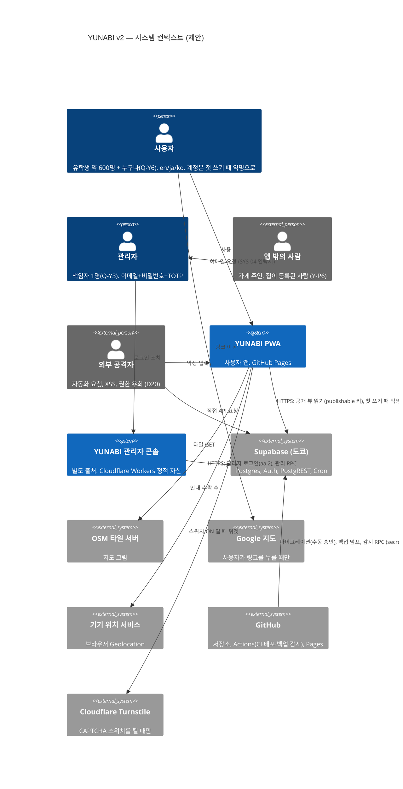
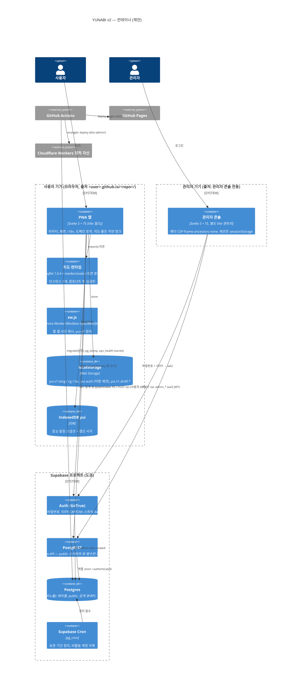
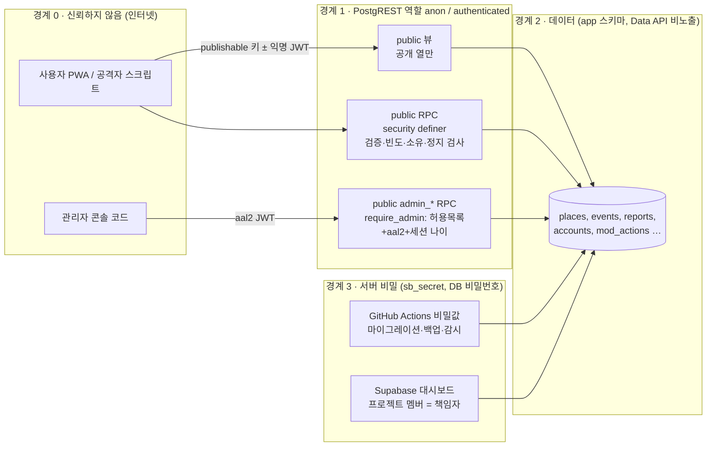
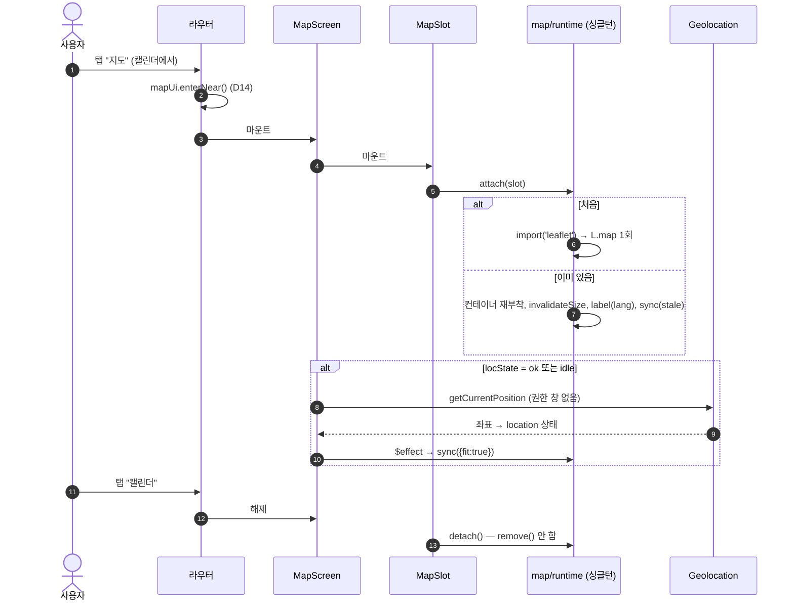
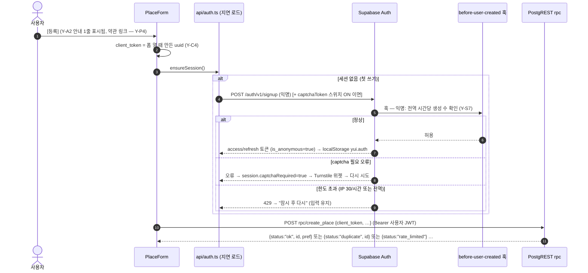
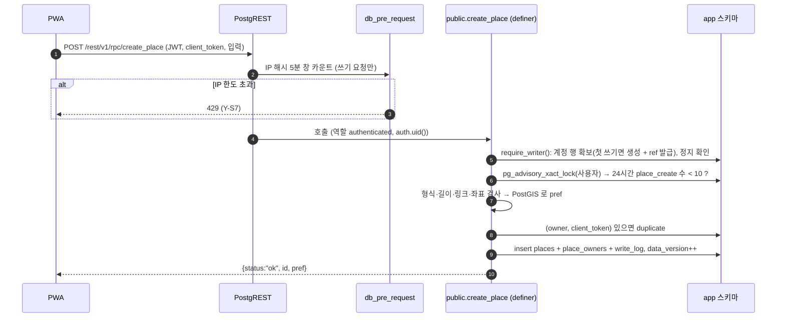
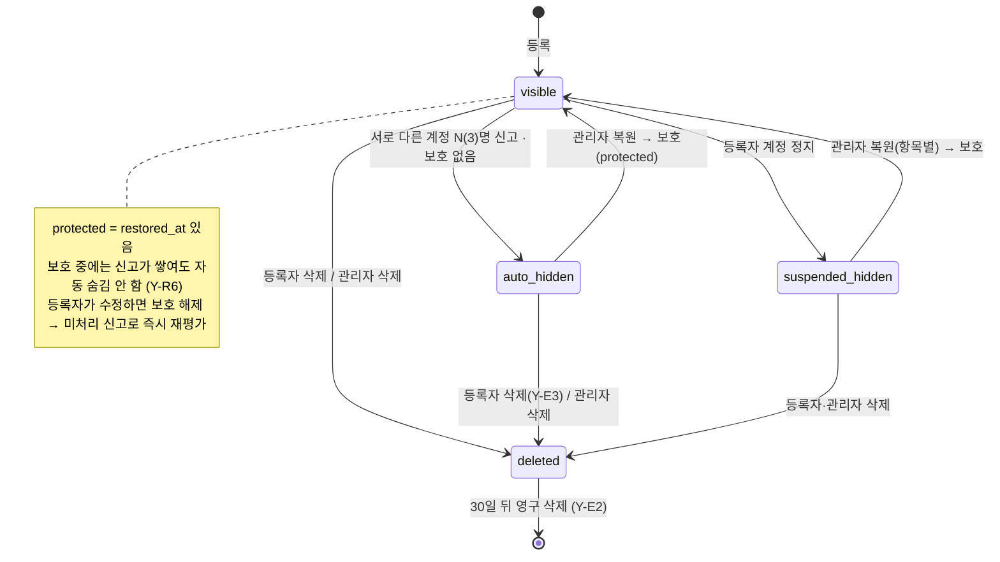
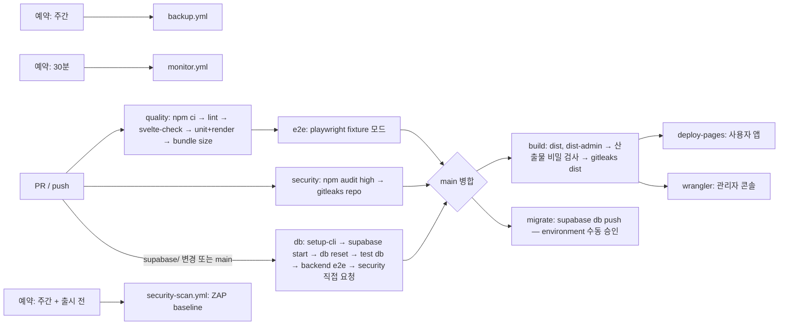

# RFC-0003 · YUNABI v2 — 재작성 구조, 공유 데이터 백엔드, 신고·관리, 보안

| | |
|---|---|
| 상태 | 제안됨 |
| 작성일 | 2026-10-12 |
| 범위 | [PRD-YUNABI v2.3](../../02-requirements/PRD-YUNABI.md) — D12~D20, Y-B\*, Y-J\*, Y-M\*, Y-K\*, Y-R\*, Y-E\*, Y-A\*, Y-C\*, Y-P\*, Y-S1~S12. 마일스톤 Y-0 의 설계 산출물 |
| 현행 코드 | `index.html` @`8ce701a` (1,835줄, v1.3 + 브랜드 + D14 + D15), `sw.js` (`CACHE = "yui-v6"`), `manifest.webmanifest` (`id: "./"`), `vendor/`, `data/japan-prefectures.geojson`, `assets/brand/yunabi-mark.svg`, 아이콘 4개. **백엔드 없음, 빌드 없음, 테스트 러너 없음** |
| 대체 관계 | [RFC-0002](0002-mlp-client-only.md)(클라이언트 단독 MLP)의 **공유 데이터 부분과 구조 부분**을 대체한다. 일본어 콘텐츠·지도 수명 주기·캘린더 모델·.ics 는 RFC-0002 의 동작을 그대로 옮긴다 |
| 같이 읽는 문서 | [tech-stack-v2](../tech-stack-v2.md), [ERD v2](../erd-v2.md), [openapi-v2.yaml](../openapi-v2.yaml), ADR [0015](../../adr/0015-frontend-framework-svelte.md)~[0022](../../adr/0022-security-baseline.md) |

**문서 형식: SAD 대신 RFC 하나 + ADR.** 개발자 소수, 컨테이너 셋(사용자 PWA, 관리자 콘솔, Supabase), 운영비 0 목표라 RFC-0001·0002 와 같은 형식을 잇는다. DB 는 [ERD v2](../erd-v2.md), API 는 [openapi-v2.yaml](../openapi-v2.yaml) 로 나눴다.

**읽는 법:** **현행** = 지금 코드에 있는 것(줄 번호는 `index.html` @`8ce701a`). **제안** = 이 RFC 가 정하는 것으로, 아직 어디에도 구현되지 않았다. 코드는 바꾸지 않았다.

---

## 1. 배경과 문제

v1.3 은 서버 없이 직접 넣은 장소·일정을 보여주는 단일 HTML PWA 였다(RFC-0002). v2 는 세 가지가 바뀐다(PRD §1).

1. 장소·일정을 **사용자가 등록하고 모두가 본다**(D16, 초기 데이터 0). 서버·계정·권한·신고·관리가 필요하다.
2. 코드를 **Vite + TypeScript + 프레임워크**로 다시 쓴다(D19). v1.3 의 "단일 파일·빌드 없음·테스트 러너 없음" 규칙을 없앤다.
3. 사용자 악용 대응은 규모(약 600명)에 맞게 **단순하게**, 대신 **외부 공격 보안**을 기준선으로 갖춘다(D20, §6.1 Y-S1~S12).

풀어야 하는 문제:

| # | 문제 | 절 |
|---|---|---|
| P1 | v1.3 의 동작(뒤로 가기·지도 유지·3개 언어·오프라인)을 퇴행 없이 새 구조로 | §5~§10, §19 |
| P2 | 로그인 화면 없이 쓰기 권한과 "내 항목만 수정" 을 서버에서 강제 | §12, §13 |
| P3 | 신고 3건 자동 숨김, 관리자 복원·삭제·정지, 감사 기록 | §15 |
| P4 | 외부 공격: 권한 우회, XSS, 키 유출, 자동화 대량 요청, 의존성 | §17 |
| P5 | 같은 주소에서 v1.3 설치·저장을 이어받기 | §18 |

## 2. 목표 / 비목표

**목표** — PRD G1~G6 과 §6.1. 운영비 0 목표.

**비목표** — PRD §3 비목표 그대로(게시판, 참가 신청, 일반 사용자 로그인, 컬렉션 동기화, 번역). 추가로: 서버 렌더링, 푸시 알림, 다중 관리자 권한 등급, 신고 자격 조건·평판 시스템(D20 이 제외), 앱 안의 사용 지표(ADR-0007 은 재사용하지 않음).

## 3. 품질 속성과 목표치

| 속성 | 목표 | 측정 | 근거 |
|---|---|---|---|
| 첫 화면 크기 | 홈 진입 JS+CSS gzip **60 KB 이하**(*제안* — v1.3 `index.html` 전체 40 KB + 프레임워크·라우터 여유). 지도·관리·폼 코드는 별도 청크 | CI 에서 `vite build` 결과 크기 검사(초과 시 실패) | Y-C1, RFC-0002 §12 |
| 지도 유지 | 탭 왕복·언어 변경 후 같은 Leaflet 인스턴스, 진입 시 내 주위 | E2E | Y-M1, Y-M2 |
| 공유 반영 | 등록·숨김이 다른 기기의 **지도·캘린더 화면 진입 시 즉시**, 이미 열린 화면은 **30초 이내** | E2E (두 브라우저 컨텍스트) | Y-M6, Y-K4, Y-R3 — PRD 의 "10초" 와의 차이는 OQ-1 |
| 오프라인 | 마지막 스냅샷과 갱신 시각 표시, 쓰기 비활성 | E2E (오프라인 에뮬레이션) | Y-C3 |
| 멱등 | 같은 등록을 두 번 보내도 1건 | pgTAP + E2E | Y-C4 |
| 권한 | 직접 요청 권한 테스트 100% 거절 | pgTAP, HTTP 테스트 | Y-S1 |
| XSS | 사용자 글 안의 스크립트 미실행, CSP 위반 0 | E2E | Y-S4 |
| 가용성 | 무료 플랜 SLA 없음. 장애 시 오프라인 스냅샷으로 읽기 유지 | 런북 | Y-C3, B-4 |
| 복구 | 주간 백업, 복구 시간 목표 4시간(*제안*), 손실 허용 7일(*제안*) | 출시 전 리허설 기록 | Y-S9 |
| 비용 | 0엔 | 대시보드 | §7 백엔드 |

---

## 4. 아키텍처 뷰

### 4.1 컨텍스트 (C4 Level 1, 제안)



### 4.2 컨테이너 (C4 Level 2, 제안)



### 4.3 신뢰 경계 (제안)



| 경계 | 누가 | 볼 수 있는 것 | 통제 (근거) |
|---|---|---|---|
| 0 → 1 | 모든 클라이언트, 공격자 포함 | 공개 뷰의 공개 열(등록자·신고자 없음). RPC 결과는 자기 것만 | 기본 테이블 비노출 스키마 + GRANT 0, 뷰 열 제한, RPC 정의자 함수 안 검사 (Y-S1, Y-M9, Y-R9) |
| 관리자 RPC | 허용 목록 + `is_anonymous=false` + `aal=aal2` + 세션 12시간 이내 | 신고 수·사유, 가명 계정 ID(`accounts.ref`) — 신고자 없음 | `require_admin()` (Y-R5, Y-S3, Y-P2, Y-R9) |
| 2 → 3 | 책임자, CI | 전부 (uuid, 신고자, 관리자 이메일) | 프로젝트 멤버 1~2명, 비밀값은 Actions 비밀값에만, 덤프 암호화 (Y-S2, Y-S9) |

> **익명성의 범위 (ADR-0001 재검토).** v2 의 약속은 "등록자·신고자는 **다른 사용자**에게 보이지 않는다(Y-M9, Y-R9). 관리자는 등록자의 **가명 ID** 만 본다(Y-P2, Q-Y11)." 경계 3(책임자)은 기술적으로 모두 볼 수 있다 — 개인정보처리방침에 쓴다(Y-P4).

---

## 5. 프론트엔드 구조 (제안)

### 5.1 원칙 (v1.3 CLAUDE.md 규칙의 일반화 — PRD §7 "남길 원칙")

| v1.3 규칙 | v2 의 형태 | 강제 수단 |
|---|---|---|
| 모든 문자열은 `T` 에 3개 언어 | `src/i18n/{en,ja,ko}.ts`, `en` 이 타입 원본 | 타입(`satisfies Messages`) + 단위 테스트 |
| `esc()` 로 이스케이프 | Svelte 텍스트 보간은 자동 이스케이프. `{@html}` 금지 | ESLint `svelte/no-at-html-tags: error` (Y-S4) |
| `\uXXXX` 는 스크립트 안에서만 | 해당 없음(모든 문자열이 TS) | — |
| 한국어 기준 폭 | 그대로 | E2E 375px × ko 넘침 검사 |
| 지도는 한 번 만들고 `render()` 를 넘어 산다 | 지도 런타임은 모듈 싱글턴, 컴포넌트는 슬롯만 | 단위 테스트 + E2E |
| 뷰는 바깥 세계를 건드리지 않는다 | **화면 컴포넌트는 `localStorage`·`navigator`·`fetch`·`L` 을 직접 쓰지 않는다** — `src/platform/`, `src/api/`, `src/map/` 만 | ESLint `no-restricted-globals`/`no-restricted-imports` (features·ui 폴더 대상) |
| 위치는 안내 후에만 | `location` 상태 기계 그대로 | 단위 테스트 |
| `CACHE` 를 올린다 | Workbox 사전 캐시 해시로 자동 | — (규칙 폐기) |

### 5.2 폴더 구조

```
/
├─ index.html                 사용자 앱 엔트리 (meta CSP)
├─ admin/index.html           관리자 콘솔 엔트리 (별도 빌드, CSP 는 _headers)
├─ vite.config.ts             사용자 앱 (base './', PWA)
├─ vite.admin.config.ts       관리자 콘솔 (outDir dist-admin)
├─ public/
│  ├─ manifest.webmanifest    id "./" 유지
│  ├─ icon-*.png
│  └─ data/japan-prefectures.geojson   (경로 유지 — v1.3 와 같은 URL)
├─ admin-public/_headers      관리자 콘솔 보안 헤더
├─ src/
│  ├─ main.ts                 부팅: 저장소 복원, 라우터 시작, SW 등록
│  ├─ app/                    App.svelte, router.ts, routes.ts, nav.ts(PARENT·뒤로)
│  ├─ i18n/                   en.ts(원본), ja.ts, ko.ts, index.ts(t(), 언어 상태)
│  ├─ content/                lessons.ts, vn.ts, endings.ts (v1.3 데이터, 타입), art.ts(그림 목록)
│  ├─ art/                    그림 파일 (§10 규칙)
│  ├─ domain/                 프레임워크 없는 순수 TS
│  │  ├─ calendar/            occurrences.ts(v1.3 occOn·upcoming), tokyoDate.ts
│  │  ├─ ics.ts               v1.3 downloadICS 의 생성부
│  │  ├─ geo/                 distance.ts, walk.ts, prefecture.ts(미리보기용 판정), bounds.ts(mainBounds)
│  │  ├─ validation.ts        서버와 같은 한도 (미리 안내용, 보장은 서버)
│  │  └─ types.ts             Place, EventSeries, Occurrence, ReportReason …
│  ├─ state/                  Svelte 룬 상태 (*.svelte.ts) — §7
│  ├─ platform/               storage.ts(store, yui.v1.*), idb.ts, geolocation.ts, online.ts, sw.ts(등록)
│  ├─ api/                    rest.ts(공개 뷰 GET, fetch), auth.ts(익명 로그인, 지연 로드),
│  │                          rpc.ts(타입 있는 RPC), errors.ts(상태·코드 → i18n 키), db.types.ts(생성)
│  ├─ map/                    runtime.ts(싱글턴), MapSlot.svelte, layers.ts, icons.ts
│  ├─ features/
│  │  ├─ home/  learn/(LearnList, Lesson, VnGame, Collection)
│  │  ├─ map/(MapScreen, ModeBar, StatusBar, CategoryChips, PlaceCard, PlaceList, PrefList, PlaceForm)
│  │  ├─ calendar/(MonthGrid, DayList, EventDetail, EventForm, OccurrenceForm)
│  │  ├─ report/ReportSheet  me/MyItems  legal/(Terms, Privacy, Contact)
│  ├─ ui/                     Header, TabBar, BackBar, LangMenu, Toast, Sheet, ArtImage, Button, FrameGuard
│  ├─ admin/                  관리자 콘솔 전용 (Login, MfaEnroll, Queue, ItemDetail, Accounts, AuditLog)
│  ├─ styles/                 tokens.css(v1.3 색·폰트 변수), base.css
│  └─ sw.ts                   서비스워커 소스 (§18.2)
├─ supabase/
│  ├─ config.toml
│  ├─ migrations/             ERD v2 §8
│  ├─ tests/                  pgTAP (*.test.sql)
│  └─ seed/                   fixtures.sql (로컬·CI 전용, 운영에는 적용 안 함)
├─ tests/
│  ├─ fixtures/               places.json, events.json (PRD §7 테스트 데이터)
│  ├─ render/                 모든 라우트 × 언어 렌더 검사 (v1.3 헤드리스 검사)
│  ├─ e2e/                    Playwright (fixture 모드)
│  ├─ e2e-backend/            Playwright (로컬 Supabase)
│  └─ security/               권한 직접 요청, XSS 페이로드, CSP 위반 수집
├─ scripts/                   gen-prefectures-sql.ts, check-dist-secrets.ts, check-bundle-size.ts
└─ .github/workflows/         ci.yml, deploy.yml, db.yml, backup.yml, monitor.yml, security-scan.yml
```

`index.html`(루트)은 **v1.3 단일 파일에서 Vite 엔트리로 바뀐다.** v1.3 파일은 git 기록에 남는다.

### 5.3 컴포넌트 구성


`App.svelte` 는 v1.3 `render()` 의 역할(헤더 표시 여부 `ROOTS`, `body.dataset.top`, `<html lang>`)을, 라우터는 `go()`·`popstate` 의 역할을 맡는다.

---

## 6. 라우팅과 뒤로 가기 (제안)

### 6.1 URL

v1.3 은 URL 을 `./` 로 고정하고 화면을 `history.state` 에만 두었다(RFC-0002 §5.4). v2 는 **해시 라우트**를 쓴다: GitHub Pages 는 경로 라우트의 새로고침을 404 로 돌려주고(별도 `404.html` 우회가 필요), 해시는 `base: './'` 하위 경로에서도 그대로 동작한다. 일정 링크를 공유할 수 있게 되는 이점도 있다.

| 라우트 | 화면 | 부모(‹) | 탭 | v1.3 view |
|---|---|---|---|---|
| `#/` | 홈 | — | 0 | `home` |
| `#/learn` | 일본어 | `#/` | 1 | `learn` |
| `#/learn/:lid` | 레슨·분기 게임 | `#/learn` | 1 | `lesson` |
| `#/learn/collection` | 컬렉션 | `#/learn` | 1 | `collection` |
| `#/map` | 지도 (`mode`, `pref` 는 state) | `#/` | 2 | `map` |
| `#/map/new`, `#/map/edit/:id` | 장소 등록·수정 (MAP-04) | `#/map` | 2 | 신규 |
| `#/cal` | 캘린더 | `#/` | 3 | `cal` |
| `#/cal/event/:id/:date` | 일정 상세 | `#/cal` | 3 | `event` |
| `#/cal/new`, `#/cal/edit/:id`, `#/cal/edit/:id/:date` | 일정 등록·수정, 회차 수정 (CAL-03) | `#/cal` 또는 상세 | 3 | 신규 |
| `#/me` | 내가 등록한 것 (ME-02) | `#/` | 0 | 신규 |
| `#/legal/:doc` | 약관·방침·문의 (SYS-04) | `#/` | 0 | 신규 |

신고 시트(SYS-03)는 라우트가 아니라 시트 상태다(열린 채로 OS 뒤로 가기 → 시트를 닫는다: 시트를 열 때 `pushState({sheet:true})`).

### 6.2 v1.3 동작의 대응

| v1.3 (현행, RFC-0002 §5.4, `index.html:1745-1826`) | v2 |
|---|---|
| `go(view)` = `pushState(snap())` + `render()` | `navigate(route)` = `pushState({prev}, "", "#…")` + 라우트 상태 갱신 |
| 같은 탭 다시 누르기 → `replaceState` | 같음 |
| ‹ : `PARENT[view] === prevView` 이면 `history.back()`, 아니면 `go(parent, true)` | 같음 — `nav.ts` 의 `PARENT` 표(위 표의 "부모"), `history.state.prev` |
| 도도부현 선택 = `pushState(+pf)`, OS 뒤로 가기 → 같은 지도에서 `updateMap` | 같음 — `#/map` 에 머무르며 `state.pref` 만 바뀐 기록 항목. `popstate` 가 지도 → 지도이면 **화면을 다시 만들지 않고** 지도 상태만 바꾼다 |
| 모드 전환은 기록 항목 아님(`replaceState`) | 같음 |
| D14: 다른 화면에서 지도로 `go()` 하면 near 로 (`index.html:1747-1753`) | 같음 — `navigate('#/map')` 가 다른 라우트에서 올 때 `mode=near, pref=null, cat='', pl=null`. 위치가 허용 상태면 다시 측위(Y-M1, 권한 창 없음) |
| `popstate` 로 지도에 돌아오면 state 의 `mode` 를 복원 (`:1823`) — D14 를 적용하지 않음 | **같게 유지** (OS 뒤로 가기는 "이전 화면 그대로" 가 기대 동작). OQ-8 에 확인 요청 |
| 시작: `history.state` → `?v=` → `?tab=1` → 홈, 쿼리 제거 | 시작: 해시 라우트 → `history.state` → **옛 쿼리 `?v=learn|map|cal`, `?tab=1`(→`#/cal`), `?compose=1`(→`#/`) 을 해시로 바꿔 `replaceState`** (manifest 바로가기·옛 링크 호환) |
| manifest `shortcuts` `./?v=map` | `./#/map` 으로 바꾸되, 옛 쿼리도 계속 받는다 |

## 7. 상태 관리 (제안)

전역 저장소 라이브러리 없이 **Svelte 5 룬(`$state`, `$derived`)을 담은 `.svelte.ts` 모듈**로 나눈다. v1.3 의 `S` 한 객체를 책임별로 쪼갠 것이다.

| 모듈 | 필드 (v1.3 `S` 대응) | 영속 |
|---|---|---|
| `state/prefs.svelte.ts` | `lang` | `yui.v1.lang` |
| `state/collection.svelte.ts` | `cg` (엔딩 카드) | `yui.v1.cg` (모양 검사 유지 — `index.html:1813`) |
| `state/location.svelte.ts` | `locState`(ask/idle/wait/ok/denied/fail/skip), `loc` | 선택만 `yui.v1.loc`, 좌표는 메모리 (Y-P3) |
| `state/mapUi.svelte.ts` | `mode`, `pref`, `cat`, `pl`, `prefFail`, `tileFail` | history state |
| `state/vn.svelte.ts` | `vn` 진행 | 메모리 |
| `state/calendarUi.svelte.ts` | `day`, `month` | 메모리 |
| `state/data.svelte.ts` | `places`, `events`, `overrides`, `fetchedAt`, `status`(idle/loading/ok/offline/error) | IndexedDB 스냅샷 |
| `state/session.svelte.ts` | `hasAccount`, `myIds`(내 항목 id 집합), `captchaRequired` | 세션은 `yui.auth` (auth-js 저장 키) |
| `state/net.svelte.ts` | `online` | — |

규칙: 컴포넌트는 상태를 읽고 **동작 함수**(`actions/*.ts`)를 부른다. 동작 함수만 `api/`·`platform/`·`map/` 을 부른다. 이것이 v1.3 의 "클릭 처리만 부수 효과" 경계를 대신한다 — 경계가 주석이 아니라 폴더와 린트 규칙이 된다(RFC-0002 OQ-9 해결).

## 8. i18n (제안)

| 항목 | 설계 |
|---|---|
| 형식 | `src/i18n/en.ts` 가 `export const en = {...} as const`. `type Messages = Widen<typeof en>`. `ja.ts`·`ko.ts` 는 `satisfies Messages` → 키가 빠지면 **컴파일 오류** |
| 이전 | v1.3 `T`(`index.html:383-615`)를 기계적으로 옮긴다. 배열(`tabs`, `wd`)·중첩(`regions`, `cats`)은 그대로. `by`(추가한 사람 라벨)·주최 관련 문구는 폐기(Y-M3, Y-K1) |
| 보간 | v1.3 `fill("{n}")` 과 같은 `t('homeCol', {n, m})`. 매개변수 이름도 타입으로 |
| 신규 문구 | 폼 라벨·검증·서버 상태 코드(§13.4)·빈 상태(Y-M5, Y-K3)·신고 사유(Y-R1)·Y-A2 안내·Y-M7 경고·Y-K11·법적 페이지. 모두 3개 언어(Y-C2) |
| 콘텐츠 | 레슨·게임·엔딩의 `{ja,en,ko}` 필드는 `src/content/` 의 타입 데이터로 유지. 장면 메모 `s` 는 데이터에 남기되 렌더하지 않는다(Y-J2, 현행 `8ce701a` 와 같음; 남길지는 Q-Y8) |
| 사용자 글 | 번역 없음. `lang` 이 화면 언어와 다르면 작은 언어 배지(Y-C5) |
| 라이브러리 | 쓰지 않는다. Paraglide 같은 컴파일러형도 후보였으나(tech-stack-v2 §2.2) 현재 `T` 의 배열·객체 구조를 그대로 옮기는 편이 비용이 작다 |
| 검사 | 단위 테스트: 세 언어 키 집합 동일·빈 문자열 없음. 렌더 검사: 모든 라우트 × 언어에서 `undefined`·`NaN`·`[object Object]` 없음 |
| 관리자 콘솔 | 영어·일본어·한국어 중 **관리자 언어 하나**로 시작해도 되는지 — OQ-9 (Y-C2 는 "새 화면의 모든 문구" 라 원칙상 3개 언어) |

## 9. 지도 수명 주기 (제안 — ADR-0014 의 일반화)

| 구성 | 역할 (v1.3 대응) |
|---|---|
| `map/runtime.ts` | 모듈 싱글턴. `container: HTMLDivElement`(v1.3 `LBOX`), `map`(`LMAP`), 클러스터, 핀, 내 위치, 경계 레이어, `modeView`(`MODEVIEW`), `stale`(`MAPSTALE`). `ensure()` 가 `import('leaflet')`·markercluster 를 한 번만 불러와 `L.map` 을 한 번 만든다(`initMap`) |
| `MapSlot.svelte` | `onMount` 에서 `runtime.attach(slotEl)` — 컨테이너를 슬롯에 붙이고 `invalidateSize()` → `label(lang)` → `sync(stale)`. `onDestroy` 에서 `detach()` — **떼기만 하고 `map.remove()` 하지 않는다** |
| 상태 → 지도 | `MapScreen` 의 `$effect` 가 `mapUi`·`data.places`·`location`·`lang` 이 바뀔 때 `runtime.sync({fit})` 를 부른다. 화면 HTML(상태줄·칩·목록·카드)은 Svelte 가 부분 갱신하므로 v1.3 의 `updateMap()`(컨테이너 5개 `innerHTML` 교체)이 필요 없다 |
| 비동기 결과 | 위치·경계 로드·**데이터 갱신**은 상태만 바꾼다. 지도 화면이면 `$effect` 가 반영하고, 아니면 `runtime.stale = true` → 다음 `attach` 가 맞춤 (v1.3 `mapChanged`/`locChanged`) |
| D14 / Y-M1 | 라우터가 다른 화면 → `#/map` 일 때 `mapUi.enterNear()`: `modeView.japan` 저장 → near → 저장된 near 화면이 있으면 `setView`, 없으면 맞춤. 위치 상태가 `ok`/`idle` 이면 `locate()` 다시(권한 창 없음 — 이미 허용된 권한만 사용) |
| 도도부현 | 경계 GeoJSON 은 `public/data/` 에서 일본 전체 첫 진입 때 `fetch`(v1.3 `ensurePrefs`). 같은 파일이 DB 의 판정용 테이블로도 들어간다(ERD v2 §4.6). `mainBounds()` 는 `domain/geo/bounds.ts` 로 |
| 장소 등록 | MAP-04 는 **같은 지도 인스턴스**를 쓴다: 폼 라우트에서도 `MapSlot` 을 붙이고 "위치 고르기" 모드(지도 탭 → 임시 마커). [현재 위치] 는 Y-M7 경고 확인 후에만 좌표를 채운다 |
| 타일 | URL 은 설정 상수(RFC-0002 R-2). 실패 집계·안내(v1.3 `tileFail`) 유지 |
| 라벨 | 확대 버튼·내 위치·결 마커 문구는 `attach` 때마다 현재 언어로(v1.3 `labelMap`) |



## 10. 그림 자리와 파일 규칙 (Y-J2, Y-J3)

**현행(`8ce701a`):** 그림이 없으면 회색 상자(`#D5D7D2`) — 컷 `.cutph` 4:3 + 컷 번호, 분기 게임 장면·컬렉션 카드 `.cgart` 4:3, 엔딩 화면 `.cgart.big` 3:2. 데이터에 `img` 필드가 있으면 ``. 장면 메모는 렌더하지 않는다.

**제안 — 파일을 넣으면 바뀌는 규칙:**

| 자리 | 경로·파일명 | 비율 | 권장 크기 | 비고 |
|---|---|---|---|---|
| 만화 컷 | `src/art/lessons/<lid>/<nn>.webp` — `lid` = `l1`~`l7`, `nn` = 컷 순서 2자리 1부터(`01`) | 4:3 | 1200×900 | 예: `src/art/lessons/l2/05.webp` = 2화 5번째 컷 |
| 분기 게임 장면 | `src/art/vn/<route>/<nn>.webp` — `route` = `osaka`·`kyoto` | 4:3 | 1200×900 | |
| 엔딩 카드 | `src/art/endings/<ending_id>.webp` — `e_osaka_best` 등 5개 | **3:2 원본** | 1200×800 | 엔딩 화면은 3:2 그대로, 컬렉션 격자(4:3)는 가운데 기준 `object-fit: cover` 로 잘림 → **좌우 각 약 6% 는 잘려도 되게** 그린다 |

- 형식: `.webp` 우선, `.png`·`.jpg` 도 허용(같은 이름이 둘이면 빌드 실패).
- 동작: `src/content/art.ts` 가 `import.meta.glob('/src/art/**/*.{webp,png,jpg}', { eager: true, query: '?url', import: 'default' })` 로 **빌드 시점에 있는 파일 목록**을 만든다. `ArtImage` 컴포넌트는 키(`lessons/l2/05`)가 목록에 있으면 ``, 없으면 회색 자리를 그린다. 코드 수정 없이 파일 하나를 넣고 빌드(=`main` 푸시 → CI 배포)하면 그 칸만 바뀐다(Y-J3 수락 기준).
- 파일은 해시 이름으로 출력되어 캐시 무효화가 자동이고, 서비스워커 사전 캐시에 들어간다(그림 총량이 커지면 사전 캐시에서 빼고 런타임 캐시로 — OQ-10).
- 검사: 단위 테스트가 `src/art/` 의 모든 파일 이름이 실제 자리(레슨 컷 수·장면 수·엔딩 id)에 대응하는지 확인 — 오타 파일이 조용히 무시되지 않게.
- `alt`: 컷의 일본어 대사(`jp`)를 대체 텍스트로.

## 11. 데이터 읽기·캐시·오프라인·반영 (제안)

### 11.1 읽기

| 데이터 | 요청 | 비고 |
|---|---|---|
| 장소 | `GET /rest/v1/places_public?select=…` | 보이는 항목 전체. 1,000건 ≈ gzip 80 KB(*추정*). **2,000건을 넘으면** 도도부현별 요청 + `place_counts_by_pref` 로 바꾼다(OQ-11) |
| 일정 | `GET /rest/v1/events_public?select=…` + `GET /rest/v1/event_occurrences_public?select=…` | 보이는 시리즈 + 회차 덮어쓰기. 전개(`occOn`)는 클라이언트 `domain/calendar` |
| 판 번호 | `POST /rest/v1/rpc/data_version` → bigint | 장소·일정·회차·숨김이 바뀔 때마다 오르는 카운터. 같으면 다시 받지 않는다 |
| 내 항목 | `POST /rest/v1/rpc/my_items` (계정이 있을 때만) | 숨김·삭제 상태 포함(Y-R8). 응답의 id 로 카드에 [수정]·[삭제] 표시 |

읽기에는 **계정이 필요 없다**(`anon` 역할 + publishable 키). Y-A1(읽기만 하면 계정 없음)과 맞고, 익명 로그인이 막혀도(B-1, 공격 대응 스위치) 읽기는 된다. 읽기 요청은 SDK 없이 `fetch` 로 해 첫 화면 크기를 줄인다.

### 11.2 캐시와 오프라인 (Y-C3, Y-R10)

- 성공한 읽기는 IndexedDB `yui` › `snapshot` 에 `{places, events, overrides, version, fetchedAt}` 로 **통째로 교체** 저장한다. 숨겨진 항목은 응답에 없으므로 다음 갱신 때 스냅샷에서도 사라진다(Y-R10).
- 시작 시: 스냅샷을 먼저 그리고(있으면) → 온라인이면 `data_version` 확인 → 다르면 다시 받는다.
- 오프라인(`navigator.onLine === false` 또는 요청 실패): 스냅샷 + "마지막 갱신: {시각}" 표시, 등록·수정·삭제·신고 버튼 비활성 + 안내(Y-C3).
- 서비스워커는 API 응답을 캐시하지 않는다(교차 출처, 사용자 토큰이 실린 요청도 있음). 데이터 캐시는 앱 코드 한 곳(IndexedDB)에만.
- 저장소 차단 시: 메모리로만 동작(v1.3 ADR-0010 원칙).

### 11.3 반영 시간

| 상황 | 동작 | 지연 |
|---|---|---|
| 지도·캘린더 화면에 들어올 때, 앱이 다시 보일 때(`visibilitychange`) | `data_version` 확인 → 다르면 다시 받기 | 즉시 |
| 지도·캘린더가 열려 있는 동안 | 30초마다 `data_version` (응답 수십 바이트) | 최대 30초 |
| 내가 쓴 직후 | 응답을 바로 반영 + 다시 받기 | 즉시 |

PRD 는 "10초 안에 다른 기기에서" 를 요구한다(Y-M6, Y-K4, Y-R3). 열린 화면에 10초를 보장하려면 Supabase Realtime(브로드캐스트) 구독이 필요하다 — 의존성·연결 수가 늘어 이 RFC 는 30초 폴링을 제안하고 OQ-1 로 책임자 확인을 요청한다. 폴링 egress 추정: 동시에 화면을 연 사용자 10명 × 하루 2,880회 × 약 400 B ≈ 월 350 MB(*추정*).

---

## 12. 인증 흐름 (제안)

### 12.1 익명 계정 — 첫 쓰기 때 (Y-A1, Y-A2, Q-Y10)



- 세션 저장 키는 `yui.auth`(auth-js `storageKey`) — 출처 공유(R-6) 아래에서 다른 앱과 겹치지 않게.
- 토큰 갱신은 auth-js 자동 갱신. 갱신 토큰이 만료·삭제되면(저장소 삭제, 1년 비활동 정리 — Y-P5) 새 익명 계정이 생기고 옛 항목은 고칠 수 없다(Y-A2 안내의 내용).
- 기기 이전(Q-Y2)은 범위 밖.

### 12.2 관리자 로그인 (Y-R5, Y-S3)

| 단계 | 설계 |
|---|---|
| 계정 생성 | 책임자가 Supabase 대시보드에서 이메일+비밀번호 사용자를 만든다(가입 화면 없음). `before-user-created` 훅이 **익명이 아닌 가입은 `app.admins` 허용 목록의 이메일만** 통과시킨다 — 이메일 가입 경로가 열려 있어도 외부인이 관리자 후보 계정을 만들 수 없다 |
| 허용 목록 | `app.admins(user_id, email, active)` — 마이그레이션·SQL 로만 추가(클라이언트 경로 없음) |
| 2단계 | 첫 로그인 때 TOTP 등록 강제, 이후 매 로그인 TOTP. 관리 RPC 는 JWT `aal = 'aal2'` 가 아니면 거절 |
| 세션 만료 | (1) 대시보드의 비활동·최대 수명 설정(플랜 제한 미확인 — tech-stack-v2 §5.5), (2) **플랜과 무관한 서버 검사**: `require_admin()` 이 `auth.sessions` 에서 현재 세션(`session_id` 클레임)의 생성 시각을 읽어 12시간 넘으면 거절, (3) 콘솔은 세션을 `sessionStorage` 에 둔다(창을 닫으면 끝) |
| 출처 분리 | 관리자 콘솔은 사용자 앱과 다른 출처(Cloudflare) — 사용자 앱이나 같은 `github.io` 의 다른 페이지에 XSS 가 있어도 관리자 토큰에 닿지 않는다(ADR-0020) |
| 기록 | 모든 관리 조치를 `app.mod_actions` 에 추가 전용으로(누가: 관리자 이메일·id, 언제, 무엇을, 대상, 메모) — Y-R5. 거절된 관리 RPC 호출도 `app.security_events` 에(Y-S10) |

---

## 13. 쓰기 경로와 서버 검증 (제안 — ADR-0021)

### 13.1 원칙

1. **클라이언트는 테이블에 직접 쓰지 않는다.** 기본 테이블은 Data API 가 노출하지 않는 `app` 스키마에 있고 `anon`·`authenticated` 에 테이블 권한이 없다. 쓰기는 `public` 스키마의 정의자 함수(RPC)뿐이다(Y-S1, Y-A5).
2. **모든 검사는 함수 안에서, 같은 트랜잭션에서:** 세션 → 정지 여부 → 빈도 → 형식·길이 → 소유 → 쓰기. 클라이언트 검사는 안내용(같은 한도를 `domain/validation.ts` 에 둠).
3. **SQL 은 문자열로 조합하지 않는다**(Y-S5): 함수 본문은 정적 SQL + 매개변수. `EXECUTE format()` 을 쓰지 않는다(마이그레이션 검사가 `prosrc` 에서 `execute` 를 찾으면 실패 — ERD v2 §8 `checks`). 클라이언트는 PostgREST 매개변수만 보낸다.
4. **거절은 기록하고 상태로 돌려준다, 형식 오류는 예외로:** 권한 거절·빈도 초과·정지는 `app.security_events` 에 남기고 `{status: …}` 로 반환한다(예외는 트랜잭션을 되돌려 기록이 사라지므로 — 이전 erd.md §6 의 교훈). 형식 오류는 `raise exception using errcode='P0001', message='invalid_<field>'`.
5. **멱등(Y-C4):** 생성 RPC 는 `client_token uuid` 를 받는다. `(owner, client_token)` 이 이미 있으면 새로 만들지 않고 `{status:'duplicate', id}`. 클라이언트는 폼을 열 때 토큰을 만들고 재전송에 같은 토큰을 쓴다. 입력은 `yui.v1.draft.<form>` 에 저장해 연결이 끊겨도 잃지 않는다.

### 13.2 검증 규칙

| 대상 | 규칙 (서버) | 근거 |
|---|---|---|
| 장소 이름 | 공백 정리 후 1~60자(`char_length`), 제어 문자 금지 | Y-M6 |
| 카테고리 | enum `transit, daily, food, study, admin, health` | Y-M6, v1.3 `CATCOLOR` |
| 설명 | 0~500자 | Y-M6 |
| Google 링크 | 선택. `https://` 만, 호스트가 정확히 `www.google.com`·`google.com`·`www.google.co.jp`·`google.co.jp` 이고 경로가 `/maps` 로 시작, 또는 호스트 `maps.app.goo.gl`, 또는 `goo.gl` + 경로 `/maps/`. 최대 500자. 사용자 정보(`user@`)·포트 금지 | Y-M6, Y-S4 |
| 좌표 | 유한한 수, 일본 경계 폴리곤(PostGIS, 단순화본)에서 **10 km 이내**여야 하고, 도도부현 = 가장 가까운 폴리곤. 단순화로 지워진 작은 섬·해안 지점을 위한 여유 거리 | Y-M6, Y-A5 |
| 작성 언어 | enum `en, ja, ko` (화면 언어) | Y-M6, Y-K4 |
| 일정 제목 / 장소 / 설명 | 1~60 / 0~60 / 0~500자 | Y-K4 |
| 일정 날짜 | `>= 도쿄 오늘`(생성 시). 시작·끝 `HH:MM`, 끝 > 시작(같은 날) | Y-K4 |
| 매주 반복 | `weekly_until` 필수(반복일 때), 같은 요일, `start_date < weekly_until <= start_date + 175일`(**최대 26회**) | Y-K6 — "26주" 해석은 OQ-3 |
| 회차 수정·취소 | 시리즈의 실제 회차 날짜, 그 회차가 끝나지 않았을 것 | Y-K7, Y-K9 |
| 지난 일정 수정 | 마지막 회차의 끝 시각(도쿄)이 지났으면 수정 거절, 삭제는 허용 | Y-K9 |
| 신고 사유 | enum `wrong, spam, inappropriate, privacy, other` | Y-R1 |
| 빈도 | §14 | Y-A3 |
| 정지 | `accounts.suspended_at is not null` → 모든 쓰기·신고 거절 | Y-R7 |

### 13.3 시퀀스 — 장소 등록



### 13.4 상태 코드 (클라이언트는 `api/errors.ts` 한 곳에서 i18n 키로)

`ok`, `duplicate`, `rate_limited`, `suspended`, `not_found`(남의 것·없음·삭제됨 — 구별하지 않음), `past_event`, `already_reported`, `forbidden`(관리자), 예외 `invalid_<field>`. HTTP 429 는 IP 한도, 401 은 세션 문제.

## 14. 빈도 제한 (제안 — Y-A3, Y-S7)

| 층 | 대상 | 한도 (설정값 `app.settings`) | 구현 |
|---|---|---|---|
| Auth (Supabase) | 익명 로그인 | IP 당 시간당 30 (기본, 대시보드) | 플랫폼. 기숙사 NAT 확인 후 조정(OQ-5) |
| Auth 훅 | 익명 계정 생성 **전역** | 시간당 200 (*제안* — 600명이 첫 주에 몰려도 넘기 어려운 값) | `before-user-created` 가 최근 1시간 익명 생성 수를 세어 초과 시 거절 + `security_events` |
| PostgREST | 쓰기 요청(POST rpc) **IP 당** | 5분 60회 (*제안*) | `db_pre_request` — Supabase 공식 패턴. IP 는 `sha256(ip || 일일 솔트)` 로만, 1시간 뒤 삭제(Y-S12). 신뢰할 헤더 값은 Y-2 실측(tech-stack-v2 §5.5) |
| RPC | 계정당 24시간 | 장소 등록 10, 일정 등록 10, 수정 30, 신고 20 (Y-A3) | `write_log` + 사용자 단위 advisory 잠금. 삭제는 제한 없음(악용 이득 없음) |
| 스위치 | CAPTCHA | 기본 OFF | Supabase Bot and Abuse Protection(Turnstile) ON → 익명 로그인에 토큰 필요. 클라이언트는 오류를 받으면 위젯을 띄운다(재배포 불필요). CSP 는 Turnstile 출처를 미리 허용(§17.3) |

"하루" 는 롤링 24시간(경계 시각 악용 없음, 구현 단순). 계정을 새로 만들어 한도를 피하는 것은 **자동화된 대량 생성일 때만** 막는다(Y-A4, D20) — 위 Auth·훅·IP 층과 CAPTCHA 스위치가 그 장치다.

## 15. 신고·자동 숨김·관리 (제안 — ADR-0019)

### 15.1 항목 상태



DB 에서는 열 조합이다(ERD v2 §4.2): `deleted_at`, `auto_hidden_at`, `suspension_hidden_at`, `restored_at`. 공개 조건 = `deleted_at is null and auto_hidden_at is null and suspension_hidden_at is null`.

### 15.2 규칙 (D20 — 단순하게)

| # | 규칙 | 근거 |
|---|---|---|
| M-1 | 한 계정은 한 항목을 한 번 신고(`unique(대상, 신고자)`). 두 번째는 `already_reported` | Y-R2 |
| M-2 | 등록자 자신의 신고는 저장하지만 세지 않는다 | 자기 항목 숨기기는 삭제로 충분 — 단순 규칙 |
| M-3 | **미처리 신고의 서로 다른 신고자 수 ≥ N(3)** 이고 보호 중이 아니면 같은 트랜잭션에서 `auto_hidden_at = now()` + `mod_actions(actor_kind='system', action='auto_hide', 사유별 건수)` | Y-R3 |
| M-4 | 신고자 자격 조건(계정 나이 등)·CAPTCHA 기본 사용·평판 없음 | D20, Y-R3 |
| M-5 | 신고는 시리즈 단위(일정은 회차가 아니라 시리즈) | 단순 |
| M-6 | 관리자 **복원**: 숨김 열을 모두 비우고 `restored_at = now()`, 그 항목의 미처리 신고를 `resolution='restored'` 로 처리 | Y-R4, Y-R6 |
| M-7 | 보호 중(복원 후 수정 전)에는 신고가 쌓여도(관리자 화면에 보임) 자동 숨김하지 않는다 | Y-R6 |
| M-8 | 등록자가 보호 중인 항목을 수정하면 `restored_at = null` → 그 시점의 미처리 신고로 M-3 즉시 재평가 | Y-R6 (v2.3) |
| M-9 | 수정은 신고를 지우지 않고 숨김을 풀지 않는다 | Y-E1 |
| M-10 | 관리자 **삭제**: `deleted_at`, `deleted_by='admin'`, 미처리 신고 `resolution='deleted'` | Y-R4 |
| M-11 | 관리자 **신고 기각**(보이는 항목에 쌓인 신고를 처리): 미처리 신고 `resolution='dismissed'` — 항목은 그대로 | Y-R4 "신고가 있는 항목" 처리 |
| M-12 | **정지**: `accounts.suspended_at` + 그 계정의 보이는 항목 모두 `suspension_hidden_at`. 정지 계정은 쓰기·신고 불가. **해제해도 항목은 숨김 유지**, 관리자가 항목별 복원 | Y-R7 |
| M-13 | 관리자에게 보이는 것: 항목 내용, 상태, 사유별 신고 수, 첫·마지막 신고 시각, 등록자 **가명 ID** (`accounts.ref`, 예 `a-7f3k9q2m`). 신고자 정보 없음 | Y-R4, Y-R9, Y-P2 |
| M-14 | 등록자는 ME-02 에서 자기 항목 상태(`visible`/`hidden_review`/`deleted`)를 본다. 숨김 원인(신고·정지)은 구별하지 않고 "검토 중" | Y-R8 |

### 15.3 감사 기록 (ADR-0006 재사용)

`app.mod_actions` 는 추가 전용: UPDATE·DELETE 행 트리거 + TRUNCATE 문장 트리거가 거부(트리거 함수는 **security invoker** — 정의자로 만들면 `current_user` 검사가 무력화된다, erd.md §6 교훈). 예외는 보관 기간 정리 하나: 1년 지난 행만, 정리 함수 안에서만(ERD v2 §5.3). 항목 행을 영구 삭제해도 기록은 대상 종류·id·메모만 남기고 **본문 사본을 두지 않는다**(개인정보 노출 신고 대상의 내용을 기록에 복제하지 않기 위해 — Y-S12).

## 16. 개인정보·보관 (Y-P\*, Y-S12)

| 데이터 | 저장 위치 | 보관 | 비고 |
|---|---|---|---|
| 익명 계정 (`auth.users` 익명 행, `app.accounts`) | Supabase | 마지막 활동(`last_active_at`, 쓰기·신고 때 갱신) 1년 → 삭제 | 삭제돼도 장소는 남음(주인 없음), 일정은 끝난 지 1년 뒤 함께 정리(Y-P5) |
| 장소·일정·회차 | Supabase | 삭제 후 30일 → 영구 삭제. 끝난 일정은 1년 뒤 | Y-E2, Y-P5 |
| 신고 | Supabase | 1년 | 신고자 id 는 계정 삭제 시 null (집계는 유지) |
| 관리 기록 | Supabase | 1년 | 관리자 이메일 포함(관리자만 이메일 저장 — Y-P1) |
| 빈도 기록 `write_log` | Supabase | 48시간 | 계정 단위 24시간 판단에만 |
| IP 해시 `ip_hits` | Supabase | 1시간 | 일일 솔트 해시, 원 IP 저장 안 함 |
| `security_events` | Supabase | 90일 (*제안*) | 계정 id 또는 IP 해시, 이벤트 종류만 |
| 사용자 좌표 | 기기 메모리만 | — | 등록한 장소 좌표만 서버로(Y-P3). 백엔드 요청에 사용자 위치 없음 |
| 컬렉션·언어·위치 선택 | `localStorage yui.v1.*` | 사용자가 지울 때까지 | v1.3 그대로 |
| 플랫폼 로그 (IP 등) | Supabase·GitHub·Cloudflare | 각 사업자 정책 | 방침에 명시(Y-P1) |

공개 뷰는 날짜만 내보낸다(`created_on`, `edited_on`) — 초 단위 시각으로 사용자 행동과 대조하는 것을 줄인다. 서버 위치(도쿄 리전 — 확인 필요 TS-Q8)와 미국 사업자(GitHub, Cloudflare, Supabase)의 해외 이전 여부를 방침에 적는다(Y-P4). 데이터 최소화 검토(Y-S12)는 ERD v2 §4 의 각 열에 "왜 필요한가" 를 적는 것으로 대신하고, 출시 전 점검표에 넣는다.

삭제 요청(Y-P6, Y-P7): 관리자 콘솔의 검색(이름·도도부현)으로 항목을 찾아 관리자 삭제 + 메모 "외부 요청". 30일 보관 중 노출은 없다(공개 뷰 제외).

---

## 17. 보안 — 위협 모델과 대응 (D20, Y-S1~S12, ADR-0022)

### 17.1 보호 대상

| 자산 | 가치 | 위치 |
|---|---|---|
| A1 공개 데이터의 무결성 (장소·일정) | 서비스 신뢰 | `app.places`, `app.events` |
| A2 등록자·신고자 연결 | 개인정보, 신뢰 | `place_owners`, `event_owners`, `reports.reporter_id` |
| A3 관리자 권한 | 전체 데이터 조작 | 관리자 세션, `admins` |
| A4 서버 비밀 (`sb_secret`, DB 비밀번호, Cloudflare 토큰) | 모든 권한 | GitHub Actions 비밀값, Supabase |
| A5 사용자 기기의 세션·저장 | 개인 항목 수정 권한, 컬렉션 | 브라우저 |
| A6 가용성 | 서비스 | Supabase 무료 한도, Pages |
| A7 백업 | 복구 | 암호화 덤프 |

### 17.2 STRIDE

| # | 범주 | 위협 | 대상 | 대응 | Y-S | 검증 |
|---|---|---|---|---|---|---|
| T-01 | S 위장 | 남의 항목을 고치려 다른 계정인 척 (`owner_id` 를 요청에 넣음) | A1 | 소유자는 요청 값이 아니라 `auth.uid()` 로만. RPC 매개변수에 소유자 없음 | S1 | pgTAP: 다른 사용자 JWT 로 `update_place` → `not_found` |
| T-02 | S | 관리자 사칭: 익명 JWT·도난 비밀번호로 관리 RPC | A3 | `require_admin()`: 허용 목록 + `is_anonymous=false` + `aal2` + 세션 12시간. 비밀번호만으로는 `aal1` | S3 | pgTAP: aal1 관리자, 허용 목록 밖 aal2 사용자, 익명 → 모두 `forbidden` + 기록 |
| T-03 | S | 이메일 가입으로 관리자 후보 계정 생성 | A3 | `before-user-created` 훅이 허용 목록 밖 비익명 가입 거부 | S3 | 통합 테스트 |
| T-04 | S | 공식 행사 사칭 일정 | A1 | 일정 종류 없음(Y-K5) — 기능상 대응 | — | — |
| T-05 | T 변조 | PostgREST 로 테이블 직접 INSERT/UPDATE/DELETE | A1 | 기본 테이블은 비노출 `app` 스키마 + GRANT 0. `public` 에는 뷰(읽기)와 RPC 만 | S1 | pgTAP: `anon`·`authenticated` 의 `app` 권한 0, `public` 뷰 쓰기 불가 |
| T-06 | T | SQL 주입 | A1, A2 | 정적 SQL·매개변수만, 동적 `EXECUTE` 금지(마이그레이션 검사), PostgREST 매개변수화 | S5 | 마이그레이션 `checks`, 비정상 입력 세트 |
| T-07 | T | 저장형 XSS (장소 이름·설명에 스크립트) → 다른 사용자 토큰 탈취 | A5 | Svelte 텍스트 보간(자동 이스케이프), `{@html}` 린트 금지, 링크는 서버 허용 목록 + 클라이언트도 `https:` 확인 후 `rel="noopener noreferrer"`, meta CSP `script-src 'self'` | S4 | E2E: 페이로드 세트 등록 → `dialog`·`securitypolicyviolation` 0 |
| T-08 | T | `javascript:`·데이터 URL 링크 | A5 | 서버 정규식(§13.2) + 클라이언트 URL 파서 이중 | S4, S5 | pgTAP + 단위 |
| T-09 | T | 공급망: 악성·취약 npm 의존성 | A5, A4 | 잠금 파일, `npm ci`, `npm audit --audit-level=high` 실패 처리, Dependabot, 런타임 의존성 최소(Svelte, Leaflet, markercluster, auth-js, postgrest-js, workbox) | S6 | CI |
| T-10 | T | 배포 산출물 변조 (CI 탈취) | A5 | `main` 보호 규칙(PR + CI 통과), Actions 권한 최소(`permissions:` 명시), 서드파티 액션은 커밋 SHA 고정, 배포 환경 보호 | S2, S6 | 저장소 설정 점검표 |
| T-11 | R 부인 | 관리자가 조치를 부인·기록 삭제 | A3 | `mod_actions` 추가 전용(트리거, invoker), 행위자 이메일·id | S3, S10 | pgTAP: `service_role` 로도 UPDATE/DELETE/TRUNCATE 거부 |
| T-12 | I 정보 노출 | 등록자 uuid·신고자 노출 (공개 뷰, 오류 메시지, 시각 대조) | A2 | 뷰 열 제한(소유·토큰 없음), 신고자는 어떤 뷰·RPC 반환에도 없음, 관리자도 가명 ref 만, `not_found` 균일화, 공개 날짜는 일 단위 | S1, S12 | pgTAP: 모든 뷰의 열 목록 고정 검사, `reports` 직접 접근 불가 |
| T-13 | I | 숨김·삭제 항목 읽기 | A1 | 공개 뷰 조건 + 테이블 비노출. `my_items` 는 본인 것만 | S1 | pgTAP |
| T-14 | I | 비밀 키 유출 (저장소·번들·로그) | A4 | 클라이언트는 publishable 키만(`VITE_` 접두어 변수 2개만 허용), gitleaks(저장소·`dist`), 산출물 패턴 검사, GitHub push protection, `.env*` 무시(현행 `.gitignore`) | S2 | CI |
| T-15 | I | 관리자 토큰 탈취 (같은 `github.io` 출처의 다른 페이지, 사용자 앱 XSS) | A3 | 관리자 콘솔은 별도 출처 + 헤더 CSP·`frame-ancestors 'none'`, 세션은 `sessionStorage`, 12시간 서버 만료 | S3, S4 | ZAP baseline(헤더), 점검표 |
| T-16 | I | 백업 덤프 유출 | A7, A2 | `age` 공개 키로 암호화 후 보관, 개인 키는 책임자만, 덤프에서 `ip_hits`·`write_log` 제외 | S9, S12 | 리허설 기록 |
| T-17 | I | 전송 구간 도청·혼합 콘텐츠 | A5 | HTTPS 만(Pages "Enforce HTTPS", Supabase·Cloudflare 기본 HTTPS), CSP `upgrade-insecure-requests`, 외부 요청은 모두 `https:` | S8 | ZAP, 점검표 |
| T-18 | D 서비스 거부 | 자동화된 익명 계정 대량 생성 → DB 비대·MAU | A6 | Auth IP 한도, 훅의 전역 시간당 한도, CAPTCHA 스위치, 1년 정리 | S7 | 통합 테스트(한도+1 거절), 스위치 시험 |
| T-19 | D | 쓰기·신고 폭주 | A6, A1 | IP 5분 한도(`db_pre_request`), 계정 24시간 한도, 자동 숨김 남용은 관리자 복원 + 보호(Y-R6) | S7 | pgTAP, 통합 |
| T-20 | D | 읽기 폭주로 egress 소진 | A6 | 읽기는 IP 제한 대상이 아님(공식 패턴 한계). 응답 최소 열·판 번호로 재다운로드 억제, 감시가 사용량 70% 경보 → 필요 시 Turnstile/Pro 판단 | S10 | 감시 |
| T-21 | D | 무료 프로젝트 일시정지·장애 | A6 | 오프라인 스냅샷 읽기, 런북 재개 절차, 감시 워크플로가 정지 탐지 | S9, S10 | 런북 |
| T-22 | E 권한 상승 | 정지된 계정이 계속 쓰기 | A1 | 모든 쓰기 RPC 첫 단계 `require_writer()` 가 정지 확인 | S1 | pgTAP |
| T-23 | E | 정의자 함수의 `search_path` 탈취, 헬퍼 남용 | A1, A2 | 모든 정의자 함수 `set search_path = ''` 와 스키마 한정 이름, `public` 에 CREATE 권한 회수, 헬퍼(`require_admin` 등)는 EXECUTE 부여 안 함 | S1 | 마이그레이션 `checks` |
| T-24 | E | 클릭재킹으로 사용자 앱에서 삭제·신고 유도 | A1 | 사용자 앱은 meta CSP 로 `frame-ancestors` 불가 → `FrameGuard`: 최상위 창이 아니면 쓰기 버튼 비활성 + "새 창에서 열기" | S4 | E2E(iframe 안에서 버튼 비활성) |
| T-25 | E | 서비스워커 하이재킹(같은 출처 다른 페이지가 범위 안 SW 등록) | A5 | SW 범위는 앱 하위 경로. 같은 `github.io` 사용자 페이지의 위험은 출처 공유 한계로 수용(R-3) | — | — |

### 17.3 사용자 앱 meta CSP (초안)

```
default-src 'self';
script-src 'self' https://challenges.cloudflare.com;
style-src 'self' 'unsafe-inline';
img-src 'self' data: https://tile.openstreetmap.org;
connect-src 'self' https://<ref>.supabase.co https://challenges.cloudflare.com;
frame-src https://challenges.cloudflare.com;
worker-src 'self';
manifest-src 'self';
object-src 'none';
base-uri 'self';
form-action 'self';
upgrade-insecure-requests
```

- `style-src 'unsafe-inline'`: Leaflet·Svelte 전환 효과가 인라인 스타일을 쓴다. 스크립트 실행 경로가 아니라 수용(Y-1 에서 제거 가능 여부 확인).
- Turnstile 출처는 스위치를 재배포 없이 켜기 위해 미리 허용한다(스위치 OFF 일 때 그 스크립트는 로드되지 않는다).
- Vite 빌드는 인라인 스크립트를 만들지 않게 설정(SW 등록도 모듈에서) — `'unsafe-inline'` 없이 `script-src 'self'`.
- 관리자 콘솔은 같은 정책을 **헤더**로, 여기에 `frame-ancestors 'none'` 과 `connect-src` 에서 Turnstile·타일 제외.

### 17.4 감시와 알림 (Y-S10)

| 신호 | 출처 | 경보 기준 (*제안*) |
|---|---|---|
| 관리자 조치 | `mod_actions` | 모든 조치를 일일 요약 |
| 권한 거절 | `security_events` (`forbidden`, `not_found` on edit/delete, 관리 RPC 거절) | 1시간 50건 초과 |
| 빈도 초과 | `security_events` (`rate_limited`), `ip_hits` 의 한도 도달 창 | 1시간 100건 초과, 또는 한 IP 해시가 3개 창 연속 한도 |
| 익명 계정 생성 | `auth.users` 최근 1시간 | 전역 한도의 50% |
| 자동 숨김 | `mod_actions` `auto_hide` | 1시간 5건 초과 (대량 신고 공격 징후) |
| 사용량 | Supabase 대시보드(DB 크기·egress) | 무료 한도 70% — 수동 주간 확인 |
| 사이트 가동 | Pages·콘솔·Supabase 상태 | 실패 시 |

구현: **GitHub Actions `monitor.yml`**(30분마다 예약 실행)이 `sb_secret` 으로 `public.ops_health()`(`service_role` 전용)를 부르고, 기준을 넘으면 비공개 정보 없이 요약한 **GitHub 이슈**를 열어 관리자에게 메일 알림이 가게 한다(추가 서비스 없음). 이 예약 실행은 무료 프로젝트 비활동 일시정지를 막는 부수 효과도 있다 — 의도적으로 쓰는지는 OQ-12. 대안(Supabase 로그 드레인·외부 모니터링)은 비용 때문에 기각.

### 17.5 백업·복구 (Y-S9)

무료 플랜은 백업이 없다(tech-stack-v2 §5.5). `backup.yml`: 주 1회(일요일 03:00 JST) `supabase db dump`(스키마·데이터, `auth` 의 사용자 행 포함, `app.ip_hits`·`app.write_log` 제외) → `age` 공개 키로 암호화 → Actions 아티팩트(보관 90일). 개인 키는 책임자만. 복구 절차(런북에 문서화): 새 프로젝트(또는 로컬 스택) 생성 → 마이그레이션 적용 → 복호화 → `psql` 복원 → `checks` 실행 → 앱의 URL·키 교체. **출시 전 리허설 1회**(로컬 스택으로 복원 + E2E 스모크) 기록을 남긴다. 덤프 주기(7일 손실 허용)는 OQ-13.

### 17.6 출시 전 보안 점검 (Y-S11, 마일스톤 Y-3S)

1. pgTAP 권한 스위트 전부 통과(역할 × 객체 × 동작 매트릭스, ERD v2 §9).
2. HTTP 직접 요청 스위트(`tests/security/`) 통과 — Y-S1 수락 기준.
3. XSS 페이로드·비정상 입력 세트 통과 — Y-S4, Y-S5.
4. OWASP ZAP baseline: 스테이징(로컬 스택 + `vite preview`)과 운영 URL(수동 스캔만) — 높음 0.
5. `npm audit` 높음 0, gitleaks 0.
6. 점검표: 대시보드 설정(익명 로그인 ON, CAPTCHA 스위치 위치 확인·켜고 끄기 시험, TOTP ON, 세션 설정, 레거시 키 비활성, Data API 노출 스키마 = `public` 만, 프로젝트 멤버 1~2명), 저장소 설정(`main` 보호, push protection, Dependabot), Pages "Enforce HTTPS", 백업 리허설 기록, 알림 시험(임계 넘는 가짜 이벤트로 이슈 생성 확인), 방침·약관 게시.

---

## 18. v1.3 에서 옮기기 (제안)

### 18.1 저장소

| 키 | v1.3 | v2 |
|---|---|---|
| `yui.v1.lang` | 읽기·쓰기 | **그대로** 읽기·쓰기 (Y-B3) |
| `yui.v1.cg` | 읽기·쓰기, 모양 검사 | **그대로** + 모양 검사, 엔딩 id 는 v1.3 와 동일(`e_osaka_best` …) |
| `yui.v1.loc` | `"use"`/`"skip"` | **그대로** |
| `yui.auth` | — | 신규: 익명 세션(auth-js) |
| `yui.v1.draft.place`, `yui.v1.draft.event` | — | 신규: 쓰기 중 입력 보존(Y-C4). 성공하면 지움 |
| IndexedDB `yui` | — | 신규: 데이터 스냅샷 |

키 이름은 앱 이름과 무관한 내부 식별자로 남긴다(ADR-0010 S-Q3). 이름을 바꾸지 않으므로 옮기는 코드가 없다.

### 18.2 서비스워커와 캐시

| 항목 | 설계 |
|---|---|
| 파일 경로 | **`./sw.js` 유지**, 범위 `./` — 이미 설치된 v1.3 등록이 같은 URL 의 새 스크립트로 갱신된다 |
| 갱신 경로 | v1.3 SW 는 탐색 요청을 network-first 로 처리하므로 새 `index.html` 을 받는다 → 새 번들이 `sw.js` 를 다시 등록 → 바이트가 달라 새 SW 설치 |
| 정리 | 새 SW `activate` 에서 `yui-` 로 시작하는 옛 캐시(`yui-v1`~`yui-v6`) 삭제 + Workbox 오래된 사전 캐시 정리. 캐시 이름은 `cacheId: 'yunabi'` 로 구분 |
| 사전 캐시 | Vite 산출물(해시 파일), `public/data/japan-prefectures.geojson`, 아이콘, `src/art/**`(OQ-10) |
| 런타임 | 같은 출처 탐색: network-first + **3초 시간 제한** 후 캐시(RFC-0002 OQ-17 해결). 교차 출처(타일, Supabase)는 처리하지 않음 |
| 갱신 알림 | 새 SW 가 대기하면 "새 버전 — 다시 열기" 토스트(3개 언어), `skipWaiting` 은 사용자가 누를 때 |
| manifest | `id: "./"`, `start_url: "./"`, `scope: "./"` 유지. 바로가기 URL 은 `./#/map` 등 |

### 18.3 콘텐츠·데이터

- 레슨·게임·엔딩: `index.html` 의 `LESSONS`·`VN`·`ENDINGS` → `src/content/*.ts` (타입 검사).
- 샘플 장소 13곳·일정 6건: **운영 데이터로 옮기지 않는다**(Y-M3, Y-K2). 테스트 고정 데이터 `tests/fixtures/` 로 옮겨 v1.3 검사가 같은 상황을 재현하게 한다(PRD §7 테스트 데이터).
- `HOSTS`·`kind`·`by` 는 폐기(Y-K1, Y-K5, Y-M3).

---

## 19. 테스트 전략과 CI (제안 — ADR-0016)

### 19.1 층

| 층 | 도구 | 대상 | 실행 |
|---|---|---|---|
| 단위 | Vitest | `domain/**`, `platform/storage`, `api/errors`, i18n 키, 그림 파일 이름 | `npm test` |
| 렌더 검사 | Vitest + `svelte/server` | 모든 라우트 × en/ja/ko × 상태 조합(v1.3 헤드리스 검사 케이스: 위치 7상태, 일본 전체·도도부현, 일정 회차, 컬렉션 빈/가득, 분기 게임 모든 장면 × 선택 전후) — 예외, `undefined`·`NaN`·`[object Object]`, 라우트 표 누락 | `npm test` |
| 컴포넌트 | Vitest 브라우저 모드 | 폼 검증 표시, 신고 시트, `MapSlot` 재부착, `FrameGuard` | `npm test` |
| E2E (고정 데이터) | Playwright Chromium 375px | v1.3 50개 검사 범주(RFC-0002 §11.2) + Y-M5/K3 빈 상태 + 오프라인 + 375px 3개 언어 넘침 + CSP 위반 수집. Supabase 는 `page.route` 로 `tests/fixtures` 응답 | `npm test` |
| DB | pgTAP (`supabase test db`) | ERD v2 §9 권한 매트릭스, 검증, 빈도, 신고·숨김·보호·정지, 감사 기록, 정리 | `npm run test:db` |
| 통합 E2E | Playwright + 로컬 Supabase | 첫 쓰기 익명 계정, 멱등 재전송, 다른 기기 반영, 신고 3건 숨김, 관리자 aal2 로그인·복원·삭제·정지 | `npm run test:backend` |
| 보안 | Playwright `request` + 페이로드 세트, ZAP baseline | Y-S1, Y-S4, Y-S5, Y-S11 | CI(보안), 출시 전 |

**v1.3 의 50개 검사 이전:** 스크립트가 저장소에 없다(RFC-0002 §11.2). RFC-0002 §11.2 의 범주표를 테스트 목록으로 펼쳐 `tests/e2e/v13-parity.spec.ts` 로 다시 쓰고, 각 테스트 이름에 ML-\*/Y-\* ID 를 붙인다. Y-1 완료 기준 = 이 파일 통과. 원본이 발견되면 대조한다(tech-stack-v2 TS-Q4).

### 19.2 CI (GitHub Actions)



- 액션은 커밋 SHA 로 고정, 워크플로마다 `permissions:` 최소.
- 비밀값: `SUPABASE_ACCESS_TOKEN`, `SUPABASE_DB_PASSWORD`, `SUPABASE_SECRET_KEY`(감시·백업), `CLOUDFLARE_API_TOKEN`, `BACKUP_AGE_RECIPIENT`(공개 키). 공개값 `VITE_SUPABASE_URL`, `VITE_SUPABASE_PUBLISHABLE_KEY` 는 저장소 변수.
- 순서 규칙(infra.md §4.2 유지): DB 마이그레이션 먼저, 클라이언트 나중. 클라이언트를 깨는 변경은 두 단계.

## 20. 배포 (제안 — ADR-0020)

| 대상 | 방법 | 환경 |
|---|---|---|
| 사용자 앱 | `actions/deploy-pages` 로 `dist/` (Pages 소스를 "GitHub Actions" 로 전환, 주소 그대로) | prod |
| 관리자 콘솔 | `wrangler deploy` (Workers 정적 자산, `_headers`) | prod |
| DB | `supabase db push` (수동 승인), Cron 작업은 마이그레이션에 포함 | prod |
| 로컬 | `npm run dev`(fixture 모드: `VITE_SUPABASE_URL` 없음 → `tests/fixtures`), `npm run dev:backend`(로컬 Supabase) | local |
| 스테이징 | 따로 두지 않는다(무료 프로젝트 2개 한도·일시정지, infra.md §2 판단 유지). CI 의 로컬 스택이 스테이징 역할 | — |

롤백: 사용자 앱은 이전 성공 실행의 산출물 재배포(새 SW 가 다시 설치됨). DB 는 앞으로만(되돌리는 마이그레이션을 짝으로) — 데이터 손상은 백업 복구.

전환 순서(Y-1 → Y-2): ① Y-1 새 구조를 fixture 모드로 배포해도 되는가? — **아니다**: 운영 데이터 0 + 백엔드 없는 v2 는 v1.3 보다 못하다(샘플 데이터도 사라짐). Y-1 은 CI·미리보기에서만 검증하고, **운영 첫 배포는 Y-2(백엔드) 이후**를 제안한다(OQ-14).

---

## 21. 고려한 대안

| 대안 | 기각 이유 |
|---|---|
| v1.3 단일 파일 유지 + 백엔드만 추가 (ADR-0003 방식) | D19 가 재작성을 결정 |
| SvelteKit / Next.js 같은 메타 프레임워크 | 서버 렌더 불필요, 정적 SPA 하나. 뒤로 가기 규칙은 작은 자체 라우터가 맞음 |
| Edge Function 이 모든 쓰기를 대행 | 번역이 없어(Q-Y4) 서버 코드가 필요 없다. 검사는 DB 함수가 같은 트랜잭션에서 하는 편이 우회 경로가 없다 |
| 테이블 직접 쓰기 + RLS 정책 | 빈도 제한·정지·멱등·자동 숨김을 정책 식으로 쓰기 어렵고, 열 단위 쓰기 권한을 세밀하게 관리해야 한다 |
| 신고 자격 조건(계정 나이·평판), 전역 자동 숨김 차단기 | 처음 초안에 있었으나 D20 으로 제외 — 600명 규모에서 관리자 복원으로 충분 |
| 익명 계정을 앱 열 때 생성 | Y-A1/Q-Y10 이 첫 쓰기로 정함. MAU·DB 증가가 없고 읽기가 Auth 장애와 무관해짐 |
| 관리자 화면을 사용자 앱 안에 | 출처 공유·meta CSP 한계(T-15) |
| Realtime 구독으로 즉시 반영 | OQ-1 — 필요성 확인 후 |

## 22. 리스크

| # | 리스크 | 가능성/영향 | 대응 |
|---|---|---|---|
| R-1 | 프레임워크 선택이 유지보수 인력과 맞지 않음 | 중/중 | TS-Q1, 도메인·지도·라우터를 프레임워크 밖에 둠 |
| R-2 | 기숙사 NAT 로 익명 로그인 IP 한도에 걸림 | 중/중 (학기 초) | OQ-5, 한도 조정, 오류 시 입력 유지 |
| R-3 | `github.io` 출처 공유 (다른 프로젝트 페이지) | 낮음/중 | 관리자 분리, 사용자 토큰 피해 작음. 사용자 도메인 도입 시 해소(출처 변경 비용 있음) |
| R-4 | meta CSP 한계(클릭재킹, 위반 보고 없음) | 낮음/중 | FrameGuard, E2E 위반 수집 |
| R-5 | 무료 플랜: 백업 없음, 일시정지, SLA 없음 | 중/높음 | 주간 덤프·리허설, 감시, Pro 전환 조건(TS-Q7) |
| R-6 | 50개 v1.3 검사 원본 없음 → 이전이 불완전 | 중/중 | 범주표에서 재작성, TS-Q4 |
| R-7 | iOS 저장소 7일 삭제(ADR-0010) → 익명 계정 상실 | 중/낮음 | Y-A2 안내, 홈 화면 설치 권장 |
| R-8 | `x-forwarded-for` 위조로 IP 한도 우회 | 중/낮음 | 계정 한도·Auth 한도가 남음. Y-2 실측으로 신뢰 헤더 결정 |
| R-9 | PostGIS 단순화 경계로 해안·섬 좌표 오판정 | 낮음/낮음 | 10 km 여유, 도도부현은 가장 가까운 폴리곤. 오판정 신고는 "틀린 정보" |
| R-10 | Supabase 정책 변경(키 폐기, 노출 기본값) | 확정/낮음 | 처음부터 새 키·명시 GRANT |

## 23. 추적표 — PRD v2.3 ↔ 설계

| ID | 요약 | 설계 위치 | 검증 |
|---|---|---|---|
| D14, Y-M1 | 지도 진입 = 내 주위, 재측위 | §6.2, §9 | E2E |
| D15, Y-J2, Y-J3 | 회색 자리, 그림 파일 규칙 | §10 | 렌더·단위 |
| D16, Y-M4, Y-K2 | 서버 공유 데이터, 초기 0 | §11, ADR-0017 | E2E |
| D17, Y-A1, Y-A2 | 첫 쓰기 때 익명 계정 | §12.1, ADR-0018 | 통합 E2E |
| D18, Y-R\* | 신고·자동 숨김·관리 | §15, ADR-0019 | pgTAP, 통합 |
| D19 | Vite+TS+프레임워크, 테스트, CI | §5, §19, ADR-0015·0016 | CI |
| D20 | 단순한 악용 대응, 외부 공격 보안 | §14, §15.2, §17, ADR-0019·0022 | — |
| Y-B1, Y-B2 | 이름·로고 | 현행 유지(`8ce701a`), `public/` 아이콘 | E2E |
| Y-B3 | `yui.v1.*` | §18.1 | E2E(옛 키 심고 시작) |
| Y-J1 | 만화·게임·컬렉션 | §18.3, §19 | E2E·렌더 |
| Y-M2 | v1.3 지도 기능 | §9 | E2E |
| Y-M3 | 큐레이션·등록자 라벨 폐기 | §18.3 | 렌더 |
| Y-M5, Y-K3 | 빈 상태 | §8 | E2E |
| Y-M6 | 장소 등록 규칙 | §13.2, ERD v2 §4.1 | pgTAP |
| Y-M7 | 현재 위치 경고 | §9 | E2E |
| Y-M8, Y-K8 | 내 항목만 수정 | §13, ADR-0021 | pgTAP(T-01) |
| Y-M9 | 카드에 등록자 없음 | §16, ERD v2 §5 | pgTAP 열 검사 |
| Y-M10, Y-K10 | 신고 버튼 | §5.3 | E2E |
| Y-K1 | 달력·.ics, 주최 줄 폐기 | §18.3, `domain/ics.ts` | 단위 |
| Y-K4 | 일정 등록 규칙 | §13.2 | pgTAP |
| Y-K5 | 종류 하나 | ERD v2 §4.3 | — |
| Y-K6, Y-K7 | 매주 26회, 회차 취소·수정 | §13.2, ERD v2 §4.3 | pgTAP·단위 |
| Y-K9 | 지난 일정 수정 불가, 삭제 가능 | §13.2 | pgTAP |
| Y-K11 | .ics 안내 문구 | §8 | 렌더 |
| Y-R1~R10 | | §15 | pgTAP, 통합 |
| Y-E1~E3 | 수정 표시, 30일 보관, 숨김 항목 삭제 | §15.1, §16 | pgTAP |
| Y-A3 | 계정 한도 | §14 | pgTAP |
| Y-A4 | 대량 생성만 막음 | §14 | 통합 |
| Y-A5 | 서버 검증 | §13 | pgTAP |
| Y-C1, Y-C2 | 3개 언어 | §8 | 단위·렌더·E2E |
| Y-C3 | 오프라인 + 갱신 시각 | §11.2 | E2E |
| Y-C4 | 멱등, 입력 보존 | §13.1 | pgTAP·E2E |
| Y-C5 | 언어 배지 | §8 | 렌더 |
| Y-P1~P7 | 개인정보·보관·연락 | §16 | 점검표 |
| Y-S1 | 서버 권한 | §13, §17.2 T-01/05/12/13/22/23 | pgTAP, HTTP 직접 요청 |
| Y-S2 | 비밀 키 | §17.2 T-14, §19.2 | CI |
| Y-S3 | 관리자 보호 | §12.2, T-02/03/11/15 | pgTAP, 점검 |
| Y-S4 | XSS·CSP | §17.3, T-07/08/24 | E2E |
| Y-S5 | 입력 검증·주입 | §13.2, T-06 | pgTAP, 페이로드 |
| Y-S6 | 의존성 | T-09/10, §19.2 | CI |
| Y-S7 | 자동화 공격 | §14, T-18/19 | 통합 |
| Y-S8 | HTTPS | T-17 | ZAP, 점검 |
| Y-S9 | 백업·복구 | §17.5 | 리허설 기록 |
| Y-S10 | 감시·알림 | §17.4 | 알림 시험 |
| Y-S11 | 출시 전 점검 | §17.6 | 점검 기록 |
| Y-S12 | 데이터 최소화 | §16, ERD v2 §4 | 스키마 검토 |

## 24. 열린 질문

### 책임자 결정이 필요한 것 (구현 전)

| # | 질문 | 제안 |
|---|---|---|
| OQ-A | **프레임워크 승인** — Svelte 5 제안, 유지보수자가 React 를 알면 React (tech-stack-v2 §2.4) | Svelte 5 |
| OQ-B | **관리자 콘솔을 Cloudflare 에 별도 출처로** 둘지 (계정 하나 추가) | 둔다 (ADR-0020) |
| OQ-C | 관리자 인원(Q-Y3)과 관리자 이메일. TOTP 앱을 쓸 수 있는지 | 책임자 1명 + TOTP |
| OQ-D | 운영 첫 배포를 Y-2(백엔드) 이후로 미룰지 (§20) | 미룬다 |

### PRD 에 대한 지적 (PRD 는 고치지 않음)

| # | 질문 | 제안 |
|---|---|---|
| OQ-1 | "등록·숨김 후 10초 안에 다른 기기에서" (Y-M6, Y-K4, Y-R3): 이미 열린 화면까지 10초를 보장하려면 Realtime 이 필요하다. "다른 기기가 화면을 열면 보임 + 열린 화면은 30초" 로 받아들일지 | 30초 폴링, 부족하면 Realtime 브로드캐스트 추가 |
| OQ-2 | PRD 파일의 1행 제목이 "PRD v2.1" 인데 상태는 v2.3 | 제목 고치기 |
| OQ-3 | Y-K6 "최대 26주" — 26회인가, 시작부터 26주(27회 가능)인가 | 26회(`until <= start + 175일`) |
| OQ-4 | Y-K4 "오늘 이후" 에 오늘이 포함되나, 오늘 이미 지난 시각도 되나 | 오늘 포함, 시각은 검사 안 함 |
| OQ-5 | 기숙사 Wi-Fi 공인 IP(NAT) — 익명 로그인 IP 한도(30/시간) 조정 필요 여부 | 출시 전 확인 |
| OQ-6 | Y-R7 정지 해제 후 항목은 숨김 유지 — 그동안 등록자의 ME-02 표시는 "검토 중" 으로 충분한가 | 충분 |
| OQ-7 | Y-P5 "1년간 활동 없는" 의 활동 = 쓰기·신고(서버가 아는 것). 읽기만 한 사용자는 계정이 없으므로 해당 없음 | 쓰기·신고 기준 |
| OQ-8 | OS 뒤로 가기로 지도에 돌아올 때는 D14 대신 이전 상태 복원(현행 코드와 같음) — 맞는가 | 유지 |
| OQ-9 | 관리자 콘솔도 3개 언어인가(Y-C2) | 3개 언어 (비용 작음) |
| OQ-10 | 그림이 많아지면(수십 MB) 사전 캐시 대신 런타임 캐시 | 총량 5 MB 넘으면 전환 |
| OQ-11 | 장소가 2,000건을 넘으면 도도부현 단위 로딩 | 그때 전환 |
| OQ-12 | 감시 예약 실행이 무료 프로젝트 일시정지를 막는 효과를 의도로 받아들일지 | 받아들임 (규정 확인 필요) |
| OQ-13 | 백업 주기(주 1회 = 최대 7일 손실) | 학기 중 주 2회도 가능 |
| OQ-14 | Q-Y9(공식 일정)를 나중에 넣으면 사칭 방지를 위해 관리자 지정 계정에 배지 — 스키마에 미리 자리를 둘지 | 두지 않음(필요할 때 마이그레이션) |
| OQ-15 | ADR 상태값(Q-Y7): 이 RFC 의 ADR 은 모두 "제안됨". ADR-0009 는 "ADR-0017으로 일부 대체됨". ADR-0011(정적 데이터)·ADR-0013(빌드 없음)도 D16·D19 로 사실상 대체 — 상태 줄을 바꿀지 | 승인 후 바꿈 |
