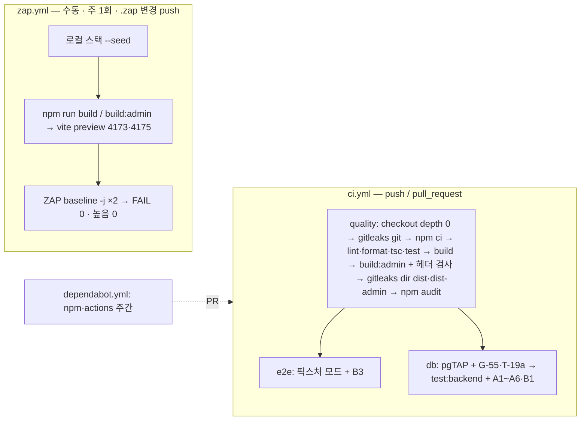

# 기술 설계서 · Y-3S 자동 검사 보강 (계획 11번)

| | |
|---|---|
| 상태 | 구현됨 (2026-10-22, 같은 브랜치) — 구현에서 달라진 점은 §11 |
| 날짜 | 2026-10-22 |
| 브랜치 | `claude/sharp-einstein-3m78cy` (기준 `4e108b5`) |
| 근거 | PRD Y-S1·S2·S4·S5·S6·S8·S11 · [ADR-0022](../adr/0022-security-baseline.md) S1·S2·S4·S6·S8·S11 · [RFC-0003 §17.6](rfc/0003-yunabi-v2.md) 1~5 · [ERD v2 §5·§9](erd-v2.md) · 계획 2판(독립 검사 반영) |
| 형식 | 작업 단위 기술 설계서 하나. **새 ADR 없음**: gitleaks·ZAP·Dependabot·HTTP 스위트는 ADR-0022 가 이미 정했고, 여기서는 그 결정을 구현하는 방법만 정한다 |
| 검토 반영 | 2026-10-22 — 산출물 gitleaks 와 제3자 오탐 처리(§1.3·§1.4), B1 의 TOTP 창(§4.1), 문서 정리 목록 보강(§7.1), B2 비교에서 `''`·`null`·앞뒤 공백 제외(§4.2), 갱신 불가 뷰 응답 고정(§3.3), `.gitleaksignore` 지문과 squash 병합(§1.3), B3 `[lang]` 선택자(§4.3), TODO 해소(ZAP 다이제스트·upload-artifact SHA·체크섬 대조, §1.1·§6.2·§6.5). 고친 곳에 `[검토 반영]` |
| 범위 밖 | 클라우드 프로젝트 변경(없음), 비공개 운영 저장소(12번), 점검 기록 문서(13번), 기숙사 범위 부하 시험(PL-1 뒤 수동) |

`[설계 결정]` 은 이 문서에서 고른 것이고, 나머지는 코드·계획에서 온 사실이다. "현행" 은 `4e108b5` 의 코드, "제안" 은 이 작업으로 바뀔 것이다.

---

## 0. 한눈에

현행(코드 확인): gitleaks 없음·checkout 깊이 1, 콘솔 `_headers` 에 HSTS 없음, `security.spec.ts` 의 G-03/G-12 는 인자 `{}` 로 401/403/404/405 아무거나 통과, 콘솔·일정 XSS 브라우저 시험 없음, `npm audit … --omit=dev`, Dependabot·ZAP 없음, 문서 3곳이 없는 `tests/security/` 를 가리킴. 제안은 아래 그림과 §1~§7.



---

## 1. D — 비밀 검사 (첫 번째로 한다)

진짜 비밀이 나오면 키 교체가 다른 모든 일보다 앞서야 하므로 이 묶음을 먼저 구현·실행한다(계획 D3).

### 1.1 gitleaks 바이너리 `[설계 결정]`

- **gitleaks v8.30.1** — 공식 릴리스 페이지의 "Latest", 확인 2026-10-22(페이지에 연도 표시 없음, "21 Mar"). 자산 `gitleaks_8.30.1_linux_x64.tar.gz`.
- sha256 `551f6fc83ea457d62a0d98237cbad105af8d557003051f41f3e7ca7b3f2470eb` — 같은 릴리스의 `gitleaks_8.30.1_checksums.txt` 에서 읽음(2026-10-22). **구현 때 대조함**(2026-10-22): 체크섬 파일을 직접 내려받아 `linux_x64` 줄이 이 값과 같음을 확인했고, 첫 실행에 쓴 `windows_x64.zip` 도 같은 파일의 값과 맞았다.
- 액션(`gitleaks/gitleaks-action`) 대신 바이너리: 버전과 해시가 이 워크플로에 그대로 보이고, `fetch-bins.sh` 와 같은 방식(받기 → sha256 확인)이라 저장소 관례와 맞다. 액션은 조직 계정이면 라이선스 키가 필요하다(이 저장소는 개인 계정이라 지금은 해당 없음 — *일반 지식*).
- 모든 실행에 **`--redact`**: 공개 저장소의 Actions 로그는 누구나 읽는다. 진짜 비밀이 나왔을 때 로그가 두 번째 유출 경로가 되면 안 된다.

### 1.2 ci.yml — quality 잡 변경 (정확한 diff)

```diff
   quality:
     runs-on: ubuntu-latest
     timeout-minutes: 15
     steps:
       - uses: actions/checkout@3d3c42e5aac5ba805825da76410c181273ba90b1 # v7.0.1
+        with:
+          fetch-depth: 0 # gitleaks reads every commit, not just the last one
       - uses: actions/setup-node@949feb2413d6458794dcd2491c4babbbce0c15c1 # v7.1.0
         with:
           node-version: 22
           cache: npm
+      - name: gitleaks (pinned binary, checksum checked)
+        env:
+          GITLEAKS_VERSION: 8.30.1
+          GITLEAKS_SHA256: 551f6fc83ea457d62a0d98237cbad105af8d557003051f41f3e7ca7b3f2470eb
+        run: |
+          mkdir -p "$RUNNER_TEMP/gitleaks" && cd "$RUNNER_TEMP/gitleaks"
+          curl -sSLf -o gl.tgz "https://github.com/gitleaks/gitleaks/releases/download/v${GITLEAKS_VERSION}/gitleaks_${GITLEAKS_VERSION}_linux_x64.tar.gz"
+          echo "${GITLEAKS_SHA256}  gl.tgz" | sha256sum -c --quiet
+          tar xzf gl.tgz gitleaks && rm gl.tgz
+          echo "$RUNNER_TEMP/gitleaks" >> "$GITHUB_PATH"
+      - name: No secrets in the history
+        run: gitleaks git . --no-banner --redact --verbose
       - run: npm ci
       - run: npm run lint
       - run: npm run format:check
       - run: npm run typecheck
       - run: npm test
       - run: npm run build # includes the bundle size budgets
         env:
           YUNABI_ORIGIN: https://underthesun7213.github.io/yui-board/
-      - run: npm run build:admin # the admin console, with its secret check
+      - run: npm run build:admin # the admin console, with its secret and header checks
         env:
           VITE_SUPABASE_URL: https://example.supabase.co
-      - run: npm audit --audit-level=high --omit=dev
+      - name: No secrets in the builds
+        run: |
+          gitleaks dir dist --no-banner --redact --verbose
+          gitleaks dir dist-admin --no-banner --redact --verbose
+      - run: npm audit --audit-level=high # dev dependencies too (ADR-0022 S6)
       - name: No pull_request_target workflows
```

- 이력 검사를 `npm ci` 앞에 둔다: 가장 싸고, 실패하면 나머지를 돌릴 이유가 없다.
- `dist-e2e*`·`dist-admin-e2e` 는 대상이 아니다 — quality 잡은 그것을 만들지 않고, 그 빌드에는 로컬 전용 anon 키가 들어 있다(계획 D1).
- e2e·db 잡의 checkout 은 그대로 깊이 1.

### 1.3 `.gitleaksignore` — 지문 단위 허용 `[설계 결정]`

- 파일: 저장소 루트 `.gitleaksignore`(gitleaks 기본 위치, `-i` 생략 가능). 한 줄에 지문 하나. `git` 검사 지문 형식은 `커밋:경로:규칙:줄`(README 예시).
- **각 지문 위에 `#` 주석으로 이유**. gitleaks 8.x 는 `#` 로 시작하는 줄을 건너뛴다(*일반 지식 — 첫 실행에서 확인*). 안 되면 이유는 이 문서 §1.4 표에만 두고 파일에는 지문만 둔다.
- **`dist`·`dist-admin` 은 허용 0**: 해시가 붙은 산출물 파일 이름은 빌드마다 바뀌어 지문이 고정되지 않는다. 산출물에서 나온 것은 무조건 고친다.
- 경로 단위 허용(`.gitleaks.toml` 의 `[allowlist] paths`)은 쓰지 않는다: `keys.mjs` 에 나중에 진짜 값이 들어가도 통과하게 된다. 지문 단위면 그 줄이 바뀌는 순간 다시 걸린다(아래 위험 R-1).
- **지문에는 커밋 SHA 가 들어 있다.** squash 병합이나 rebase 로 커밋이 다시 만들어지면 SHA 가 바뀌어 지문이 맞지 않고 CI 가 다시 실패한다. 그래서 **새로 쓰는 줄**은 지문 대신 그 줄 끝의 인라인 주석 `gitleaks:allow`(이유와 함께)를 쓴다. `.gitleaksignore` 는 이미 이력에 있는, 고칠 수 없는 줄에만 쓴다.
- **산출물의 제3자 코드 오탐**(Workbox, `@supabase/auth-js` 등 우리가 고칠 수 없는 번들 코드): 그때에 한해 저장소 루트 `.gitleaks.toml` 에 `[extend] useDefault = true` 와 그 문자열만 맞는 **좁은** 허용(규칙별 `[[rules.allowlists]]` 의 `regexes` 또는 `stopwords`)을 두고, 주석에 라이브러리 이름과 버전을 적는다. 경로 허용은 여전히 쓰지 않는다. **이런 허용을 둘지는 사례마다 책임자가 정한다.**
- 모든 실행(로컬 첫 실행 포함)에 `--redact`.

### 1.4 첫 실행 절차와 예상 후보

1. 로컬(클라우드 세션 또는 책임자 PC)에서 같은 버전의 바이너리로 `gitleaks git . --redact --report-format json --report-path <scratchpad>/gl.json` — CI 를 기다리지 않는다.
2. 이어서 산출물: `npm run build`(`YUNABI_ORIGIN` 설정) → `gitleaks dir dist --redact`, `npm run build:admin`(`VITE_SUPABASE_URL` 설정) → `gitleaks dir dist-admin --redact`. 제3자 번들의 오탐은 §1.3 의 좁은 `.gitleaks.toml` 로만, 책임자 결정 뒤에.
3. 결과마다 분류한다.

| 예상 후보 (추정) | 판단 | 처리 |
|---|---|---|
| `scripts/local-stack/keys.mjs:5` `JWT_SECRET` (`yunabi-local-only-…`) | 로컬 스택 전용, 파일 머리말에 "Never used outside this machine" | 지문 허용, 주석 "local stack only (keys.mjs header)" |
| `scripts/local-stack/start.sh` 의 `local-auth-admin`·`local-authenticator` (DB 연결 문자열) | 로컬 전용 비밀번호 | 걸리면 지문 허용 |
| `tests/e2e-backend/*.spec.ts` 의 `local-only-Passw0rd!`, `a-long-password-1` | 시험용 가짜 비밀번호 | 걸리면 지문 허용 |
| 그 밖의 모든 것 (`sb_secret_`, `sb_publishable_` 실제 값, service role JWT, `ghp_`·`github_pat_`, DB URL 의 실제 비밀번호, `.mcp.json` 의 토큰) | **진짜일 수 있음** | **멈춘다.** 책임자에게 보고 → 키 교체가 먼저(계획 D3). 허용 목록으로 덮지 않는다. 이력 재작성은 교체 뒤에 책임자가 정한다(교체 없이 지우는 것은 의미 없음) |

**첫 실행 결과 (2026-10-22, 구현 때)**: gitleaks 8.30.1(`windows_x64`, 체크섬 확인) — `gitleaks git . --redact` 74 커밋(`--log-opts=--all` 로 75 커밋도) **0건**, `gitleaks dir dist` **0건**, `gitleaks dir dist-admin` **0건**. 그래서 `.gitleaksignore` 와 `.gitleaks.toml` 은 만들지 않았다(위 표의 예상 후보는 기본 규칙에 걸리지 않았다).

D4(secret scanning, push protection, Dependabot alerts, `main` 보호)는 저장소 설정이므로 이 작업에서 바꾸지 않는다 → 13번 점검표, §10 열린 질문 2.

---

## 2. C — 관리자 콘솔 HSTS (C1)

### 2.1 변경

`vite.admin.config.ts` 의 `HEADERS` `/*` 블록, `X-Content-Type-Options` 줄 다음:

```
  Strict-Transport-Security: max-age=31536000; includeSubDomains
```

- `preload` 는 넣지 않는다: preload 목록 등록은 되돌리기 어렵고, 지금 출처는 Cloudflare 가 준 하위 도메인이다.
- `includeSubDomains` 는 지금 출처의 하위 도메인(미리보기 배포 주소 등)에만 걸린다. **사용자 도메인을 붙일 때 다시 본다**: 콘솔을 도메인 꼭대기(apex)에 두면 그 도메인의 모든 하위 도메인에 HTTPS 를 강제하게 된다. 이 메모를 `vite.admin.config.ts` 주석에도 남긴다.

### 2.2 산출물 검사 `scripts/check-admin-headers.mjs` `[설계 결정]`

설정 파일의 문자열이 아니라 **`build:admin` 이 실제로 낸 `dist-admin/_headers`** 를 본다(설정과 산출물 사이의 플러그인 오류까지 잡도록). `check-dist-secrets.mjs` 와 같은 모양의 Node 스크립트, 인자 = 디렉터리(기본 `dist-admin`).

```json
"build:admin": "tsc -b && vite build -c vite.admin.config.ts && node scripts/check-dist-secrets.mjs dist-admin && node scripts/check-admin-headers.mjs dist-admin"
```

검사 내용 (하나라도 없으면 목록을 출력하고 `exit 1`):

| # | 대상 | 조건 |
|---|---|---|
| H1 | `_headers` 의 `/*` 블록 | `Content-Security-Policy:` 줄이 있고 `default-src 'none'` 과 `frame-ancestors 'none'` 을 포함 |
| H2 | 〃 | `X-Frame-Options: DENY` |
| H3 | 〃 | `X-Content-Type-Options: nosniff` |
| H4 | 〃 | `Strict-Transport-Security:` 의 `max-age` ≥ 31536000 이고 `includeSubDomains` 포함 |
| H5 | 〃 | `Referrer-Policy: no-referrer` |
| H6 | `index.html` | `<meta http-equiv="Content-Security-Policy"` 가 있고 `default-src 'none'` 포함 |

블록 파싱은 Cloudflare `_headers` 형식 그대로: 들여쓰기 없는 줄 = 경로, 들여쓴 줄 = `이름: 값`. `/*` 블록만 H1~H5 대상. backend e2e 의 콘솔 빌드(`npx vite build -c …`, `ADMIN_OUT_DIR=dist-admin-e2e`)는 이 스크립트를 거치지 않는다 — quality 잡의 `build:admin` 하나로 충분하다.

---

## 3. A — HTTP 권한 스위트 (`tests/e2e-backend/security.spec.ts`)

### 3.1 공통

**psql 도우미 `tests/e2e-backend/db.ts` (신규)** `[설계 결정]` — SQL 은 표준 입력으로, 값은 psql 변수(`:'이름'`)로 넘긴다. 셸을 거치지 않고(`execFileSync`), SQL 문자열에 값을 이어 붙이지 않는다. psql 변수 치환은 `-c` 에서는 안 되고 표준 입력·파일에서만 되므로 반드시 `input` 으로 넘긴다. `-v 이름=값` 은 첫 `=` 에서만 나뉘므로 페이로드 안의 `=` 는 문제없다.

```ts
import { execFileSync } from 'node:child_process';
/** SQL on stdin; values only as psql variables (:'name'), never spliced into the SQL. */
export function psql(sql: string, vars: Record<string, string> = {}): string {
  const args = ['-X', '-q', '-t', '-A', '-v', 'ON_ERROR_STOP=1',
    '-h', '127.0.0.1', '-p', '54322', '-U', 'postgres', '-d', 'postgres'];
  for (const [k, v] of Object.entries(vars)) args.push('-v', `${k}=${v}`);
  return execFileSync('psql', args, { input: sql }).toString().trim();
}
```

- 파일 머리에 `const SERVICE = …keys.mjs…SERVICE_KEY` 추가(aal1 계정용, `admin.spec.ts` 와 같은 방식).
- `test.beforeAll(() => psql('delete from app.ip_hits'))` — 앞선 spec(posting·reports)이 같은 5분 창에 쌓은 쓰기 수를 지운다. 이 파일의 커밋되는 쓰기는 많아야 10건 남짓(기본 한도 60).
- **상태 코드의 근거** (PostgREST v13 오류 문서, 확인 2026-10-22; 로컬 PostgREST `v13.0.8`):

| 상황 | DB 오류 | HTTP |
|---|---|---|
| `anon` 이 EXECUTE 없는 함수, 쓰기 권한 없는 뷰 | 42501 | **401** — 로컬 게이트웨이는 `Authorization` 을 만들지 않아 "인증 안 됨" |
| 로그인한 사용자가 EXECUTE 없는 함수, `require_admin` 의 `raise … 42501` | 42501 | **403** |
| `stable` 함수를 POST | `db_pre_request` 의 insert 가 읽기 전용 트랜잭션에서 25006 | **405** — 권한 검사 **전에** 난다. 기존 G-03 시험이 405 를 받아야 했던 이유. 그래서 `stable` 함수는 GET 으로 부른다 |
| 스키마 캐시에 없는 함수·테이블 | PGRST202 / PGRST205 | 404 (DB 를 타지 않음) |
| 인자 변환 실패(잘못된 enum·uuid) | 22P02 | 400 |
| 자동 갱신 불가 뷰에 INSERT/UPDATE/DELETE | 55000(*추정 — PG 재작성기의 "cannot insert into view"*) | 500 (55\* 행) |

- 스키마 캐시는 역할과 무관하게 하나라서, `anon` 이 실행 못 하는 함수도 캐시에는 있다 → 404 가 아니라 401 이다.
- 클라우드 게이트웨이는 `apikey` 를 `Authorization` 으로 바꿔 넣으므로 같은 요청이 403 일 수 있다(*추정*). 이 스위트는 로컬 전용이다.
- 401·403 단언에는 응답 본문 `code === '42501'` 도 함께 본다. JWT 오류(PGRST301 등)로 인한 401 과 구별하기 위해서다.

### 3.2 A7 — G-01 메서드 추가 (기존 시험 수정)

이름: `G-01 the app schema and its tables are not reachable (GET, PATCH, DELETE)`. 기존 GET 루프는 그대로 두고 다음을 추가한다.

| 요청 | 헤더 | 본문 | 기대 |
|---|---|---|---|
| `PATCH /rest/v1/places?id=eq.1` | `H` | `{"name":"x"}` | 404 (PGRST205) |
| `DELETE /rest/v1/places?id=eq.1` | `H` | — | 404 (PGRST205) |

### 3.3 A1 — G-02 공개 뷰 쓰기

이름: `G-02 the public views cannot be written over HTTP`.

준비: `v0 = psql("select v from app.data_version where id = 1")`. 장소·일정·회차 표의 어떤 변경이든 이 값을 올린다(트리거).

| 뷰 | 자동 갱신 | POST 본문 | PATCH (본문) | DELETE |
|---|---|---|---|---|
| `places_public` | 가능 (단일 표, WHERE·식 열만) | `{"name":"x"}` | `?id=eq.-1` `{"name":"x"}` | `?id=eq.-1` |
| `events_public` | 가능 | `{"title":"x"}` | `?id=eq.-1` `{"title":"x"}` | `?id=eq.-1` |
| `event_occurrences_public` | **불가** (JOIN) | `{"cancelled":true}` | `?event_id=eq.-1` `{"cancelled":true}` | `?event_id=eq.-1` |
| `prefecture_counts` | **불가** (GROUP BY) | `{"n":0}` | `?pref=eq.00` `{"n":0}` | `?pref=eq.00` |

기대:

- **자동 갱신 가능한 두 뷰** × 3 메서드: `anon`(헤더 `H`) → **401** + `code 42501`, 익명 계정(`account()`) → **403** + `code 42501`. pgTAP G-02 가 이미 `insert into places_public` → 42501 로 같은 순서(권한 검사)를 보였다.
- **자동 갱신 불가한 두 뷰**: PG 는 권한을 보기 **전에** 재작성 단계에서 "갱신할 수 없는 뷰" 로 실패한다(*추정*). 이 상태 코드는 권한이 아니라 뷰 모양을 보여 준다. `[설계 결정 — 검토 반영]` 첫 CI 실행에서 관찰한 **정확한 값**으로 단언을 고정한다 — **관찰값 500 + `55000`**(CI run 39661765852, anon·계정 모두, 세 메서드 모두). `42501` 도 받아 주는 느슨한 단언은 두지 않는다: 값이 바뀌면(PG·PostgREST 판 변경) 시험이 알려 주고, 그때 이 절을 고친다. 권한 자체는 psql 로 직접 확인한다.
  ```sql
  select count(*) from unnest(array['anon','authenticated']) r,
    unnest(array['public.places_public','public.events_public',
                 'public.event_occurrences_public','public.prefecture_counts']) v,
    unnest(array['INSERT','UPDATE','DELETE']) m
  where has_table_privilege(r, v::regclass, m);
  ```
  → `'0'`.
- 계획은 "401/403 만" 이라 했지만, 뒤의 두 뷰에서는 그 기대가 코드와 맞지 않는다. 그래서 위처럼 바꿨다(§10 에 따로 묻지 않음 — 보안 의미는 같다).
- 끝: `data_version` 이 `v0` 그대로. 실패한 요청은 `db_pre_request` 의 집계까지 롤백하므로 IP 창도 늘지 않는다.

### 3.4 A2 — G-23 HTTP (숨김·삭제가 공개 뷰 4개에 없음)

이름: `G-23 hidden and deleted items are in none of the four public views`.

보이는 항목 하나를 함께 만들어 **양성 대조**로 쓴다. 쿼리 문법이 틀려서 빈 배열이 나오는 "공허한 통과" 를 막기 위해서다. 준비:

1. `n0` = `GET /rest/v1/prefecture_counts?select=n&pref=eq.27` 의 `n`(행 없으면 0).
2. psql 1회 — 장소:
```sql
with p as (
  insert into app.places (name, category, description, lat, lng, pref, lang,
                          auto_hidden_at, suspension_hidden_at, deleted_at, deleted_by)
  values ('G23 visible',   'food', '', 34.8250, 135.6528, '27', 'en', null,  null,  null,  null),
         ('G23 auto',      'food', '', 34.8250, 135.6528, '27', 'en', now(), null,  null,  null),
         ('G23 suspended', 'food', '', 34.8250, 135.6528, '27', 'en', null,  now(), null,  null),
         ('G23 deleted',   'food', '', 34.8250, 135.6528, '27', 'en', null,  null,  now(), 'owner')
  returning id, name)
select json_object_agg(name, id) from p;
```
3. psql 1회 — 일정(주간, 1주 뒤 시작, 3회)과 2회째 회차 덮어쓰기:
```sql
with d as (select (now() at time zone 'Asia/Tokyo')::date + 7 as day),
e as (
  insert into app.events (title, start_date, start_time, end_time, weekly_until, lang,
                          auto_hidden_at, suspension_hidden_at, deleted_at, deleted_by)
  select t.title, d.day, time '10:00', time '11:00', d.day + 14, 'en'::app.ui_lang, t.a, t.s, t.x, t.b
  from d, (values ('G23 visible', null::timestamptz, null::timestamptz, null::timestamptz, null::text),
                  ('G23 auto', now(), null, null, null),
                  ('G23 suspended', null, now(), null, null),
                  ('G23 deleted', null, null, now(), 'owner')) t(title, a, s, x, b)
  returning id, title),
o as (
  insert into app.event_occurrences (event_id, occurs_on, cancelled, title)
  select e.id, d.day + 7, false, 'G23 week' from e, d returning event_id)
select json_build_object('events', (select json_object_agg(title, id) from e),
                         'weeks', (select count(*) from o));
```
(`weeks` = 4 을 단언해 준비가 다 됐는지 확인.)

요청(헤더 `H`, 모두 GET, 기대 200):

| 요청 | 기대 본문 |
|---|---|
| `places_public?select=id&id=in.(<장소 4개 id>)` | `[{id: visible}]` 정확히 |
| `events_public?select=id&id=in.(<일정 4개 id>)` | `[{id: visible}]` 정확히 |
| `event_occurrences_public?select=event_id&event_id=in.(<일정 4개 id>)` | `[{event_id: visible}]` 정확히 |
| `prefecture_counts?select=n&pref=eq.27` | `n === n0 + 1` (보이는 1개만 셈) |

정리(`finally`): `psql("delete from app.places where name like 'G23 %'; delete from app.events where title like 'G23 %'")`.

### 3.5 A3 — G-21 HTTP (남의 항목, 소유자 열)

이름: `G-21 another account sees none of my items; my own carry no owner column`.

| 단계 | 요청 | 기대 |
|---|---|---|
| A 등록 | `POST /rpc/create_place`, A 헤더, `place()` | 200 `{status:'ok', id, pref}` |
| B 목록 | `GET /rpc/my_items`, B 헤더 | 200, 본문 `[]` (B 는 쓰기 0 → 계정 행도 없음) |
| B 단건 | `GET /rpc/my_place?p_id=<A id>`, B 헤더 | 200, 본문 `null` |
| A 목록 키 | `GET /rpc/my_items`, A 헤더 | 행 1개, `Object.keys(row).sort()` = `['created_on','deleted_on','edited_on','id','kind','last_date','state','title']` |
| A 단건 키 | `GET /rpc/my_place?p_id=<A id>`, A 헤더 | `Object.keys(body).sort()` = `['category','description','gmaps_url','id','lang','lat','lng','name','pref']` |

- 계획의 "→ not_found" 는 고친다: `my_place` 는 SQL 함수라 남의 것·없음·삭제됨이 모두 **`null`** 이다(ERD §5.2 "구별 없음, 기록 없음"). `not_found` 는 쓰기 함수의 응답이다.
- 둘 다 `stable` 이므로 GET 으로 부른다(POST 면 405).

### 3.6 A4 — G-03 강화 + G-30 ①②③ + G-31

허용 목록은 `20261013000190_grants.sql` 과 `200_checks.sql` 의 `want_auth`·`want_anon`·`want_service` 그대로이고, `public` 스키마 함수 25개다(`app.db_pre_request` 는 노출 스키마 밖이라 HTTP 로 부를 수 없음).

**목록 동기화 단언** `[설계 결정]`: 시험 안의 `CALLS` 표 키 집합이 카탈로그와 같아야 한다. 새 함수에 시험 항목이 없으면 시험이 실패한다.
```sql
select string_agg(p.proname, ',' order by p.proname) from pg_proc p
where p.pronamespace = 'public'::regnamespace
  and (has_function_privilege('authenticated', p.oid, 'execute')
       or has_function_privilege('service_role', p.oid, 'execute'));
```

`CALLS` — 함수마다 메서드와 타입이 맞는 인자. `X = 999999999`(없는 id — 보호가 풀린 돌연변이 상태에서도 아무것도 바꾸지 않게), `D = '2030-01-07'`.

| 함수 | 메서드 | 인자 |
|---|---|---|
| `data_version` | GET | — |
| `my_items` | GET | — |
| `my_place` | GET | `?p_id=X` |
| `my_event` | GET | `?p_id=X` |
| `ops_health` | GET | — |
| `create_place` | POST | `{p_client_token: uuid, p_name:'x', p_category:'food', p_description:'', p_gmaps_url:null, p_lat:34.82, p_lng:135.65, p_lang:'en'}` |
| `update_place` | POST | `{p_id:X, p_name:'x', p_category:'food', p_description:'', p_gmaps_url:null, p_lat:34.82, p_lng:135.65, p_lang:'en'}` |
| `delete_place` | POST | `{p_id:X}` |
| `create_event` | POST | `{p_client_token: uuid, p_title:'x', p_start_date:D, p_start_time:'10:00', p_end_time:'11:00', p_weekly_until:null, p_place_text:'', p_body:'', p_lang:'en'}` |
| `update_event` | POST | `{p_id:X, p_title:'x', p_start_date:D, p_start_time:'10:00', p_end_time:'11:00', p_weekly_until:null, p_place_text:'', p_body:'', p_lang:'en'}` |
| `delete_event` | POST | `{p_id:X}` |
| `set_occurrence` | POST | `{p_event_id:X, p_occurs_on:D, p_cancelled:true, p_title:null, p_start_time:null, p_end_time:null, p_place_text:null, p_body:null}` |
| `clear_occurrence` | POST | `{p_event_id:X, p_occurs_on:D}` |
| `submit_report` | POST | `{p_kind:'place', p_id:X, p_reason:'spam'}` |
| `admin_whoami` | POST | `{}` |
| `admin_queue` | POST | `{p_filter:'all', p_limit:1, p_offset:0}` |
| `admin_item` | POST | `{p_kind:'place', p_id:X}` |
| `admin_restore` | POST | `{p_kind:'place', p_id:X, p_note:null}` |
| `admin_restore_bulk` | POST | `{p_since:'2026-01-01T00:00:00Z', p_until:'2026-01-02T00:00:00Z', p_note:null, p_dry_run:true, p_expected:null}` |
| `admin_delete` | POST | `{p_kind:'place', p_id:X, p_note:null}` |
| `admin_dismiss` | POST | `{p_kind:'place', p_id:X, p_note:null}` |
| `admin_suspend` | POST | `{p_account_ref:'nobody', p_note:null}` |
| `admin_unsuspend` | POST | `{p_account_ref:'nobody', p_note:null}` |
| `admin_search` | POST | `{p_q:'x', p_pref:null}` |
| `admin_audit_log` | POST | `{p_limit:1, p_before:null}` |

메서드 근거: `stable` 은 GET(위 405 이유), 나머지는 모두 `volatile` 이라 POST(`rpc_admin.sql` 머리말 — 콘솔이 POST 로 부르므로 읽기 함수도 volatile). 이 25개는 오버로드가 없으므로 PGRST203(모호함)은 생기지 않는다.

**시험 A4a** — `G-03 / G-12 / G-30 ① anon: every function in the allowlist but data_version is 401`
- 헤더 `H`(apikey 만). `data_version` → **200**(양성 대조). 나머지 24개 → 각각 **401** + `code 42501`. 실패 메시지에 함수 이름을 넣는다(`expect(status, fn)`).

**시험 A4b** — `G-30 ②③ / G-31 a non-admin account: admin functions are 403, admin_whoami answers forbidden`
- ② 익명 계정(`account()`):
  - `admin_*` 10개(`admin_whoami` 제외) → **403** + `code 42501`(`require_admin` 의 `raise … errcode 42501, message 'forbidden'`).
  - `admin_whoami` → **200**, 본문 정확히 `{status:'forbidden'}`. psql 로 `security_events` 의 `kind = 'admin_denied'` 가 1 늘었는지 확인(G-31).
  - `ops_health`(GET) → **403** + `code 42501`(authenticated 도 EXECUTE 없음).
- ③ aal1 비익명 계정 — 준비:
  1. `psql("insert into app.admin_invites (email, invited_at) values (:'email', now() - interval '1 minute')", { email })`, 여기서 `email = 'aal1-<Date.now()>@yunabi.test'`.
  2. `POST /auth/v1/admin/users`(SERVICE 키) `{email, password:'local-only-Passw0rd!', email_confirm:true}` → 200.
  3. `POST /auth/v1/token?grant_type=password`, 헤더 `H`, `{email, password}` → 200 `access_token`(aal1).
  - `admin_queue` → **403** + `code 42501`(거절 사유 `not aal2`).
- ④~⑦(세션 행 없음, 13시간, 허용 목록 밖 aal2, 이메일 연결 익명)은 TOTP 등록이 필요하므로 HTTP 로 하지 않는다. pgTAP 09 가 모든 `admin_%` 에 대해, admin.spec 이 ⑤·⑥ 을 브라우저로 본다.

### 3.7 A5 — GraphQL (T-19a)

HTTP 시험 `T-19a GraphQL is not reachable through /rpc`:
- `POST /rest/v1/rpc/graphql`, 헤더 `H`, `{"query":"{__typename}"}` → **404**, `code === 'PGRST202'`.
- `/graphql/v1` 은 로컬 게이트웨이가 원래 404 를 주므로 로컬 시험은 의미가 없다. 클라우드에서 확인 끝(PL-6 ③, 2026-10-22) → 13번 점검 기록.

pgTAP `01_permissions.test.sql` (`plan(17)` → `plan(19)`, M1 블록 앞):
```sql
-- T-19a / PL-6 ③: no GraphQL door next to the RPCs
select ok(not exists (select 1 from pg_extension where extname = 'pg_graphql'), 'T-19a pg_graphql is not installed');
select ok(to_regproc('public.graphql') is null, 'T-19a no public.graphql for /rpc/graphql');
```
로컬에는 pg_graphql 패키지가 없어서 첫 줄은 로컬에서 늘 참이다. 그래도 그 마이그레이션(`ops.sql` 의 `drop extension`)이 지키는 것을 이름으로 남긴다. 실제로 지켜 주는 것은 둘째 줄과 HTTP 시험이다.

### 3.8 A6 — G-55 (형식 오류 쓰기도 IP 창에 남음)

HTTP 시험 `G-55 a malformed write is still counted per IP; one PostgREST cannot convert is not`:

| 단계 | 요청 | 기대 |
|---|---|---|
| 준비 | `a = account()`, `h0 = psql("select coalesce(sum(n),0) from app.ip_hits")` | |
| 1 | `POST /rpc/create_place`, a 헤더, `place({p_name: ''})` | 200, 본문 정확히 `{status:'invalid', field:'name'}`. `ip_hits` 합 = `h0 + 1` |
| 2 (대조, ERD G-55 의 남는 구멍) | `POST /rpc/create_place`, a 헤더, `place({p_category: 'nope'})` | **400**(22P02). `ip_hits` 합은 그대로 `h0 + 1` — 변환 실패는 집계까지 롤백 |

2단계는 ERD G-55 본문이 이미 정한 동작을 고정하는 것이다. 이 동작이 바뀌면(PostgREST 가 집계 뒤에 변환하게 되는 등) 문서도 바꿔야 하므로 시험으로 알린다.

pgTAP `05_ip_limit.test.sql` (`plan(17)` → `plan(19)`). 도우미 정의 뒤에 함수 하나를 추가한다.
```sql
create function tests.write_invalid(p_xff text) returns jsonb
language plpgsql as $$
begin
  perform tests.req('POST', '/rpc/create_place', p_xff);
  return public.create_place(gen_random_uuid(), '', 'food', '', null, 34.82, 135.65, 'en');
end $$;
```
(`grant execute on all functions in schema tests to public` 이 이 정의 **뒤에** 오게 둔다.) dorm 블록과 `-- G-53` 사이에 넣는다.
```sql
-- G-55: a malformed write answers with a status, so its request stays counted
select tests.as_owner();
select tests.as_user(tests.user());
select tests.hits() as g55_before \gset
select is(tests.write_invalid('203.0.113.55') ->> 'field', 'name', 'G-55 a malformed write is a status, not an exception');
select is(tests.hits() - :g55_before, 1, 'G-55 and the request is counted');
```
`203.0.113.55` 는 이 파일에서 처음 쓰는 주소라 한도(3)와 겹치지 않는다. 다음 줄의 `select tests.as_owner();`(G-53)는 그대로 둔다.

---

## 4. B — XSS 빈칸

공통 페이로드(이름 칸은 60자 제한이라 둘로 나눈다):
- `NAME = '"\'&'` (39자)
- `BODY = '<script>window.__xss=2</script>"\'&'`

### 4.1 B1 — 관리자 콘솔 (`tests/e2e-backend/admin.spec.ts`)

이름 `Y-S4 user text in the console stays text: queue and item detail`. 위치는 `M-6a` 시험 다음, `G-34`(→ G-30 ⑤) 시험 앞이다.

**TOTP `[설계 결정 — 검토 반영]`**: admin.spec 은 일부러 인증기를 번갈아 쓴다(`Y-R4` `secrets[0]` → `M-6a` `secrets[1]` → `G-34` `secrets[0]`). 같은 30초 창에서 같은 인증기의 코드를 다시 쓰면 거절될 수 있으므로, B1 은 `secrets[1]` 을 쓰고 **`M-6a` 가 그 인증기를 쓴 30초 창이 지날 때까지 기다린 뒤** 코드를 만든다. 그래야 바로 다음 `G-34`(`secrets[0]`) 와도, 바로 앞 `M-6a`(`secrets[1]`) 와도 같은 코드를 쓰지 않는다. 구현은 인증기마다 마지막으로 쓴 창을 기억하는 `freshCode(i)` 도우미 하나로, 이 파일의 모든 TOTP 입력이 이것을 쓴다.

준비 — §3.1 의 `psql` 도우미, 값은 변수로:
```sql
with u as (insert into auth.users (id, aud, role, is_anonymous, created_at, updated_at)
           values (gen_random_uuid(), 'authenticated', 'authenticated', true, now(), now()) returning id),
a as (insert into app.accounts (user_id) select id from u returning user_id),
p as (insert into app.places (name, category, description, lat, lng, pref, lang, auto_hidden_at)
      values (:'name', 'food', :'body', 34.8250, 135.6528, '27', 'en', now()) returning id),
o as (insert into app.place_owners (place_id, owner_id, client_token)
      select p.id, a.user_id, gen_random_uuid() from p, a)
select id from p;
```
`psql(위 SQL, { name: NAME, body: BODY })`.

절차와 단언:
1. 로그인(`signIn` → "Backup" → `freshCode(1)`).
2. `[data-item="place:<id>"] b` 의 텍스트가 `NAME` 과 같음(큐).
3. 그 항목을 클릭한다. `.detail dd` 중 `NAME` 과 정확히 같은 것 1개, `BODY` 와 정확히 같은 것 1개.
4. `window.__xss` 가 `undefined`, `page.locator('img[src="x"]').count()` 가 0, `dialog` 0.
5. `errors` 픽스처가 CSP 위반·콘솔 오류 0 을 확인한다.

정리(`finally`): `psql("delete from app.places where id = :'id'", { id })`.

참고: 콘솔 CSP(`script-src 'self' …`)는 인라인 처리기를 어차피 막는다. 그래서 `__xss` 만 보면 약하다. 핵심 단언은 텍스트가 같다는 것과 `img` 요소가 0 이라는 것이다. 주입이 되면 CSP 위반이 생겨 픽스처가 실패시키는 것이 두 번째 그물이다.

### 4.2 B2 — `safeMapsUrl` 을 `src/domain/` 으로

**현행**: `MapScreen.tsx:182` 의 모듈 내부 함수는 `/^https:\/\/(www\.)?google\.(com|co\.jp)\/maps|^https:\/\/maps\.app\.goo\.gl\//` 를 쓴다. 서버(`app.check_maps_url`)보다 느슨하다. `…/maps` 뒤 경계, 점 경로 조각, `%2e%2e`, 역슬래시·공백, 500자 제한이 없다. 그래서 "서버 G-15 와 같은 세트" 단위 시험은 지금 코드로는 통과하지 못한다. 옮기면서 서버와 같은 규칙으로 맞춘다.

**새 파일 `src/domain/links.ts`** `[설계 결정]`:
```ts
/** A Google Maps link the server would also accept (app.check_maps_url, Y-S4, T-08), or null. */
export function safeMapsUrl(u: string | null | undefined): string | null
```
- 규칙: `u` 가 비어 있지 않음, 길이 ≤ 500(코드 포인트), `^https://((www\.)?google\.(com|co\.jp)/maps([/?#]|$)|maps\.app\.goo\.gl/)` 일치, 점 경로 조각 `(/|%2f)(\.|%2e){1,2}(/|%2f|\?|#|$)`(대소문자 무시) 불일치, 역슬래시·공백 없음. 다듬기(trim)는 하지 않는다 — 서버가 다듬은 값만 저장하므로 화면이 받는 값에는 앞뒤 공백이 없다.
- URL 파서로 호스트를 다시 확인하지는 않는다. 정규식이 호스트 바로 뒤의 `/` 까지 고정하고 역슬래시·공백을 거절하므로 `@`·백슬래시 우회가 생기지 않는다. 바이트를 아끼기 위해서이기도 하다(아래 크기).
- `MapScreen.tsx` 는 내부 함수를 지우고 `import { safeMapsUrl } from '../../domain/links'`.

**크기 예산**: `links.ts` 는 `MapScreen.tsx` **만** import 한다. 그래서 Rollup 이 지도 청크 안에 넣고 새 청크는 생기지 않는다. `validation.ts`(쓰기 청크)는 import 하지 않는다. import 하면 공유 청크가 생겨 지도 묶음(현재 59.8/60 KB)이 늘어난다. 바뀌는 크기는 정규식 2개와 조건 몇 개뿐이라 gzip 수십 바이트(*추정*)다. 구현 뒤 `npm run build` 출력의 `map:` 줄로 확인한다. 60.0 을 넘으면 멈추고 §10 질문 3 으로 올린다.

**두 규칙의 어긋남 방지**: `validation.ts` 의 `checkPlace` 링크 규칙과 `links.ts` 는 따로 정의된다(청크 이유). 그래서 아래 표의 사례에 대해 둘의 판정이 같은지 단위 시험이 확인한다(`safeMapsUrl(u) === null` ⇔ `checkPlace({...정상 장소, gmaps_url: u}) === 'gmaps_url'`). `[검토 반영]` 비교에서 **`''`, `null`, 앞뒤 공백이 있는 입력은 뺀다**: `checkPlace` 는 값을 다듬고(trim) 빈 링크를 "링크 없음" 으로 받지만, `links.ts` 는 다듬지 않는다(서버가 다듬은 값만 저장하므로 화면이 받는 값에는 앞뒤 공백이 없다). 이 세 가지는 `links.ts` 단독 기대(`null`)로만 본다. CLAUDE.md 의 "서버 규칙은 두 번 확인" 줄에 `links.ts` 를 함께 적는다.

**단위 시험** `tests/unit/domain.test.ts` 의 `describe('links')`:

| 입력 | 기대 | 서버 G-15 대응 |
|---|---|---|
| `https://www.google.com/maps/place/x` | 그대로 | 정상 |
| `https://google.co.jp/maps?q=1` | 그대로 | 정상 |
| `https://www.google.com/maps` | 그대로 | 정상(끝) |
| `https://maps.app.goo.gl/abc` | 그대로 | 정상 |
| `null`, `''` | `null` | — |
| `javascript:alert(1)`, `JAVASCRIPT:alert(1)` | `null` | `javascript:` |
| `data:text/html,<script>alert(1)</script>` | `null` | data: (T-08) |
| `http://www.google.com/maps` | `null` | `http:` |
| `https://evil.com/maps` | `null` | 다른 호스트 |
| `https://google.com.evil.com/maps` | `null` | 호스트 위장 |
| `https://user@google.com/maps` | `null` | 사용자 정보 |
| `https://goo.gl/maps/x` | `null` | `goo.gl/maps` 제외 |
| `https://www.google.com/mapsx` | `null` | 경계(현행 클라이언트는 통과) |
| `https://www.google.com/maps/../url?q=https://evil.example` | `null` | 점 경로 조각 |
| `https://www.google.com/maps/%2e%2e/url` | `null` | `%2e%2e` |
| `https://www.google.com/maps\x` (역슬래시) | `null` | 역슬래시 |
| `https://www.google.com/maps x` | `null` | 공백 |
| `'https://www.google.com/maps/' + 'x'.repeat(480)` | `null` | 500자 초과 |

### 4.3 B3 — 일정 (`tests/e2e/v2.spec.ts`, 픽스처 모드)

**현행**: 시험 핸들(`src/e2e.ts`)은 `data` 저장소만 노출하고, `data.set({events})` 로는 `schedule`(파생값)이 다시 만들어지지 않는다. 홈과 상세는 `schedule` 을 읽는다.

**제안** `[설계 결정]`: `src/e2e.ts` 핸들에 `setData`(`state/data.ts` 의 기존 함수)를 추가하고, `tests/e2e/fixtures.ts` 의 `Handle` 타입에 `setData(places, events, overrides, fetchedAt): void` 를 추가한다. e2e 빌드에만 들어가는 파일이므로 운영 번들과 예산에 영향이 없다.

`'user text stays text'` describe 안에 시험 `Y-S4 an event with markup renders as text on home and in its detail`:
1. `page.goto('./#/cal')` → `data.get().status === 'ok'` 를 기다린다.
2. `day` = 도쿄 기준 내일(`new Date(Date.now() + 9*3600e3 + 86400e3).toISOString().slice(0,10)`).
3. `setData(places 그대로, [ev], [], fetchedAt)`, 여기서 `ev = {id: 99, title: NAME, start_date: day, start_time: '09:00', end_time: '10:00', weekly_until: null, place_text: NAME, body: BODY, lang: 'en', created_on: day, edited_on: null}`. 일정을 이것 하나로 바꿔 "다음 일정" 이 반드시 이것이 되게 한다.
4. `page.goto('./#/')` → `.hcard.cal small span[lang]` 의 텍스트가 `NAME`.
5. `page.goto('./#/cal/event/99/' + day)` → `.evwrap h1[lang]` = `NAME`, `.evwrap .facts dd[lang]` = `NAME`, `.evwrap .body[lang]` = `BODY`. `[lang]` 을 붙여 사용자 글이 들어가는 요소(작성 언어 표시가 붙은 것)만 고른다(`EventDetail.tsx` 의 `<dd lang={e.lang}>` 등).
6. `__xss` 가 `undefined`, `#main img[src="x"]` 0, `dialog` 0. CSP·콘솔 오류는 픽스처가 본다.

해시 이동은 같은 문서 안의 이동이라 저장소 값이 남는다. 그래도 화면이 데이터를 다시 읽어 값을 덮는다면, 4~5 를 `.hcard.cal` 클릭과 일정 행 클릭으로 바꾼다(구현 판단).

---

## 5. E — 의존성

### 5.1 npm audit (E2)
§1.2 diff 대로 `--omit=dev` 를 뺀다. ADR-0022 S6 의 문구(`npm audit --audit-level=high` 실패)와 일치하게 되므로 새 결정 기록은 필요 없다. 계획 시점에 전체 0건을 확인했고, 구현 때 로컬에서 `npm audit --audit-level=high` 로 한 번 더 본다.

### 5.2 `.github/dependabot.yml` (E1)
```yaml
# Weekly version updates (ADR-0022 S6). Security alerts and security updates
# are repository settings, not this file.
version: 2
updates:
  - package-ecosystem: npm
    directory: /
    schedule:
      interval: weekly
      day: monday
      time: '06:00'
      timezone: Asia/Tokyo
    open-pull-requests-limit: 5
    groups:
      runtime:
        dependency-type: production
      dev:
        dependency-type: development
  - package-ecosystem: github-actions
    directory: /
    schedule:
      interval: weekly
      day: monday
      time: '06:00'
      timezone: Asia/Tokyo
    groups:
      actions:
        patterns: ['*']
```
- Dependabot 은 SHA 로 고정한 액션도 새 SHA 와 뒤의 `# vX.Y.Z` 주석을 함께 갱신한다(*일반 지식 — 첫 PR 에서 확인*). `zap.yml` 의 `docker run` 이미지 다이제스트는 이 갱신 대상이 아니다 → §6.5.
- Dependabot 은 **기본 브랜치의** 설정 파일만 읽는다. 그래서 병합 전에는 동작을 확인할 수 없다.
- 모든 의존성이 정확한 버전으로 고정되어 있어(`package.json`), PR 마다 CI 전체(크기 예산 포함)를 통과해야 병합된다.

---

## 6. F — ZAP baseline (`.github/workflows/zap.yml`)

### 6.1 ZAP 이 보는 것과 못 보는 것

| 볼 수 있음 (passive 검사) | 못 봄 → 대신 확인하는 곳 |
|---|---|
| `vite preview` 응답 헤더, HTML·JS 내용(주석, 위험 함수, 시각 노출), 다른 출처 스크립트 포함, 쿠키(없음), `sw.js`·manifest | **meta CSP**: 헤더 규칙은 헤더만 보므로 "CSP 없음" 으로 나온다 → e2e 의 CSP 위반 0, C1 산출물 검사 |
| 앱을 띄우면 요청되는 화면 청크(유휴 미리 받기·서비스워커 사전 캐시 — 아약스 스파이더의 브라우저가 ZAP 프록시를 거쳐 받음) | **해시 라우트**: `#/…` 는 서버로 가지 않으므로 화면마다 다른 HTTP 응답이 없다. 해시 URL 을 시작점으로 주어도 일반 스파이더에는 의미가 없다 |
| | **DOM·저장형 XSS**: baseline 은 공격 요청을 보내지 않는다 → B1·B3·v2·posting |
| | **로그인 뒤 콘솔 화면**: TOTP 가 필요하다 → admin.spec |
| | **실제 배포 헤더**(GitHub Pages, Cloudflare `_headers`), **HSTS**(http 대상) → C1, 운영 URL 수동 스캔(F3) |

`[설계 결정]` 계획 F1 의 "해시 라우트 URL 목록을 시작점으로" 대신 **대상은 루트 하나 + `-j`(아약스 스파이더)** 로 한다. 이유는 위 표와 같다. 조각(fragment)은 HTTP 로 가지 않고, 화면 청크는 루트를 열면 미리 받아진다(v2.spec 오프라인 시험의 "every screen chunk is cached" 가 기대는 동작). 첫 실행에서 HTML 보고서의 사이트 트리에 `assets/` 의 지도·학습·쓰기 청크가 있는지 눈으로 확인한다.

### 6.2 워크플로 전문

```yaml
# OWASP ZAP baseline (passive) against production builds on the local stack,
# served by vite preview (RFC-0003 §17.6-4, ADR-0022 S8·S11). No secrets, and
# results of local targets only: production URLs are scanned by hand.
name: zap
on:
  workflow_dispatch:
  schedule:
    - cron: '0 18 * * 0' # Monday 03:00 JST
  push:
    paths: ['.zap/**', '.github/workflows/zap.yml']
permissions:
  contents: read
concurrency:
  group: zap-${{ github.ref }}
  cancel-in-progress: true
jobs:
  baseline:
    runs-on: ubuntu-24.04
    timeout-minutes: 30
    env:
      # ghcr.io/zaproxy/zaproxy:stable (multi-arch index; ZAP 2.17.0, image built
      # 2026-10-16), digest read from the registry on 2026-10-22. Refresh by hand
      # each quarter: Dependabot does not update it (y3s-automated-checks §6.5).
      ZAP_IMAGE: ghcr.io/zaproxy/zaproxy@sha256:5ccfff9a411743ab2615136a2edd7416bec9ce41572fa94e935df38c14adb2b6
    steps:
      - uses: actions/checkout@3d3c42e5aac5ba805825da76410c181273ba90b1 # v7.0.1
      - uses: actions/setup-node@949feb2413d6458794dcd2491c4babbbce0c15c1 # v7.1.0
        with:
          node-version: 22
          cache: npm
      - name: Postgres 16 with pgTAP and PostGIS
        run: |
          sudo apt-get update -q
          sudo apt-get install -y -q postgresql-16 postgresql-16-pgtap postgresql-16-postgis-3
      - name: Supabase Auth and PostgREST binaries
        run: sudo mkdir -p /opt/yunabi-local && sudo chown "$USER" /opt/yunabi-local && scripts/local-stack/fetch-bins.sh
      - run: npm ci
      - run: scripts/local-stack/start.sh --seed
      - name: Build the app and the console for the local stack
        run: |
          ANON=$(node -e 'import("./scripts/local-stack/keys.mjs").then(k=>console.log(k.ANON_KEY))')
          YUNABI_ORIGIN=http://127.0.0.1:4173/ VITE_SUPABASE_URL=http://127.0.0.1:54321 \
            VITE_SUPABASE_PUBLISHABLE_KEY="$ANON" npm run build
          VITE_SUPABASE_URL=http://127.0.0.1:54321 VITE_SUPABASE_PUBLISHABLE_KEY="$ANON" npm run build:admin
      - name: Serve both
        run: |
          nohup npx vite preview --port 4173 --strictPort --host 127.0.0.1 >preview-app.log 2>&1 &
          nohup npx vite preview -c vite.admin.config.ts --port 4175 --strictPort --host 127.0.0.1 >preview-admin.log 2>&1 &
          for u in http://127.0.0.1:4173/ http://127.0.0.1:4175/; do
            for _ in $(seq 1 60); do curl -sf -o /dev/null "$u" && break; sleep 1; done
            curl -sf -o /dev/null "$u"
          done
      - run: docker pull "$ZAP_IMAGE"
      - name: Baseline scans (a FAIL rule or an error fails the job)
        run: |
          mkdir -p zap-out && cp .zap/rules.tsv zap-out/ && chmod -R a+rwX zap-out
          for t in app:4173 admin:4175; do
            name=${t%%:*}; port=${t##*:}
            set +e
            docker run --rm --network host -v "$PWD/zap-out:/zap/wrk/:rw" "$ZAP_IMAGE" \
              zap-baseline.py -t "http://127.0.0.1:$port/" -c rules.tsv -j -I -T 15 -s \
              -r "$name.html" -J "$name.json" -w "$name.md"
            code=$?
            set -e
            [ "$code" = 0 ] || { echo "ZAP $name exited $code (1: a FAIL rule, 3: error)"; exit 1; }
          done
      - name: No high-risk alert
        run: |
          for n in app admin; do
            jq -e '[.site[]?.alerts[]? | select(.riskcode == "3")] | length == 0' "zap-out/$n.json"
          done
      - name: Summary
        if: always()
        run: cat zap-out/*.md >> "$GITHUB_STEP_SUMMARY" 2>/dev/null || true
      - uses: actions/upload-artifact@cf430e030ddbb5b0abf93d22962f4752f3646cd9 # v7.0.2
        if: always()
        with:
          name: zap-local-targets
          path: |
            zap-out/*.html
            zap-out/*.json
            zap-out/*.md
          retention-days: 14
```

- **트리거** `[설계 결정]`: `workflow_dispatch` 와 `schedule` 은 기본 브랜치에 있는 워크플로만 실행한다. 그래서 병합 전 첫 실행과 돌연변이 확인을 위해 `.zap/**`·`zap.yml` 이 바뀌는 push 에도 돈다. 이 트리거는 그대로 두어도 비용이 작다(그 파일들이 바뀔 때만).
- **`docker run` 을 직접** 쓰는 이유 `[설계 결정]`: 공식 `zaproxy/action-baseline` 은 기본으로 이슈를 쓰려고 `issues: write` 를 요구한다(끌 수 있음). 직접 실행하면 권한이 `contents: read` 하나로 끝나고, 다이제스트 고정과 아티팩트 범위를 이 파일이 정한다.
- **`--network host`**: 컨테이너의 `127.0.0.1` 이 러너의 것이 되어 `vite preview`(4173·4175)와 게이트웨이(54321)에 닿는다. ZAP 컨테이너 사용자(`zap`)가 마운트에 쓸 수 있도록 `zap-out` 을 `a+rwX` 로 연다.
- **빌드**: `http://127.0.0.1:4173/` 는 `YUNABI_ORIGIN` 검사를 통과하고, `https:` 가 아니므로 `upgrade-insecure-requests` 는 빠진다(로컬 http 대상이라 맞음). 로컬 anon 키는 `role: anon` 이라 `check-dist-secrets` 를 통과한다. 이 잡은 배포하지 않으므로 `dist/` 를 써도 된다. 실행기는 일회용이다.
- **로컬 스택이 필요한 이유**: 앱이 실제 데이터로 화면을 그려야 아약스 스파이더가 지도·일정 상태에 닿는다. 단, 게이트웨이(54321)는 Supabase 게이트웨이의 대역이라 그 응답은 범위 밖으로 둔다(§6.3).
- **통과 기준**: (1) ZAP 종료 코드 0 — `-I` 로 WARN 은 실패가 아니고, `rules.tsv` 에서 FAIL 로 정한 규칙이 하나라도 나오면 1. (2) JSON 보고서에 위험도 높음(`riskcode "3"`) 경보 0 — RFC §17.6-4 "높음 0". JSON 구조(`site[].alerts[].riskcode` 가 문자열)는 첫 보고서로 확인한다(*일반 지식*).
- **아티팩트**: 로컬 대상 결과만, 14일. 공개 저장소의 아티팩트는 누구나 받을 수 있지만 내용은 공개 소스로 만든 로컬 빌드의 수동 검사 결과다. 운영 URL 스캔은 배포 뒤 책임자가 수동으로 하고, 결과는 비공개 운영 기록에 둔다(F3).
- 예약 실행은 공개 저장소에 60일 활동이 없으면 GitHub 가 멈춘다(*일반 지식*). 출시 뒤 조용한 기간에 생길 수 있다 — 13번 점검표 항목.

### 6.3 `.zap/rules.tsv`

탭 구분. `#` 줄은 ZAP 이 무시한다(설정 파일 머리말 형식). 규칙 ID·이름은 구현 때 `-g gen.conf` 로 만든 목록과 대조한다.

```
# vite preview cannot send the production headers. The user app is on GitHub Pages
# (no headers: meta CSP + FrameGuard, checked by e2e); the console's headers come
# from Cloudflare _headers, checked by scripts/check-admin-headers.mjs (C1).
10020	IGNORE	(Missing Anti-clickjacking Header)
10021	IGNORE	(X-Content-Type-Options Header Missing)
10038	IGNORE	(Content Security Policy (CSP) Header Not Set)
10063	IGNORE	(Permissions Policy Header Not Set)
90004	IGNORE	(Insufficient Site Isolation Against Spectre Vulnerability)
10015	IGNORE	(Re-examine Cache-control Directives)
# Forms never submit to a server (form-action 'none'); requests carry a bearer
# token in a header, not a cookie, so there is nothing for CSRF to ride on.
10202	IGNORE	(Absence of Anti-CSRF Tokens)
# Scripts come only from the app itself (Turnstile loads only when the switch is on).
10017	FAIL	(Cross-Domain JavaScript Source File Inclusion)
# The local gateway stands in for Supabase's; map tiles are OpenStreetMap's.
*	OUTOFSCOPE	^http://127\.0\.0\.1:54321/
*	OUTOFSCOPE	^https://tile\.openstreetmap\.org/
```

나머지 규칙은 기본(WARN)으로 두어 요약에만 나온다(예: 10027 의심스러운 주석, 10096 시각 노출, 10110 위험한 JS 함수). 첫 실행의 WARN 목록을 보고 IGNORE 로 내릴 것은 이유와 함께 이 파일에 더한다. **FAIL 로 올리는 규칙은 이유를 적고 하나씩만** 늘린다.

아약스 스파이더가 지도를 열면 OSM 타일 몇 장을 실제로 받는다. 주 1회 몇 장이라 타일 사용 정책상 문제는 없다고 본다(*추정*).

### 6.4 실행 시간 (추정)
apt + 바이너리 약 2분, `npm ci` 30초, 스택 기동 30초, 빌드 2개 약 1.5분, 이미지 받기 1~2분, 스캔 2회 × 3~6분(아약스 스파이더 포함) → **약 12~18분**. 제한 30분.

### 6.5 이미지 다이제스트 고정
- 구현 때(2026-10-22) 레지스트리 API(`ghcr.io/token` → `HEAD /v2/zaproxy/zaproxy/manifests/stable`, `docker-content-digest`)로 읽은 다중 아키텍처 인덱스 다이제스트 `sha256:5ccfff9a…adb2b6` 을 넣었다. 이미지 생성일 2026-10-16, ZAP 최신 릴리스는 2.17.0(`gh api …/releases/latest`). 갱신도 같은 방법(또는 `docker buildx imagetools inspect`)으로 하고, 주석의 버전·날짜를 함께 고친다. `actions/upload-artifact` v7.0.2 의 전체 SHA 는 `gh api repos/actions/upload-artifact/git/ref/tags/v7.0.2` 로 확인했다(`cf430e030ddbb5b0abf93d22962f4752f3646cd9`).
- 이 줄은 Dependabot 이 갱신하지 않는다 → 분기마다 한 번 수동으로 갱신한다. 런북(Y-3S `runbook.md`) 정기 작업 표에 넣는다.

---

## 7. G — 문서 정리 (구현 단계에서 고칠 곳)

### 7.1 `tests/security/` (G1)

| 파일:줄 | 지금 | 바꿀 문구 |
|---|---|---|
| `docs/architecture/erd-v2.md:604` | "`tests/security/` 의 Playwright `request` 로 대표 항목(G-01, G-03, G-10, G-15, G-30)을 … `anon` 이 `POST /rpc/ops_health`·`/rpc/create_place` 를 불러 401/403 인지 본다." | "`tests/e2e-backend/security.spec.ts` 의 Playwright `request` 로 G-01, G-02, G-03, G-10, G-12, G-15, G-21, G-23, G-30 ①~③, G-31, G-52, G-55 를 다시 확인한다 — … 특히 G-03 은 허용 목록의 모든 함수를 타입이 맞는 인자로 불러 `anon` 은 `data_version` 외 모두 401, 비관리자 계정의 `admin_*` 는 403 인지 본다(`stable` 함수는 GET — POST 는 권한 검사 전에 405). 대응표는 §9.1." |
| `docs/adr/0022-security-baseline.md:21` (S1 수락 확인 칸) | "`tests/security/` HTTP 직접 요청" | "`tests/e2e-backend/security.spec.ts` HTTP 직접 요청". ADR 상태가 "제안됨" 이라 본문 수정 가능 |
| `docs/architecture/rfc/0003-yunabi-v2.md:843` (§17.6-2) | "HTTP 직접 요청 스위트(`tests/security/`) … 401/403" | "HTTP 직접 요청 스위트(`tests/e2e-backend/security.spec.ts`) … `anon` 은 401, 비관리자 계정의 관리 함수는 403" |
| `docs/architecture/rfc/0003-yunabi-v2.md:936·940·944` (§19.2 그림) | `security: npm audit high → gitleaks repo` 별도 잡, `security-scan.yml` | quality 잡 안의 gitleaks(이력·`dist`·`dist-admin`)·audit, `zap.yml`(수동·주간·`.zap` 변경 push) |
| `docs/architecture/rfc/0003-yunabi-v2.md:266·270` (§2 디렉터리 그림) `[검토 반영]` | `tests/security/`, 워크플로 목록의 `security-scan.yml` | `tests/e2e-backend/security.spec.ts`(HTTP 직접 요청), 워크플로 `ci.yml`(gitleaks·audit 포함)·`zap.yml` 와 나머지 |
| `docs/architecture/tech-stack-v2.md:276` (§5.6 비밀 검사) `[검토 반영]` | "gitleaks 액션의 현재 버전·라이선스 조건은 확인 못 함(SB-Q3)" | "gitleaks **CLI 바이너리 v8.30.1**(체크섬 고정, `--redact`) — 액션 대신(y3s-automated-checks §1.1)" |
| `docs/architecture/tech-stack-v2.md:364` (열린 질문 SB-Q3) `[검토 반영]` | `SB-Q3` 열림 | 줄 긋고 "**해결: CLI 바이너리 v8.30.1** (액션 쓰지 않음, y3s-automated-checks §1.1)" |
| `docs/adr/0016-toolchain-test-ci.md:41·42` (결정 5·6) `[검토 반영]` | `test:security`, 별도 `security` 잡, `supabase start` | 본문은 그대로 두고 **날짜 붙은 메모**만: "2026-10-22 — 결정 5·6 의 `test:security`·`security` 잡·`supabase start` 는 ADR-0022 와 y3s-automated-checks 가 대체한다(gitleaks·audit 는 `quality` 잡, HTTP 스위트는 `test:backend`, 로컬 스택은 Docker 없이 `scripts/local-stack`)" |

### 7.2 admin.spec 라벨 (G2) — ERD §9 기준

| 지금 이름 | 바꿀 이름 | 근거 |
|---|---|---|
| `Y-R4 restore a hidden item; Y-R7 suspend its account; the log says who` | `Y-R4 / G-34 restore …` | ERD G-34 = aal2 정상 → 조치 + `mod_actions` 이메일 |
| `M-6a bulk restore lists first …` | `M-6a / G-36 bulk restore …` | G-36 |
| `G-34 a session older than 12 hours …` | `G-30 ⑤ a session older than 12 hours …` | 13시간 세션 = G-30 ⑤ |
| `G-31 a signed-in account that is not an admin gets nothing` | `G-30 ⑥ / G-31 a signed-in account that is not an admin gets nothing` | 허용 목록 밖 aal2 = ⑥, `admin_denied` 기록 확인 = G-31 |

security.spec 의 기존 두 시험도 이름을 바꾼다: `Y-S7 / G-52 writes are limited per IP …`, `G-37 the signup hook: …`. 덧붙여, `supabase/tests/08_reports.test.sql` 머리말의 G-24~G-28 번호가 ERD 와 어긋나 있다(이번 범위 밖, 후속 정리 메모만).

### 7.3 G-ID ↔ 시험 대응표 (G3) — ERD §9 끝에 "§9.1" 로 추가 `[설계 결정]`

코드와 설계 사이의 추적이라 ERD 에 둔다. 13번 점검 기록은 이 표를 가리킨다.

| ID | pgTAP | HTTP (`security.spec.ts`) | 브라우저·단위 |
|---|---|---|---|
| G-01 | 01 | `G-01 …` | — |
| G-02 | 01 | `G-02 …` | — |
| G-03 | checks ③④⑩, 01 | `G-03 / G-12 / G-30 ① …` | — |
| G-10 | 02 | `G-10 / G-15 …` | — |
| G-12 | 01 | `G-03 / G-12 / G-30 ① …` | — |
| G-15 | 02, 03 | `G-10 / G-15 …` | posting `Y-A5 …`, unit `links` |
| G-20 | 01 | (`G-21 …` 의 키 검사) | — |
| G-21 | 02 | `G-21 …` | — |
| G-22 | 09 (Y-R9 줄) | — | — |
| G-23 | 02, 03 | `G-23 …` | reports `Y-R2/R3 …` |
| G-30 | 09 (①~⑦ × 모든 `admin_%`) | ① `G-03 …`, ②③ `G-30 ②③ / G-31 …` | admin `G-30 ⑤ …`, `G-30 ⑥ / G-31 …` |
| G-31 | 09 | `G-30 ②③ / G-31 …` | admin `G-30 ⑥ / G-31 …` |
| G-34 | 09 | — | admin `Y-R4 / G-34 …` |
| G-35 | checks ⑪ | — | — |
| G-36 | 09 | — | admin `M-6a / G-36 …` |
| G-37 | 06 | `G-37 the signup hook …` | — |
| G-52 | 05 | `Y-S7 / G-52 …` | — |
| G-53, G-54 | 05 | — (클라우드 확인 PL-6 ②) | — |
| G-55 | 05 | `G-55 …` | — |
| G-60 | — | — | reports `G-60 …` |
| T-19a | 01 | `T-19a …` | — |
| Y-S4 | — | — | v2 장소·**일정**, posting `Y-S4 …`, admin `Y-S4 …`, render `admin.test.tsx` |
| Y-S8 HSTS | — | — | `check-admin-headers.mjs` (build:admin) |
| 그 밖의 G (11, 13, 14, 16, 24~29, 32, 33, 38, 40~42, 50, 51, 56) | 각 파일 머리말 | — | — |

---

## 8. 위험

| # | 위험 | 대응 |
|---|---|---|
| R-1 | gitleaks 지문이 커밋·줄에 묶여, 허용한 줄을 옮기면 CI 가 다시 실패 | 의도된 마찰이다(허용 값이 바뀌면 다시 본다). 실패 메시지에 "§1.4 절차" 를 안내하는 주석을 `.gitleaksignore` 머리에 둔다 |
| R-2 | 첫 실행에서 진짜 비밀 발견 | 구현 중단 → 책임자 보고 → 교체(D3). 로그는 `--redact` |
| R-3 | 자동 갱신 불가 뷰의 오류 코드(55000)는 추정 | 첫 CI 실행에서 관찰한 값으로 고정하고(§3.3), 권한은 카탈로그(권한 0)로 따로 본다. 판이 바뀌어 값이 달라지면 시험이 실패해 알린다 |
| R-4 | 클라우드와 로컬의 401/403 차이 | 스위트는 로컬 전용이라고 문서와 시험 머리말에 적는다 |
| R-5 | `--omit=dev` 를 빼면, 고칠 판이 없는 개발 의존성 경고로 CI 가 막힐 수 있다 | ADR S6 그대로 실패시킨다. 막히면 그때 책임자가 판단한다(`overrides` 또는 수용 기록) |
| R-6 | 지도 예산 59.8/60 — B2 로 넘칠 수 있음 | 공유 청크를 만들지 않는 배치(§4.2), 빌드 출력으로 확인, 넘으면 멈춤(§10-3) |
| R-7 | ZAP 아약스 스파이더의 불안정·시간 | `-T 15`, 잡 제한 30분, PR 경로가 아니므로 개발을 막지 않음 |
| R-8 | 이미지 다이제스트가 낡음 | 분기 갱신(§6.5) |
| R-9 | e2e-backend 의 DB 상태가 spec 사이에 남음 | security.spec 은 알파벳순 마지막이고, 새 항목은 `finally` 에서 지운다. admin.spec 의 B1 도 자기 행을 지운다 |
| R-10 | 기존 `admin.spec.ts` 의 `sql()` 은 `-c "…"` 에 상수를 끼워 넣는 방식 | 이번에 넣는 값은 모두 `psql()` 도우미로 넘긴다. 기존 호출은 사용자 입력이 아닌 상수라 그대로 두고, 후속 정리로 메모만 한다 |

## 9. CI 시간과 돌연변이 확인

### 9.1 시간 (추정)
- quality: 이력 전체 checkout 수 초, gitleaks 받기·검사 3회 10~20초, `npm audit`(개발 포함) 몇 초, 헤더 검사 1초 미만 → **+30초 안팎**.
- e2e: B3 +5초.
- db: pgTAP 단언 4개 증가는 무시할 만하다. test:backend 는 A1~A6(요청 약 90개) 10~15초, B1(로그인·TOTP) 20~30초 → **+1분 안팎**. 완료 기준(+3분 이하) 안이다.
- zap: 별도 워크플로, 12~18분(§6.4). PR 을 막지 않는다.

### 9.2 보호를 빼면 시험이 실패하는지 (한 번씩, 커밋하지 않음)

"임시 마이그레이션" 은 `supabase/migrations/20261013000201_mutation.sql` 처럼 `checks` **뒤에** 두는 파일이다. `checks` 는 한 번만 돌기 때문에 그 뒤의 변경은 걸리지 않는다. 확인이 끝나면 지운다. 로컬 스택은 Docker 없이 돌므로 클라우드 세션에서도 할 수 있다.

| 시험 | 망가뜨리는 방법 | 기대 실패 | 어디서 |
|---|---|---|---|
| A1 G-02 | 임시 마이그레이션 `grant insert, update, delete on public.places_public to anon, authenticated` | 401 대신 400(NOT NULL) 등 → 실패, 권한 카운트 ≠ 0 | 로컬 |
| A2 G-23 | `views.sql` 의 `places_public` 에서 `and p.auto_hidden_at is null` 제거 | `G23 auto` 가 보임 | 로컬 (pgTAP 02 도 실패) |
| A3 G-21 | 임시 마이그레이션으로 `my_items` 의 `where o.owner_id = auth.uid()` → `where true` | B 목록이 비지 않음 | 로컬 |
| A4a | 임시 마이그레이션 `grant execute on function public.ops_health() to anon` | `ops_health` 200 | 로컬 |
| A4b | 임시 마이그레이션으로 `app.require_admin()` 이 예외 없이 `null` 반환 | `admin_*` 200 | 로컬 |
| A4 동기화 | 임시 마이그레이션으로 `public.extra()` 를 만들고 authenticated 에 EXECUTE | 목록 불일치 | 로컬 |
| A5 | 임시 마이그레이션 `create function public.graphql(query text) returns jsonb language sql as $$ select '{}'::jsonb $$` | HTTP 404 대신 401, pgTAP `to_regproc` 실패 | 로컬 |
| A6 / G-55 | 임시 마이그레이션으로 `app.invalid()` 가 `raise exception` | HTTP 400 + 집계 롤백, pgTAP `is` 실패 | 로컬 |
| C1 | `vite.admin.config.ts` 의 HSTS 줄 삭제 | `build:admin` 실패 | 로컬 |
| B1 | `Queue.tsx` 의 `<b>{r.title}</b>` 를 `dangerouslySetInnerHTML` 로(eslint-disable 주석으로 린트 우회) | `img` 요소·CSP 위반 → 실패 | 로컬 |
| B2 | `links.ts` 를 현행 정규식으로 되돌림 | `mapsx`·`..`·`%2e%2e`·역슬래시·공백 사례 실패 | 로컬 |
| B3 | `EventDetail.tsx` 의 `<h1>` 을 `dangerouslySetInnerHTML` 로 | 실패 | 로컬 |
| D 이력 | 임시 로컬 브랜치에 가짜 키를 커밋(예: `api_key = "<무작위 40자>"`) → `gitleaks git .` | 종료 코드 1 | 로컬. **CI 배선 확인은 임시 원격 브랜치 push** 로 quality 실패를 본 뒤 브랜치 삭제. GitHub push protection 이 켜져 있으면 막힐 수 있으므로 GitHub 패턴에 없는 일반 형태를 쓴다 |
| D dist | 임시 디렉터리에 가짜 키 파일 → `gitleaks dir <dir>` | 종료 코드 1 | 로컬(CI 단계 배선은 위 이력 확인과 같은 명령 형태) |
| F ZAP | 임시 원격 브랜치에서 `rules.tsv` 의 `10038` 을 `FAIL` 로 바꿔 push(`.zap/**` 트리거) | 잡 실패(종료 코드 1) → 되돌리고 다시 push 해 초록 확인 | **임시 CI 브랜치만** (클라우드 세션은 이미지를 받을 수 없음) |
| E Dependabot | 돌연변이 없음 | 병합 뒤 Insights › Dependency graph › Dependabot 에서 설정 오류 없음 확인 | 기본 브랜치에서만 |

---

## 10. 열린 질문 (책임자)

1. ~~**ZAP 실행 주기**~~ — **2026-10-22 책임자 결정: 주 1회 예약 + 수동**(이 설계 그대로). `.zap` 변경 push 트리거도 둔다.
2. **저장소 설정 켜기**(코드로 못 함, 13번 점검표): secret scanning, push protection, Dependabot alerts·security updates, `main` 보호 규칙(PR + quality·e2e·db 필수). 켤 시점을 정해 주세요.
3. (조건부) B2 뒤 지도 묶음이 60.0 KB 를 넘으면: 예산을 조금 올릴지, 다른 곳을 줄일지.

---

## 11. 구현 기록 (2026-10-22)

- **gitleaks 첫 실행**: §1.4 끝 — 이력·`dist`·`dist-admin` 모두 0건, 허용 파일 없음.
- **지도 묶음**: B2 전 61,262 B → 뒤 61,328 B gzip(59.8 → 59.9 KB / 60 KB, +66 B). 새 청크 없음.
- **§3.3 갱신 불가 뷰**: 500 + `55000` 으로 고정(첫 CI 실행에서 관찰).
- **달라진 점**
  - T-19a pgTAP 둘째 줄은 `to_regproc('public.graphql') is null` 대신 `pg_proc` 에 `public.graphql` 이 없는지 본다. `to_regproc` 는 이름이 오버로드되어 있어도 null 이라 그 경우를 놓친다.
  - B1 의 TOTP: `freshCode(i)` 를 B1 만이 아니라 admin.spec 의 모든 코드 입력에 썼다(§4.1).
  - B1 의 상세 단언은 `.detail dd` 의 텍스트 목록에서 `NAME`·`BODY` 와 **정확히 같은** 것이 각각 1개인지 본다(`hasText` 는 부분 일치라 쓰지 않음).
  - 시험 페이로드의 따옴표는 역슬래시 대신 템플릿 문자열로 썼다(도구가 역슬래시를 바꾸는 문제, CLAUDE.md).
  - ADR-0016 은 본문을 고치지 않고 머리 표에 날짜 붙은 메모 한 줄만 더했다.
  - RFC-0003 §2 디렉터리 그림의 `tests/security/` 줄도 함께 고쳤다(§7.1 G1 과 같은 이유).
  - ZAP 돌연변이는 `10038` 대신 `10020` 을 FAIL 로 올렸다: 첫 실행에서 `10038` 경보가 한 번도 나오지 않아(메타 CSP 를 읽어 `10055` 로 나옴) FAIL 로 바꿔도 잡이 실패하지 않는다.
- **ZAP 첫 실행**(run 39662602728, 초록): 보고서 기준 ZAP 2.17.0. 두 대상 모두 FAIL 0, 높음 0. WARN 은 `10049`(캐시), `10055`(CSP 지시어 없음 — 대체 지시어 없는 것), `10109`(현대 웹앱) 세 가지 — IGNORE 로 내릴지는 책임자 판단으로 남긴다. 아약스 스파이더가 `#/map`·`#/map/new`·`#/cal/new` 에 닿았다.
- **CI 의 이력 검사 범위**: `fetch-depth: 0` 은 원격의 모든 브랜치를 받아 오고 gitleaks 는 그 커밋까지 본다(돌연변이 확인 중 다른 브랜치의 가짜 키로 이 브랜치의 quality 도 실패했다). 어느 브랜치에든 비밀이 있으면 모든 브랜치의 CI 가 막힌다 — 의도에 맞는 동작으로 보고 그대로 둔다.
- **돌연변이 확인 (§9.2, 2026-10-22)**: 임시 원격 브랜치 `mut/y3s-checks-1`·`-2`(확인 뒤 삭제)에서 — A1·A2·A3·A4a·A4b·A4 동기화·A5·A6 모두 해당 HTTP 시험이 기대한 이유로 실패(pgTAP 01·02·05·09 도 실패), B1 실패(렌더 검사 `admin.test.tsx` 도 먼저 잡음), B3 실패, D 이력 CI 실패(`generic-api-key`, 값은 REDACTED), F ZAP 실패 후 되돌려 초록. 로컬에서 — C1(`build:admin` 실패), B2(단위 시험 2개 실패), D 이력·D dist(종료 코드 1). E(Dependabot)는 병합 뒤에만 확인 가능 — 하지 않음.
